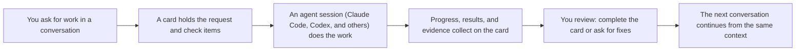
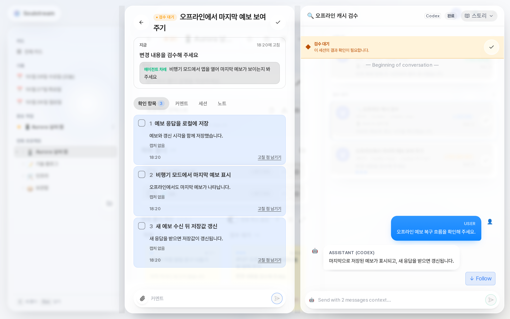
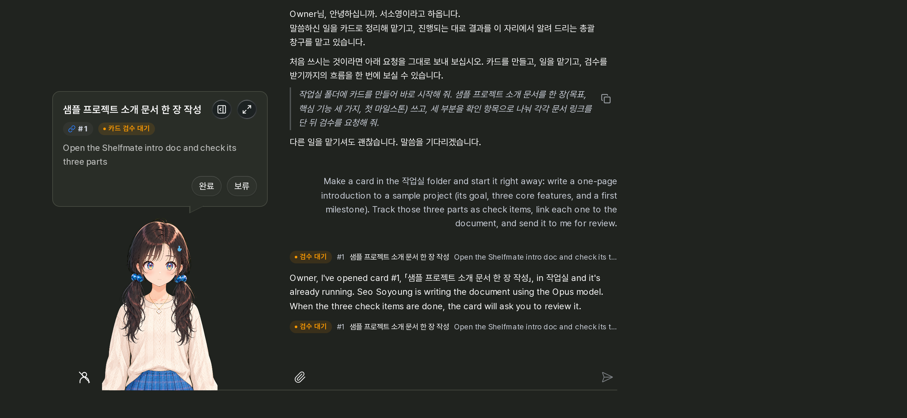
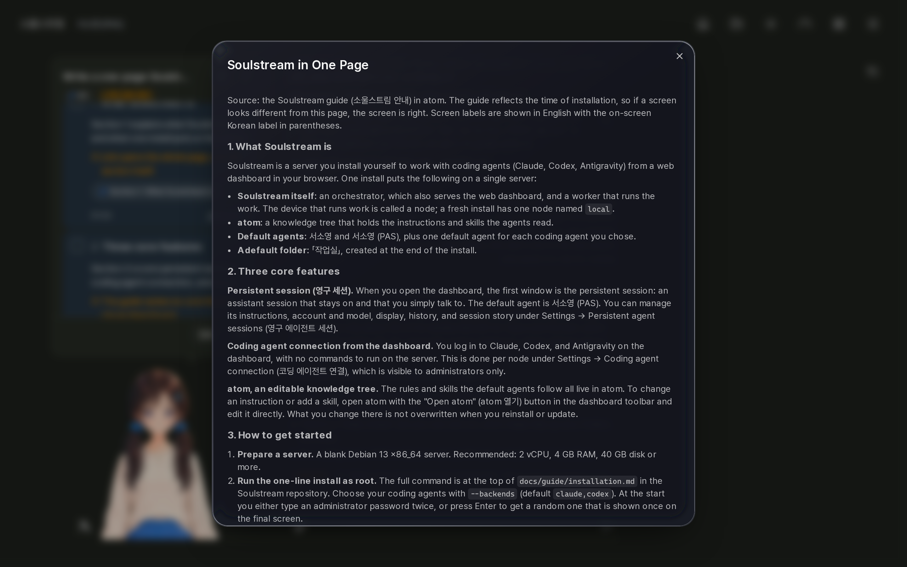

# Soulstream

**Soulstream is a personal workspace for your coding agents.** Hand work to Claude Code, Codex, and other agents, follow the progress and results of many tasks in one place, and pick up where you left off in the next conversation.

> **Public beta.** Soulstream runs on your own server: a fresh Debian 13 (`x86_64`) machine with root access. The dashboard is in Korean for now. Read [Before you install](#before-you-install) first.


The screenshots use demo data.

## How it works



- **Hand off work.** What you ask for becomes a card with check items, and an agent session does the work.
- **See it all in one place.** The report board lists active and recently completed cards next to the assistant chat, and session output streams live.
- **Review with evidence.** Each check item carries its result and evidence. You complete the card, or send a comment or follow-up message to ask for fixes.
- **Keep going later.** Cards, session history, and the instructions stored in atom stay in place, so the next conversation picks up with the same context.



## Install

### Before you install

- **Who it is for.** You should be comfortable running a Linux server: preparing it, connecting over SSH, and reading service logs with `journalctl`. You also recover from a failed update yourself.
- **Agents have broad access.** With the installed settings, Claude, Codex, and Antigravity run as the `soulstream` user with no approval prompts. They can edit any file that account can reach and run commands. Session isolation is off by default. Install on a dedicated server or VM that holds no other data.
- **Updates can leave services stopped.** If an update fails after it stops the services, they stay stopped until you fix the cause and run the same command again. Databases do not roll back automatically. For details, see [Security and permissions](docs/guide/installation.md#security-and-permissions).

Run the one-line installer as `root` on a fresh Debian 13 (`x86_64`) server. The recommended size is at least 2 vCPU, 4 GB RAM, and 40 GB disk.

```bash
bash -c 'set -euo pipefail; (command -v curl >/dev/null 2>&1 && test -f /etc/ssl/certs/ca-certificates.crt) || (apt-get update && apt-get install -y curl ca-certificates); tmp=$(mktemp); trap "rm -f \"$tmp\"" EXIT; curl -fsSL https://raw.githubusercontent.com/eiaserinnys/soulstream/beta/install/install.sh -o "$tmp"; bash "$tmp" --backends claude,codex'
```

By default, this installs the verified `beta` channel of Soulstream and atom. For the latest development commits, download `install.sh` from `main` instead of `beta` and pass `--ref main --atom-ref main`.

`--backends` takes a comma-separated list of `claude`, `codex`, and `antigravity` (default: `claude,codex`). The first one is the backend for the default profiles. For `--ref`, `--atom-ref`, `--tailscale`, and the other options, see [Installation](docs/guide/installation.md).

On an interactive terminal, the installer asks for the administrator password that Soulstream and atom share (press Enter to generate one and see it once at the end). For non-interactive runs, pass `--admin-password-file <path>`. To change the password later, see [how to change it](docs/guide/installation.md#changing-the-administrator-password).

The installer sets up the dashboard and orchestrator, an execution worker, atom (a knowledge tree for instructions and skills), PostgreSQL, and three systemd services. [Installation](docs/guide/installation.md#linux-one-line-installer) lists everything it installs.

### After installing

Three steps, in order.

#### Open the dashboard and atom

In the default password mode, both services listen on `127.0.0.1` only. Forward both ports over SSH and open them in a local browser:

```bash
ssh -L 127.0.0.1:5200:127.0.0.1:5200 -L 127.0.0.1:4200:127.0.0.1:4200 user@example.com
```

Open Soulstream at `http://127.0.0.1:5200` and atom at `http://127.0.0.1:4200`. Both use the same administrator password that you set during installation (or that was shown once on your terminal if you pressed Enter to generate one). If you ran the installer without a terminal or need to check the saved password later, read it on the server:

```bash
sudo cat /home/soulstream/soulstream/.admin-password
```

To change the administrator password later, run this command as `root` on the server in an interactive SSH session. It asks for the new password on the terminal:

```bash
bash -c 'set -euo pipefail; tmp=$(mktemp); trap "rm -f \"$tmp\"" EXIT; curl -fsSL https://raw.githubusercontent.com/eiaserinnys/soulstream/beta/install/install.sh -o "$tmp"; bash "$tmp" --backends claude,codex --set-admin-password'
```

The command also updates the server to the latest verified version on the `beta` channel, and the new password applies to both the dashboard and atom right away. To change it without a terminal, pass `--admin-password-file <path>` instead of `--set-admin-password`; see [Changing the administrator password](docs/guide/installation.md#changing-the-administrator-password) for details.

#### Connect coding agents

Sign in as the administrator, then open **Settings > Coding agents** (`설정 > 코딩 에이전트`) to connect Claude, Codex, and Antigravity from the browser:

- **Claude** uses the account pool that the installer turns on. Expand the Claude row and choose Add account (`계정 추가`).
- **Codex** uses device-code login. Open the URL the dashboard shows and enter the one-time code. If the dashboard reports that device code authentication is off, turn it on in the security section of your ChatGPT settings and try again.
- **Antigravity** uses Google authentication. Open the URL the dashboard shows and paste the returned code back into the dashboard.

If you cannot use the dashboard, [Installation](docs/guide/installation.md) describes SSH login for Codex and Antigravity.

#### Start working

The dashboard opens the persistent assistant session view by default. When you connect your first coding agent, Soulstream creates the default persistent assistant session and opens it. Ask for your first piece of work there.

To see the whole flow once, paste this request. The assistant's first greeting suggests the same request in Korean.

```text
Make a card in the 작업실 folder and start it right away: write a one-page introduction to a sample project (its goal, three core features, and a first milestone). Track those three parts as check items, link each one to the document, and send it to me for review.
```

The assistant creates a card in the `작업실` (workroom) folder, and an agent session starts the work. Within a few minutes, the card appears beside the chat for your review. Each check item links to the document, which opens in the dashboard. Choose Complete (`완료`) to close the card.





These screenshots are from a fresh install.

### Update and uninstall

Run the same install command again to [update](docs/guide/installation.md#updating). If it finds local changes, it aborts before it stops any service. To remove Soulstream and atom from a dedicated server, see [Uninstalling](docs/guide/installation.md#uninstalling).

### Other options

To add a worker on Windows, see the [Windows worker installer](docs/guide/installation.md#windows-worker-installer). To run from source (Node.js 22.5 or newer, pnpm 10.32.1, and PostgreSQL), see [Running from source](docs/guide/installation.md#running-from-source).

## Documentation

- [Concepts](docs/guide/concepts.md): folders, cards, sessions, persistent assistant sessions, agents, model presets, and nodes. Start with the [feature overview](docs/guide/concepts.md#feature-overview).
- [Architecture](docs/guide/architecture.md): system diagram, control plane and worker roles, multi-node routing, backends, and repository layout.
- [Installation](docs/guide/installation.md): Linux one-line installer, updates, Tailscale Serve, uninstalling, Windows worker installer, source build, database initialization, and local dev servers.
- [Configuration](docs/guide/configuration.md): orchestrator and worker environment variables, `agents.yaml`, installer-managed files, atom settings, the model catalog data file, and secret handling.
- [Agents and tools](docs/guide/agents-and-tools.md): skill catalog (`load_skill`), MCP tool groups, worktrees, pages, recurring jobs, custom views, attachments, and usage stats.
- [Development](docs/guide/development.md): package typecheck and test scripts, Playwright suites, screenshot regeneration, and internal architecture references.
- [Deployment](docs/guide/deployment.md): Haniel release manifests, central database migration authority, and worker rollout.
