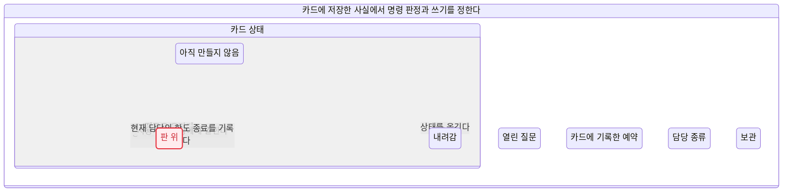
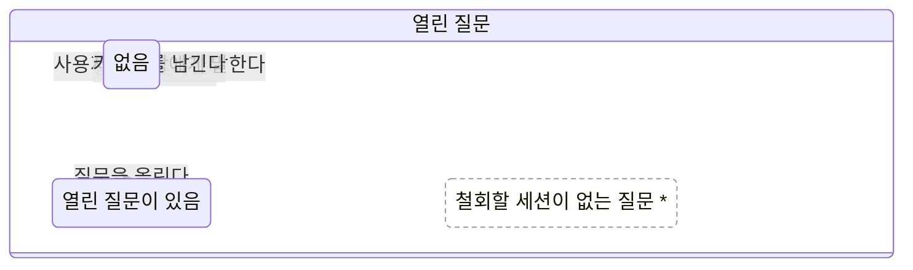
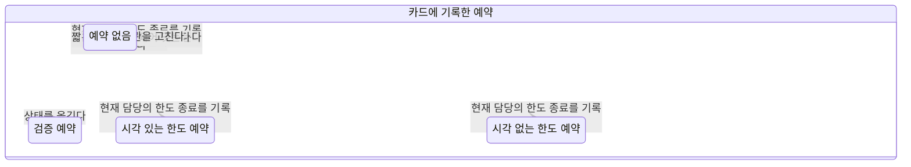
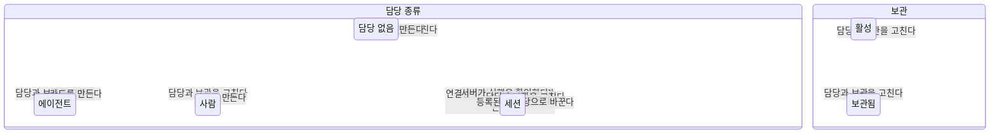

# 카드 상태 결정 규칙

이 문서는 결정 기계와 검증 세계에서 만든 생성물이다. 동작 기준 커밋은 c8b9c745a, 구조 전환 시작 기준은 52fb382d5다. 기준 위의 결정 정의로 그림, 권한, 규칙과 검사를 함께 생성한다. PR 2에서 사람과 질문 명령을 운영 서비스에 연결했다. 나머지 명령은 다음 PR에서 연결한다.

저장 영역은 status, question, reservation, assignee, archive다. verdict는 목표 없는 전이로 허용, 무변경, 거절을 고른다. 담당 세션 생존과 감독 PAS, 다른 장 수와 내린 기록은 검증 세계의 환경이다. 원래 담당과 교체 담당의 생존 상태, 질문 작성자 관계, limitedOwner는 저장 상태 그림에서 제거했다. 작성자와 담당 관계는 사건 사실로, 생존은 환경으로 옮겼으며 예약 담당 불일치는 DB CHECK가 금지한다.

도달 세계 3834개. 유한 사실은 명령별 값 목록을 전부 열거하고 사실 일관성만 걸러 BFS로 탐색한다. 권한 표는 도달 세계에서 실제 선택한 verdict와 거절 가드 결과다. 같은 결정 값과 환경 담당 상태의 판정은 재사용한다.

## 저장한 상태와 나란한 영역



전이 화살표 6개. 이 보기의 명령은 CREATE, SET_STATUS, ASK_QUESTION, HUMAN_INPUT, BLOCK_FOR_LIMIT, PATCH_CARD_CONTROL다. 다른 명령은 이 그림에서 모두 숨기고 아래 출처 표에 적었다. 빨강은 약속 6을 어기는 세계가 있는 상태이며, 점선 구멍은 도달하지 않는 구성을 뜻한다.

## 카드 상태 계층

```mermaid
stateDiagram-v2
direction TB
classDef breaks fill:#ffecee,stroke:#e72e3b,stroke-width:2px,color:#cd2834
classDef hole fill:#ffffff,stroke:#9a9a9a,stroke-dasharray:4 3
state "카드 상태" as cardDecision_status {
    direction TB
    state "아직 만들지 않음" as s_uncreated
    state "판 위" as s_on {
        direction TB
        state "준비" as cardDecision_status_on_ready {
            direction TB
            state "할 일" as s_todo
            state "대기열" as cardDecision_status_on_ready_queued {
                direction TB
                state "대기열" as s_queued
                state "담당 에이전트 없음 표시" as s_missing
            }
        }
        state "실행 중" as s_running
        state "말로 풀리는 기다림" as cardDecision_status_on_talk {
            direction TB
            state "질문으로 막힘" as s_question
            state "보고 없이 막힘" as s_noReport
            state "사유 없이 막힘" as s_other
            state "검증 대기" as s_verification
        }
        state "말로 안 풀리는 기다림" as cardDecision_status_on_silent {
            direction TB
            state "한도로 막힘" as s_limit {
                direction TB
                state "담당이 바뀐 한도 막힘 *" as hole_holeChangedLimitOwner
            }
            state "검수 대기" as s_review
        }
        state "판에 올라야 하는데 카드 장이 없음 *" as hole_holeCardMissing
        state "질문은 열렸는데 판에 장이 없음 *" as hole_holeQuestionMissing
    }
    state "내려감" as s_off {
        direction TB
        state "보류" as s_hold
        state "완료" as s_done
        state "취소" as s_cancelled
    }
}
cardDecision_status --> s_todo: 상태를 옮긴다
cardDecision_status --> s_queued: 상태를 옮긴다
cardDecision_status --> s_running: 상태를 옮긴다
cardDecision_status --> s_question: 상태를 옮긴다
cardDecision_status --> s_noReport: 상태를 옮긴다
cardDecision_status --> s_other: 상태를 옮긴다
cardDecision_status --> s_limit: 상태를 옮긴다
cardDecision_status --> s_verification: 상태를 옮긴다
cardDecision_status --> s_review: 상태를 옮긴다
cardDecision_status --> s_hold: 상태를 옮긴다
cardDecision_status --> s_done: 상태를 옮긴다
cardDecision_status --> s_cancelled: 상태를 옮긴다
cardDecision_status --> s_todo: 카드를 만든다
cardDecision_status --> s_queued: 카드를 만든다
cardDecision_status --> s_review: 검수를 요청한다
cardDecision_status --> s_question: 질문을 올린다
cardDecision_status --> s_limit: 현재 담당의 한도 종료를 기록한다
cardDecision_status --> s_running: 검증 시각이 되어 잇는다
class s_question breaks
class s_noReport breaks
class s_other breaks
class s_limit breaks
class hole_holeCardMissing hole
class hole_holeQuestionMissing hole
class hole_holeChangedLimitOwner hole
```



전이 화살표 18개. 이 보기의 명령은 CREATE, SET_STATUS, ASK_QUESTION, REQUEST_REVIEW, BLOCK_FOR_LIMIT, RESUME_VERIFICATION다. 다른 명령은 이 그림에서 모두 숨기고 아래 출처 표에 적었다. 빨강은 약속 6을 어기는 세계가 있는 상태이며, 점선 구멍은 도달하지 않는 구성을 뜻한다.

## 열린 질문의 기억



전이 화살표 5개. 이 보기의 명령은 ASK_QUESTION, ANSWER_QUESTION, WITHDRAW_QUESTION, HUMAN_INPUT, ADD_COMMENT다. 다른 명령은 이 그림에서 모두 숨기고 아래 출처 표에 적었다. 빨강은 약속 6을 어기는 세계가 있는 상태이며, 점선 구멍은 도달하지 않는 구성을 뜻한다.

## 예약의 기억



전이 화살표 9개. 이 보기의 명령은 SET_STATUS, BLOCK_FOR_LIMIT, RESUME_SHORT_LIMIT, RESUME_LONG_LIMIT, RESUME_VERIFICATION, PATCH_CARD_CONTROL다. 다른 명령은 이 그림에서 모두 숨기고 아래 출처 표에 적었다. 빨강은 약속 6을 어기는 세계가 있는 상태이며, 점선 구멍은 도달하지 않는 구성을 뜻한다.

## 담당 종류와 보관



전이 화살표 13개. 이 보기의 명령은 CREATE, CLAIM, CONFIRM_EXECUTION, REGISTER_REPLACEMENT, PATCH_CARD_CONTROL다. 다른 명령은 이 그림에서 모두 숨기고 아래 출처 표에 적었다. 빨강은 약속 6을 어기는 세계가 있는 상태이며, 점선 구멍은 도달하지 않는 구성을 뜻한다.

## 상태와 저장 칸

| 상태 | status | blocked_kind |
| :-- | :-- | :-- |
| uncreated | uncreated | null |
| todo | todo | null |
| queued | queued | null |
| missing | queued | null |
| running | running | null |
| question | blocked | question |
| noReport | blocked | no_report |
| other | blocked | null |
| verification | awaiting_verification | null |
| limit | blocked | limit |
| review | review | null |
| hold | on_hold | null |
| done | done | null |
| cancelled | cancelled | null |

writeStatus 액션이 있을 때만 status와 blocked_kind를 쓴다. 같은 상태를 다시 지정해도 완료 정보와 대기열 키 쓰기는 실행한다. 예약 제거, 담당 연결, 질문 행과 now 서식은 선택된 기호 액션을 decoder가 번역한다. 댓글의 claim, 항목, 상태 단계는 별개 UPDATE로 남긴다. status 칸을 쓰지 않는 담당 연결은 검증 예약을 보존한다.

## 판에 오르는 장

판은 상태 영역이 아니다. cardBoardEntries가 카드, 질문, 감독, 다른 장 단계와 내린 기록에서 장을 계산한다. 다른 장 수는 계산 장을 밀어내지 않으며 아래 모든 조합을 생성했다.

| 카드 상태 | 보관 | 질문 | 감독과 다른 장 | 내린 기록 | 계산 장 |
| :-- | :-- | :-- | :-- | :-- | :-- |
| uncreated | active | none | none | 없음 | 없음 |
| uncreated | active | none | none | 있음 | 없음 |
| uncreated | active | none | room | 없음 | 없음 |
| uncreated | active | none | room | 있음 | 없음 |
| uncreated | active | none | one | 없음 | 없음 |
| uncreated | active | none | one | 있음 | 없음 |
| uncreated | active | none | full | 없음 | 없음 |
| uncreated | active | none | full | 있음 | 없음 |
| uncreated | active | open | none | 없음 | 없음 |
| uncreated | active | open | none | 있음 | 없음 |
| uncreated | active | open | room | 없음 | 없음 |
| uncreated | active | open | room | 있음 | 없음 |
| uncreated | active | open | one | 없음 | 없음 |
| uncreated | active | open | one | 있음 | 없음 |
| uncreated | active | open | full | 없음 | 없음 |
| uncreated | active | open | full | 있음 | 없음 |
| uncreated | archived | none | none | 없음 | 없음 |
| uncreated | archived | none | none | 있음 | 없음 |
| uncreated | archived | none | room | 없음 | 없음 |
| uncreated | archived | none | room | 있음 | 없음 |
| uncreated | archived | none | one | 없음 | 없음 |
| uncreated | archived | none | one | 있음 | 없음 |
| uncreated | archived | none | full | 없음 | 없음 |
| uncreated | archived | none | full | 있음 | 없음 |
| uncreated | archived | open | none | 없음 | 없음 |
| uncreated | archived | open | none | 있음 | 없음 |
| uncreated | archived | open | room | 없음 | 없음 |
| uncreated | archived | open | room | 있음 | 없음 |
| uncreated | archived | open | one | 없음 | 없음 |
| uncreated | archived | open | one | 있음 | 없음 |
| uncreated | archived | open | full | 없음 | 없음 |
| uncreated | archived | open | full | 있음 | 없음 |
| todo | active | none | none | 없음 | 없음 |
| todo | active | none | none | 있음 | 없음 |
| todo | active | none | room | 없음 | 없음 |
| todo | active | none | room | 있음 | 없음 |
| todo | active | none | one | 없음 | 없음 |
| todo | active | none | one | 있음 | 없음 |
| todo | active | none | full | 없음 | 없음 |
| todo | active | none | full | 있음 | 없음 |
| todo | active | open | none | 없음 | 없음 |
| todo | active | open | none | 있음 | 없음 |
| todo | active | open | room | 없음 | question |
| todo | active | open | room | 있음 | question |
| todo | active | open | one | 없음 | question |
| todo | active | open | one | 있음 | question |
| todo | active | open | full | 없음 | question |
| todo | active | open | full | 있음 | question |
| todo | archived | none | none | 없음 | 없음 |
| todo | archived | none | none | 있음 | 없음 |
| todo | archived | none | room | 없음 | 없음 |
| todo | archived | none | room | 있음 | 없음 |
| todo | archived | none | one | 없음 | 없음 |
| todo | archived | none | one | 있음 | 없음 |
| todo | archived | none | full | 없음 | 없음 |
| todo | archived | none | full | 있음 | 없음 |
| todo | archived | open | none | 없음 | 없음 |
| todo | archived | open | none | 있음 | 없음 |
| todo | archived | open | room | 없음 | 없음 |
| todo | archived | open | room | 있음 | 없음 |
| todo | archived | open | one | 없음 | 없음 |
| todo | archived | open | one | 있음 | 없음 |
| todo | archived | open | full | 없음 | 없음 |
| todo | archived | open | full | 있음 | 없음 |
| queued | active | none | none | 없음 | 없음 |
| queued | active | none | none | 있음 | 없음 |
| queued | active | none | room | 없음 | 없음 |
| queued | active | none | room | 있음 | 없음 |
| queued | active | none | one | 없음 | 없음 |
| queued | active | none | one | 있음 | 없음 |
| queued | active | none | full | 없음 | 없음 |
| queued | active | none | full | 있음 | 없음 |
| queued | active | open | none | 없음 | 없음 |
| queued | active | open | none | 있음 | 없음 |
| queued | active | open | room | 없음 | question |
| queued | active | open | room | 있음 | question |
| queued | active | open | one | 없음 | question |
| queued | active | open | one | 있음 | question |
| queued | active | open | full | 없음 | question |
| queued | active | open | full | 있음 | question |
| queued | archived | none | none | 없음 | 없음 |
| queued | archived | none | none | 있음 | 없음 |
| queued | archived | none | room | 없음 | 없음 |
| queued | archived | none | room | 있음 | 없음 |
| queued | archived | none | one | 없음 | 없음 |
| queued | archived | none | one | 있음 | 없음 |
| queued | archived | none | full | 없음 | 없음 |
| queued | archived | none | full | 있음 | 없음 |
| queued | archived | open | none | 없음 | 없음 |
| queued | archived | open | none | 있음 | 없음 |
| queued | archived | open | room | 없음 | 없음 |
| queued | archived | open | room | 있음 | 없음 |
| queued | archived | open | one | 없음 | 없음 |
| queued | archived | open | one | 있음 | 없음 |
| queued | archived | open | full | 없음 | 없음 |
| queued | archived | open | full | 있음 | 없음 |
| missing | active | none | none | 없음 | 없음 |
| missing | active | none | none | 있음 | 없음 |
| missing | active | none | room | 없음 | 없음 |
| missing | active | none | room | 있음 | 없음 |
| missing | active | none | one | 없음 | 없음 |
| missing | active | none | one | 있음 | 없음 |
| missing | active | none | full | 없음 | 없음 |
| missing | active | none | full | 있음 | 없음 |
| missing | active | open | none | 없음 | 없음 |
| missing | active | open | none | 있음 | 없음 |
| missing | active | open | room | 없음 | question |
| missing | active | open | room | 있음 | question |
| missing | active | open | one | 없음 | question |
| missing | active | open | one | 있음 | question |
| missing | active | open | full | 없음 | question |
| missing | active | open | full | 있음 | question |
| missing | archived | none | none | 없음 | 없음 |
| missing | archived | none | none | 있음 | 없음 |
| missing | archived | none | room | 없음 | 없음 |
| missing | archived | none | room | 있음 | 없음 |
| missing | archived | none | one | 없음 | 없음 |
| missing | archived | none | one | 있음 | 없음 |
| missing | archived | none | full | 없음 | 없음 |
| missing | archived | none | full | 있음 | 없음 |
| missing | archived | open | none | 없음 | 없음 |
| missing | archived | open | none | 있음 | 없음 |
| missing | archived | open | room | 없음 | 없음 |
| missing | archived | open | room | 있음 | 없음 |
| missing | archived | open | one | 없음 | 없음 |
| missing | archived | open | one | 있음 | 없음 |
| missing | archived | open | full | 없음 | 없음 |
| missing | archived | open | full | 있음 | 없음 |
| running | active | none | none | 없음 | 없음 |
| running | active | none | none | 있음 | 없음 |
| running | active | none | room | 없음 | 없음 |
| running | active | none | room | 있음 | 없음 |
| running | active | none | one | 없음 | 없음 |
| running | active | none | one | 있음 | 없음 |
| running | active | none | full | 없음 | 없음 |
| running | active | none | full | 있음 | 없음 |
| running | active | open | none | 없음 | 없음 |
| running | active | open | none | 있음 | 없음 |
| running | active | open | room | 없음 | question |
| running | active | open | room | 있음 | question |
| running | active | open | one | 없음 | question |
| running | active | open | one | 있음 | question |
| running | active | open | full | 없음 | question |
| running | active | open | full | 있음 | question |
| running | archived | none | none | 없음 | 없음 |
| running | archived | none | none | 있음 | 없음 |
| running | archived | none | room | 없음 | 없음 |
| running | archived | none | room | 있음 | 없음 |
| running | archived | none | one | 없음 | 없음 |
| running | archived | none | one | 있음 | 없음 |
| running | archived | none | full | 없음 | 없음 |
| running | archived | none | full | 있음 | 없음 |
| running | archived | open | none | 없음 | 없음 |
| running | archived | open | none | 있음 | 없음 |
| running | archived | open | room | 없음 | 없음 |
| running | archived | open | room | 있음 | 없음 |
| running | archived | open | one | 없음 | 없음 |
| running | archived | open | one | 있음 | 없음 |
| running | archived | open | full | 없음 | 없음 |
| running | archived | open | full | 있음 | 없음 |
| question | active | none | none | 없음 | 없음 |
| question | active | none | none | 있음 | 없음 |
| question | active | none | room | 없음 | card |
| question | active | none | room | 있음 | 없음 |
| question | active | none | one | 없음 | card |
| question | active | none | one | 있음 | 없음 |
| question | active | none | full | 없음 | card |
| question | active | none | full | 있음 | 없음 |
| question | active | open | none | 없음 | 없음 |
| question | active | open | none | 있음 | 없음 |
| question | active | open | room | 없음 | question |
| question | active | open | room | 있음 | question |
| question | active | open | one | 없음 | question |
| question | active | open | one | 있음 | question |
| question | active | open | full | 없음 | question |
| question | active | open | full | 있음 | question |
| question | archived | none | none | 없음 | 없음 |
| question | archived | none | none | 있음 | 없음 |
| question | archived | none | room | 없음 | 없음 |
| question | archived | none | room | 있음 | 없음 |
| question | archived | none | one | 없음 | 없음 |
| question | archived | none | one | 있음 | 없음 |
| question | archived | none | full | 없음 | 없음 |
| question | archived | none | full | 있음 | 없음 |
| question | archived | open | none | 없음 | 없음 |
| question | archived | open | none | 있음 | 없음 |
| question | archived | open | room | 없음 | 없음 |
| question | archived | open | room | 있음 | 없음 |
| question | archived | open | one | 없음 | 없음 |
| question | archived | open | one | 있음 | 없음 |
| question | archived | open | full | 없음 | 없음 |
| question | archived | open | full | 있음 | 없음 |
| noReport | active | none | none | 없음 | 없음 |
| noReport | active | none | none | 있음 | 없음 |
| noReport | active | none | room | 없음 | card |
| noReport | active | none | room | 있음 | 없음 |
| noReport | active | none | one | 없음 | card |
| noReport | active | none | one | 있음 | 없음 |
| noReport | active | none | full | 없음 | card |
| noReport | active | none | full | 있음 | 없음 |
| noReport | active | open | none | 없음 | 없음 |
| noReport | active | open | none | 있음 | 없음 |
| noReport | active | open | room | 없음 | question |
| noReport | active | open | room | 있음 | question |
| noReport | active | open | one | 없음 | question |
| noReport | active | open | one | 있음 | question |
| noReport | active | open | full | 없음 | question |
| noReport | active | open | full | 있음 | question |
| noReport | archived | none | none | 없음 | 없음 |
| noReport | archived | none | none | 있음 | 없음 |
| noReport | archived | none | room | 없음 | 없음 |
| noReport | archived | none | room | 있음 | 없음 |
| noReport | archived | none | one | 없음 | 없음 |
| noReport | archived | none | one | 있음 | 없음 |
| noReport | archived | none | full | 없음 | 없음 |
| noReport | archived | none | full | 있음 | 없음 |
| noReport | archived | open | none | 없음 | 없음 |
| noReport | archived | open | none | 있음 | 없음 |
| noReport | archived | open | room | 없음 | 없음 |
| noReport | archived | open | room | 있음 | 없음 |
| noReport | archived | open | one | 없음 | 없음 |
| noReport | archived | open | one | 있음 | 없음 |
| noReport | archived | open | full | 없음 | 없음 |
| noReport | archived | open | full | 있음 | 없음 |
| other | active | none | none | 없음 | 없음 |
| other | active | none | none | 있음 | 없음 |
| other | active | none | room | 없음 | card |
| other | active | none | room | 있음 | 없음 |
| other | active | none | one | 없음 | card |
| other | active | none | one | 있음 | 없음 |
| other | active | none | full | 없음 | card |
| other | active | none | full | 있음 | 없음 |
| other | active | open | none | 없음 | 없음 |
| other | active | open | none | 있음 | 없음 |
| other | active | open | room | 없음 | question |
| other | active | open | room | 있음 | question |
| other | active | open | one | 없음 | question |
| other | active | open | one | 있음 | question |
| other | active | open | full | 없음 | question |
| other | active | open | full | 있음 | question |
| other | archived | none | none | 없음 | 없음 |
| other | archived | none | none | 있음 | 없음 |
| other | archived | none | room | 없음 | 없음 |
| other | archived | none | room | 있음 | 없음 |
| other | archived | none | one | 없음 | 없음 |
| other | archived | none | one | 있음 | 없음 |
| other | archived | none | full | 없음 | 없음 |
| other | archived | none | full | 있음 | 없음 |
| other | archived | open | none | 없음 | 없음 |
| other | archived | open | none | 있음 | 없음 |
| other | archived | open | room | 없음 | 없음 |
| other | archived | open | room | 있음 | 없음 |
| other | archived | open | one | 없음 | 없음 |
| other | archived | open | one | 있음 | 없음 |
| other | archived | open | full | 없음 | 없음 |
| other | archived | open | full | 있음 | 없음 |
| verification | active | none | none | 없음 | 없음 |
| verification | active | none | none | 있음 | 없음 |
| verification | active | none | room | 없음 | 없음 |
| verification | active | none | room | 있음 | 없음 |
| verification | active | none | one | 없음 | 없음 |
| verification | active | none | one | 있음 | 없음 |
| verification | active | none | full | 없음 | 없음 |
| verification | active | none | full | 있음 | 없음 |
| verification | active | open | none | 없음 | 없음 |
| verification | active | open | none | 있음 | 없음 |
| verification | active | open | room | 없음 | question |
| verification | active | open | room | 있음 | question |
| verification | active | open | one | 없음 | question |
| verification | active | open | one | 있음 | question |
| verification | active | open | full | 없음 | question |
| verification | active | open | full | 있음 | question |
| verification | archived | none | none | 없음 | 없음 |
| verification | archived | none | none | 있음 | 없음 |
| verification | archived | none | room | 없음 | 없음 |
| verification | archived | none | room | 있음 | 없음 |
| verification | archived | none | one | 없음 | 없음 |
| verification | archived | none | one | 있음 | 없음 |
| verification | archived | none | full | 없음 | 없음 |
| verification | archived | none | full | 있음 | 없음 |
| verification | archived | open | none | 없음 | 없음 |
| verification | archived | open | none | 있음 | 없음 |
| verification | archived | open | room | 없음 | 없음 |
| verification | archived | open | room | 있음 | 없음 |
| verification | archived | open | one | 없음 | 없음 |
| verification | archived | open | one | 있음 | 없음 |
| verification | archived | open | full | 없음 | 없음 |
| verification | archived | open | full | 있음 | 없음 |
| limit | active | none | none | 없음 | 없음 |
| limit | active | none | none | 있음 | 없음 |
| limit | active | none | room | 없음 | card |
| limit | active | none | room | 있음 | 없음 |
| limit | active | none | one | 없음 | card |
| limit | active | none | one | 있음 | 없음 |
| limit | active | none | full | 없음 | card |
| limit | active | none | full | 있음 | 없음 |
| limit | active | open | none | 없음 | 없음 |
| limit | active | open | none | 있음 | 없음 |
| limit | active | open | room | 없음 | question |
| limit | active | open | room | 있음 | question |
| limit | active | open | one | 없음 | question |
| limit | active | open | one | 있음 | question |
| limit | active | open | full | 없음 | question |
| limit | active | open | full | 있음 | question |
| limit | archived | none | none | 없음 | 없음 |
| limit | archived | none | none | 있음 | 없음 |
| limit | archived | none | room | 없음 | 없음 |
| limit | archived | none | room | 있음 | 없음 |
| limit | archived | none | one | 없음 | 없음 |
| limit | archived | none | one | 있음 | 없음 |
| limit | archived | none | full | 없음 | 없음 |
| limit | archived | none | full | 있음 | 없음 |
| limit | archived | open | none | 없음 | 없음 |
| limit | archived | open | none | 있음 | 없음 |
| limit | archived | open | room | 없음 | 없음 |
| limit | archived | open | room | 있음 | 없음 |
| limit | archived | open | one | 없음 | 없음 |
| limit | archived | open | one | 있음 | 없음 |
| limit | archived | open | full | 없음 | 없음 |
| limit | archived | open | full | 있음 | 없음 |
| review | active | none | none | 없음 | 없음 |
| review | active | none | none | 있음 | 없음 |
| review | active | none | room | 없음 | card |
| review | active | none | room | 있음 | 없음 |
| review | active | none | one | 없음 | card |
| review | active | none | one | 있음 | 없음 |
| review | active | none | full | 없음 | card |
| review | active | none | full | 있음 | 없음 |
| review | active | open | none | 없음 | 없음 |
| review | active | open | none | 있음 | 없음 |
| review | active | open | room | 없음 | question |
| review | active | open | room | 있음 | question |
| review | active | open | one | 없음 | question |
| review | active | open | one | 있음 | question |
| review | active | open | full | 없음 | question |
| review | active | open | full | 있음 | question |
| review | archived | none | none | 없음 | 없음 |
| review | archived | none | none | 있음 | 없음 |
| review | archived | none | room | 없음 | 없음 |
| review | archived | none | room | 있음 | 없음 |
| review | archived | none | one | 없음 | 없음 |
| review | archived | none | one | 있음 | 없음 |
| review | archived | none | full | 없음 | 없음 |
| review | archived | none | full | 있음 | 없음 |
| review | archived | open | none | 없음 | 없음 |
| review | archived | open | none | 있음 | 없음 |
| review | archived | open | room | 없음 | 없음 |
| review | archived | open | room | 있음 | 없음 |
| review | archived | open | one | 없음 | 없음 |
| review | archived | open | one | 있음 | 없음 |
| review | archived | open | full | 없음 | 없음 |
| review | archived | open | full | 있음 | 없음 |
| hold | active | none | none | 없음 | 없음 |
| hold | active | none | none | 있음 | 없음 |
| hold | active | none | room | 없음 | 없음 |
| hold | active | none | room | 있음 | 없음 |
| hold | active | none | one | 없음 | 없음 |
| hold | active | none | one | 있음 | 없음 |
| hold | active | none | full | 없음 | 없음 |
| hold | active | none | full | 있음 | 없음 |
| hold | active | open | none | 없음 | 없음 |
| hold | active | open | none | 있음 | 없음 |
| hold | active | open | room | 없음 | 없음 |
| hold | active | open | room | 있음 | 없음 |
| hold | active | open | one | 없음 | 없음 |
| hold | active | open | one | 있음 | 없음 |
| hold | active | open | full | 없음 | 없음 |
| hold | active | open | full | 있음 | 없음 |
| hold | archived | none | none | 없음 | 없음 |
| hold | archived | none | none | 있음 | 없음 |
| hold | archived | none | room | 없음 | 없음 |
| hold | archived | none | room | 있음 | 없음 |
| hold | archived | none | one | 없음 | 없음 |
| hold | archived | none | one | 있음 | 없음 |
| hold | archived | none | full | 없음 | 없음 |
| hold | archived | none | full | 있음 | 없음 |
| hold | archived | open | none | 없음 | 없음 |
| hold | archived | open | none | 있음 | 없음 |
| hold | archived | open | room | 없음 | 없음 |
| hold | archived | open | room | 있음 | 없음 |
| hold | archived | open | one | 없음 | 없음 |
| hold | archived | open | one | 있음 | 없음 |
| hold | archived | open | full | 없음 | 없음 |
| hold | archived | open | full | 있음 | 없음 |
| done | active | none | none | 없음 | 없음 |
| done | active | none | none | 있음 | 없음 |
| done | active | none | room | 없음 | 없음 |
| done | active | none | room | 있음 | 없음 |
| done | active | none | one | 없음 | 없음 |
| done | active | none | one | 있음 | 없음 |
| done | active | none | full | 없음 | 없음 |
| done | active | none | full | 있음 | 없음 |
| done | active | open | none | 없음 | 없음 |
| done | active | open | none | 있음 | 없음 |
| done | active | open | room | 없음 | 없음 |
| done | active | open | room | 있음 | 없음 |
| done | active | open | one | 없음 | 없음 |
| done | active | open | one | 있음 | 없음 |
| done | active | open | full | 없음 | 없음 |
| done | active | open | full | 있음 | 없음 |
| done | archived | none | none | 없음 | 없음 |
| done | archived | none | none | 있음 | 없음 |
| done | archived | none | room | 없음 | 없음 |
| done | archived | none | room | 있음 | 없음 |
| done | archived | none | one | 없음 | 없음 |
| done | archived | none | one | 있음 | 없음 |
| done | archived | none | full | 없음 | 없음 |
| done | archived | none | full | 있음 | 없음 |
| done | archived | open | none | 없음 | 없음 |
| done | archived | open | none | 있음 | 없음 |
| done | archived | open | room | 없음 | 없음 |
| done | archived | open | room | 있음 | 없음 |
| done | archived | open | one | 없음 | 없음 |
| done | archived | open | one | 있음 | 없음 |
| done | archived | open | full | 없음 | 없음 |
| done | archived | open | full | 있음 | 없음 |
| cancelled | active | none | none | 없음 | 없음 |
| cancelled | active | none | none | 있음 | 없음 |
| cancelled | active | none | room | 없음 | 없음 |
| cancelled | active | none | room | 있음 | 없음 |
| cancelled | active | none | one | 없음 | 없음 |
| cancelled | active | none | one | 있음 | 없음 |
| cancelled | active | none | full | 없음 | 없음 |
| cancelled | active | none | full | 있음 | 없음 |
| cancelled | active | open | none | 없음 | 없음 |
| cancelled | active | open | none | 있음 | 없음 |
| cancelled | active | open | room | 없음 | 없음 |
| cancelled | active | open | room | 있음 | 없음 |
| cancelled | active | open | one | 없음 | 없음 |
| cancelled | active | open | one | 있음 | 없음 |
| cancelled | active | open | full | 없음 | 없음 |
| cancelled | active | open | full | 있음 | 없음 |
| cancelled | archived | none | none | 없음 | 없음 |
| cancelled | archived | none | none | 있음 | 없음 |
| cancelled | archived | none | room | 없음 | 없음 |
| cancelled | archived | none | room | 있음 | 없음 |
| cancelled | archived | none | one | 없음 | 없음 |
| cancelled | archived | none | one | 있음 | 없음 |
| cancelled | archived | none | full | 없음 | 없음 |
| cancelled | archived | none | full | 있음 | 없음 |
| cancelled | archived | open | none | 없음 | 없음 |
| cancelled | archived | open | none | 있음 | 없음 |
| cancelled | archived | open | room | 없음 | 없음 |
| cancelled | archived | open | room | 있음 | 없음 |
| cancelled | archived | open | one | 없음 | 없음 |
| cancelled | archived | open | one | 있음 | 없음 |
| cancelled | archived | open | full | 없음 | 없음 |
| cancelled | archived | open | full | 있음 | 없음 |

## 주체 관계별 권한

PAS는 agent 세션이다. 현재 담당, 작성자, 담당이면서 작성자인 관계를 별도 행으로 그대로 보여 준다. 입구 없음은 명령 출처 metadata에서 읽으며 거절 가드와 기존 오류는 실제 열거 결과다.

| 명령 | 주체 관계 | 사람 | 현재 담당 세션 | 다른 agent 세션 | PAS | 서버 |
| :-- | :-- | :-- | :-- | :-- | :-- | :-- |
| CREATE | human | 모두 허용 | 해당 없음 | 해당 없음 | 해당 없음 | 해당 없음 |
| CREATE | owner | 해당 없음 | 도달 상태 없음 | 해당 없음 | 도달 상태 없음 | 해당 없음 |
| CREATE | author | 해당 없음 | 해당 없음 | 도달 상태 없음 | 도달 상태 없음 | 해당 없음 |
| CREATE | ownerAuthor | 해당 없음 | 도달 상태 없음 | 해당 없음 | 도달 상태 없음 | 해당 없음 |
| CREATE | otherAgent | 해당 없음 | 해당 없음 | 모두 허용 | 모두 허용 | 해당 없음 |
| CREATE | anonymousAgent | 해당 없음 | 해당 없음 | 모두 허용 | 해당 없음 | 해당 없음 |
| CREATE | server | 해당 없음 | 해당 없음 | 해당 없음 | 해당 없음 | 입구 없음 |
| CREATE | external | 해당 없음 | 해당 없음 | 해당 없음 | 해당 없음 | 해당 없음 |
| SET_STATUS | human | 조건부: reject.SET_STATUS.verificationOwner (422, INVALID_CARD_REQUEST)<br>reject.SET_STATUS.verification_empty (422, INVALID_CARD_REQUEST)<br>reject.SET_STATUS.verification_invalid (422, INVALID_CARD_REQUEST)<br>reject.SET_STATUS.verification_missing (422, INVALID_CARD_REQUEST)<br>reject.SET_STATUS.verification_past (422, INVALID_CARD_REQUEST)<br>reject.SET_STATUS.verification_tooLate (422, INVALID_CARD_REQUEST)<br>reject.SET_STATUS.verification_tooLong (422, INVALID_CARD_REQUEST) | 해당 없음 | 해당 없음 | 해당 없음 | 해당 없음 |
| SET_STATUS | owner | 해당 없음 | 조건부: reject.SET_STATUS.verification_empty (422, INVALID_CARD_REQUEST)<br>reject.SET_STATUS.verification_invalid (422, INVALID_CARD_REQUEST)<br>reject.SET_STATUS.verification_missing (422, INVALID_CARD_REQUEST)<br>reject.SET_STATUS.verification_past (422, INVALID_CARD_REQUEST)<br>reject.SET_STATUS.verification_tooLate (422, INVALID_CARD_REQUEST)<br>reject.SET_STATUS.verification_tooLong (422, INVALID_CARD_REQUEST) | 해당 없음 | 조건부: reject.SET_STATUS.verification_empty (422, INVALID_CARD_REQUEST)<br>reject.SET_STATUS.verification_invalid (422, INVALID_CARD_REQUEST)<br>reject.SET_STATUS.verification_missing (422, INVALID_CARD_REQUEST)<br>reject.SET_STATUS.verification_past (422, INVALID_CARD_REQUEST)<br>reject.SET_STATUS.verification_tooLate (422, INVALID_CARD_REQUEST)<br>reject.SET_STATUS.verification_tooLong (422, INVALID_CARD_REQUEST) | 해당 없음 |
| SET_STATUS | author | 해당 없음 | 해당 없음 | 도달 상태 없음 | 도달 상태 없음 | 해당 없음 |
| SET_STATUS | ownerAuthor | 해당 없음 | 도달 상태 없음 | 해당 없음 | 도달 상태 없음 | 해당 없음 |
| SET_STATUS | otherAgent | 해당 없음 | 해당 없음 | 조건부: reject.SET_STATUS.statusOwner (403, statusOwner)<br>reject.SET_STATUS.verification_empty (422, INVALID_CARD_REQUEST)<br>reject.SET_STATUS.verification_invalid (422, INVALID_CARD_REQUEST)<br>reject.SET_STATUS.verification_missing (422, INVALID_CARD_REQUEST)<br>reject.SET_STATUS.verification_past (422, INVALID_CARD_REQUEST)<br>reject.SET_STATUS.verification_tooLate (422, INVALID_CARD_REQUEST)<br>reject.SET_STATUS.verification_tooLong (422, INVALID_CARD_REQUEST) | 조건부: reject.SET_STATUS.statusOwner (403, statusOwner)<br>reject.SET_STATUS.verification_empty (422, INVALID_CARD_REQUEST)<br>reject.SET_STATUS.verification_invalid (422, INVALID_CARD_REQUEST)<br>reject.SET_STATUS.verification_missing (422, INVALID_CARD_REQUEST)<br>reject.SET_STATUS.verification_past (422, INVALID_CARD_REQUEST)<br>reject.SET_STATUS.verification_tooLate (422, INVALID_CARD_REQUEST)<br>reject.SET_STATUS.verification_tooLong (422, INVALID_CARD_REQUEST) | 해당 없음 |
| SET_STATUS | anonymousAgent | 해당 없음 | 해당 없음 | 모두 거절: reject.SET_STATUS.statusOwner (403, statusOwner) | 해당 없음 | 해당 없음 |
| SET_STATUS | server | 해당 없음 | 해당 없음 | 해당 없음 | 해당 없음 | 조건부: reject.SET_STATUS.verificationOwner (422, INVALID_CARD_REQUEST)<br>reject.SET_STATUS.verification_empty (422, INVALID_CARD_REQUEST)<br>reject.SET_STATUS.verification_invalid (422, INVALID_CARD_REQUEST)<br>reject.SET_STATUS.verification_missing (422, INVALID_CARD_REQUEST)<br>reject.SET_STATUS.verification_past (422, INVALID_CARD_REQUEST)<br>reject.SET_STATUS.verification_tooLate (422, INVALID_CARD_REQUEST)<br>reject.SET_STATUS.verification_tooLong (422, INVALID_CARD_REQUEST) |
| SET_STATUS | external | 해당 없음 | 해당 없음 | 해당 없음 | 해당 없음 | 해당 없음 |
| REQUEST_REVIEW | human | 조건부: reject.REQUEST_REVIEW.reviewAsk (422, INVALID_CARD_REQUEST) | 해당 없음 | 해당 없음 | 해당 없음 | 해당 없음 |
| REQUEST_REVIEW | owner | 해당 없음 | 조건부: reject.REQUEST_REVIEW.reviewAsk (422, INVALID_CARD_REQUEST) | 해당 없음 | 조건부: reject.REQUEST_REVIEW.reviewAsk (422, INVALID_CARD_REQUEST) | 해당 없음 |
| REQUEST_REVIEW | author | 해당 없음 | 해당 없음 | 도달 상태 없음 | 도달 상태 없음 | 해당 없음 |
| REQUEST_REVIEW | ownerAuthor | 해당 없음 | 도달 상태 없음 | 해당 없음 | 도달 상태 없음 | 해당 없음 |
| REQUEST_REVIEW | otherAgent | 해당 없음 | 해당 없음 | 조건부: reject.REQUEST_REVIEW.reviewAsk (422, INVALID_CARD_REQUEST)<br>reject.REQUEST_REVIEW.statusOwner (403, statusOwner) | 조건부: reject.REQUEST_REVIEW.reviewAsk (422, INVALID_CARD_REQUEST)<br>reject.REQUEST_REVIEW.statusOwner (403, statusOwner) | 해당 없음 |
| REQUEST_REVIEW | anonymousAgent | 해당 없음 | 해당 없음 | 모두 거절: reject.REQUEST_REVIEW.reviewAsk (422, INVALID_CARD_REQUEST)<br>reject.REQUEST_REVIEW.statusOwner (403, statusOwner) | 해당 없음 | 해당 없음 |
| REQUEST_REVIEW | server | 해당 없음 | 해당 없음 | 해당 없음 | 해당 없음 | 입구 없음 |
| REQUEST_REVIEW | external | 해당 없음 | 해당 없음 | 해당 없음 | 해당 없음 | 해당 없음 |
| HUMAN_INPUT | human | 입구 없음 | 해당 없음 | 해당 없음 | 해당 없음 | 해당 없음 |
| HUMAN_INPUT | owner | 해당 없음 | 입구 없음 | 해당 없음 | 입구 없음 | 해당 없음 |
| HUMAN_INPUT | author | 해당 없음 | 해당 없음 | 입구 없음 | 입구 없음 | 해당 없음 |
| HUMAN_INPUT | ownerAuthor | 해당 없음 | 입구 없음 | 해당 없음 | 입구 없음 | 해당 없음 |
| HUMAN_INPUT | otherAgent | 해당 없음 | 해당 없음 | 입구 없음 | 입구 없음 | 해당 없음 |
| HUMAN_INPUT | anonymousAgent | 해당 없음 | 해당 없음 | 입구 없음 | 해당 없음 | 해당 없음 |
| HUMAN_INPUT | server | 해당 없음 | 해당 없음 | 해당 없음 | 해당 없음 | 모두 허용 |
| HUMAN_INPUT | external | 해당 없음 | 해당 없음 | 해당 없음 | 해당 없음 | 해당 없음 |
| ASK_QUESTION | human | 모두 허용 | 해당 없음 | 해당 없음 | 해당 없음 | 해당 없음 |
| ASK_QUESTION | owner | 해당 없음 | 모두 허용 | 해당 없음 | 모두 허용 | 해당 없음 |
| ASK_QUESTION | author | 해당 없음 | 해당 없음 | 도달 상태 없음 | 도달 상태 없음 | 해당 없음 |
| ASK_QUESTION | ownerAuthor | 해당 없음 | 도달 상태 없음 | 해당 없음 | 도달 상태 없음 | 해당 없음 |
| ASK_QUESTION | otherAgent | 해당 없음 | 해당 없음 | 조건부: reject.ASK_QUESTION.otherAssignee (422, INVALID_CARD_REQUEST) | 조건부: reject.ASK_QUESTION.otherAssignee (422, INVALID_CARD_REQUEST) | 해당 없음 |
| ASK_QUESTION | anonymousAgent | 해당 없음 | 해당 없음 | 조건부: reject.ASK_QUESTION.otherAssignee (422, INVALID_CARD_REQUEST) | 해당 없음 | 해당 없음 |
| ASK_QUESTION | server | 해당 없음 | 해당 없음 | 해당 없음 | 해당 없음 | 입구 없음 |
| ASK_QUESTION | external | 해당 없음 | 해당 없음 | 해당 없음 | 해당 없음 | 해당 없음 |
| ANSWER_QUESTION | human | 조건부: reject.ANSWER_QUESTION.openQuestion (422, INVALID_CARD_REQUEST)<br>reject.ANSWER_QUESTION.withdrawnAnswer (422, INVALID_CARD_REQUEST) | 해당 없음 | 해당 없음 | 해당 없음 | 해당 없음 |
| ANSWER_QUESTION | owner | 해당 없음 | 입구 없음 | 해당 없음 | 입구 없음 | 해당 없음 |
| ANSWER_QUESTION | author | 해당 없음 | 해당 없음 | 입구 없음 | 입구 없음 | 해당 없음 |
| ANSWER_QUESTION | ownerAuthor | 해당 없음 | 입구 없음 | 해당 없음 | 입구 없음 | 해당 없음 |
| ANSWER_QUESTION | otherAgent | 해당 없음 | 해당 없음 | 입구 없음 | 입구 없음 | 해당 없음 |
| ANSWER_QUESTION | anonymousAgent | 해당 없음 | 해당 없음 | 입구 없음 | 해당 없음 | 해당 없음 |
| ANSWER_QUESTION | server | 해당 없음 | 해당 없음 | 해당 없음 | 해당 없음 | 입구 없음 |
| ANSWER_QUESTION | external | 해당 없음 | 해당 없음 | 해당 없음 | 해당 없음 | 해당 없음 |
| WITHDRAW_QUESTION | human | 모두 거절: reject.WITHDRAW_QUESTION.ownerOrAuthor (403, withdrawOwner) | 해당 없음 | 해당 없음 | 해당 없음 | 해당 없음 |
| WITHDRAW_QUESTION | owner | 해당 없음 | 조건부: reject.WITHDRAW_QUESTION.answered (422, INVALID_CARD_REQUEST)<br>reject.WITHDRAW_QUESTION.missing (422, INVALID_CARD_REQUEST)<br>reject.WITHDRAW_QUESTION.withdrawn (422, INVALID_CARD_REQUEST) | 해당 없음 | 조건부: reject.WITHDRAW_QUESTION.answered (422, INVALID_CARD_REQUEST)<br>reject.WITHDRAW_QUESTION.missing (422, INVALID_CARD_REQUEST)<br>reject.WITHDRAW_QUESTION.withdrawn (422, INVALID_CARD_REQUEST) | 해당 없음 |
| WITHDRAW_QUESTION | author | 해당 없음 | 해당 없음 | 조건부: reject.WITHDRAW_QUESTION.answered (422, INVALID_CARD_REQUEST)<br>reject.WITHDRAW_QUESTION.withdrawn (422, INVALID_CARD_REQUEST) | 조건부: reject.WITHDRAW_QUESTION.answered (422, INVALID_CARD_REQUEST)<br>reject.WITHDRAW_QUESTION.withdrawn (422, INVALID_CARD_REQUEST) | 해당 없음 |
| WITHDRAW_QUESTION | ownerAuthor | 해당 없음 | 조건부: reject.WITHDRAW_QUESTION.answered (422, INVALID_CARD_REQUEST)<br>reject.WITHDRAW_QUESTION.withdrawn (422, INVALID_CARD_REQUEST) | 해당 없음 | 조건부: reject.WITHDRAW_QUESTION.answered (422, INVALID_CARD_REQUEST)<br>reject.WITHDRAW_QUESTION.withdrawn (422, INVALID_CARD_REQUEST) | 해당 없음 |
| WITHDRAW_QUESTION | otherAgent | 해당 없음 | 해당 없음 | 모두 거절: reject.WITHDRAW_QUESTION.ownerOrAuthor (403, withdrawOwner) | 모두 거절: reject.WITHDRAW_QUESTION.ownerOrAuthor (403, withdrawOwner) | 해당 없음 |
| WITHDRAW_QUESTION | anonymousAgent | 해당 없음 | 해당 없음 | 모두 거절: reject.WITHDRAW_QUESTION.ownerOrAuthor (403, withdrawOwner) | 해당 없음 | 해당 없음 |
| WITHDRAW_QUESTION | server | 해당 없음 | 해당 없음 | 해당 없음 | 해당 없음 | 입구 없음 |
| WITHDRAW_QUESTION | external | 해당 없음 | 해당 없음 | 해당 없음 | 해당 없음 | 해당 없음 |
| ADD_COMMENT (direct) | human | 조건부: reject.ADD_COMMENT.itemMissing (422, INVALID_CARD_REQUEST) | 해당 없음 | 해당 없음 | 해당 없음 | 해당 없음 |
| ADD_COMMENT (direct) | owner | 해당 없음 | 조건부: reject.ADD_COMMENT.commentMode (422, INVALID_CARD_REQUEST)<br>reject.ADD_COMMENT.itemMissing (422, INVALID_CARD_REQUEST)<br>reject.ADD_COMMENT.replyLength (422, INVALID_CARD_REQUEST)<br>reject.ADD_COMMENT.userInput (422, INVALID_CARD_REQUEST) | 해당 없음 | 조건부: reject.ADD_COMMENT.commentMode (422, INVALID_CARD_REQUEST)<br>reject.ADD_COMMENT.itemMissing (422, INVALID_CARD_REQUEST)<br>reject.ADD_COMMENT.replyLength (422, INVALID_CARD_REQUEST)<br>reject.ADD_COMMENT.userInput (422, INVALID_CARD_REQUEST) | 해당 없음 |
| ADD_COMMENT (direct) | author | 해당 없음 | 해당 없음 | 도달 상태 없음 | 도달 상태 없음 | 해당 없음 |
| ADD_COMMENT (direct) | ownerAuthor | 해당 없음 | 도달 상태 없음 | 해당 없음 | 도달 상태 없음 | 해당 없음 |
| ADD_COMMENT (direct) | otherAgent | 해당 없음 | 해당 없음 | 조건부: reject.ADD_COMMENT.commentMode (422, INVALID_CARD_REQUEST)<br>reject.ADD_COMMENT.itemMissing (422, INVALID_CARD_REQUEST)<br>reject.ADD_COMMENT.otherAssignee (422, INVALID_CARD_REQUEST)<br>reject.ADD_COMMENT.replyLength (422, INVALID_CARD_REQUEST)<br>reject.ADD_COMMENT.replyOwner (422, INVALID_CARD_REQUEST)<br>reject.ADD_COMMENT.userInput (422, INVALID_CARD_REQUEST) | 조건부: reject.ADD_COMMENT.commentMode (422, INVALID_CARD_REQUEST)<br>reject.ADD_COMMENT.itemMissing (422, INVALID_CARD_REQUEST)<br>reject.ADD_COMMENT.otherAssignee (422, INVALID_CARD_REQUEST)<br>reject.ADD_COMMENT.replyLength (422, INVALID_CARD_REQUEST)<br>reject.ADD_COMMENT.replyOwner (422, INVALID_CARD_REQUEST)<br>reject.ADD_COMMENT.userInput (422, INVALID_CARD_REQUEST) | 해당 없음 |
| ADD_COMMENT (direct) | anonymousAgent | 해당 없음 | 해당 없음 | 조건부: reject.ADD_COMMENT.commentMode (422, INVALID_CARD_REQUEST)<br>reject.ADD_COMMENT.itemMissing (422, INVALID_CARD_REQUEST)<br>reject.ADD_COMMENT.otherAssignee (422, INVALID_CARD_REQUEST) | 해당 없음 | 해당 없음 |
| ADD_COMMENT (direct) | server | 해당 없음 | 해당 없음 | 해당 없음 | 해당 없음 | 입구 없음 |
| ADD_COMMENT (direct) | external | 해당 없음 | 해당 없음 | 해당 없음 | 해당 없음 | 해당 없음 |
| ADD_COMMENT (followup) | human | 입구 없음 | 해당 없음 | 해당 없음 | 해당 없음 | 해당 없음 |
| ADD_COMMENT (followup) | owner | 해당 없음 | 조건부: reject.ADD_COMMENT.commentMode (422, INVALID_CARD_REQUEST)<br>reject.ADD_COMMENT.itemMissing (422, INVALID_CARD_REQUEST)<br>reject.ADD_COMMENT.replyLength (422, INVALID_CARD_REQUEST)<br>reject.ADD_COMMENT.userInput (422, INVALID_CARD_REQUEST) | 해당 없음 | 조건부: reject.ADD_COMMENT.commentMode (422, INVALID_CARD_REQUEST)<br>reject.ADD_COMMENT.itemMissing (422, INVALID_CARD_REQUEST)<br>reject.ADD_COMMENT.replyLength (422, INVALID_CARD_REQUEST)<br>reject.ADD_COMMENT.userInput (422, INVALID_CARD_REQUEST) | 해당 없음 |
| ADD_COMMENT (followup) | author | 해당 없음 | 해당 없음 | 도달 상태 없음 | 도달 상태 없음 | 해당 없음 |
| ADD_COMMENT (followup) | ownerAuthor | 해당 없음 | 도달 상태 없음 | 해당 없음 | 도달 상태 없음 | 해당 없음 |
| ADD_COMMENT (followup) | otherAgent | 해당 없음 | 해당 없음 | 조건부: reject.ADD_COMMENT.commentMode (422, INVALID_CARD_REQUEST)<br>reject.ADD_COMMENT.itemMissing (422, INVALID_CARD_REQUEST)<br>reject.ADD_COMMENT.replyLength (422, INVALID_CARD_REQUEST)<br>reject.ADD_COMMENT.replyOwner (422, INVALID_CARD_REQUEST)<br>reject.ADD_COMMENT.userInput (422, INVALID_CARD_REQUEST) | 조건부: reject.ADD_COMMENT.commentMode (422, INVALID_CARD_REQUEST)<br>reject.ADD_COMMENT.itemMissing (422, INVALID_CARD_REQUEST)<br>reject.ADD_COMMENT.replyLength (422, INVALID_CARD_REQUEST)<br>reject.ADD_COMMENT.replyOwner (422, INVALID_CARD_REQUEST)<br>reject.ADD_COMMENT.userInput (422, INVALID_CARD_REQUEST) | 해당 없음 |
| ADD_COMMENT (followup) | anonymousAgent | 해당 없음 | 해당 없음 | 조건부: reject.ADD_COMMENT.commentMode (422, INVALID_CARD_REQUEST)<br>reject.ADD_COMMENT.itemMissing (422, INVALID_CARD_REQUEST) | 해당 없음 | 해당 없음 |
| ADD_COMMENT (followup) | server | 해당 없음 | 해당 없음 | 해당 없음 | 해당 없음 | 입구 없음 |
| ADD_COMMENT (followup) | external | 해당 없음 | 해당 없음 | 해당 없음 | 해당 없음 | 해당 없음 |
| START_WORK | human | 입구 없음 | 해당 없음 | 해당 없음 | 해당 없음 | 해당 없음 |
| START_WORK | owner | 해당 없음 | 조건부: reject.START_WORK.admission (422, INVALID_CARD_WORK)<br>reject.START_WORK.execution (422, INVALID_CARD_WORK) | 해당 없음 | 조건부: reject.START_WORK.admission (422, INVALID_CARD_WORK)<br>reject.START_WORK.execution (422, INVALID_CARD_WORK) | 해당 없음 |
| START_WORK | author | 해당 없음 | 해당 없음 | 도달 상태 없음 | 도달 상태 없음 | 해당 없음 |
| START_WORK | ownerAuthor | 해당 없음 | 도달 상태 없음 | 해당 없음 | 도달 상태 없음 | 해당 없음 |
| START_WORK | otherAgent | 해당 없음 | 해당 없음 | 조건부: reject.START_WORK.admission (422, INVALID_CARD_WORK)<br>reject.START_WORK.execution (422, INVALID_CARD_WORK)<br>reject.START_WORK.owner (422, INVALID_CARD_WORK) | 조건부: reject.START_WORK.admission (422, INVALID_CARD_WORK)<br>reject.START_WORK.execution (422, INVALID_CARD_WORK)<br>reject.START_WORK.owner (422, INVALID_CARD_WORK) | 해당 없음 |
| START_WORK | anonymousAgent | 해당 없음 | 해당 없음 | 모두 거절: reject.START_WORK.actor (422, INVALID_CARD_WORK) | 해당 없음 | 해당 없음 |
| START_WORK | server | 해당 없음 | 해당 없음 | 해당 없음 | 해당 없음 | 입구 없음 |
| START_WORK | external | 해당 없음 | 해당 없음 | 해당 없음 | 해당 없음 | 해당 없음 |
| CONFIRM_EXECUTION | human | 조건부: reject.CONFIRM_EXECUTION.executionMatches (422, INVALID_CARD_REQUEST) | 해당 없음 | 해당 없음 | 해당 없음 | 해당 없음 |
| CONFIRM_EXECUTION | owner | 해당 없음 | 조건부: reject.CONFIRM_EXECUTION.executionMatches (422, INVALID_CARD_REQUEST) | 해당 없음 | 조건부: reject.CONFIRM_EXECUTION.executionMatches (422, INVALID_CARD_REQUEST) | 해당 없음 |
| CONFIRM_EXECUTION | author | 해당 없음 | 해당 없음 | 도달 상태 없음 | 도달 상태 없음 | 해당 없음 |
| CONFIRM_EXECUTION | ownerAuthor | 해당 없음 | 도달 상태 없음 | 해당 없음 | 도달 상태 없음 | 해당 없음 |
| CONFIRM_EXECUTION | otherAgent | 해당 없음 | 해당 없음 | 조건부: reject.CONFIRM_EXECUTION.executionMatches (422, INVALID_CARD_REQUEST) | 조건부: reject.CONFIRM_EXECUTION.executionMatches (422, INVALID_CARD_REQUEST) | 해당 없음 |
| CONFIRM_EXECUTION | anonymousAgent | 해당 없음 | 해당 없음 | 조건부: reject.CONFIRM_EXECUTION.executionMatches (422, INVALID_CARD_REQUEST) | 해당 없음 | 해당 없음 |
| CONFIRM_EXECUTION | server | 해당 없음 | 해당 없음 | 해당 없음 | 해당 없음 | 조건부: reject.CONFIRM_EXECUTION.executionMatches (422, INVALID_CARD_REQUEST) |
| CONFIRM_EXECUTION | external | 해당 없음 | 해당 없음 | 해당 없음 | 해당 없음 | 해당 없음 |
| DISPATCH | human | 입구 없음 | 해당 없음 | 해당 없음 | 해당 없음 | 해당 없음 |
| DISPATCH | owner | 해당 없음 | 입구 없음 | 해당 없음 | 입구 없음 | 해당 없음 |
| DISPATCH | author | 해당 없음 | 해당 없음 | 입구 없음 | 입구 없음 | 해당 없음 |
| DISPATCH | ownerAuthor | 해당 없음 | 입구 없음 | 해당 없음 | 입구 없음 | 해당 없음 |
| DISPATCH | otherAgent | 해당 없음 | 해당 없음 | 입구 없음 | 입구 없음 | 해당 없음 |
| DISPATCH | anonymousAgent | 해당 없음 | 해당 없음 | 입구 없음 | 해당 없음 | 해당 없음 |
| DISPATCH | server | 해당 없음 | 해당 없음 | 해당 없음 | 해당 없음 | 조건부: reject.DISPATCH.admissionRequired (422, INVALID_CARD_REQUEST)<br>reject.DISPATCH.capacity (일반 오류, admission_capacity)<br>reject.DISPATCH.ineligible (일반 오류, admission_ineligible)<br>reject.DISPATCH.missingCapacity (일반 오류, admission_missingCapacity)<br>reject.DISPATCH.pending (409, CARD_EXECUTION_PENDING)<br>reject.DISPATCH.policyDisabled (422, INVALID_CARD_REQUEST)<br>reject.DISPATCH.queued (422, INVALID_CARD_REQUEST)<br>reject.DISPATCH.stale (일반 오류, admission_stale) |
| DISPATCH | external | 해당 없음 | 해당 없음 | 해당 없음 | 해당 없음 | 해당 없음 |
| BLOCK_FOR_LIMIT | human | 입구 없음 | 해당 없음 | 해당 없음 | 해당 없음 | 해당 없음 |
| BLOCK_FOR_LIMIT | owner | 해당 없음 | 입구 없음 | 해당 없음 | 입구 없음 | 해당 없음 |
| BLOCK_FOR_LIMIT | author | 해당 없음 | 해당 없음 | 입구 없음 | 입구 없음 | 해당 없음 |
| BLOCK_FOR_LIMIT | ownerAuthor | 해당 없음 | 입구 없음 | 해당 없음 | 입구 없음 | 해당 없음 |
| BLOCK_FOR_LIMIT | otherAgent | 해당 없음 | 해당 없음 | 입구 없음 | 입구 없음 | 해당 없음 |
| BLOCK_FOR_LIMIT | anonymousAgent | 해당 없음 | 해당 없음 | 입구 없음 | 해당 없음 | 해당 없음 |
| BLOCK_FOR_LIMIT | server | 해당 없음 | 해당 없음 | 해당 없음 | 해당 없음 | 조건부: reject.BLOCK_FOR_LIMIT.currentRunningOwner (422, INVALID_CARD_REQUEST)<br>reject.BLOCK_FOR_LIMIT.currentTermination (422, INVALID_CARD_REQUEST) |
| BLOCK_FOR_LIMIT | external | 해당 없음 | 해당 없음 | 해당 없음 | 해당 없음 | 해당 없음 |
| RESUME_SHORT_LIMIT | human | 입구 없음 | 해당 없음 | 해당 없음 | 해당 없음 | 해당 없음 |
| RESUME_SHORT_LIMIT | owner | 해당 없음 | 입구 없음 | 해당 없음 | 입구 없음 | 해당 없음 |
| RESUME_SHORT_LIMIT | author | 해당 없음 | 해당 없음 | 입구 없음 | 입구 없음 | 해당 없음 |
| RESUME_SHORT_LIMIT | ownerAuthor | 해당 없음 | 입구 없음 | 해당 없음 | 입구 없음 | 해당 없음 |
| RESUME_SHORT_LIMIT | otherAgent | 해당 없음 | 해당 없음 | 입구 없음 | 입구 없음 | 해당 없음 |
| RESUME_SHORT_LIMIT | anonymousAgent | 해당 없음 | 해당 없음 | 입구 없음 | 해당 없음 | 해당 없음 |
| RESUME_SHORT_LIMIT | server | 해당 없음 | 해당 없음 | 해당 없음 | 해당 없음 | 조건부: reject.RESUME_SHORT_LIMIT.pending (409, CARD_EXECUTION_PENDING)<br>reject.RESUME_SHORT_LIMIT.sameDueReservation (422, INVALID_CARD_REQUEST) |
| RESUME_SHORT_LIMIT | external | 해당 없음 | 해당 없음 | 해당 없음 | 해당 없음 | 해당 없음 |
| RESUME_LONG_LIMIT | human | 입구 없음 | 해당 없음 | 해당 없음 | 해당 없음 | 해당 없음 |
| RESUME_LONG_LIMIT | owner | 해당 없음 | 입구 없음 | 해당 없음 | 입구 없음 | 해당 없음 |
| RESUME_LONG_LIMIT | author | 해당 없음 | 해당 없음 | 입구 없음 | 입구 없음 | 해당 없음 |
| RESUME_LONG_LIMIT | ownerAuthor | 해당 없음 | 입구 없음 | 해당 없음 | 입구 없음 | 해당 없음 |
| RESUME_LONG_LIMIT | otherAgent | 해당 없음 | 해당 없음 | 입구 없음 | 입구 없음 | 해당 없음 |
| RESUME_LONG_LIMIT | anonymousAgent | 해당 없음 | 해당 없음 | 입구 없음 | 해당 없음 | 해당 없음 |
| RESUME_LONG_LIMIT | server | 해당 없음 | 해당 없음 | 해당 없음 | 해당 없음 | 조건부: reject.RESUME_LONG_LIMIT.admissionRequired (422, INVALID_CARD_REQUEST)<br>reject.RESUME_LONG_LIMIT.capacity (일반 오류, admission_capacity)<br>reject.RESUME_LONG_LIMIT.ineligible (일반 오류, admission_ineligible)<br>reject.RESUME_LONG_LIMIT.missingCapacity (일반 오류, admission_missingCapacity)<br>reject.RESUME_LONG_LIMIT.pending (409, CARD_EXECUTION_PENDING)<br>reject.RESUME_LONG_LIMIT.policyDisabled (422, INVALID_CARD_REQUEST)<br>reject.RESUME_LONG_LIMIT.sameLongReservation (422, INVALID_CARD_REQUEST)<br>reject.RESUME_LONG_LIMIT.stale (일반 오류, admission_stale) |
| RESUME_LONG_LIMIT | external | 해당 없음 | 해당 없음 | 해당 없음 | 해당 없음 | 해당 없음 |
| RESUME_VERIFICATION | human | 입구 없음 | 해당 없음 | 해당 없음 | 해당 없음 | 해당 없음 |
| RESUME_VERIFICATION | owner | 해당 없음 | 입구 없음 | 해당 없음 | 입구 없음 | 해당 없음 |
| RESUME_VERIFICATION | author | 해당 없음 | 해당 없음 | 입구 없음 | 입구 없음 | 해당 없음 |
| RESUME_VERIFICATION | ownerAuthor | 해당 없음 | 입구 없음 | 해당 없음 | 입구 없음 | 해당 없음 |
| RESUME_VERIFICATION | otherAgent | 해당 없음 | 해당 없음 | 입구 없음 | 입구 없음 | 해당 없음 |
| RESUME_VERIFICATION | anonymousAgent | 해당 없음 | 해당 없음 | 입구 없음 | 해당 없음 | 해당 없음 |
| RESUME_VERIFICATION | server | 해당 없음 | 해당 없음 | 해당 없음 | 해당 없음 | 조건부: reject.RESUME_VERIFICATION.sameReservation (422, INVALID_CARD_REQUEST) |
| RESUME_VERIFICATION | external | 해당 없음 | 해당 없음 | 해당 없음 | 해당 없음 | 해당 없음 |
| NOTE_MISSING | human | 입구 없음 | 해당 없음 | 해당 없음 | 해당 없음 | 해당 없음 |
| NOTE_MISSING | owner | 해당 없음 | 입구 없음 | 해당 없음 | 입구 없음 | 해당 없음 |
| NOTE_MISSING | author | 해당 없음 | 해당 없음 | 입구 없음 | 입구 없음 | 해당 없음 |
| NOTE_MISSING | ownerAuthor | 해당 없음 | 입구 없음 | 해당 없음 | 입구 없음 | 해당 없음 |
| NOTE_MISSING | otherAgent | 해당 없음 | 해당 없음 | 입구 없음 | 입구 없음 | 해당 없음 |
| NOTE_MISSING | anonymousAgent | 해당 없음 | 해당 없음 | 입구 없음 | 해당 없음 | 해당 없음 |
| NOTE_MISSING | server | 해당 없음 | 해당 없음 | 해당 없음 | 해당 없음 | 모두 허용 |
| NOTE_MISSING | external | 해당 없음 | 해당 없음 | 해당 없음 | 해당 없음 | 해당 없음 |
| BULK_SET_STATUS | human | 입구 없음 | 해당 없음 | 해당 없음 | 해당 없음 | 해당 없음 |
| BULK_SET_STATUS | owner | 해당 없음 | 조건부: reject.BULK_SET_STATUS.cardRunning (409, CARD_ASSIGNEE_RUNNING)<br>reject.BULK_SET_STATUS.ownerRunning (409, CARD_ASSIGNEE_RUNNING)<br>reject.BULK_SET_STATUS.rest (403, bulkRest) | 해당 없음 | 조건부: reject.BULK_SET_STATUS.cardRunning (409, CARD_ASSIGNEE_RUNNING)<br>reject.BULK_SET_STATUS.ownerRunning (409, CARD_ASSIGNEE_RUNNING)<br>reject.BULK_SET_STATUS.rest (403, bulkRest) | 해당 없음 |
| BULK_SET_STATUS | author | 해당 없음 | 해당 없음 | 도달 상태 없음 | 도달 상태 없음 | 해당 없음 |
| BULK_SET_STATUS | ownerAuthor | 해당 없음 | 도달 상태 없음 | 해당 없음 | 도달 상태 없음 | 해당 없음 |
| BULK_SET_STATUS | otherAgent | 해당 없음 | 해당 없음 | 조건부: reject.BULK_SET_STATUS.cardRunning (409, CARD_ASSIGNEE_RUNNING)<br>reject.BULK_SET_STATUS.human (403, bulkHuman)<br>reject.BULK_SET_STATUS.ownerRunning (409, CARD_ASSIGNEE_RUNNING)<br>reject.BULK_SET_STATUS.rest (403, bulkRest) | 조건부: reject.BULK_SET_STATUS.cardRunning (409, CARD_ASSIGNEE_RUNNING)<br>reject.BULK_SET_STATUS.human (403, bulkHuman)<br>reject.BULK_SET_STATUS.ownerRunning (409, CARD_ASSIGNEE_RUNNING)<br>reject.BULK_SET_STATUS.rest (403, bulkRest) | 해당 없음 |
| BULK_SET_STATUS | anonymousAgent | 해당 없음 | 해당 없음 | 모두 거절: reject.BULK_SET_STATUS.session (403, maintenanceSession) | 해당 없음 | 해당 없음 |
| BULK_SET_STATUS | server | 해당 없음 | 해당 없음 | 해당 없음 | 해당 없음 | 입구 없음 |
| BULK_SET_STATUS | external | 해당 없음 | 해당 없음 | 해당 없음 | 해당 없음 | 해당 없음 |
| MERGE_SOURCE | human | 입구 없음 | 해당 없음 | 해당 없음 | 해당 없음 | 해당 없음 |
| MERGE_SOURCE | owner | 해당 없음 | 모두 거절: reject.MERGE_SOURCE.archived (409, CARD_NOT_UNSTARTED)<br>reject.MERGE_SOURCE.connected (409, CARD_NOT_UNSTARTED) | 해당 없음 | 모두 거절: reject.MERGE_SOURCE.archived (409, CARD_NOT_UNSTARTED)<br>reject.MERGE_SOURCE.connected (409, CARD_NOT_UNSTARTED) | 해당 없음 |
| MERGE_SOURCE | author | 해당 없음 | 해당 없음 | 도달 상태 없음 | 도달 상태 없음 | 해당 없음 |
| MERGE_SOURCE | ownerAuthor | 해당 없음 | 도달 상태 없음 | 해당 없음 | 도달 상태 없음 | 해당 없음 |
| MERGE_SOURCE | otherAgent | 해당 없음 | 해당 없음 | 조건부: reject.MERGE_SOURCE.archived (409, CARD_NOT_UNSTARTED)<br>reject.MERGE_SOURCE.connected (409, CARD_NOT_UNSTARTED)<br>reject.MERGE_SOURCE.human (409, CARD_NOT_UNSTARTED)<br>reject.MERGE_SOURCE.pending (409, CARD_EXECUTION_PENDING)<br>reject.MERGE_SOURCE.status (409, CARD_NOT_UNSTARTED) | 조건부: reject.MERGE_SOURCE.archived (409, CARD_NOT_UNSTARTED)<br>reject.MERGE_SOURCE.connected (409, CARD_NOT_UNSTARTED)<br>reject.MERGE_SOURCE.human (409, CARD_NOT_UNSTARTED)<br>reject.MERGE_SOURCE.pending (409, CARD_EXECUTION_PENDING)<br>reject.MERGE_SOURCE.status (409, CARD_NOT_UNSTARTED) | 해당 없음 |
| MERGE_SOURCE | anonymousAgent | 해당 없음 | 해당 없음 | 모두 거절: reject.MERGE_SOURCE.session (403, maintenanceSession) | 해당 없음 | 해당 없음 |
| MERGE_SOURCE | server | 해당 없음 | 해당 없음 | 해당 없음 | 해당 없음 | 입구 없음 |
| MERGE_SOURCE | external | 해당 없음 | 해당 없음 | 해당 없음 | 해당 없음 | 해당 없음 |
| UPDATE_UNSTARTED | human | 입구 없음 | 해당 없음 | 해당 없음 | 해당 없음 | 해당 없음 |
| UPDATE_UNSTARTED | owner | 해당 없음 | 모두 거절: reject.UPDATE_UNSTARTED.archived (409, CARD_NOT_UNSTARTED)<br>reject.UPDATE_UNSTARTED.connected (409, CARD_NOT_UNSTARTED) | 해당 없음 | 모두 거절: reject.UPDATE_UNSTARTED.archived (409, CARD_NOT_UNSTARTED)<br>reject.UPDATE_UNSTARTED.connected (409, CARD_NOT_UNSTARTED) | 해당 없음 |
| UPDATE_UNSTARTED | author | 해당 없음 | 해당 없음 | 도달 상태 없음 | 도달 상태 없음 | 해당 없음 |
| UPDATE_UNSTARTED | ownerAuthor | 해당 없음 | 도달 상태 없음 | 해당 없음 | 도달 상태 없음 | 해당 없음 |
| UPDATE_UNSTARTED | otherAgent | 해당 없음 | 해당 없음 | 조건부: reject.UPDATE_UNSTARTED.archived (409, CARD_NOT_UNSTARTED)<br>reject.UPDATE_UNSTARTED.connected (409, CARD_NOT_UNSTARTED)<br>reject.UPDATE_UNSTARTED.human (409, CARD_NOT_UNSTARTED)<br>reject.UPDATE_UNSTARTED.pending (409, CARD_EXECUTION_PENDING)<br>reject.UPDATE_UNSTARTED.status (409, CARD_NOT_UNSTARTED) | 조건부: reject.UPDATE_UNSTARTED.archived (409, CARD_NOT_UNSTARTED)<br>reject.UPDATE_UNSTARTED.connected (409, CARD_NOT_UNSTARTED)<br>reject.UPDATE_UNSTARTED.human (409, CARD_NOT_UNSTARTED)<br>reject.UPDATE_UNSTARTED.pending (409, CARD_EXECUTION_PENDING)<br>reject.UPDATE_UNSTARTED.status (409, CARD_NOT_UNSTARTED) | 해당 없음 |
| UPDATE_UNSTARTED | anonymousAgent | 해당 없음 | 해당 없음 | 모두 거절: reject.UPDATE_UNSTARTED.session (403, maintenanceSession) | 해당 없음 | 해당 없음 |
| UPDATE_UNSTARTED | server | 해당 없음 | 해당 없음 | 해당 없음 | 해당 없음 | 입구 없음 |
| UPDATE_UNSTARTED | external | 해당 없음 | 해당 없음 | 해당 없음 | 해당 없음 | 해당 없음 |
| SAVE_EXECUTION_SETTINGS | human | 조건부: reject.SAVE_EXECUTION_SETTINGS.owner (409, settingsOwner)<br>reject.SAVE_EXECUTION_SETTINGS.pending (409, CARD_EXECUTION_PENDING) | 해당 없음 | 해당 없음 | 해당 없음 | 해당 없음 |
| SAVE_EXECUTION_SETTINGS | owner | 해당 없음 | 모두 거절: reject.SAVE_EXECUTION_SETTINGS.owner (409, settingsOwner)<br>reject.SAVE_EXECUTION_SETTINGS.pending (409, CARD_EXECUTION_PENDING) | 해당 없음 | 모두 거절: reject.SAVE_EXECUTION_SETTINGS.owner (409, settingsOwner)<br>reject.SAVE_EXECUTION_SETTINGS.pending (409, CARD_EXECUTION_PENDING) | 해당 없음 |
| SAVE_EXECUTION_SETTINGS | author | 해당 없음 | 해당 없음 | 도달 상태 없음 | 도달 상태 없음 | 해당 없음 |
| SAVE_EXECUTION_SETTINGS | ownerAuthor | 해당 없음 | 도달 상태 없음 | 해당 없음 | 도달 상태 없음 | 해당 없음 |
| SAVE_EXECUTION_SETTINGS | otherAgent | 해당 없음 | 해당 없음 | 조건부: reject.SAVE_EXECUTION_SETTINGS.owner (409, settingsOwner)<br>reject.SAVE_EXECUTION_SETTINGS.pending (409, CARD_EXECUTION_PENDING) | 조건부: reject.SAVE_EXECUTION_SETTINGS.owner (409, settingsOwner)<br>reject.SAVE_EXECUTION_SETTINGS.pending (409, CARD_EXECUTION_PENDING) | 해당 없음 |
| SAVE_EXECUTION_SETTINGS | anonymousAgent | 해당 없음 | 해당 없음 | 조건부: reject.SAVE_EXECUTION_SETTINGS.owner (409, settingsOwner)<br>reject.SAVE_EXECUTION_SETTINGS.pending (409, CARD_EXECUTION_PENDING) | 해당 없음 | 해당 없음 |
| SAVE_EXECUTION_SETTINGS | server | 해당 없음 | 해당 없음 | 해당 없음 | 해당 없음 | 입구 없음 |
| SAVE_EXECUTION_SETTINGS | external | 해당 없음 | 해당 없음 | 해당 없음 | 해당 없음 | 해당 없음 |
| PATCH_CARD_CONTROL | human | 모두 허용 | 해당 없음 | 해당 없음 | 해당 없음 | 해당 없음 |
| PATCH_CARD_CONTROL | owner | 해당 없음 | 모두 허용 | 해당 없음 | 모두 허용 | 해당 없음 |
| PATCH_CARD_CONTROL | author | 해당 없음 | 해당 없음 | 도달 상태 없음 | 도달 상태 없음 | 해당 없음 |
| PATCH_CARD_CONTROL | ownerAuthor | 해당 없음 | 도달 상태 없음 | 해당 없음 | 도달 상태 없음 | 해당 없음 |
| PATCH_CARD_CONTROL | otherAgent | 해당 없음 | 해당 없음 | 모두 허용 | 모두 허용 | 해당 없음 |
| PATCH_CARD_CONTROL | anonymousAgent | 해당 없음 | 해당 없음 | 모두 허용 | 해당 없음 | 해당 없음 |
| PATCH_CARD_CONTROL | server | 해당 없음 | 해당 없음 | 해당 없음 | 해당 없음 | 입구 없음 |
| PATCH_CARD_CONTROL | external | 해당 없음 | 해당 없음 | 해당 없음 | 해당 없음 | 해당 없음 |
| REGISTER_REPLACEMENT | human | 입구 없음 | 해당 없음 | 해당 없음 | 해당 없음 | 해당 없음 |
| REGISTER_REPLACEMENT | owner | 해당 없음 | 조건부: reject.REGISTER_REPLACEMENT.owner (409, replacementOwner) | 해당 없음 | 조건부: reject.REGISTER_REPLACEMENT.owner (409, replacementOwner) | 해당 없음 |
| REGISTER_REPLACEMENT | author | 해당 없음 | 해당 없음 | 도달 상태 없음 | 도달 상태 없음 | 해당 없음 |
| REGISTER_REPLACEMENT | ownerAuthor | 해당 없음 | 도달 상태 없음 | 해당 없음 | 도달 상태 없음 | 해당 없음 |
| REGISTER_REPLACEMENT | otherAgent | 해당 없음 | 해당 없음 | 조건부: reject.REGISTER_REPLACEMENT.owner (409, replacementOwner) | 조건부: reject.REGISTER_REPLACEMENT.owner (409, replacementOwner) | 해당 없음 |
| REGISTER_REPLACEMENT | anonymousAgent | 해당 없음 | 해당 없음 | 조건부: reject.REGISTER_REPLACEMENT.owner (409, replacementOwner) | 해당 없음 | 해당 없음 |
| REGISTER_REPLACEMENT | server | 해당 없음 | 해당 없음 | 해당 없음 | 해당 없음 | 입구 없음 |
| REGISTER_REPLACEMENT | external | 해당 없음 | 해당 없음 | 해당 없음 | 해당 없음 | 해당 없음 |
| CLAIM | human | 입구 없음 | 해당 없음 | 해당 없음 | 해당 없음 | 해당 없음 |
| CLAIM | owner | 해당 없음 | 모두 허용 | 해당 없음 | 모두 허용 | 해당 없음 |
| CLAIM | author | 해당 없음 | 해당 없음 | 도달 상태 없음 | 도달 상태 없음 | 해당 없음 |
| CLAIM | ownerAuthor | 해당 없음 | 도달 상태 없음 | 해당 없음 | 도달 상태 없음 | 해당 없음 |
| CLAIM | otherAgent | 해당 없음 | 해당 없음 | 모두 허용 | 모두 허용 | 해당 없음 |
| CLAIM | anonymousAgent | 해당 없음 | 해당 없음 | 모두 허용 | 해당 없음 | 해당 없음 |
| CLAIM | server | 해당 없음 | 해당 없음 | 해당 없음 | 해당 없음 | 입구 없음 |
| CLAIM | external | 해당 없음 | 해당 없음 | 해당 없음 | 해당 없음 | 해당 없음 |

## 규칙 요약과 운영 호출지

| 명령 | 전이 설명 | 운영 출처 |
| :-- | :-- | :-- |
| CREATE | 카드를 만든다 | cards/card_control_plane_service.ts#createCard<br>cards/card_control_plane_service.ts#createCardTx<br>cards/card_control_plane_service.ts#createCardMutation |
| SET_STATUS | 현재 담당 권한과 검증 대기 입력을 확인한다. 같은 done 재지정도 완료 정보를 다시 쓰고 같은 queued 재지정도 새 대기열 순서 키를 요청한다. | cards/card_control_plane_service.ts#setCardStatus |
| REQUEST_REVIEW | 검수를 요청한다 | cards/card_control_plane_service.ts#requestCardReview |
| HUMAN_INPUT | 보관되지 않은 세션 담당의 검증 대기 또는 한도 아닌 막힘을 재개하고 열린 질문을 모두 닫는다. | cards/card_control_plane_service.ts#resumeBlockedCardOnHumanInput |
| ASK_QUESTION | 다른 세션 담당 여부를 확인하고 질문 행을 추가한다. 질문 막힘으로 옮기며 완료 정보와 대기열 순서를 지운다. | cards/card_control_plane_service.ts#askQuestion |
| ANSWER_QUESTION | 사람만 열린 질문에 답한다. 마지막 열린 질문이고 질문 막힘일 때만 실행 중으로 옮긴다. 완료 뒤 늦은 답은 상태를 보존한다. | cards/card_control_plane_service.ts#answerQuestion |
| WITHDRAW_QUESTION | 질문 작성자 또는 현재 담당 세션이 철회한다. 마지막 질문 막힘일 때만 실행 중으로 옮긴다. | cards/card_control_plane_service.ts#withdrawQuestion |
| ADD_COMMENT | 직접 입구는 prepare 검사 뒤 다른 담당 검사를 먼저 한다. dispatch_work의 Tx 후속 입구는 이 검사를 하지 않는다. reply의 담당, 길이와 사용자 입력을 확인한다. non-reply이면 사람뿐 아니라 담당의 spoken도 말로 풀리는 기다림을 재개한다. claim과 항목과 상태 UPDATE는 나눈다. | cards/card_control_plane_service.ts#addComment<br>cards/card_control_plane_service.ts#addCommentTx<br>cards/card_control_plane_service.ts#applyAddCommentTx<br>cards/card_work_dispatch_service.ts#accept |
| START_WORK | 작업 착수를 확인한다 | cards/card_control_plane_service.ts#startCardWork |
| CONFIRM_EXECUTION | 요청 세션을 담당으로 연결한다. 요청 이후 상태가 바뀐 뒤늦은 확인은 상태와 완료 정보를 보존한다. | cards/card_execution_service.ts#observe<br>cards/card_execution_service.ts#observeOnce<br>cards/card_execution_service.ts#observePendingForNode<br>cards/card_execution_service.ts#sendAndObserve |
| DISPATCH | queued와 미확인 실행 요청을 확인한다. 정책 설정과 admission 증거에 따라 허가를 확인하고, admission이면 queued 유지, 기존 실행이면 running으로 옮긴다. | cards/card_control_plane_service.ts#recordDispatch |
| BLOCK_FOR_LIMIT | 현재 실행 중 담당의 최신 한도 종료가 일치할 때 담당 예약을 기록한다. 짧은 한도는 시각을, 긴 한도는 담당만 기록한다. | cards/card_control_plane_service.ts#blockCardForLimit |
| RESUME_SHORT_LIMIT | 현재 담당과 기록된 예약이 일치하고 같은 시각이 도래했을 때만 재개한다. | cards/card_control_plane_service.ts#resumeLimitedCard |
| RESUME_LONG_LIMIT | 시각 없는 예약의 현재 담당만 재개한다. 정책 설정과 admission 확인을 함께 적용한다. | cards/card_control_plane_service.ts#resumeDispatchedCard |
| RESUME_VERIFICATION | 기록한 검증 시각과 담당이 일치하면 예약을 지우고 재개한다. 도래 선별과 실제 깨우기는 호출부가 한다. | cards/card_control_plane_service.ts#resumeVerificationCard |
| NOTE_MISSING | 담당 에이전트 없음을 적는다 | cards/card_control_plane_service.ts#noteMissingAssignee |
| BULK_SET_STATUS | 여러 카드의 상태를 옮긴다 | cards/card_maintenance_service.ts#bulkSetCardStatus |
| MERGE_SOURCE | 시작 전 카드를 합쳐 닫는다 | cards/card_maintenance_service.ts#mergeCards |
| UPDATE_UNSTARTED | 시작 전 카드를 고친다 | cards/card_maintenance_service.ts#updateUnstartedCard |
| SAVE_EXECUTION_SETTINGS | 실행 설정을 저장한다 | cards/card_control_plane_service.ts#saveExecutionSettings |
| PATCH_CARD_CONTROL | 명시한 담당과 보관만 바꾼다. 담당 교체와 보관 또는 한도 탈출은 한도 예약을 함께 지운다. 명시적 status 쓰기가 없으면 검증 예약은 보존한다. | cards/card_control_plane_service.ts#patchCard |
| REGISTER_REPLACEMENT | 등록된 새 담당으로 바꾼다 | control_plane/repositories/session_card_replacement.ts#applySessionCardReplacement |
| CLAIM | 연결된 작업 세션이 담당을 맡는다 | cards/card_control_plane_service.ts#claim |

### 연결된 운영 입구

| 명령 | 결정 기계를 부르는 입구 |
| :-- | :-- |
| CREATE | cards/card_control_plane_service.ts#createCard<br>cards/card_control_plane_service.ts#createCardTx |
| SET_STATUS | cards/card_control_plane_service.ts#setCardStatus |
| REQUEST_REVIEW | cards/card_control_plane_service.ts#requestCardReview |
| HUMAN_INPUT | cards/card_control_plane_service.ts#resumeBlockedCardOnHumanInput |
| ASK_QUESTION | cards/card_control_plane_service.ts#askQuestion |
| ANSWER_QUESTION | cards/card_control_plane_service.ts#answerQuestion |
| WITHDRAW_QUESTION | cards/card_control_plane_service.ts#withdrawQuestion |
| ADD_COMMENT | cards/card_control_plane_service.ts#addComment<br>cards/card_control_plane_service.ts#addCommentTx |

주체 종류와 입력만 보는 입구 검사는 단일 입구 표를 읽어 카드 잠금과 version 확인보다 먼저 서비스 입구에서 확인한다. ANSWER_QUESTION은 사람만 들어오며, 커멘트 mode와 spoken의 신뢰 주체 검사도 이 표에 둔다. 상태와 증거를 보는 권한은 잠금 뒤 결정 기계가 정한다. 이 입구는 한 번 결정한 뒤 decoder의 요청 쓰기만 기존 patchCardTx에 넘긴다. 예약의 최종 정리는 PR 4까지 patchCardTx가 맡는다. SQL 잠금, version fence, 멱등 키, 질문 조건부 UPDATE와 커밋 뒤 판과 알림 처리는 기존 서비스 경계에 남는다.


## 약속과 구멍

| 약속 | 위반 수 | 예시 최단 경로 |
| :-- | --: | :-- |
| 판에 올라야 할 장은 판에 있다 (1-가 질문 장) | 0 | 없음 |
| 판에 올라야 할 장은 판에 있다 (1-나 카드 장) | 0 | 없음 |
| 서버의 한도 재개는 기록된 담당이 현재 담당일 때만 한다 | 0 | 없음 |
| 같은 질문의 답은 카드 상세와 감독 판에서 결과가 같다 | 0 | 없음 |
| 질문을 올릴 수 있는 세션은 철회할 수 있다 | 0 | 없음 |
| 짧은 한도로 막히면 취소 전까지 시각 있는 예약이 있다 | 0 | 없음 |
| 기다리는 카드는 판의 장이나 시각으로 나가는 길이 있다 | 195 | PAS_APPEARS → {"type":"CREATE","actor":"human","facts":{"queued":false,"assigneeInput":"none"}} → {"type":"SET_STATUS","actor":"human","facts":{"target":"question","claim":false,"wait":"missing"}} → ACK_CARD |

| 구멍 | 도달 | 설명 |
| :-- | :-- | :-- |
| 판에 올라야 하는데 카드 장이 없음 | 닿지 않음 |  |
| 질문은 열렸는데 판에 장이 없음 | 닿지 않음 |  |
| 철회할 세션이 없는 질문 | 닿지 않음 |  |
| 담당이 바뀐 한도 막힘 | 닿지 않음 | 예약 담당 불일치는 DB CHECK가 금지하며 결정 상태의 별도 영역으로 만들지 않는다 |

기존 모형의 담당 생존, 작성자, admitted, 감독과 내린 기록을 저장 영역에서 뺐으므로 세계 구성 수와 약속 6의 위반 수는 이전의 구성 수와 단위가 다르다. 약속 1-가부터 5는 위반 0을 유지하고, 약속 6은 알려진 실패를 유지한다.

## 다시 만들기

```bash
corepack pnpm@10.32.1 --dir orch-server-ts exec tsx scripts/card-state-charts.ts docs/cards/generated
```
