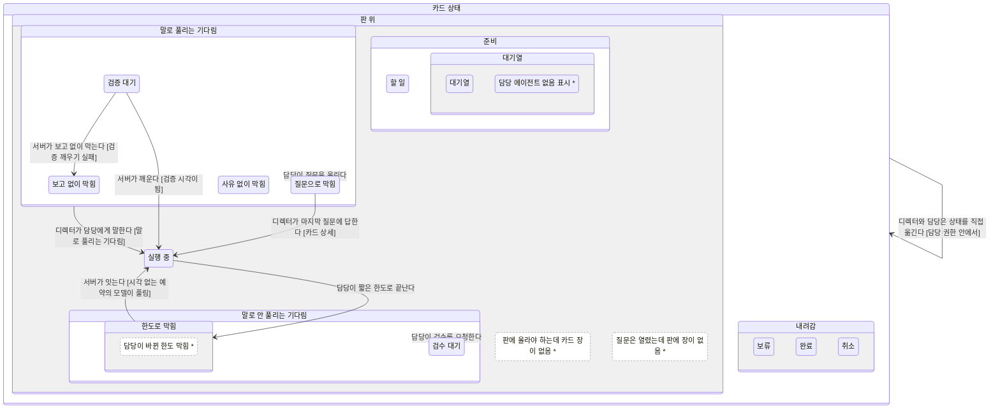
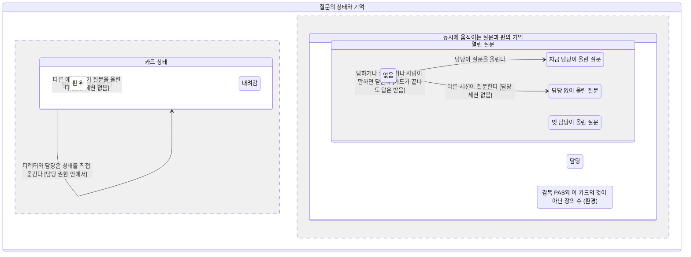
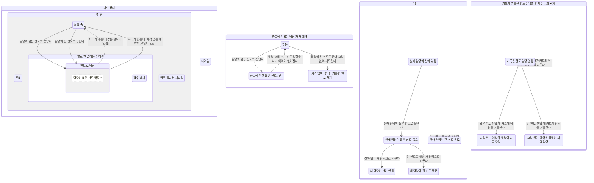
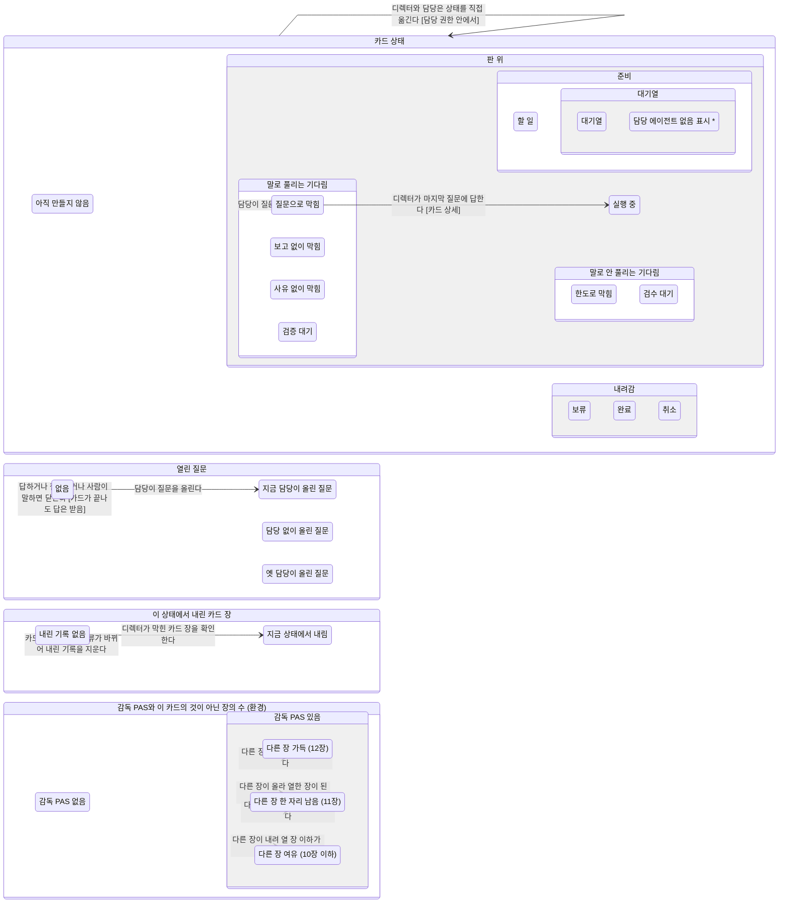

# 현행 카드 규칙

이 문서는 XState 정의와 약속 검사에서 생성한다. 걸음 2의 질문 규칙과 한도 예약, 계산한 판 장과 내린 기록을 반영한 현행 모형이다.

한 카드에 열린 질문은 하나까지만 대조했다. 한 카드의 동시 질문 여러 개, 보관, 권한 표 전체, 자동 배정 조정자 내부와 임의의 담당 변경 조합은 대조하지 않았다.

판의 전체 장 수와 이 카드의 장 수는 DB 사실에서 읽는다. 기계에는 숫자를 저장하지 않고, 다른 장이 10장 이하인 경우와 11장인 경우, 12장인 단계만 둔다. 한도 담당과 재개 시각은 cards.limit_resume_session_id와 limit_resume_at에서 읽는다. 시각 없는 예약도 담당을 기록하며, 담당 교체가 기록을 지운다.

영역 7개, 상태 노드 60개, 사건 71개, 도달 구성 1679개, 정의별 전이 갈래 250개.

빨강은 약속을 어기는 도달 구성이 있다는 뜻이다. 별표는 이름 없는 상태나 구멍이다. 그림은 사건을 골라 나누며, 같은 사건의 화살표는 해당 그림에서 전부 남기거나 전부 숨긴다. 자유 이동과 같은 결과의 기억 쓰기는 각각 한 화살표로 묶는다. 기억 쓰기 화살표는 값이 실제로 바뀌는 대표 시작과 끝을 나타내며, 이미 같은 값인 쓰기는 따로 그리지 않는다.

## 전체: 상태와 함께 움직이는 기억

카드 상태는 계층으로, 질문과 예약, 담당과 내린 기록은 나란한 영역으로 읽는다. 접힌 상자의 빨강은 그 아래에 약속을 어기는 구성이 도달한다는 뜻이다.

```mermaid
stateDiagram-v2
direction TB
classDef breaks fill:#ffecee,stroke:#e72e3b,stroke-width:2px,color:#cd2834
classDef hole fill:#ffffff,stroke:#9a9a9a,stroke-dasharray:4 3
state "현행 카드 규칙 (운영 코드와 대조할 모형)" as card {
    direction TB
    state "카드 상태" as status {
        direction TB
        state "판 위" as on {
            direction TB
            state "준비" as ready
            state "실행 중" as running
            state "말로 풀리는 기다림" as talk
            state "말로 안 풀리는 기다림" as silent
            state "판에 올라야 하는데 카드 장이 없음 *" as hole_holeCardMissing
            state "질문은 열렸는데 판에 장이 없음 *" as hole_holeQuestionMissing
            running --> silent: 담당이 짧은 한도로 끝난다
            talk --> running: 디렉터가 담당에게 말한다 [말로 풀리는 기다림]
            talk --> running: 서버가 깨운다 [검증 시각이 됨]
            silent --> running: 서버가 잇는다 [시각 없는 예약의 모델이 풀림]
        }
        state "내려감" as off
    }
    --
    state "카드 상태와 동시에 움직이는 기억" as overviewMemory {
        direction LR
        state "열린 질문" as card_question
        state "카드에 기록된 담당 재개 예약" as card_reservation
        state "담당" as card_assignee
        state "이 상태에서 내린 카드 장" as card_dismissed {
            direction TB
            state "내린 기록 없음" as dNone
            state "지금 상태에서 내림" as dCurrent
        }
        state "감독 PAS와 이 카드의 것이 아닌 장의 수 (환경)" as card_pasBoard
        state "카드에 기록된 한도 담당과 현재 담당의 관계" as card_limitedOwner
    }
    status --> status: 디렉터와 담당은 상태를 직접 옮긴다 [담당 권한 안에서]
}
status --> talk: 담당이 질문을 올린다
status --> talk: 다른 에이전트가 질문을 올린다 [담당 세션 없음]
status --> silent: 담당이 검수를 요청한다
class hole_holeCardMissing hole
class hole_holeQuestionMissing hole
class silent hole
```

화살표 8개. 남긴 사건: 디렉터가 실행 중으로 옮긴다 / 담당이 질문을 올린다 / 다른 에이전트가 질문을 올린다 [담당 세션 없음] / 디렉터가 담당에게 말한다 [말로 풀리는 기다림] / 담당이 짧은 한도로 끝난다 / 서버가 점검한다 [예약 시각 전에는 재개하지 않음] / 서버가 잇는다 [시각 없는 예약의 모델이 풀림] / 서버가 깨운다 [검증 시각이 됨] / 담당이 검수를 요청한다. 나머지 사건은 아래 전체 표에서 확인한다.

## 카드 상태: 같은 기다림에서 물려받는 규칙

말로 풀리는 기다림의 세 자식은 디렉터가 말하면 재개하는 규칙을 함께 물려받는다. 자유 이동 하나가 모든 잎 상태의 직접 이동을 대표한다.



화살표 9개. 남긴 사건: 디렉터가 실행 중으로 옮긴다 / 담당이 질문을 올린다 / 디렉터가 담당에게 말한다 [말로 풀리는 기다림] / 담당이 짧은 한도로 끝난다 / 서버가 점검한다 [예약 시각 전에는 재개하지 않음] / 서버가 잇는다 [시각 없는 예약의 모델이 풀림] / 서버가 깨운다 [검증 시각이 됨] / 서버가 보고 없이 막는다 [검증 깨우기 실패] / 담당이 검수를 요청한다 / 디렉터가 마지막 질문에 답한다 [카드 상세]. 나머지 사건은 아래 전체 표에서 확인한다.

## 질문: 내려간 카드가 돌아오면 질문 장도 돌아온다

질문 장은 카드 구성에서 계산하며 판이 가득 차도 빠지지 않는다. 완료와 취소 뒤 늦은 답도 카드 상세와 감독 판에서 받고 상태는 그대로 둔다. 질문을 올린 세션과 현재 담당이 철회할 수 있다.



화살표 6개. 남긴 사건: 디렉터가 실행 중으로 옮긴다 / 디렉터가 보류으로 옮긴다 / 디렉터가 완료으로 옮긴다 / 담당이 질문을 올린다 / 다른 에이전트가 질문을 올린다 [담당 세션 없음] / 디렉터가 마지막 질문에 답한다 [카드 상세] / 디렉터가 마지막 질문에 답한다 [감독 판] / 담당이 마지막 질문을 철회한다 / 올린 세션이 마지막 질문을 철회한다 / 디렉터가 담당에게 말한다 [말로 풀리는 기다림]. 나머지 사건은 아래 전체 표에서 확인한다.

## 한도: 카드에 기록된 담당과 예약으로 재개한다

한도 진입 때 담당과 선택적인 재개 시각을 카드에 기록한다. 담당 교체와 한도 탈출은 두 칸을 함께 지운다. 짧은 한도는 시각이 지난 뒤, 긴 한도는 모델이 풀린 뒤 기록된 같은 담당만 잇는다.



화살표 14개. 남긴 사건: 담당이 짧은 한도로 끝난다 / 담당이 긴 한도로 끝난다 / 실행 중인 세션으로 담당을 바꾼다 / 긴 한도로 끝난 세션으로 담당을 바꾼다 / 서버가 점검한다 [예약 시각 전에는 재개하지 않음] / 서버가 깨운다 [짧은 한도가 풀림] / 서버가 잇는다 [시각 없는 예약의 모델이 풀림]. 나머지 사건은 아래 전체 표에서 확인한다.

## 판: 계산 장과 상태별 내린 기록

직접 장만 12장으로 제한한다. 카드와 질문 장은 구성에서 계산한다. 확인한 막힌 카드 장은 상태, 막힘 종류 또는 상태 변경 시각이 바뀔 때 다시 나온다.



화살표 11개. 남긴 사건: 디렉터가 보고 없이 막힘으로 옮긴다 / 디렉터가 막힌 카드 장을 확인한다 / 디렉터가 검수 대기으로 옮긴다 / 담당이 질문을 올린다 / 디렉터가 마지막 질문에 답한다 [카드 상세] / 다른 장이 올라 열한 장이 된다 / 다른 장이 올라 열두 장이 된다 / 다른 장이 내려 열 장 이하가 된다 / 다른 장이 내려 열한 장이 된다. 나머지 사건은 아래 전체 표에서 확인한다.

## 약속 검사

약속 1-나는 이번 실제 DB 대조에서 새로 찾았다. 가득 찬 판에서 신규 카드 장이 사라지는 것으로, 질문 장을 버리는 어긋남 1과 같은 뿌리다.

| 약속 | 결과 | 어긋남 | 어긴 구성 수 | 예시 사건 경로 |
| :-- | :-- | :-- | --: | :-- |
| 판에 올라야 할 장은 판에 있다 (1-가 질문 장) | 지킴 | 1, 7 | 0 | 없음 |
| 판에 올라야 할 장은 판에 있다 (1-나 카드 장) | 지킴 | 1 | 0 | 없음 |
| 서버의 한도 재개는 기록된 담당이 현재 담당일 때만 한다 | 지킴 | 2 | 0 | 없음 |
| 같은 질문의 답은 카드 상세와 감독 판에서 결과가 같다 | 지킴 | 4 | 0 | 없음 |
| 질문을 올릴 수 있는 세션은 철회할 수 있다 | 지킴 | 8 | 0 | 없음 |
| 짧은 한도로 막히면 취소 전까지 시각 있는 예약이 있다 | 지킴 | 별도 약속 | 0 | 없음 |
| 기다리는 카드는 판의 장이나 시각으로 나가는 길이 있다 | 어김 | 별도 약속 | 141 | 디렉터가 할 일 카드를 만든다 → 디렉터가 질문으로 막힘으로 옮긴다 → 감독 PAS가 생긴다 → 디렉터가 막힌 카드 장을 확인한다 |

## 사건과 원문 위치

상태를 정하는 17곳을 사건에 연결했다. 서버의 복합 루프 전체가 아니라 카드 서비스 변경 경계를 대조한다. 한도 자동 재개와 검증 깨우기는 실제 디스패처도 실행한다.

| 사건 | 뜻 | 원문 파일과 함수 |
| :-- | :-- | :-- |
| `HUMAN_MOVE_todo` | 디렉터가 할 일으로 옮긴다 | `cards/card_control_plane_service.ts#setCardStatus/applyStatusTx`<br>`cards/card_operations.ts#executeCardOperation` |
| `ASSIGNEE_MOVE_todo` | 담당이 할 일으로 옮긴다 | `cards/card_control_plane_service.ts#setCardStatus/applyStatusTx`<br>`cards/card_operations.ts#executeCardOperation` |
| `HUMAN_MOVE_queued` | 디렉터가 대기열으로 옮긴다 | `cards/card_control_plane_service.ts#setCardStatus/applyStatusTx`<br>`cards/card_operations.ts#executeCardOperation` |
| `ASSIGNEE_MOVE_queued` | 담당이 대기열으로 옮긴다 | `cards/card_control_plane_service.ts#setCardStatus/applyStatusTx`<br>`cards/card_operations.ts#executeCardOperation` |
| `HUMAN_MOVE_running` | 디렉터가 실행 중으로 옮긴다 | `cards/card_control_plane_service.ts#setCardStatus/applyStatusTx`<br>`cards/card_operations.ts#executeCardOperation` |
| `ASSIGNEE_MOVE_running` | 담당이 실행 중으로 옮긴다 | `cards/card_control_plane_service.ts#setCardStatus/applyStatusTx`<br>`cards/card_operations.ts#executeCardOperation` |
| `HUMAN_MOVE_question` | 디렉터가 질문으로 막힘으로 옮긴다 | `cards/card_control_plane_service.ts#setCardStatus/applyStatusTx`<br>`cards/card_operations.ts#executeCardOperation` |
| `ASSIGNEE_MOVE_question` | 담당이 질문으로 막힘으로 옮긴다 | `cards/card_control_plane_service.ts#setCardStatus/applyStatusTx`<br>`cards/card_operations.ts#executeCardOperation` |
| `HUMAN_MOVE_noReport` | 디렉터가 보고 없이 막힘으로 옮긴다 | `cards/card_control_plane_service.ts#setCardStatus/applyStatusTx`<br>`cards/card_operations.ts#executeCardOperation` |
| `ASSIGNEE_MOVE_noReport` | 담당이 보고 없이 막힘으로 옮긴다 | `cards/card_control_plane_service.ts#setCardStatus/applyStatusTx`<br>`cards/card_operations.ts#executeCardOperation` |
| `HUMAN_MOVE_other` | 디렉터가 사유 없이 막힘으로 옮긴다 | `cards/card_control_plane_service.ts#setCardStatus/applyStatusTx`<br>`cards/card_operations.ts#executeCardOperation` |
| `ASSIGNEE_MOVE_other` | 담당이 사유 없이 막힘으로 옮긴다 | `cards/card_control_plane_service.ts#setCardStatus/applyStatusTx`<br>`cards/card_operations.ts#executeCardOperation` |
| `HUMAN_MOVE_limit` | 디렉터가 한도로 막힘으로 옮긴다 | `cards/card_control_plane_service.ts#setCardStatus/applyStatusTx`<br>`cards/card_operations.ts#executeCardOperation` |
| `ASSIGNEE_MOVE_limit` | 담당이 한도로 막힘으로 옮긴다 | `cards/card_control_plane_service.ts#setCardStatus/applyStatusTx`<br>`cards/card_operations.ts#executeCardOperation` |
| `HUMAN_MOVE_verification` | 디렉터가 검증 대기으로 옮긴다 | `cards/card_control_plane_service.ts#setCardStatus/applyStatusTx`<br>`cards/card_operations.ts#executeCardOperation` |
| `ASSIGNEE_MOVE_verification` | 담당이 검증 대기으로 옮긴다 | `cards/card_control_plane_service.ts#setCardStatus/applyStatusTx`<br>`cards/card_operations.ts#executeCardOperation` |
| `HUMAN_MOVE_review` | 디렉터가 검수 대기으로 옮긴다 | `cards/card_control_plane_service.ts#setCardStatus/applyStatusTx`<br>`cards/card_operations.ts#executeCardOperation` |
| `ASSIGNEE_MOVE_review` | 담당이 검수 대기으로 옮긴다 | `cards/card_control_plane_service.ts#setCardStatus/applyStatusTx`<br>`cards/card_operations.ts#executeCardOperation` |
| `HUMAN_MOVE_hold` | 디렉터가 보류으로 옮긴다 | `cards/card_control_plane_service.ts#setCardStatus/applyStatusTx`<br>`cards/card_operations.ts#executeCardOperation` |
| `ASSIGNEE_MOVE_hold` | 담당이 보류으로 옮긴다 | `cards/card_control_plane_service.ts#setCardStatus/applyStatusTx`<br>`cards/card_operations.ts#executeCardOperation` |
| `HUMAN_MOVE_done` | 디렉터가 완료으로 옮긴다 | `cards/card_control_plane_service.ts#setCardStatus/applyStatusTx`<br>`cards/card_operations.ts#executeCardOperation` |
| `ASSIGNEE_MOVE_done` | 담당이 완료으로 옮긴다 | `cards/card_control_plane_service.ts#setCardStatus/applyStatusTx`<br>`cards/card_operations.ts#executeCardOperation` |
| `HUMAN_MOVE_cancelled` | 디렉터가 취소으로 옮긴다 | `cards/card_control_plane_service.ts#setCardStatus/applyStatusTx`<br>`cards/card_operations.ts#executeCardOperation` |
| `ASSIGNEE_MOVE_cancelled` | 담당이 취소으로 옮긴다 | `cards/card_control_plane_service.ts#setCardStatus/applyStatusTx`<br>`cards/card_operations.ts#executeCardOperation` |
| `CREATE_TODO` | 디렉터가 할 일 카드를 만든다 | `cards/card_control_plane_service.ts#createCardMutation` |
| `CREATE_QUEUED` | 디렉터가 대기열 카드를 만든다 | `cards/card_control_plane_service.ts#createCardMutation` |
| `ASK_OWNER` | 담당이 질문을 올린다 | `cards/card_control_plane_service.ts#askQuestion` |
| `ASK_OTHER` | 다른 에이전트가 질문을 올린다 [담당 세션 없음] | `cards/card_control_plane_service.ts#askQuestion/assertNotOtherSessionAssignee` |
| `ANSWER_DETAIL` | 디렉터가 마지막 질문에 답한다 [카드 상세] | `cards/card_control_plane_service.ts#answerQuestion` |
| `ANSWER_BOARD` | 디렉터가 마지막 질문에 답한다 [감독 판] | `session/persistent_report_service.ts#acceptReply/cardQuestionDecision` |
| `WITHDRAW` | 담당이 마지막 질문을 철회한다 | `cards/card_control_plane_service.ts#withdrawQuestion` |
| `WITHDRAW_AUTHOR` | 올린 세션이 마지막 질문을 철회한다 | `cards/card_control_plane_service.ts#withdrawQuestion`<br>`cards/card_question_rules.ts#canWithdrawCardQuestion` |
| `HUMAN_MESSAGE` | 디렉터가 담당에게 말한다 [말로 풀리는 기다림] | `cards/card_control_plane_service.ts#resumeBlockedCardOnHumanInput`<br>`production.ts#resumeBlockedCardOnHumanInput caller` |
| `HUMAN_COMMENT` | 디렉터가 커멘트를 남긴다 [말로 풀리는 기다림] | `cards/card_control_plane_service.ts#applyAddCommentTx` |
| `AGENT_COMMENT` | 담당이 커멘트를 남긴다 | `cards/card_control_plane_service.ts#applyAddCommentTx` |
| `START_ADMITTED_WORK` | 자동 배정된 첫 작업 세션이 착수한다 | `cards/card_control_plane_service.ts#startCardWork`<br>`cards/card_work_lifecycle.ts#acceptQueuedWork` |
| `START_WORK` | 담당이 착수를 확인한다 | `cards/card_control_plane_service.ts#startCardWork` |
| `REQUEST_REVIEW` | 담당이 검수를 요청한다 | `cards/card_control_plane_service.ts#requestCardReview` |
| `RECORD_EXECUTION` | 서버가 실행을 확인한다 | `cards/card_control_plane_service.ts#recordExecution`<br>`cards/card_execution_service.ts#observeOnce` |
| `RECORD_EXECUTION_LATE` | 서버가 실행을 확인한다 [사람이 이미 상태를 바꿈] | `cards/card_control_plane_service.ts#recordExecution` |
| `DISPATCH` | 서버가 대기열 카드를 실행한다 | `cards/card_control_plane_service.ts#recordDispatch`<br>`cards/card_dispatcher.ts#dispatchOnce`<br>`cards/card_execution_service.ts#execute` |
| `ADMIT_DISPATCH` | 서버가 배정을 허가하고 대기열에 둔다 | `cards/card_control_plane_service.ts#recordDispatch`<br>`cards/card_orchestration_coordinator.ts#dispatch`<br>`cards/card_orchestration_workers.ts#reconcile/reject` |
| `SERVER_SHORT_LIMIT` | 담당이 짧은 한도로 끝난다 | `cards/card_dispatcher.ts#sessionEnded/reconcileTerminal/blockForLimit`<br>`cards/card_control_plane_service.ts#blockCardForLimit` |
| `SERVER_LONG_LIMIT` | 담당이 긴 한도로 끝난다 | `cards/card_dispatcher.ts#blockForLimit`<br>`cards/card_control_plane_service.ts#blockCardForLimit` |
| `SERVER_LIVE_RESUME` | 서버가 점검한다 [예약 시각 전에는 재개하지 않음] | `cards/card_dispatcher.ts#resumeAutoLimitedCard`<br>`cards/card_control_plane_service.ts#resumeLimitedCard` |
| `SERVER_LIMIT_TIME` | 서버가 깨운다 [짧은 한도가 풀림] | `cards/card_dispatcher.ts#resumeAutoLimitedCard`<br>`cards/card_control_plane_service.ts#resumeLimitedCard` |
| `SERVER_LIMIT_RELAUNCH` | 서버가 잇는다 [시각 없는 예약의 모델이 풀림] | `cards/card_dispatcher.ts#resumeLimits`<br>`cards/card_control_plane_service.ts#resumeDispatchedCard` |
| `SERVER_LIMIT_REQUEUE` | 서버가 점검한다 [기록된 담당이 없으면 그대로] | `cards/card_dispatcher.ts#resumeLimits` |
| `ADMIT_LIMIT` | 서버가 한도 재배정을 허가한다 | `cards/card_control_plane_service.ts#resumeDispatchedCard`<br>`cards/card_orchestration_coordinator.ts#dispatch` |
| `WAKE_TIME` | 서버가 깨운다 [검증 시각이 됨] | `cards/card_dispatcher.ts#wakeAwaitingVerification`<br>`cards/card_control_plane_service.ts#resumeVerificationCard` |
| `WAKE_FAIL` | 서버가 보고 없이 막는다 [검증 깨우기 실패] | `cards/card_dispatcher.ts#blockVerificationWake` |
| `CREATE_FAIL` | 서버가 보고 없이 막는다 [세션 생성 실패] | `cards/card_dispatcher.ts#dispatchOnce`<br>`cards/card_execution_service.ts#sendAndObserve`<br>`cards/card_orchestration_workers.ts#reconcile/reject` |
| `ATTACHMENT_FAIL` | 서버가 보고 없이 막는다 [첨부 준비 실패] | `cards/card_dispatcher.ts#resumeLimits/resumeAutoLimitedCard` |
| `NOTE_MISSING` | 서버가 담당 에이전트 없음을 적는다 | `cards/card_dispatcher.ts#dispatchOnce`<br>`cards/card_control_plane_service.ts#noteMissingAssignee` |
| `ASSIGN_SESSION` | 담당을 세션으로 정한다 | `cards/card_control_plane_service.ts#patchCard/claim`<br>`cards/card_operations.ts#transfer_card_assignee` |
| `ASSIGN_AGENT` | 시작 전 카드의 담당 에이전트를 정한다 | `cards/card_control_plane_service.ts#patchCard/saveExecutionSettings`<br>`cards/card_maintenance_service.ts#updateUnstartedCard` |
| `ASSIGN_HUMAN` | 담당을 사람으로 정한다 | `cards/card_control_plane_service.ts#patchCard` |
| `REPLACE_LIVE` | 실행 중인 세션으로 담당을 바꾼다 | `control_plane/repositories/session_card_replacement.ts#applySessionCardReplacement`<br>`cards/card_control_plane_service.ts#patchCard` |
| `REPLACE_LIMITED` | 긴 한도로 끝난 세션으로 담당을 바꾼다 | `cards/card_control_plane_service.ts#patchCard` |
| `OWNER_END` | 담당 세션이 끝난다 [정상 종료] | `cards/card_dispatcher.ts#sessionEnded/reconcileTerminal` |
| `ACK_CARD` | 디렉터가 막힌 카드 장을 확인한다 | `session/persistent_report_service.ts#remove` |
| `PAS_APPEARS` | 감독 PAS가 생긴다 | `session/persistent_report_service.ts#readCardBoardSessions` |
| `BOARD_ONE` | 다른 장이 올라 열한 장이 된다 | `session/persistent_report_service.ts#upsertEntry` |
| `BOARD_OTHER_REMOVED` | 다른 장이 내려 열한 장이 된다 | `session/persistent_report_service.ts#remove` |
| `BOARD_FULL` | 다른 장이 올라 열두 장이 된다 | `session/persistent_report_service.ts#upsertEntry` |
| `BOARD_ROOM` | 다른 장이 내려 열 장 이하가 된다 | `session/persistent_report_service.ts#remove` |
| `BULK_TODO` | 디렉터가 여러 장을 할 일로 옮긴다 [담당이 쉬고 있음] | `cards/card_maintenance_service.ts#bulkSetCardStatus`<br>`cards/card_maintenance_tx.ts#assertBulkStatusGuardTx` |
| `BULK_QUEUED` | 디렉터가 여러 장을 대기열로 옮긴다 [담당이 쉬고 있음] | `cards/card_maintenance_service.ts#bulkSetCardStatus` |
| `BULK_HOLD` | 디렉터가 여러 장을 보류로 옮긴다 [담당이 쉬고 있음] | `cards/card_maintenance_service.ts#bulkSetCardStatus` |
| `BULK_CANCELLED` | 디렉터가 여러 장을 취소로 옮긴다 [담당이 쉬고 있음] | `cards/card_maintenance_service.ts#bulkSetCardStatus` |
| `MERGE_SOURCE` | 디렉터가 시작 전 카드를 합쳐 취소한다 | `cards/card_maintenance_service.ts#mergeCards` |

## 다시 만들기

저장소 루트에서 실행한다. 첫 명령은 Markdown을 만들고, 선택한 폴더에는 같은 정의의 Mermaid 원문과 검사 결과도 저장한다.

```bash
corepack pnpm@10.32.1 --dir orch-server-ts exec tsx scripts/card-state-charts.ts <그림 원문 폴더>
```
