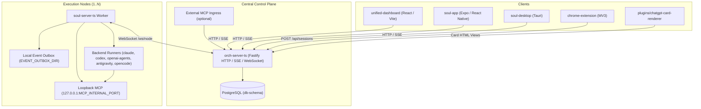

# Architecture

Soulstream separates the central control plane (`orch-server-ts`) from node-local execution workers (`soul-server-ts`). The control plane owns public HTTP and SSE APIs, PostgreSQL persistence, and session routing. Workers connect upstream over WebSocket, run agent turns on their local filesystems, and expose a loopback-only MCP endpoint for running agents.

## System overview



## Components

- **`orch-server-ts`**: production TypeScript orchestrator and Fastify server. Serves the built web dashboard when `DASHBOARD_DIR` is set, owns all public `/api/*` REST and SSE routes, maintains the connected-node registry, persists canonical state in PostgreSQL, and optionally exposes credential-bound external MCP ingress.
- **`soul-server-ts`**: TypeScript execution worker. Runs on each machine where agents execute code or tools. It connects outbound to `orch-server-ts` at `/ws/node`, spawns and supervises backend runner processes, buffers outgoing events in `EVENT_OUTBOX_DIR`, and serves a loopback-only internal MCP endpoint (`127.0.0.1:MCP_INTERNAL_PORT`). The worker runtime does not connect to PostgreSQL (`DATABASE_URL` is unused by the worker).
- **`unified-dashboard`**: React 19, Vite, and Tailwind CSS web application and PWA. Provides the main folder and card workspace (`/`), persistent assistant sessions (`/persistent` and `/persistent/:sessionId`), and UI review harnesses (`/components`, `/dialogues`).
- **`soul-app`**: Expo and React Native client for iOS, Android, and web. Connects to the orchestrator API for chat (`ChatScreen`), cards (`CardHomeScreen`), persistent assistant sessions (`PersistentSessionScreen`), recurring jobs (`RecurringJobsScreen`), and provider settings (`SettingsScreen`).
- **`soul-desktop`**: Tauri desktop application wrapping the dashboard client.
- **`chrome-extension`**: Manifest V3 unpacked browser extension that sends the active page and a generated prompt to `POST /api/sessions` on the orchestrator. See [`chrome-extension/README.md`](../../chrome-extension/README.md).
- **`plugins/chatgpt-card-renderer`**: static HTML renderer (`public/cards.html`) for externally published card views.

## Request flow and multi-node routing

1. **Node registration**: when a `soul-server-ts` worker starts, it opens an authenticated WebSocket connection to `/ws/node` on `orch-server-ts` and registers its `node_id`, agent profiles, capabilities, and `supported_backends`.
2. **Node selection**: when a user, bot, or delegating agent creates a session, `orch-server-ts` checks `session_create_node_selector`. If a specific `node_id` is requested, the orchestrator verifies that the node is connected and compatible. Otherwise, it selects a connected node whose registered profiles and backends match the request.
3. **Command dispatch**: the orchestrator sends a typed control command over `/ws/node` using the protocol defined in `packages/wire-schema/src/upstream.schema.json`.
4. **Turn execution and event delivery**: `soul-server-ts` spawns or resumes the runner process for the selected backend, injects startup context (`<soulstream_session>`, `<page_context>`, `<board_workspace>`, `<running_sessions>`, `<cogito_context>`), and writes durable events to `EVENT_OUTBOX_DIR` before streaming them upstream.
5. **Persistence and fan-out**: `orch-server-ts` records durable events in PostgreSQL and broadcasts live updates over SSE to subscribed web and mobile clients.

## Supported backends

`packages/model-catalog` defines five execution backends:

- `claude`: Anthropic Claude Code CLI and Claude Agent SDK runner.
- `codex`: OpenAI Codex CLI (`codex app-server`) and Codex SDK runner.
- `openai-agents`: OpenAI Agents SDK (`@openai/agents`) runtime.
- `antigravity`: Antigravity CLI (`agy`) runner (for example, Gemini presets).
- `opencode`: OpenCode CLI (`opencode`) runner.

Each node advertises which backends and model presets are available based on its local CLI binaries, `model-catalog.yaml`, authentication state, and resolved environment variables.

## Repository layout and packages

```text
soulstream/
├── orch-server-ts/                 Production TypeScript orchestrator and API
├── soul-server-ts/                 TypeScript execution worker and loopback MCP server
├── unified-dashboard/              React 19 and Vite web dashboard and PWA
├── soul-app/                       Expo and React Native mobile client (standalone npm package)
├── soul-desktop/                   Tauri desktop client
├── chrome-extension/               Manifest V3 browser extension for page actions
├── plugins/
│   └── chatgpt-card-renderer/      Static HTML card renderer
├── packages/
│   ├── agent-profile-contract/     Shared agent profile schema and types
│   ├── chat-ui/                    Shared chat UI components and document model
│   ├── db-schema/                  Canonical PostgreSQL DDL, migrations, and release executor
│   ├── fractional-position/        Shared fractional-indexing ordering primitive
│   ├── mcp-contract/               Shared MCP tool contracts and schemas
│   ├── model-catalog/              Shared backend enum and model preset contracts
│   ├── page-model/                 Shared page, block, and Y.Doc projection contracts
│   ├── search-contract/            Shared session search request and result contracts
│   ├── soul-ui/                    Shared dashboard UI components, stores, and hooks
│   └── wire-schema/                Canonical worker-to-orchestrator WebSocket protocol
├── deploy/                         Haniel release manifests and database safety contracts
├── install/                        Windows worker installer and Haniel service templates
├── docs/                           Architecture guides, pathmaps, invariants, and API references
├── scripts/                        Workspace bundle verification and QA harnesses
└── assets/                         Static repository assets
```

The pnpm workspace is declared in `pnpm-workspace.yaml` and includes `packages/*`, `unified-dashboard`, `soul-desktop`, `soul-server-ts`, `orch-server-ts`, and `chrome-extension`. `soul-app` sits outside the pnpm workspace and uses `npm --prefix soul-app`.

The live control plane and workers run entirely on TypeScript and Node.js. Python is used only for Windows worker installer checks and repository maintenance or QA scripts.
