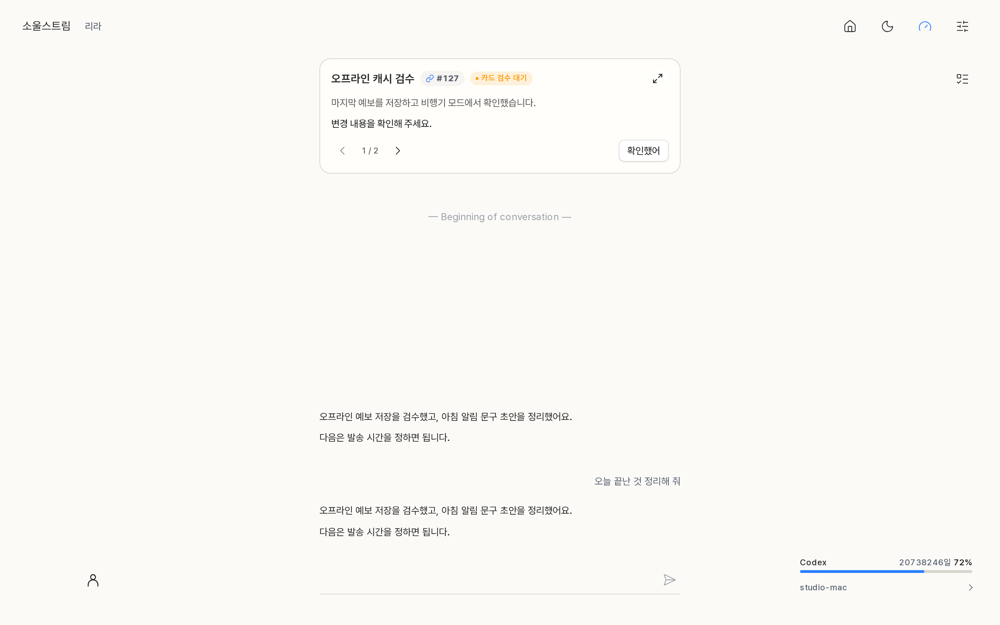
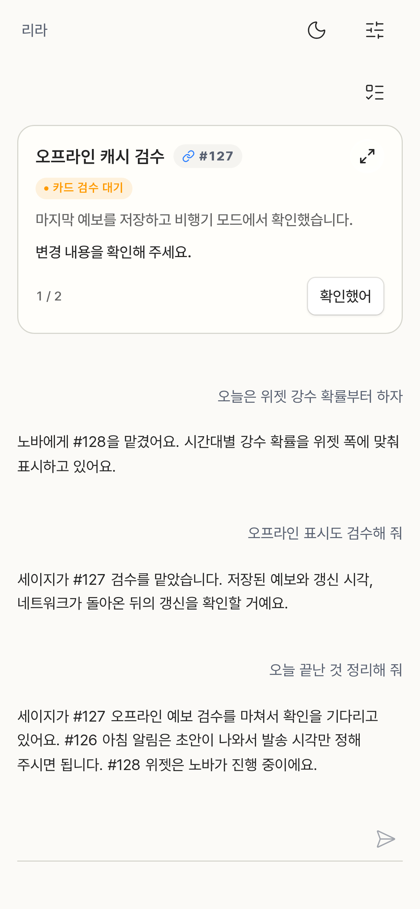

# Concepts

Soulstream organizes ongoing agent work around folders, cards, sessions, and nodes. The web dashboard (`unified-dashboard`) and mobile client (`soul-app`) present the same core entities backed by the central `orch-server-ts` control plane.

## Feature overview

- **Long-lived agent sessions** with live streaming output, follow-up messages, mid-turn intervention, file attachments, and resumable history.
- **Structured work cards** inside hierarchical folders, tracking the request, check items with evidence, a one-line status (`now`), user questions, and review completion.
- **Persistent assistant sessions** with a live report board, active task lists, session monitoring, and weekly quota headroom.
- **Four execution backends** configured through node-local agent profiles and model presets: Claude, Codex, Antigravity, and OpenCode.
- **Multi-node routing** where the TypeScript orchestrator (`orch-server-ts`) dispatches authenticated WebSocket commands to TypeScript workers (`soul-server-ts`).
- **Built-in MCP tools** for service reflection, session search, git worktrees, on-demand skill loading (`load_skill`), recurring jobs, and card or folder management. See [Agents and tools](agents-and-tools.md).
- **Release-safe operations** with [Haniel](https://github.com/eiaserinnys/haniel) manifests that keep PostgreSQL migration authority on the central orchestrator while remote workers stay database-free. See [Deployment](deployment.md).

## Folders

Folders are hierarchical containers that group related work by project, domain, or team.

- A folder holds cards, sessions, and board items such as markdown documents, pages, and custom views.
- Folder-scoped guidance, knowledge references (`atom_ref`), and page context are injected into sessions created inside the folder unless an agent profile sets `context_scope: minimal`.
- In the web dashboard, `FolderWorkspace` renders the folder tree and item counts alongside the active card and session views.

## Cards

A card is the canonical unit of work inside a folder. Both human users and delegating agent sessions create and update cards.

Each card tracks:

- **Request**: the user's original ask, quoted in one or two sentences.
- **Brief**: a handoff summary for the next session that picks up the card (decisions made, where the material is, what is done and what remains).
- **Check items**: discrete verification steps or deliverables. As an agent completes work, it reports each check item's status, result summary, and verification evidence (`report_card_item`).
- **Current status (`now`)**: a one-line status banner (`update_card_now`) showing what the assigned session is doing right now.
- **Questions**: a short question with one to three choices (`ask_card_question`) that waits for the user's decision without losing card context.
- **Notes and comments**: execution notes (`add_card_note`) for intermediate findings and user-facing comments (`add_card_comment`).
- **Status and review**: cards move through active work (`start_card_work`), review (`request_card_review`), and completion (`set_card_status`). In the dashboard and mobile app, reviewing a card shows all check items and evidence, with support for completing the card and an undo countdown gauge if a card is closed by mistake.
- **Linked sessions**: every card tracks its assignee session (`assignee`) and any delegated member sessions (`member`) attached to the work.

## Sessions and live intervention

A session is a durable agent execution stream bound to a specific node, agent profile, and model preset.

- **Real-time streaming**: clients subscribe to `/api/sessions/:id/events` over Server-Sent Events (SSE) to watch assistant output, tool calls, and turn boundaries live.
- **Live intervention**: users and parent sessions do not have to wait for a turn to finish. They can send follow-up messages or intervene mid-turn (`send_message_to_session` or the chat input) to steer the running agent.
- **Durable history**: every turn, tool invocation, and attachment is recorded in PostgreSQL through the orchestrator, allowing sessions to be resumed, searched, or inspected after completion.

## Persistent assistant session and report board

The persistent assistant session (PAS) provides a dedicated, always-available coordinator view at `/persistent` and `/persistent/:sessionId` on the web dashboard and in `PersistentSessionScreen` on `soul-app`. When you visit `/` in a new browser, the web dashboard opens this view by default. The dashboard saves this choice per user in that browser, and you can change it in **Settings > Appearance** (`설정 > 화면과 읽기`).

Key surfaces inside the persistent assistant view include:

- **Report board (shown as 지금의 보고 in the UI)**: rendered by `PersistentReportDeck` on the web and `PersistentReportSheet` on mobile. It surfaces active and recently completed cards so the user can expand card reports, review results, and toggle the report window directly alongside the assistant chat.
- **Task list and session controls**: `PersistentSessionTaskList` and task configuration controls track ongoing background work and session settings.
- **Session monitoring**: `PersistentSessionMonitoring` displays the turn timeline and per-turn token usage.
- **Weekly usage widget**: `PersistentSessionWeeklyUsage` displays remaining weekly provider quota percentages and reset countdowns for the session's node.

  
  

The screenshots use demo data served by a Playwright fixture.

## Agents and model presets

Soulstream separates **who the agent is** from **which model runs the turn**:

- **Agent profiles (`agents.yaml`)**: define the agent's `id`, display `name`, execution `backend`, `workspace_dir`, portrait, tool restrictions (`allowed_tools`, `disallowed_tools`), `context_scope`, and optional default preset.
- **Model presets (`packages/model-catalog/data/model-catalog.yaml`)**: the repository data file defines the selectable presets. Each preset specifies its `backend`, underlying `model` string, `supported_efforts`, `default_effort`, and optional preset-specific environment variables.

When starting a session or dispatching a card, the caller chooses an agent profile and can keep the profile's default preset or override the model preset and reasoning effort for that session. See [Configuration](configuration.md) and [Agents and tools](agents-and-tools.md) for schema details.

## Nodes

A node is a host running the `soul-server-ts` execution worker.

- Each node connects upstream to `orch-server-ts` over `/ws/node` and advertises its `SOULSTREAM_NODE_ID`, configured agent profiles, capabilities, and `supported_backends`.
- Workers do not connect directly to PostgreSQL. They execute agent turns locally in the configured workspace or git worktree and stream events back to the orchestrator through a durable local outbox (`EVENT_OUTBOX_DIR`).
- When a session is created, the orchestrator's node selector routes the command either to an explicitly requested `node_id` or to a connected node that supports the requested agent profile and backend.
