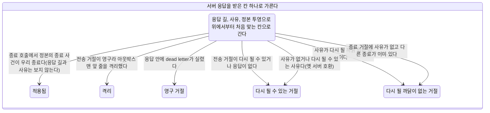
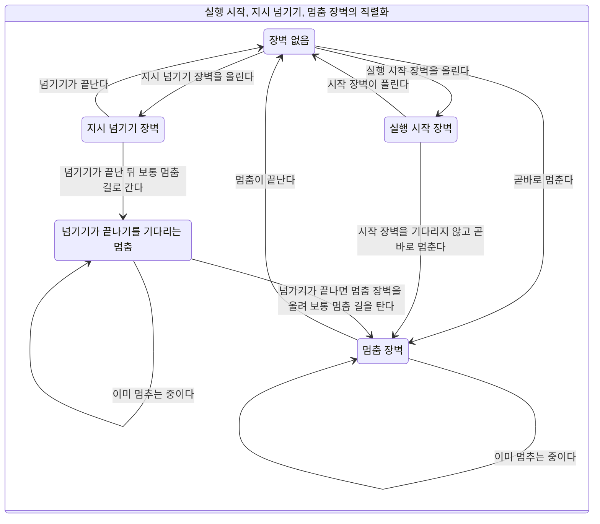

# 노드 상태

이 문서는 `soul-server-ts/src/task/state/`의 XState 정의에서 만든 생성물이다. 정의를 고치면 아래 명령으로 다시 만든다. 리포의 파일과 생성 결과가 다르면 시험이 실패한다.

멈춤 단위(카드 #1266 U4)가 장벽 직렬화 판정과 실행 상태 투영을 멈춤과 삭제 길에 이었고, 종료 경로 단위(카드 #1266 U2a)가 응답을 받은 칸의 함수를 서버 응답을 받는 일곱 호출에 이었다. 지시 경로는 지시 경로 단위가 운영 코드에 잇는다. 턴 고리 전체를 접지 않는다.

## 실행 상태

Task의 `status`, `runner`, `executionRegistration`, `runnerTerminalFact`, `runnerRetainedForDetachedWork`, `runnerReleaseClaim`, `hydratedFromDb`, `terminationEventRecorded`, `runnerIsOfflineReplay`, `executionActivation`, `executionPromise`에 흩어진 사실을 아래 상태 하나로 투영한다. 판정 순서는 표의 순서다. 응답을 기다리는 중인 상태(등록 대기, 잇기 대기)는 Task 필드에 보이지 않아 각각 `registering`, `replaying`으로 접힌다. 멈춤 장벽과 보유 종류는 Task에 표지가 없어 호출자가 입력으로 준다.

| 순서 | 상태 | 뜻 | 조건 |
| :-- | :-- | :-- | :-- |
| 1 | `retained_releasing` | 종료 뒤 러너 해제 중 | 종료가 기록됐고 러너 해제 청구가 걸려 있다 |
| 2 | `retained_claude_background` | 종료 뒤 클로드 백그라운드 작업 보유 | 종료가 기록됐고 클로드의 남은 백그라운드 작업이 러너를 쥐고 있다 |
| 3 | `retained_codex_command` | 종료 뒤 코덱스 남은 명령 보유 | 종료가 기록됐고 코덱스의 남은 명령이 러너를 쥐고 있다 |
| 4 | `stopping` | 멈추는 중 | 활성이고 멈춤 장벽이 올라 있다 |
| 5 | `hydrated_active` | 러너 없이 올린 활성 task | 러너도 실행 등록도 없이 DB에서 올린 활성 task다 |
| 6 | `starting` | 러너를 띄우는 중 | 활성이고 러너가 아직 없다 |
| 7 | `replaying` | 러너의 남은 기록을 올리는 중 | 붙은 러너가 기록을 다시 읽는 손잡이다 |
| 8 | `terminating` | 종료를 올리는 중 | 러너가 붙은 채 종료를 올렸거나 올리는 중이다 |
| 9 | `registering` | 실행 등록 응답을 기다리는 중 | 러너는 붙었고 실행 등록 응답을 아직 받지 못했다 |
| 10 | `running` | 러너가 턴을 도는 중 | 러너가 붙었고 등록이 적용됐다 |
| 11 | `idle` | 주인 없음 | 활성도 러너도 없다 |

## 응답을 받은 칸

서버 응답이 노드에 닿는 길은 다섯이고 호출은 일곱이다. 적용 응답(applied=true)은 이 칸을 거치지 않는다. 입력은 호출 종류, 응답 길, 와이어 사유, 거절된 등록이 지금 등록과 같은가, 정본 투영의 termination_event_id와 우리 종료의 관계, 중앙 세션 유무, 정상 보유 여부다. 출력은 적용됨이나 칸 넷 가운데 하나와 그 칸이 할 정리의 의도 목록이다.

입력 조합 7560가지 모두에 칸이 있으며 빈 칸은 없다. 사유 분류는 `task/state/node_adopt_rejection.ts`가 정본이고 already_terminal, session_missing, owner_node_changed, worktree_busy가 다시 될 까닭 없는 사유다. 워크트리 점유로 거절된 잇기는 러너를 거두고, 중앙 세션 줄에 끝남이 기록되지 않았으면(끊김 중단) 오류 종료도 올린다. 잇기 호출의 정본 종료 사건 칸은 그 중앙 줄의 끝남 기록이다(카드 #1266 U5c).

### 칸 결정표

같은 칸으로 모이는 입력은 한 줄로 접었다. 접은 줄은 모든 조합이 같은 칸을 내는지 문서를 만들 때 확인한다.

| 응답 길 | 호출 | 사유 | 정본의 종료 사건 | 칸 |
| :-- | :-- | :-- | :-- | :-- |
| 모든 응답 길 | 종료 | 모든 사유 | 우리 종료와 같음 | 적용됨 |
| 전송 거절(다시 될 수 있음) | 모든 호출 | 모든 사유 | 모든 경우(종료에서 우리 종료와 같은 경우는 위 줄) | 다시 될 수 있는 거절 |
| 전송 거절(영구라 격리) | 모든 호출 | 모든 사유 | 모든 경우(종료에서 우리 종료와 같은 경우는 위 줄) | 격리 |
| 응답 안의 dead letter | 모든 호출 | 모든 사유 | 모든 경우(종료에서 우리 종료와 같은 경우는 위 줄) | 영구 거절 |
| 응답 없음 | 모든 호출 | 모든 사유 | 모든 경우(종료에서 우리 종료와 같은 경우는 위 줄) | 다시 될 수 있는 거절 |
| applied=false와 거절 사유 | 종료 | already_terminal | 다른 종료 | 다시 될 까닭이 없는 거절 |
| applied=false와 거절 사유 | 종료 | already_terminal | 없음 | 다시 될 까닭이 없는 거절 |
| applied=false와 거절 사유 | 종료 밖의 여섯 호출 | already_terminal | 해당 없음 | 다시 될 까닭이 없는 거절 |
| applied=false와 거절 사유 | 종료 | session_missing | 다른 종료 | 다시 될 까닭이 없는 거절 |
| applied=false와 거절 사유 | 종료 | session_missing | 없음 | 다시 될 까닭이 없는 거절 |
| applied=false와 거절 사유 | 종료 밖의 여섯 호출 | session_missing | 해당 없음 | 다시 될 까닭이 없는 거절 |
| applied=false와 거절 사유 | 종료 | owner_node_changed | 다른 종료 | 다시 될 까닭이 없는 거절 |
| applied=false와 거절 사유 | 종료 | owner_node_changed | 없음 | 다시 될 까닭이 없는 거절 |
| applied=false와 거절 사유 | 종료 밖의 여섯 호출 | owner_node_changed | 해당 없음 | 다시 될 까닭이 없는 거절 |
| applied=false와 거절 사유 | 종료 | worktree_busy | 다른 종료 | 다시 될 까닭이 없는 거절 |
| applied=false와 거절 사유 | 종료 | worktree_busy | 없음 | 다시 될 까닭이 없는 거절 |
| applied=false와 거절 사유 | 종료 밖의 여섯 호출 | worktree_busy | 해당 없음 | 다시 될 까닭이 없는 거절 |
| applied=false와 거절 사유 | 종료 | worktree_not_ready | 다른 종료 | 다시 될 수 있는 거절 |
| applied=false와 거절 사유 | 종료 | worktree_not_ready | 없음 | 다시 될 수 있는 거절 |
| applied=false와 거절 사유 | 종료 밖의 여섯 호출 | worktree_not_ready | 해당 없음 | 다시 될 수 있는 거절 |
| applied=false와 거절 사유 | 종료 | 사유 없음 | 다른 종료 | 다시 될 까닭이 없는 거절 |
| applied=false와 거절 사유 | 종료 | 사유 없음 | 없음 | 다시 될 수 있는 거절 |
| applied=false와 거절 사유 | 종료 밖의 여섯 호출 | 사유 없음 | 해당 없음 | 다시 될 수 있는 거절 |

### 정리 의도의 규칙

- 영구 거절과 격리의 정리는 거절된 그 등록과 그 실행 명령에만 건다. 중앙 상태를 오류로 덮는 의도는 이 둘의 종료 밖 호출에서만 나온다.
- owner_node_changed나 낡은 등록의 거절은 새 실행의 중앙 상태를 오류로 덮는 의도를 내지 않는다. 낡은 등록의 거절은 러너 거둠도 내지 않는다.
- 종료의 영구 거절, 격리, 다시 될 까닭이 없는 종료 거절은 완료 정산 미결 닫기와 거절된 그 러너 등록 은퇴를 함께 내고 같은 종료를 다시 올리는 의도를 내지 않는다.
- 종료 호출에서 정본의 종료 사건이 우리 종료이면 응답 길과 사유와 중앙 세션 유무에 상관없이 적용됨이다. 적용된 종료의 미결을 완료 전달 없이 닫는 의도는 나오지 않는다.
- 중앙 세션 없음이 확인되면 로컬 소유 정리를 낸다. 받아 줄 세션이 없으므로 다시 시도하는 의도는 함께 내지 않는다. 종료는 같은 종료를 다시 올리지 않는 대신 완료 정산 미결 닫기를 함께 낸다.
- 사유 없는 거절은 옛 서버 호환으로 다시 될 수 있는 거절이다. 단 종료 거절에 사유가 없을 때 다른 종료가 이미 있으면 already_terminal 사유의 다시 될 까닭이 없는 거절이다.
- 정상 보유 중이면 러너 거둠 의도를 내지 않는다.

### 호출과 칸마다 기본 정리 의도

거절된 등록이 우리 등록이고 중앙 세션이 있고 정상 보유가 아닐 때다. 다시 될 까닭이 없는 거절의 사유는 already_terminal로 두었다.

| 호출 | 칸 | 정리 의도 |
| :-- | :-- | :-- |
| 실행 등록 | 다시 될 수 있는 거절 | 나중에 다시 시도 |
| 실행 등록 | 다시 될 까닭이 없는 거절 | 러너 거둠 |
| 실행 등록 | 영구 거절 | 중앙 상태를 오류로 덮음(거절된 그 등록과 실행 명령에만), 러너 거둠 |
| 실행 등록 | 격리 | 중앙 상태를 오류로 덮음(거절된 그 등록과 실행 명령에만), 러너 거둠 |
| 시동 복구 잇기 | 다시 될 수 있는 거절 | 나중에 다시 시도 |
| 시동 복구 잇기 | 다시 될 까닭이 없는 거절 | 러너 거둠 |
| 시동 복구 잇기 | 영구 거절 | 중앙 상태를 오류로 덮음(거절된 그 등록과 실행 명령에만), 러너 거둠 |
| 시동 복구 잇기 | 격리 | 중앙 상태를 오류로 덮음(거절된 그 등록과 실행 명령에만), 러너 거둠 |
| 붙은 러너 잇기 | 다시 될 수 있는 거절 | 나중에 다시 시도 |
| 붙은 러너 잇기 | 다시 될 까닭이 없는 거절 | 러너 거둠 |
| 붙은 러너 잇기 | 영구 거절 | 중앙 상태를 오류로 덮음(거절된 그 등록과 실행 명령에만), 러너 거둠 |
| 붙은 러너 잇기 | 격리 | 중앙 상태를 오류로 덮음(거절된 그 등록과 실행 명령에만), 러너 거둠 |
| 재개 | 다시 될 수 있는 거절 | 나중에 다시 시도 |
| 재개 | 다시 될 까닭이 없는 거절 | 이 시도를 그만둠 |
| 재개 | 영구 거절 | 이 시도를 그만둠, 중앙 상태를 오류로 덮음(거절된 그 등록과 실행 명령에만) |
| 재개 | 격리 | 이 시도를 그만둠, 중앙 상태를 오류로 덮음(거절된 그 등록과 실행 명령에만) |
| 재개 보정 종료 | 다시 될 수 있는 거절 | 나중에 다시 시도 |
| 재개 보정 종료 | 다시 될 까닭이 없는 거절 | 이 시도를 그만둠 |
| 재개 보정 종료 | 영구 거절 | 이 시도를 그만둠, 중앙 상태를 오류로 덮음(거절된 그 등록과 실행 명령에만) |
| 재개 보정 종료 | 격리 | 이 시도를 그만둠, 중앙 상태를 오류로 덮음(거절된 그 등록과 실행 명령에만) |
| 첫 메시지 | 다시 될 수 있는 거절 | 나중에 다시 시도 |
| 첫 메시지 | 다시 될 까닭이 없는 거절 | 이 시도를 그만둠 |
| 첫 메시지 | 영구 거절 | 이 시도를 그만둠, 중앙 상태를 오류로 덮음(거절된 그 등록과 실행 명령에만) |
| 첫 메시지 | 격리 | 이 시도를 그만둠, 중앙 상태를 오류로 덮음(거절된 그 등록과 실행 명령에만) |
| 종료 | 다시 될 수 있는 거절 | 같은 종료를 다시 올림 |
| 종료 | 다시 될 까닭이 없는 거절 | 완료 정산 미결 닫기, 거절된 그 러너 등록 은퇴 |
| 종료 | 영구 거절 | 완료 정산 미결 닫기, 거절된 그 러너 등록 은퇴 |
| 종료 | 격리 | 완료 정산 미결 닫기, 거절된 그 러너 등록 은퇴 |

### 규칙이 드러나는 입력

| 입력 | 칸 | 정리 의도 |
| :-- | :-- | :-- |
| 종료가 dead letter로 영구 거절됨 | 영구 거절 | 완료 정산 미결 닫기, 거절된 그 러너 등록 은퇴 |
| 종료가 사유 없이 거절됐고 정본의 종료 사건이 우리 종료 | 적용됨 | 없음 |
| 종료가 사유 없이 거절됐고 다른 종료가 이미 있음 | 다시 될 까닭이 없는 거절 | 완료 정산 미결 닫기, 거절된 그 러너 등록 은퇴 |
| 종료가 사유 없이 거절됐고 정본에 종료 사건이 없음(옛 서버) | 다시 될 수 있는 거절 | 같은 종료를 다시 올림 |
| 실행 등록이 dead letter로 영구 거절됨 | 영구 거절 | 중앙 상태를 오류로 덮음(거절된 그 등록과 실행 명령에만), 러너 거둠 |
| 실행 등록이 owner_node_changed로 영구 거절됨 | 영구 거절 | 러너 거둠 |
| 낡은 등록의 실행 등록이 영구 거절됨 | 영구 거절 | 없음 |
| 시동 복구 잇기가 owner_node_changed로 거절됨 | 다시 될 까닭이 없는 거절 | 러너 거둠 |
| 같은 거절인데 정상 보유 중 | 다시 될 까닭이 없는 거절 | 없음 |
| 붙은 러너 잇기가 worktree_busy로 거절됨 | 다시 될 까닭이 없는 거절 | 중앙 상태를 오류로 덮음(거절된 그 등록과 실행 명령에만), 러너 거둠 |
| 같은 거절인데 중앙 세션에 끝남이 기록됨 | 다시 될 까닭이 없는 거절 | 러너 거둠 |
| 붙은 러너 잇기가 사유 없이 거절됨(옛 서버) | 다시 될 수 있는 거절 | 나중에 다시 시도 |
| 첫 메시지가 격리됨 | 격리 | 이 시도를 그만둠, 중앙 상태를 오류로 덮음(거절된 그 등록과 실행 명령에만) |
| 종료 거절 뒤 중앙 세션 없음이 확인됨 | 다시 될 까닭이 없는 거절 | 완료 정산 미결 닫기, 거절된 그 러너 등록 은퇴, 로컬 소유 정리 |
| 종료가 응답 없이 끝났는데 중앙 세션 없음이 확인됨 | 다시 될 수 있는 거절 | 완료 정산 미결 닫기, 로컬 소유 정리 |
| 종료가 dead letter로 영구 거절됐는데 정본의 종료 사건이 우리 종료 | 적용됨 | 없음 |
| 다시 될 수 있는 거절인데 중앙 세션 없음이 확인됨 | 다시 될 수 있는 거절 | 로컬 소유 정리 |

## 바깥 요청 칸

실행 상태마다 멈춤, 지시, 삭제, 재개 요청의 처분이다. 괄호는 칸의 근거다. 설계는 설계가 정한 처분, 운영 확인은 그 상태를 운영 코드로 만든 뒤 운영 진입 함수(멈춤 `TaskManager.cancelTask`, 지시 `addIntervention`, 삭제 `deleteTask`, 재개 `ensureRunning`)를 불러 확인한 처분이다. 확인 못 한 칸은 없다(카드 #1266 U5b). 러너 없이 올린 활성 task의 멈춤과 삭제는 SESSION_NOT_RUNNING 답이나 조용한 삭제가 아니라 종료 기록을 만드는 처분이다.

모든 실행 상태 11개와 요청 4개의 조합에 처분이 있으며 빈 칸은 없다.

| 실행 상태 | 멈춤 | 지시 | 삭제 | 재개 |
| :-- | :-- | :-- | :-- | :-- |
| 종료 뒤 러너 해제 중 | 실행 중이 아니라고 거절 (운영 확인) | 대기 줄에 넣고 다시 띄움 (운영 확인) | 줄을 지움 (운영 확인) | 앞 일이 끝난 뒤 시작 (운영 확인) |
| 종료 뒤 클로드 백그라운드 작업 보유 | 실행 중이 아니라고 거절 (운영 확인) | 대기 줄에 넣고 다시 띄움 (운영 확인) | 줄을 지움 (운영 확인) | 보유한 러너로 새 실행 시작 (운영 확인) |
| 종료 뒤 코덱스 남은 명령 보유 | 실행 중이 아니라고 거절 (운영 확인) | 대기 줄에 넣고 다시 띄움 (운영 확인) | 줄을 지움 (운영 확인) | 보유한 러너로 새 실행 시작 (운영 확인) |
| 멈추는 중 | 앞선 멈춤에 붙음 (운영 확인) | 대기 줄에 넣고 다시 띄움 (운영 확인) | 멈춘 뒤 지움 (운영 확인) | 앞 일이 끝난 뒤 시작 (운영 확인) |
| 러너 없이 올린 활성 task | 러너 없이 종료 기록을 만듦 (운영 확인) | 대기 줄에 넣고 다시 띄움 (운영 확인) | 종료 기록을 만든 뒤 지움 (운영 확인) | 새 실행 시작 (운영 확인) |
| 러너를 띄우는 중 | 실행 중이 아니라고 거절 (운영 확인) | 시동이 끝날 때까지 붙듦 (운영 확인) | 줄을 지움 (운영 확인) | 진행 중인 시동에 붙음 (운영 확인) |
| 러너의 남은 기록을 올리는 중 | 러너에 멈춤 명령 후 멈춤으로 종료 (운영 확인) | 엔진에 넣어 보고 안 되면 대기 줄 (운영 확인) | 멈춘 뒤 지움 (운영 확인) | 러너가 붙어 있어 거절 (운영 확인) |
| 종료를 올리는 중 | 실행 중이 아니라고 거절 (운영 확인) | 대기 줄에 넣고 다시 띄움 (운영 확인) | 줄을 지움 (운영 확인) | 앞 일이 끝난 뒤 시작 (운영 확인) |
| 실행 등록 응답을 기다리는 중 | 러너에 멈춤 명령 후 멈춤으로 종료 (운영 확인) | 시동이 끝날 때까지 붙듦 (운영 확인) | 멈춘 뒤 지움 (운영 확인) | 진행 중인 시동에 붙음 (운영 확인) |
| 러너가 턴을 도는 중 | 러너에 멈춤 명령 후 멈춤으로 종료 (운영 확인) | 엔진에 넣어 보고 안 되면 대기 줄 (운영 확인) | 멈춘 뒤 지움 (운영 확인) | 러너가 붙어 있어 거절 (운영 확인) |
| 주인 없음 | 이미 끝나 멈춤이 수렴했다고 참을 돌려줌 (운영 확인) | 대기 줄에 넣고 다시 띄움 (운영 확인) | 줄을 지움 (운영 확인) | 새 실행 시작 (운영 확인) |

### 칸마다 경계 시험

칸을 확인하는 시험은 `soul-server-ts/tests/task/card1266_request_cells.test.ts`, `soul-server-ts/tests/task/card1266_request_cells_replay.test.ts`, `soul-server-ts/tests/task/card1266_request_cells_retained.test.ts`에 있다. 표의 이름과 시험의 이름이 어긋나면 시험이 실패한다.

| 실행 상태 | 요청 | 경계 시험 |
| :-- | :-- | :-- |
| 종료 뒤 러너 해제 중 | 멈춤 | 러너 해제 중에 멈춤이 오면 거짓을 돌려준다 |
| 종료 뒤 러너 해제 중 | 지시 | 러너 해제 중에 지시가 오면 해제가 끝난 뒤 다시 띄운다 |
| 종료 뒤 러너 해제 중 | 삭제 | 러너 해제 중에 지우면 러너를 닫고 줄을 지운다 |
| 종료 뒤 러너 해제 중 | 재개 | 러너 해제 중에 재개가 오면 해제가 끝난 뒤 시작한다 |
| 종료 뒤 클로드 백그라운드 작업 보유 | 멈춤 | 클로드 보유 중에 멈춤이 오면 거짓을 돌려준다 |
| 종료 뒤 클로드 백그라운드 작업 보유 | 지시 | 클로드 보유 중에 지시가 오면 보유한 러너로 다시 띄운다 |
| 종료 뒤 클로드 백그라운드 작업 보유 | 삭제 | 클로드 보유 중에 지우면 보유한 러너를 닫고 줄을 지운다 |
| 종료 뒤 클로드 백그라운드 작업 보유 | 재개 | 클로드 보유 중에 재개가 오면 보유한 러너로 새 실행을 시작한다 |
| 종료 뒤 코덱스 남은 명령 보유 | 멈춤 | 코덱스 보유 중에 멈춤이 오면 거짓을 돌려준다 |
| 종료 뒤 코덱스 남은 명령 보유 | 지시 | 코덱스 보유 중에 지시가 오면 보유한 러너로 다시 띄운다 |
| 종료 뒤 코덱스 남은 명령 보유 | 삭제 | 코덱스 보유 중에 지우면 보유한 러너를 닫고 줄을 지운다 |
| 종료 뒤 코덱스 남은 명령 보유 | 재개 | 코덱스 보유 중에 재개가 오면 보유한 러너로 새 실행을 시작한다 |
| 멈추는 중 | 멈춤 | 멈추는 중에 멈춤이 오면 앞선 멈춤에 붙는다 |
| 멈추는 중 | 지시 | 멈추는 중에 지시가 오면 대기 줄에 쌓았다가 멈춤이 끝난 뒤 다시 띄운다 |
| 멈추는 중 | 삭제 | 멈추는 중에 지우면 멈춤 마무리를 기다린 뒤 지운다 |
| 멈추는 중 | 재개 | 멈추는 중에 재개가 오면 멈춤이 끝난 뒤 그 프롬프트로 새 실행을 시작한다 |
| 러너 없이 올린 활성 task | 멈춤 | 러너 없이 올린 활성 task를 멈추면 종료 기록을 만든다 |
| 러너 없이 올린 활성 task | 지시 | 러너 없이 올린 활성 task에 지시가 오면 대기 줄에 넣고 다시 띄운다 |
| 러너 없이 올린 활성 task | 삭제 | 러너 없이 올린 활성 task를 지우면 종료 기록을 만든 뒤 지운다 |
| 러너 없이 올린 활성 task | 재개 | 러너 없이 올린 활성 task에 재개가 오면 새 실행을 시작한다 |
| 러너를 띄우는 중 | 멈춤 | 시동 중에 멈춤이 오면 거짓을 돌려준다 |
| 러너를 띄우는 중 | 지시 | 시동 중에 지시가 오면 시동이 끝날 때까지 붙든다 |
| 러너를 띄우는 중 | 삭제 | 시동 중인 task를 지우면 바로 줄을 지운다 |
| 러너를 띄우는 중 | 재개 | 시동 중에 재개가 오면 그 시동에 붙는다 |
| 러너의 남은 기록을 올리는 중 | 멈춤 | 남은 기록을 올리는 중에 멈춤이 오면 멈춤 하나로 닫힌다 |
| 러너의 남은 기록을 올리는 중 | 지시 | 남은 기록을 올리는 중에 지시가 오면 대기 줄에 쌓았다가 재생이 끝난 뒤 다시 띄운다 |
| 러너의 남은 기록을 올리는 중 | 삭제 | 남은 기록을 올리는 중에 지우면 멈춘 뒤 지운다 |
| 러너의 남은 기록을 올리는 중 | 재개 | 남은 기록을 올리는 중에 재개가 오면 새 실행을 시작하지 않는다 |
| 종료를 올리는 중 | 멈춤 | 종료를 올리는 중에 멈춤이 오면 거짓을 돌려준다 |
| 종료를 올리는 중 | 지시 | 종료를 올리는 중에 지시가 오면 종료가 끝난 뒤 다시 띄운다 |
| 종료를 올리는 중 | 삭제 | 종료를 올리는 중에 지우면 줄을 지운다 |
| 종료를 올리는 중 | 재개 | 종료를 올리는 중에 재개가 오면 종료가 끝난 뒤 그 프롬프트로 새 실행을 시작한다 |
| 실행 등록 응답을 기다리는 중 | 멈춤 | 등록 응답을 기다리는 중에 멈춤이 오면 멈춤 하나로 닫힌다 |
| 실행 등록 응답을 기다리는 중 | 지시 | 등록 응답을 기다리는 중에 지시가 오면 등록이 끝날 때까지 붙든다 |
| 실행 등록 응답을 기다리는 중 | 삭제 | 등록 응답을 기다리는 중에 지우면 멈춘 뒤 지운다 |
| 실행 등록 응답을 기다리는 중 | 재개 | 등록 응답을 기다리는 중에 재개가 오면 그 시동에 붙는다 |
| 러너가 턴을 도는 중 | 멈춤 | 턴을 도는 중에 멈춤이 오면 러너를 멈추고 멈춤으로 닫는다 |
| 러너가 턴을 도는 중 | 지시 | 턴을 도는 중에 지시가 오면 엔진에 넘긴다 |
| 러너가 턴을 도는 중 | 삭제 | 턴을 도는 중에 지우면 멈춘 뒤 지운다 |
| 러너가 턴을 도는 중 | 재개 | 턴을 도는 중에 재개가 오면 새 실행을 시작하지 않는다 |
| 주인 없음 | 멈춤 | 주인 없음에 멈춤이 오면 이미 수렴한 멈춤으로 참을 돌려준다 |
| 주인 없음 | 지시 | 주인 없음에 지시가 오면 대기 줄에 넣고 다시 띄운다 |
| 주인 없음 | 삭제 | 주인 없음을 지우면 종료 기록 없이 줄을 지운다 |
| 주인 없음 | 재개 | 주인 없음에 재개가 오면 새 실행을 시작한다 |

## 장벽 직렬화

장벽 종류는 실행 시작, 지시 넘기기, 멈춤이다. 멈춤 요청이 앞선 장벽을 만나면 곧바로 멈춤, 넘기기가 끝난 뒤 보통 멈춤 길로, 이미 멈추는 중 가운데 하나를 받는다. 넘기기 장벽을 기다린 멈춤이 아무 일 없이 돌아가는 처분은 없다.

| 앞선 장벽 | 멈춤 요청의 처분 |
| :-- | :-- |
| 장벽 없음 | 곧바로 멈춤 |
| 실행 시작 장벽 | 곧바로 멈춤 |
| 지시 넘기기 장벽 | 넘기기가 끝난 뒤 보통 멈춤 길로 |
| 멈춤 장벽 | 이미 멈추는 중 |

장벽 종류: 실행 시작, 지시 넘기기, 멈춤.

| 장벽 | 사건 | 다음 장벽 | 멈춤 처분 | 뜻 |
| :-- | :-- | :-- | :-- | :-- |
| 장벽 없음 | START_BEGUN | 실행 시작 장벽 | - | 실행 시작 장벽을 올린다 |
| 장벽 없음 | HANDOFF_BEGUN | 지시 넘기기 장벽 | - | 지시 넘기기 장벽을 올린다 |
| 장벽 없음 | STOP_REQUESTED | 멈춤 장벽 | 곧바로 멈춤 | 곧바로 멈춘다 |
| 실행 시작 장벽 | START_RELEASED | 장벽 없음 | - | 시작 장벽이 풀린다 |
| 실행 시작 장벽 | STOP_REQUESTED | 멈춤 장벽 | 곧바로 멈춤 | 시작 장벽을 기다리지 않고 곧바로 멈춘다 |
| 지시 넘기기 장벽 | HANDOFF_RELEASED | 장벽 없음 | - | 넘기기가 끝난다 |
| 지시 넘기기 장벽 | STOP_REQUESTED | 넘기기를 기다리는 멈춤 | 넘기기가 끝난 뒤 보통 멈춤 길로 | 넘기기가 끝난 뒤 보통 멈춤 길로 간다 |
| 넘기기를 기다리는 멈춤 | HANDOFF_RELEASED | 멈춤 장벽 | - | 넘기기가 끝나면 멈춤 장벽을 올려 보통 멈춤 길을 탄다 |
| 넘기기를 기다리는 멈춤 | STOP_REQUESTED | 넘기기를 기다리는 멈춤 | 이미 멈추는 중 | 이미 멈추는 중이다 |
| 멈춤 장벽 | STOP_REQUESTED | 멈춤 장벽 | 이미 멈추는 중 | 이미 멈추는 중이다 |
| 멈춤 장벽 | STOP_DONE | 장벽 없음 | - | 멈춤이 끝난다 |

## 결과를 모르는 지시

러너에 넘긴 지시의 결과를 모를 때(응답 시간 초과, 연결 끊김, 해석할 수 없는 응답, 재시작 뒤 장부에 남은 지시) 노드가 지시 번호로 러너에 물어 답을 셋으로 가른다. 번호는 장부 줄이 있으면 장부 번호이고 없으면 넘기기 전에 정해 지시 메시지에 남긴 번호다. 엔진에 바로 넣는 길과 큐로 가 다음 실행에 넣는 길이 같은 번호를 싣는다. 판정은 `task/state/node_instruction_decision.ts`가 정본이다.

- 모름은 자동으로 다시 보내지 않는다. 큐에 넣지도 않는다. 장부 줄은 uncertain으로 남아 노드가 다시 떠도 남는다.
- 적용됨은 엔진이 입력을 받았다는 뜻이다. 맡긴 일이 끝났다는 뜻이 아니다. 실시간 길은 정상 전달과 같이 턴 영수증이 소비로 닫고, 재시작 복구는 곧바로 닫는다.
- 번호를 싣지 않은 옛 길에서 온 지시는 확실히 안 됨으로 치지 않는다. 같은 등록의 러너가 받은 적 없다고 답한 경우만 확실히 안 됨이다.

| 러너의 답 | 장부 | 다시 보내는가 | 장부 처분 |
| :-- | :-- | :-- | :-- |
| 적용됨(엔진이 입력을 받음) | 장부 줄 있음 | 다시 보내지 않음 | 소비로 닫음 |
| 적용됨(엔진이 입력을 받음) | 장부 줄 없음 | 다시 보내지 않음 | 장부는 그대로 |
| 확실히 안 됨(같은 등록의 러너가 받은 적 없다고 답함) | 장부 줄 있음 | 다시 보냄 | 장부는 그대로 |
| 확실히 안 됨(같은 등록의 러너가 받은 적 없다고 답함) | 장부 줄 없음 | 다시 보냄 | 장부는 그대로 |
| 모름(러너 없음, 등록이 바뀜, 조회 실패, 옛 러너의 모르는 명령, 넘기던 참) | 장부 줄 있음 | 다시 보내지 않음 | uncertain으로 남김(runner_receipt_unknown) |
| 모름(러너 없음, 등록이 바뀜, 조회 실패, 옛 러너의 모르는 명령, 넘기던 참) | 장부 줄 없음 | 다시 보내지 않음 | 경고 기록만 남김 |

## 옛 결정표의 짐작 20칸을 닫은 자리

옛 노드 결정표(카드 #1218의 `charts/node-decision-table.md`)에서 코드를 끝까지 따라가지 못해 모형이 짐작으로 둔 20칸이다. 카드 #1266 U5b가 칸마다 그 상태를 운영 코드로 만들고 운영 진입 함수로 요청을 보내 닫았다. 닫은 자리는 바깥 요청 칸, 장벽 직렬화, 쌓인 지시와 복구 훑기의 순서 가운데 하나다. 처분은 닫은 자리의 정의가 내는 값이고, 경계 시험이 운영 동작과 같음을 확인한다. 옛 투영은 옛 결정표가 접은 실행 상태이고 운영 투영과 다르면 운영에서 본 것에 적었다.

| 번호 | 옛 표 | 옛 실행 상태 | 기다리는 지시 | 노드가 보는 러너 | 옛 투영 | 닫은 자리 | 처분 | 운영에서 본 것 | 경계 시험 |
| :-- | :-- | :-- | :-- | :-- | :-- | :-- | :-- | :-- | :-- |
| 1 | C1 | 러너의 남은 기록을 서버에 올리는 중 | 없음 | 러너가 살아 있음 | 러너의 남은 기록을 올리는 중 | 러너의 남은 기록을 올리는 중의 지시 칸 | 엔진에 넣어 보고 안 되면 대기 줄 | 끝난 러너의 기록은 살아 있는 러너를 먼저 끝내고 오프라인으로 다시 읽는다(runner_recovery_disposition.ts). 그래서 러너가 살아 있든 죽었든 같은 칸이다 | 남은 기록을 올리는 중에 지시가 오면 대기 줄에 쌓았다가 재생이 끝난 뒤 다시 띄운다 |
| 2 | C1 | 러너의 남은 기록을 서버에 올리는 중 | 없음 | 러너는 끝났거나 죽었고 기록이 남음 | 러너의 남은 기록을 올리는 중 | 러너의 남은 기록을 올리는 중의 지시 칸 | 엔진에 넣어 보고 안 되면 대기 줄 | 재생 손잡이에 넣어 결과를 모름으로 잃던 것을 대기 줄에 쌓도록 고쳤다 | 남은 기록을 올리는 중에 지시가 오면 대기 줄에 쌓았다가 재생이 끝난 뒤 다시 띄운다 |
| 3 | C1 | 러너의 남은 기록을 서버에 올리는 중 | 쌓여 있음 | 러너가 살아 있음 | 러너의 남은 기록을 올리는 중 | 러너의 남은 기록을 올리는 중의 지시 칸 | 엔진에 넣어 보고 안 되면 대기 줄 | 끝난 러너의 기록은 살아 있는 러너를 먼저 끝내고 오프라인으로 다시 읽는다(runner_recovery_disposition.ts). 그래서 러너가 살아 있든 죽었든 같은 칸이다 | 남은 기록을 올리는 중에 지시가 오면 대기 줄에 쌓았다가 재생이 끝난 뒤 다시 띄운다 |
| 4 | C1 | 러너의 남은 기록을 서버에 올리는 중 | 쌓여 있음 | 러너는 끝났거나 죽었고 기록이 남음 | 러너의 남은 기록을 올리는 중 | 러너의 남은 기록을 올리는 중의 지시 칸 | 엔진에 넣어 보고 안 되면 대기 줄 | 앞서 쌓인 지시 뒤에 쌓고 재생이 끝난 뒤 함께 다시 띄운다 | 남은 기록을 올리는 중에 지시가 오면 대기 줄에 쌓았다가 재생이 끝난 뒤 다시 띄운다 |
| 5 | C1 | 러너의 남은 기록을 서버에 올리는 중 | 러너에 넘기고 결과를 기다림 | 러너가 살아 있음 | 러너의 남은 기록을 올리는 중 | 러너의 남은 기록을 올리는 중의 지시 칸 | 엔진에 넣어 보고 안 되면 대기 줄 | 앞선 넘기기 뒤에 차례로 쌓는다. 러너는 재생 전에 끝난다 | 남은 기록을 올리는 중에 지시가 오면 대기 줄에 쌓았다가 재생이 끝난 뒤 다시 띄운다 |
| 6 | C1 | 살아 있는 러너를 잇겠다고 알리고 응답을 기다림 | 없음 | 러너가 살아 있음 | 러너의 남은 기록을 올리는 중 | 러너가 턴을 도는 중의 지시 칸 | 엔진에 넣어 보고 안 되면 대기 줄 | 잇기는 중앙 줄의 실행 등록을 가진 채 러너를 붙여 기다리므로 replaying이 아니라 running으로 투영된다 | 잇기 응답을 기다리는 중에 지시가 오면 이은 러너의 엔진에 넘긴다 |
| 7 | C1 | 살아 있는 러너를 잇겠다고 알리고 응답을 기다림 | 쌓여 있음 | 러너가 살아 있음 | 러너의 남은 기록을 올리는 중 | 러너가 턴을 도는 중의 지시 칸 | 엔진에 넣어 보고 안 되면 대기 줄 | 잇기는 중앙 줄의 실행 등록을 가진 채 러너를 붙여 기다리므로 replaying이 아니라 running으로 투영된다 | 잇기 응답을 기다리는 중에 지시가 오면 이은 러너의 엔진에 넘긴다 |
| 8 | C2 | 실행 등록을 올리고 응답을 기다림 | 없음 | 러너가 살아 있음 | 실행 등록 응답을 기다리는 중 | 실행 등록 응답을 기다리는 중의 멈춤 칸 | 러너에 멈춤 명령 후 멈춤으로 종료 | 등록 응답이 먼저 닿아 running으로 투영해도 뒤이은 종료 응답이 멈춤으로 닫는다 | 등록 응답을 기다리는 중에 멈춤이 오면 멈춤 하나로 닫힌다 |
| 9 | C2 | 실행 등록을 올리고 응답을 기다림 | 없음 | 러너는 끝났거나 죽었고 기록이 남음 | 실행 등록 응답을 기다리는 중 | 실행 등록 응답을 기다리는 중의 멈춤 칸 | 러너에 멈춤 명령 후 멈춤으로 종료 | 죽은 러너는 멈춤 명령이 실패해 멈춤 확인 실패로 종료를 올리고 거짓을 돌려준다. 종료는 한 번이다 | 등록 응답을 기다리는 중에 멈춤이 오면 멈춤 하나로 닫힌다 |
| 10 | C2 | 실행 등록을 올리고 응답을 기다림 | 쌓여 있음 | 러너가 살아 있음 | 실행 등록 응답을 기다리는 중 | 실행 등록 응답을 기다리는 중의 멈춤 칸 | 러너에 멈춤 명령 후 멈춤으로 종료 | 멈춤 길(cancelRunningTask)은 대기 줄을 보지 않아 쌓인 지시가 없을 때와 같은 칸이다 | 등록 응답을 기다리는 중에 멈춤이 오면 멈춤 하나로 닫힌다 |
| 11 | C2 | 실행 등록을 올리고 응답을 기다림 | 쌓여 있음 | 러너는 끝났거나 죽었고 기록이 남음 | 실행 등록 응답을 기다리는 중 | 실행 등록 응답을 기다리는 중의 멈춤 칸 | 러너에 멈춤 명령 후 멈춤으로 종료 | 멈춤 길은 대기 줄을 보지 않아 9번과 같은 칸이다 | 등록 응답을 기다리는 중에 멈춤이 오면 멈춤 하나로 닫힌다 |
| 12 | C2 | 러너의 남은 기록을 서버에 올리는 중 | 없음 | 러너가 살아 있음 | 러너의 남은 기록을 올리는 중 | 러너의 남은 기록을 올리는 중의 멈춤 칸 | 러너에 멈춤 명령 후 멈춤으로 종료 | 끝난 러너의 기록은 살아 있는 러너를 먼저 끝내고 오프라인으로 다시 읽는다(runner_recovery_disposition.ts). 그래서 러너가 살아 있든 죽었든 같은 칸이다 | 남은 기록을 올리는 중에 멈춤이 오면 멈춤 하나로 닫힌다 |
| 13 | C2 | 러너의 남은 기록을 서버에 올리는 중 | 없음 | 러너는 끝났거나 죽었고 기록이 남음 | 러너의 남은 기록을 올리는 중 | 러너의 남은 기록을 올리는 중의 멈춤 칸 | 러너에 멈춤 명령 후 멈춤으로 종료 | 재생 손잡이 뒤에는 러너가 없어 멈춤 명령이 실패한다. 멈춤 확인 실패로 종료를 한 번 올리고 거짓을 돌려준다. 재생은 멈춤 마무리를 기다린 뒤 끝나 종료를 다시 올리지 않는다 | 남은 기록을 올리는 중에 멈춤이 오면 멈춤 하나로 닫힌다 |
| 14 | C2 | 러너의 남은 기록을 서버에 올리는 중 | 쌓여 있음 | 러너가 살아 있음 | 러너의 남은 기록을 올리는 중 | 러너의 남은 기록을 올리는 중의 멈춤 칸 | 러너에 멈춤 명령 후 멈춤으로 종료 | 끝난 러너의 기록은 살아 있는 러너를 먼저 끝내고 오프라인으로 다시 읽는다(runner_recovery_disposition.ts). 그래서 러너가 살아 있든 죽었든 같은 칸이다 | 남은 기록을 올리는 중에 멈춤이 오면 멈춤 하나로 닫힌다 |
| 15 | C2 | 러너의 남은 기록을 서버에 올리는 중 | 쌓여 있음 | 러너는 끝났거나 죽었고 기록이 남음 | 러너의 남은 기록을 올리는 중 | 러너의 남은 기록을 올리는 중의 멈춤 칸 | 러너에 멈춤 명령 후 멈춤으로 종료 | 멈춤 길은 대기 줄을 보지 않아 13번과 같은 칸이다 | 남은 기록을 올리는 중에 멈춤이 오면 멈춤 하나로 닫힌다 |
| 16 | C2 | 러너의 남은 기록을 서버에 올리는 중 | 러너에 넘기고 결과를 기다림 | 러너가 살아 있음 | 러너의 남은 기록을 올리는 중 | 장벽 직렬화(넘기기를 기다리는 멈춤) | 넘기기가 끝난 뒤 보통 멈춤 길로 | 재생 손잡이로의 넘기기가 끝난 뒤 보통 멈춤 길을 타고, 13번처럼 멈춤 명령이 실패해 거짓으로 닫힌다 | 남은 기록을 올리는 중 넘기기를 기다리던 멈춤은 넘기기가 끝난 뒤 보통 멈춤 길로 닫힌다 |
| 17 | C2 | 살아 있는 러너를 잇겠다고 알리고 응답을 기다림 | 없음 | 러너가 살아 있음 | 러너의 남은 기록을 올리는 중 | 러너가 턴을 도는 중의 멈춤 칸 | 러너에 멈춤 명령 후 멈춤으로 종료 | 잇기는 중앙 줄의 실행 등록을 가진 채 러너를 붙여 기다리므로 replaying이 아니라 running으로 투영된다 | 잇기 응답을 기다리는 중에 멈춤이 오면 멈춤 하나로 닫힌다 |
| 18 | C2 | 살아 있는 러너를 잇겠다고 알리고 응답을 기다림 | 쌓여 있음 | 러너가 살아 있음 | 러너의 남은 기록을 올리는 중 | 러너가 턴을 도는 중의 멈춤 칸 | 러너에 멈춤 명령 후 멈춤으로 종료 | 잇기는 중앙 줄의 실행 등록을 가진 채 러너를 붙여 기다리므로 replaying이 아니라 running으로 투영된다 | 잇기 응답을 기다리는 중에 멈춤이 오면 멈춤 하나로 닫힌다 |
| 19 | T3 | 주인 없음 | 쌓여 있음 | 러너가 살아 있음 | 주인 없음 | 쌓인 지시 다시 띄우기와 복구 훑기의 순서 | 노드 시작 때는 복구 훑기가 끝난 뒤 쌓인 지시를 다시 띄운다. 쌓인 지시가 먼저 띄우면 복구 훑기는 실행을 쥔 세션을 건너뛴다. 어느 순서에서도 지시는 한 번 들어간다 | 노드 시작 때는 첫 복구 훑기가 먼저다(worker_startup.ts, adapter.ts). 중앙에 종료가 적힌 세션의 남은 등록은 재생 없이 은퇴시키고, 쌓인 지시는 그 뒤에 들어와 한 번 띄운다. 쌓인 지시가 먼저 띄우면 훑기는 실행을 쥔 세션을 건너뛰고 등록을 다음 훑기로 남긴다 | 노드 시작 때 쌓인 지시는 복구 훑기가 끝난 뒤 한 번 들어간다<br>쌓인 지시가 먼저 다시 띄우면 복구 훑기는 그 세션을 건너뛰고 지시는 한 번 들어간다 |
| 20 | T3 | 주인 없음 | 쌓여 있음 | 러너는 끝났거나 죽었고 기록이 남음 | 주인 없음 | 쌓인 지시 다시 띄우기와 복구 훑기의 순서 | 노드 시작 때는 복구 훑기가 끝난 뒤 쌓인 지시를 다시 띄운다. 쌓인 지시가 먼저 띄우면 복구 훑기는 실행을 쥔 세션을 건너뛴다. 어느 순서에서도 지시는 한 번 들어간다 | 노드 시작 때는 첫 복구 훑기가 먼저다(worker_startup.ts, adapter.ts). 중앙에 종료가 적힌 세션의 남은 등록은 재생 없이 은퇴시키고, 쌓인 지시는 그 뒤에 들어와 한 번 띄운다. 쌓인 지시가 먼저 띄우면 훑기는 실행을 쥔 세션을 건너뛰고 등록을 다음 훑기로 남긴다 | 노드 시작 때 쌓인 지시는 복구 훑기가 끝난 뒤 한 번 들어간다<br>쌓인 지시가 먼저 다시 띄우면 복구 훑기는 그 세션을 건너뛰고 지시는 한 번 들어간다 |

## 그림

### 실행 상태 투영

```mermaid
stateDiagram-v2
direction TB
classDef breaks fill:#ffecee,stroke:#e72e3b,stroke-width:2px,color:#cd2834
classDef hole fill:#ffffff,stroke:#9a9a9a,stroke-dasharray:4 3
state "Task 필드의 사실을 노드 실행 상태 하나로 투영한다" as nodeExecution {
    direction TB
    state "사실을 받아 위에서부터 처음 맞는 실행 상태로 간다" as nodeExecution_project
    state "종료 뒤 러너를 해제하는 중" as nodeExecution_retained_releasing
    state "종료 뒤 클로드 백그라운드 작업 보유" as nodeExecution_retained_claude_background
    state "종료 뒤 코덱스 남은 명령 보유" as nodeExecution_retained_codex_command
    state "멈추는 중" as nodeExecution_stopping
    state "러너 없이 올린 활성 task" as nodeExecution_hydrated_active
    state "러너를 띄우는 중(러너 없음)" as nodeExecution_starting
    state "러너의 남은 기록을 올리는 중(오프라인 재생)" as nodeExecution_replaying
    state "종료를 올리는 중(러너 붙음)" as nodeExecution_terminating
    state "실행 등록 응답을 기다리는 중(러너 붙음)" as nodeExecution_registering
    state "러너가 턴을 도는 중" as nodeExecution_running
    state "주인 없음" as nodeExecution_idle
    nodeExecution_project --> nodeExecution_retained_releasing: 종료가 기록됐고 러너 해제 청구가 걸려 있다
    nodeExecution_project --> nodeExecution_retained_claude_background: 종료가 기록됐고 클로드의 남은 백그라운드 작업이 러너를 쥐고 있다
    nodeExecution_project --> nodeExecution_retained_codex_command: 종료가 기록됐고 코덱스의 남은 명령이 러너를 쥐고 있다
    nodeExecution_project --> nodeExecution_stopping: 활성이고 멈춤 장벽이 올라 있다
    nodeExecution_project --> nodeExecution_hydrated_active: 러너도 실행 등록도 없이 DB에서 올린 활성 task다
    nodeExecution_project --> nodeExecution_starting: 활성이고 러너가 아직 없다
    nodeExecution_project --> nodeExecution_replaying: 붙은 러너가 기록을 다시 읽는 손잡이다
    nodeExecution_project --> nodeExecution_terminating: 러너가 붙은 채 종료를 올렸거나 올리는 중이다
    nodeExecution_project --> nodeExecution_registering: 러너는 붙었고 실행 등록 응답을 아직 받지 못했다
    nodeExecution_project --> nodeExecution_running: 러너가 붙었고 등록이 적용됐다
    nodeExecution_project --> nodeExecution_idle: 활성도 러너도 없다
}
```



위에서부터 처음 맞는 상태로 간다. 전이 화살표 11개.

### 응답을 받은 칸



응답 길과 사유와 정본 투영으로 위에서부터 처음 맞는 칸으로 간다. 전이 화살표 7개.

### 장벽 직렬화



넘기기 장벽을 기다린 멈춤은 장벽이 풀리면 멈춤 장벽으로 올라 보통 멈춤 길을 탄다. 장벽을 지우고 돌아가는 화살표는 없다. 전이 화살표 11개.

## 다시 만들기

```bash
corepack pnpm@10.32.1 --dir soul-server-ts exec tsx scripts/node-state-charts.ts
```

응답을 받은 칸은 입력 7560가지, 바깥 요청 칸은 44칸, 닫은 짐작 칸은 20칸이다.
