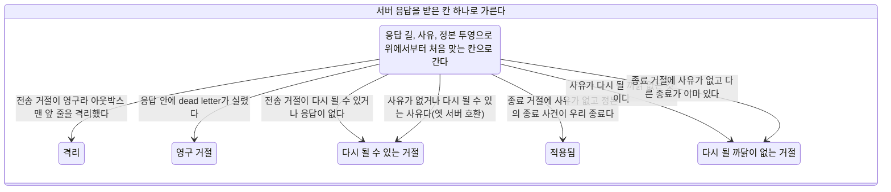
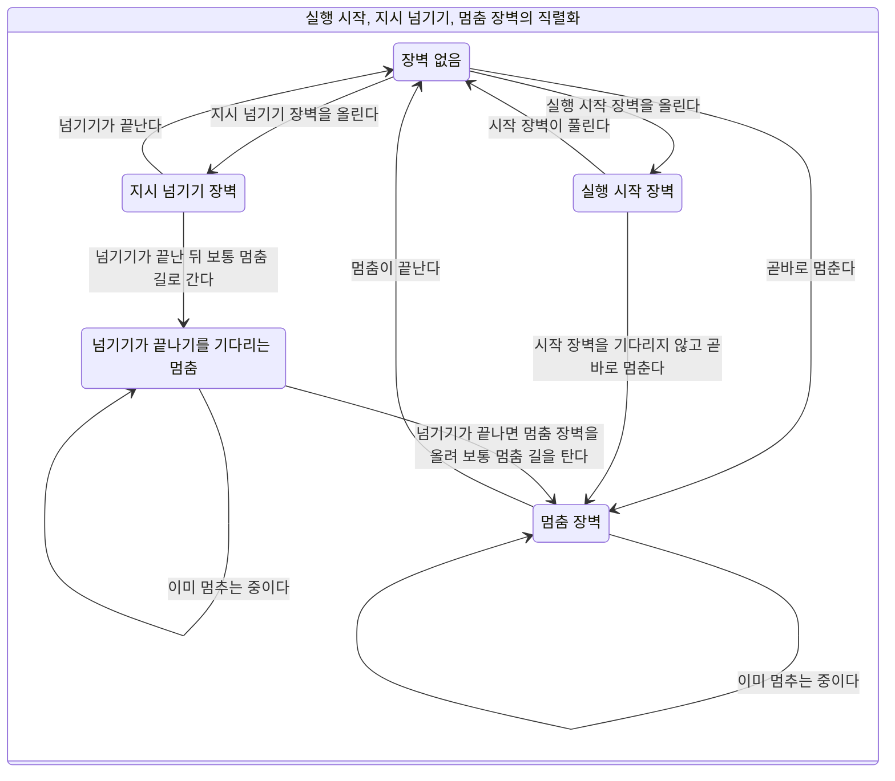

# 노드 상태

이 문서는 `soul-server-ts/src/task/state/`의 XState 정의에서 만든 생성물이다. 정의를 고치면 아래 명령으로 다시 만든다. 리포의 파일과 생성 결과가 다르면 시험이 실패한다.

멈춤 단위(카드 #1266 U4)가 장벽 직렬화 판정과 실행 상태 투영을 멈춤과 삭제 길에 이었다. 응답을 받은 칸은 종료 경로 단위가, 지시 경로는 지시 경로 단위가 운영 코드에 잇는다. 턴 고리 전체를 접지 않는다.

## 실행 상태

Task의 `status`, `runner`, `executionRegistration`, `runnerTerminalFact`, `runnerRetainedForDetachedWork`, `runnerReleaseClaim`, `hydratedFromDb`, `terminationEventRecorded`, `runnerIsOfflineReplay`, `executionActivation`, `executionPromise`에 흩어진 사실을 아래 상태 하나로 투영한다. 판정 순서는 표의 순서다. 응답을 기다리는 중인 상태(등록 대기, 잇기 대기)는 Task 필드에 보이지 않아 각각 `registering`, `replaying`으로 접힌다. 멈춤 장벽과 보유 종류는 Task에 표지가 없어 호출자가 입력으로 준다.

| 순서 | 상태 | 뜻 | 조건 |
| :-- | :-- | :-- | :-- |
| 1 | `retained_releasing` | 종료 뒤 러너 해제 중 | 종료가 기록됐고 러너 해제 청구가 걸려 있다 |
| 2 | `retained_claude_background` | 종료 뒤 클로드 백그라운드 작업 보유 | 종료가 기록됐고 클로드의 남은 백그라운드 작업이 러너를 쥐고 있다 |
| 3 | `retained_codex_command` | 종료 뒤 코덱스 남은 명령 보유 | 종료가 기록됐고 코덱스의 남은 명령이 러너를 쥐고 있다 |
| 4 | `stopping` | 멈추는 중 | 활성이고 멈춤 장벽이 올라 있다 |
| 5 | `hydrated_active` | 러너 없이 올린 활성 task | 러너도 실행 등록도 없이 DB에서 올린 활성 task다 |
| 6 | `starting` | 러너를 띄우는 중 | 활성이고 러너가 아직 없다 |
| 7 | `replaying` | 러너의 남은 기록을 올리는 중 | 붙은 러너가 기록을 다시 읽는 손잡이다 |
| 8 | `terminating` | 종료를 올리는 중 | 러너가 붙은 채 종료를 올렸거나 올리는 중이다 |
| 9 | `registering` | 실행 등록 응답을 기다리는 중 | 러너는 붙었고 실행 등록 응답을 아직 받지 못했다 |
| 10 | `running` | 러너가 턴을 도는 중 | 러너가 붙었고 등록이 적용됐다 |
| 11 | `idle` | 주인 없음 | 활성도 러너도 없다 |

## 응답을 받은 칸

서버 응답이 노드에 닿는 길은 다섯이고 호출은 일곱이다. 적용 응답(applied=true)은 이 칸을 거치지 않는다. 입력은 호출 종류, 응답 길, 와이어 사유, 거절된 등록이 지금 등록과 같은가, 정본 투영의 termination_event_id와 우리 종료의 관계, 중앙 세션 유무, 정상 보유 여부다. 출력은 적용됨이나 칸 넷 가운데 하나와 그 칸이 할 정리의 의도 목록이다.

입력 조합 7560가지 모두에 칸이 있으며 빈 칸은 없다. 사유 분류는 `task/state/node_adopt_rejection.ts`가 정본이고 already_terminal, session_missing, owner_node_changed가 다시 될 까닭 없는 사유다.

### 칸 결정표

같은 칸으로 모이는 입력은 한 줄로 접었다. 접은 줄은 모든 조합이 같은 칸을 내는지 문서를 만들 때 확인한다.

| 응답 길 | 호출 | 사유 | 정본의 종료 사건 | 칸 |
| :-- | :-- | :-- | :-- | :-- |
| 전송 거절(다시 될 수 있음) | 모든 호출 | 모든 사유 | 모든 경우 | 다시 될 수 있는 거절 |
| 전송 거절(영구라 격리) | 모든 호출 | 모든 사유 | 모든 경우 | 격리 |
| 응답 안의 dead letter | 모든 호출 | 모든 사유 | 모든 경우 | 영구 거절 |
| 응답 없음 | 모든 호출 | 모든 사유 | 모든 경우 | 다시 될 수 있는 거절 |
| applied=false와 거절 사유 | 종료 | already_terminal | 우리 종료와 같음 | 다시 될 까닭이 없는 거절 |
| applied=false와 거절 사유 | 종료 | already_terminal | 다른 종료 | 다시 될 까닭이 없는 거절 |
| applied=false와 거절 사유 | 종료 | already_terminal | 없음 | 다시 될 까닭이 없는 거절 |
| applied=false와 거절 사유 | 종료 밖의 여섯 호출 | already_terminal | 해당 없음 | 다시 될 까닭이 없는 거절 |
| applied=false와 거절 사유 | 종료 | session_missing | 우리 종료와 같음 | 다시 될 까닭이 없는 거절 |
| applied=false와 거절 사유 | 종료 | session_missing | 다른 종료 | 다시 될 까닭이 없는 거절 |
| applied=false와 거절 사유 | 종료 | session_missing | 없음 | 다시 될 까닭이 없는 거절 |
| applied=false와 거절 사유 | 종료 밖의 여섯 호출 | session_missing | 해당 없음 | 다시 될 까닭이 없는 거절 |
| applied=false와 거절 사유 | 종료 | owner_node_changed | 우리 종료와 같음 | 다시 될 까닭이 없는 거절 |
| applied=false와 거절 사유 | 종료 | owner_node_changed | 다른 종료 | 다시 될 까닭이 없는 거절 |
| applied=false와 거절 사유 | 종료 | owner_node_changed | 없음 | 다시 될 까닭이 없는 거절 |
| applied=false와 거절 사유 | 종료 밖의 여섯 호출 | owner_node_changed | 해당 없음 | 다시 될 까닭이 없는 거절 |
| applied=false와 거절 사유 | 종료 | worktree_busy | 우리 종료와 같음 | 다시 될 수 있는 거절 |
| applied=false와 거절 사유 | 종료 | worktree_busy | 다른 종료 | 다시 될 수 있는 거절 |
| applied=false와 거절 사유 | 종료 | worktree_busy | 없음 | 다시 될 수 있는 거절 |
| applied=false와 거절 사유 | 종료 밖의 여섯 호출 | worktree_busy | 해당 없음 | 다시 될 수 있는 거절 |
| applied=false와 거절 사유 | 종료 | worktree_not_ready | 우리 종료와 같음 | 다시 될 수 있는 거절 |
| applied=false와 거절 사유 | 종료 | worktree_not_ready | 다른 종료 | 다시 될 수 있는 거절 |
| applied=false와 거절 사유 | 종료 | worktree_not_ready | 없음 | 다시 될 수 있는 거절 |
| applied=false와 거절 사유 | 종료 밖의 여섯 호출 | worktree_not_ready | 해당 없음 | 다시 될 수 있는 거절 |
| applied=false와 거절 사유 | 종료 | 사유 없음 | 우리 종료와 같음 | 적용됨 |
| applied=false와 거절 사유 | 종료 | 사유 없음 | 다른 종료 | 다시 될 까닭이 없는 거절 |
| applied=false와 거절 사유 | 종료 | 사유 없음 | 없음 | 다시 될 수 있는 거절 |
| applied=false와 거절 사유 | 종료 밖의 여섯 호출 | 사유 없음 | 해당 없음 | 다시 될 수 있는 거절 |

### 정리 의도의 규칙

- 영구 거절과 격리의 정리는 거절된 그 등록과 그 실행 명령에만 건다. 중앙 상태를 오류로 덮는 의도는 이 둘의 종료 밖 호출에서만 나온다.
- owner_node_changed나 낡은 등록의 거절은 새 실행의 중앙 상태를 오류로 덮는 의도를 내지 않는다. 낡은 등록의 거절은 러너 거둠도 내지 않는다.
- 종료의 영구 거절, 격리, 다시 될 까닭이 없는 종료 거절은 완료 정산 미결 닫기와 거절된 그 러너 등록 은퇴를 함께 내고 같은 종료를 다시 올리는 의도를 내지 않는다.
- 중앙 세션 없음이 확인되면 로컬 소유 정리를 낸다. 받아 줄 세션이 없으므로 다시 시도하는 의도는 함께 내지 않는다.
- 사유 없는 거절은 옛 서버 호환으로 다시 될 수 있는 거절이다. 단 종료 거절에 사유가 없을 때 정본의 종료 사건이 우리 종료와 같으면 적용됨, 다른 종료가 이미 있으면 already_terminal 사유의 다시 될 까닭이 없는 거절이다.
- 정상 보유 중이면 러너 거둠 의도를 내지 않는다.

### 호출과 칸마다 기본 정리 의도

거절된 등록이 우리 등록이고 중앙 세션이 있고 정상 보유가 아닐 때다. 다시 될 까닭이 없는 거절의 사유는 already_terminal로 두었다.

| 호출 | 칸 | 정리 의도 |
| :-- | :-- | :-- |
| 실행 등록 | 다시 될 수 있는 거절 | 나중에 다시 시도 |
| 실행 등록 | 다시 될 까닭이 없는 거절 | 러너 거둠 |
| 실행 등록 | 영구 거절 | 중앙 상태를 오류로 덮음(거절된 그 등록과 실행 명령에만), 러너 거둠 |
| 실행 등록 | 격리 | 중앙 상태를 오류로 덮음(거절된 그 등록과 실행 명령에만), 러너 거둠 |
| 시동 복구 잇기 | 다시 될 수 있는 거절 | 나중에 다시 시도 |
| 시동 복구 잇기 | 다시 될 까닭이 없는 거절 | 러너 거둠 |
| 시동 복구 잇기 | 영구 거절 | 중앙 상태를 오류로 덮음(거절된 그 등록과 실행 명령에만), 러너 거둠 |
| 시동 복구 잇기 | 격리 | 중앙 상태를 오류로 덮음(거절된 그 등록과 실행 명령에만), 러너 거둠 |
| 붙은 러너 잇기 | 다시 될 수 있는 거절 | 나중에 다시 시도 |
| 붙은 러너 잇기 | 다시 될 까닭이 없는 거절 | 러너 거둠 |
| 붙은 러너 잇기 | 영구 거절 | 중앙 상태를 오류로 덮음(거절된 그 등록과 실행 명령에만), 러너 거둠 |
| 붙은 러너 잇기 | 격리 | 중앙 상태를 오류로 덮음(거절된 그 등록과 실행 명령에만), 러너 거둠 |
| 재개 | 다시 될 수 있는 거절 | 나중에 다시 시도 |
| 재개 | 다시 될 까닭이 없는 거절 | 이 시도를 그만둠 |
| 재개 | 영구 거절 | 이 시도를 그만둠, 중앙 상태를 오류로 덮음(거절된 그 등록과 실행 명령에만) |
| 재개 | 격리 | 이 시도를 그만둠, 중앙 상태를 오류로 덮음(거절된 그 등록과 실행 명령에만) |
| 재개 보정 종료 | 다시 될 수 있는 거절 | 나중에 다시 시도 |
| 재개 보정 종료 | 다시 될 까닭이 없는 거절 | 이 시도를 그만둠 |
| 재개 보정 종료 | 영구 거절 | 이 시도를 그만둠, 중앙 상태를 오류로 덮음(거절된 그 등록과 실행 명령에만) |
| 재개 보정 종료 | 격리 | 이 시도를 그만둠, 중앙 상태를 오류로 덮음(거절된 그 등록과 실행 명령에만) |
| 첫 메시지 | 다시 될 수 있는 거절 | 나중에 다시 시도 |
| 첫 메시지 | 다시 될 까닭이 없는 거절 | 이 시도를 그만둠 |
| 첫 메시지 | 영구 거절 | 이 시도를 그만둠, 중앙 상태를 오류로 덮음(거절된 그 등록과 실행 명령에만) |
| 첫 메시지 | 격리 | 이 시도를 그만둠, 중앙 상태를 오류로 덮음(거절된 그 등록과 실행 명령에만) |
| 종료 | 다시 될 수 있는 거절 | 같은 종료를 다시 올림 |
| 종료 | 다시 될 까닭이 없는 거절 | 완료 정산 미결 닫기, 거절된 그 러너 등록 은퇴 |
| 종료 | 영구 거절 | 완료 정산 미결 닫기, 거절된 그 러너 등록 은퇴 |
| 종료 | 격리 | 완료 정산 미결 닫기, 거절된 그 러너 등록 은퇴 |

### 규칙이 드러나는 입력

| 입력 | 칸 | 정리 의도 |
| :-- | :-- | :-- |
| 종료가 dead letter로 영구 거절됨 | 영구 거절 | 완료 정산 미결 닫기, 거절된 그 러너 등록 은퇴 |
| 종료가 사유 없이 거절됐고 정본의 종료 사건이 우리 종료 | 적용됨 | 없음 |
| 종료가 사유 없이 거절됐고 다른 종료가 이미 있음 | 다시 될 까닭이 없는 거절 | 완료 정산 미결 닫기, 거절된 그 러너 등록 은퇴 |
| 종료가 사유 없이 거절됐고 정본에 종료 사건이 없음(옛 서버) | 다시 될 수 있는 거절 | 같은 종료를 다시 올림 |
| 실행 등록이 dead letter로 영구 거절됨 | 영구 거절 | 중앙 상태를 오류로 덮음(거절된 그 등록과 실행 명령에만), 러너 거둠 |
| 실행 등록이 owner_node_changed로 영구 거절됨 | 영구 거절 | 러너 거둠 |
| 낡은 등록의 실행 등록이 영구 거절됨 | 영구 거절 | 없음 |
| 시동 복구 잇기가 owner_node_changed로 거절됨 | 다시 될 까닭이 없는 거절 | 러너 거둠 |
| 같은 거절인데 정상 보유 중 | 다시 될 까닭이 없는 거절 | 없음 |
| 붙은 러너 잇기가 worktree_busy로 거절됨 | 다시 될 수 있는 거절 | 나중에 다시 시도 |
| 붙은 러너 잇기가 사유 없이 거절됨(옛 서버) | 다시 될 수 있는 거절 | 나중에 다시 시도 |
| 첫 메시지가 격리됨 | 격리 | 이 시도를 그만둠, 중앙 상태를 오류로 덮음(거절된 그 등록과 실행 명령에만) |
| 종료 거절 뒤 중앙 세션 없음이 확인됨 | 다시 될 까닭이 없는 거절 | 완료 정산 미결 닫기, 거절된 그 러너 등록 은퇴, 로컬 소유 정리 |
| 다시 될 수 있는 거절인데 중앙 세션 없음이 확인됨 | 다시 될 수 있는 거절 | 로컬 소유 정리 |

## 바깥 요청 칸

실행 상태마다 멈춤, 지시, 삭제, 재개 요청의 처분이다. 괄호는 칸의 근거다. 설계는 설계가 정한 처분, 지금 동작은 지금 코드를 그대로 적은 것, 확인 못 함은 옛 결정표에서 확인 못 함이었거나 설계가 정하지 않아 뒤 단위가 코드로 닫을 칸이다. 러너 없이 올린 활성 task의 멈춤과 삭제는 SESSION_NOT_RUNNING 답이나 조용한 삭제가 아니라 종료 기록을 만드는 처분이다.

모든 실행 상태 11개와 요청 4개의 조합에 처분이 있으며 빈 칸은 없다.

| 실행 상태 | 멈춤 | 지시 | 삭제 | 재개 |
| :-- | :-- | :-- | :-- | :-- |
| 종료 뒤 러너 해제 중 | 실행 중이 아니라고 거절 (확인 못 함) | 대기 줄에 넣고 다시 띄움 (확인 못 함) | 줄을 지움 (확인 못 함) | 앞 일이 끝난 뒤 시작 (확인 못 함) |
| 종료 뒤 클로드 백그라운드 작업 보유 | 실행 중이 아니라고 거절 (확인 못 함) | 대기 줄에 넣고 다시 띄움 (확인 못 함) | 줄을 지움 (확인 못 함) | 보유한 러너로 새 실행 시작 (확인 못 함) |
| 종료 뒤 코덱스 남은 명령 보유 | 실행 중이 아니라고 거절 (확인 못 함) | 대기 줄에 넣고 다시 띄움 (확인 못 함) | 줄을 지움 (확인 못 함) | 앞 일이 끝난 뒤 시작 (확인 못 함) |
| 멈추는 중 | 앞선 멈춤에 붙음 (지금 동작) | 대기 줄에 넣고 다시 띄움 (지금 동작) | 멈춘 뒤 지움 (지금 동작) | 앞 일이 끝난 뒤 시작 (지금 동작) |
| 러너 없이 올린 활성 task | 러너 없이 종료 기록을 만듦 (지금 동작) | 대기 줄에 넣고 다시 띄움 (확인 못 함) | 종료 기록을 만든 뒤 지움 (지금 동작) | 새 실행 시작 (확인 못 함) |
| 러너를 띄우는 중 | 실행 중이 아니라고 거절 (지금 동작) | 시동이 끝날 때까지 붙듦 (지금 동작) | 줄을 지움 (지금 동작) | 진행 중인 시동에 붙음 (지금 동작) |
| 러너의 남은 기록을 올리는 중 | 러너에 멈춤 명령 후 멈춤으로 종료 (확인 못 함) | 엔진에 넣어 보고 안 되면 대기 줄 (확인 못 함) | 멈춘 뒤 지움 (지금 동작) | 러너가 붙어 있어 거절 (확인 못 함) |
| 종료를 올리는 중 | 실행 중이 아니라고 거절 (지금 동작) | 대기 줄에 넣고 다시 띄움 (지금 동작) | 줄을 지움 (지금 동작) | 앞 일이 끝난 뒤 시작 (지금 동작) |
| 실행 등록 응답을 기다리는 중 | 러너에 멈춤 명령 후 멈춤으로 종료 (확인 못 함) | 시동이 끝날 때까지 붙듦 (지금 동작) | 멈춘 뒤 지움 (지금 동작) | 진행 중인 시동에 붙음 (지금 동작) |
| 러너가 턴을 도는 중 | 러너에 멈춤 명령 후 멈춤으로 종료 (지금 동작) | 엔진에 넣어 보고 안 되면 대기 줄 (지금 동작) | 멈춘 뒤 지움 (지금 동작) | 러너가 붙어 있어 거절 (지금 동작) |
| 주인 없음 | 실행 중이 아니라고 거절 (지금 동작) | 대기 줄에 넣고 다시 띄움 (지금 동작) | 줄을 지움 (지금 동작) | 새 실행 시작 (지금 동작) |

## 장벽 직렬화

장벽 종류는 실행 시작, 지시 넘기기, 멈춤이다. 멈춤 요청이 앞선 장벽을 만나면 곧바로 멈춤, 넘기기가 끝난 뒤 보통 멈춤 길로, 이미 멈추는 중 가운데 하나를 받는다. 넘기기 장벽을 기다린 멈춤이 아무 일 없이 돌아가는 처분은 없다.

| 앞선 장벽 | 멈춤 요청의 처분 |
| :-- | :-- |
| 장벽 없음 | 곧바로 멈춤 |
| 실행 시작 장벽 | 곧바로 멈춤 |
| 지시 넘기기 장벽 | 넘기기가 끝난 뒤 보통 멈춤 길로 |
| 멈춤 장벽 | 이미 멈추는 중 |

장벽 종류: 실행 시작, 지시 넘기기, 멈춤.

| 장벽 | 사건 | 다음 장벽 | 멈춤 처분 | 뜻 |
| :-- | :-- | :-- | :-- | :-- |
| 장벽 없음 | START_BEGUN | 실행 시작 장벽 | - | 실행 시작 장벽을 올린다 |
| 장벽 없음 | HANDOFF_BEGUN | 지시 넘기기 장벽 | - | 지시 넘기기 장벽을 올린다 |
| 장벽 없음 | STOP_REQUESTED | 멈춤 장벽 | 곧바로 멈춤 | 곧바로 멈춘다 |
| 실행 시작 장벽 | START_RELEASED | 장벽 없음 | - | 시작 장벽이 풀린다 |
| 실행 시작 장벽 | STOP_REQUESTED | 멈춤 장벽 | 곧바로 멈춤 | 시작 장벽을 기다리지 않고 곧바로 멈춘다 |
| 지시 넘기기 장벽 | HANDOFF_RELEASED | 장벽 없음 | - | 넘기기가 끝난다 |
| 지시 넘기기 장벽 | STOP_REQUESTED | 넘기기를 기다리는 멈춤 | 넘기기가 끝난 뒤 보통 멈춤 길로 | 넘기기가 끝난 뒤 보통 멈춤 길로 간다 |
| 넘기기를 기다리는 멈춤 | HANDOFF_RELEASED | 멈춤 장벽 | - | 넘기기가 끝나면 멈춤 장벽을 올려 보통 멈춤 길을 탄다 |
| 넘기기를 기다리는 멈춤 | STOP_REQUESTED | 넘기기를 기다리는 멈춤 | 이미 멈추는 중 | 이미 멈추는 중이다 |
| 멈춤 장벽 | STOP_REQUESTED | 멈춤 장벽 | 이미 멈추는 중 | 이미 멈추는 중이다 |
| 멈춤 장벽 | STOP_DONE | 장벽 없음 | - | 멈춤이 끝난다 |

## 옛 결정표의 짐작 20칸

옛 노드 결정표(카드 #1218의 `charts/node-decision-table.md`)에서 코드를 끝까지 따라가지 못해 모형이 짐작으로 둔 20칸이다. 칸마다 지금 판정과 그 칸을 운영 코드로 닫을 단위를 적었다. 닫을 단위는 종료 경로, 지시 경로, 멈춤 가운데 하나다. 지금 판정은 이 문서의 정의가 내는 값이며 운영 코드의 동작이 이와 같다는 뜻이 아니다. 운영 코드로 닫는 일이 그 확인이다.

| 번호 | 옛 표 | 옛 실행 상태 | 기다리는 지시 | 노드가 보는 러너 | 투영 상태 | 지금 판정 | 닫을 단위 |
| :-- | :-- | :-- | :-- | :-- | :-- | :-- | :-- |
| 1 | C1 | 러너의 남은 기록을 서버에 올리는 중 | 없음 | 러너가 살아 있음 | 러너의 남은 기록을 올리는 중 | 엔진에 넣어 보고 안 되면 대기 줄 | 지시 경로 |
| 2 | C1 | 러너의 남은 기록을 서버에 올리는 중 | 없음 | 러너는 끝났거나 죽었고 기록이 남음 | 러너의 남은 기록을 올리는 중 | 엔진에 넣어 보고 안 되면 대기 줄 | 지시 경로 |
| 3 | C1 | 러너의 남은 기록을 서버에 올리는 중 | 쌓여 있음 | 러너가 살아 있음 | 러너의 남은 기록을 올리는 중 | 엔진에 넣어 보고 안 되면 대기 줄 | 지시 경로 |
| 4 | C1 | 러너의 남은 기록을 서버에 올리는 중 | 쌓여 있음 | 러너는 끝났거나 죽었고 기록이 남음 | 러너의 남은 기록을 올리는 중 | 엔진에 넣어 보고 안 되면 대기 줄 | 지시 경로 |
| 5 | C1 | 러너의 남은 기록을 서버에 올리는 중 | 러너에 넘기고 결과를 기다림 | 러너가 살아 있음 | 러너의 남은 기록을 올리는 중 | 엔진에 넣어 보고 안 되면 대기 줄 | 지시 경로 |
| 6 | C1 | 살아 있는 러너를 잇겠다고 알리고 응답을 기다림 | 없음 | 러너가 살아 있음 | 러너의 남은 기록을 올리는 중 | 엔진에 넣어 보고 안 되면 대기 줄 | 지시 경로 |
| 7 | C1 | 살아 있는 러너를 잇겠다고 알리고 응답을 기다림 | 쌓여 있음 | 러너가 살아 있음 | 러너의 남은 기록을 올리는 중 | 엔진에 넣어 보고 안 되면 대기 줄 | 지시 경로 |
| 8 | C2 | 실행 등록을 올리고 응답을 기다림 | 없음 | 러너가 살아 있음 | 실행 등록 응답을 기다리는 중 | 러너에 멈춤 명령 후 멈춤으로 종료 | 종료 경로 |
| 9 | C2 | 실행 등록을 올리고 응답을 기다림 | 없음 | 러너는 끝났거나 죽었고 기록이 남음 | 실행 등록 응답을 기다리는 중 | 러너에 멈춤 명령 후 멈춤으로 종료 | 종료 경로 |
| 10 | C2 | 실행 등록을 올리고 응답을 기다림 | 쌓여 있음 | 러너가 살아 있음 | 실행 등록 응답을 기다리는 중 | 러너에 멈춤 명령 후 멈춤으로 종료 | 종료 경로 |
| 11 | C2 | 실행 등록을 올리고 응답을 기다림 | 쌓여 있음 | 러너는 끝났거나 죽었고 기록이 남음 | 실행 등록 응답을 기다리는 중 | 러너에 멈춤 명령 후 멈춤으로 종료 | 종료 경로 |
| 12 | C2 | 러너의 남은 기록을 서버에 올리는 중 | 없음 | 러너가 살아 있음 | 러너의 남은 기록을 올리는 중 | 러너에 멈춤 명령 후 멈춤으로 종료 | 종료 경로 |
| 13 | C2 | 러너의 남은 기록을 서버에 올리는 중 | 없음 | 러너는 끝났거나 죽었고 기록이 남음 | 러너의 남은 기록을 올리는 중 | 러너에 멈춤 명령 후 멈춤으로 종료 | 종료 경로 |
| 14 | C2 | 러너의 남은 기록을 서버에 올리는 중 | 쌓여 있음 | 러너가 살아 있음 | 러너의 남은 기록을 올리는 중 | 러너에 멈춤 명령 후 멈춤으로 종료 | 종료 경로 |
| 15 | C2 | 러너의 남은 기록을 서버에 올리는 중 | 쌓여 있음 | 러너는 끝났거나 죽었고 기록이 남음 | 러너의 남은 기록을 올리는 중 | 러너에 멈춤 명령 후 멈춤으로 종료 | 종료 경로 |
| 16 | C2 | 러너의 남은 기록을 서버에 올리는 중 | 러너에 넘기고 결과를 기다림 | 러너가 살아 있음 | 러너의 남은 기록을 올리는 중 | 넘기기가 끝난 뒤 보통 멈춤 길로 | 멈춤 |
| 17 | C2 | 살아 있는 러너를 잇겠다고 알리고 응답을 기다림 | 없음 | 러너가 살아 있음 | 러너의 남은 기록을 올리는 중 | 러너에 멈춤 명령 후 멈춤으로 종료 | 종료 경로 |
| 18 | C2 | 살아 있는 러너를 잇겠다고 알리고 응답을 기다림 | 쌓여 있음 | 러너가 살아 있음 | 러너의 남은 기록을 올리는 중 | 러너에 멈춤 명령 후 멈춤으로 종료 | 종료 경로 |
| 19 | T3 | 주인 없음 | 쌓여 있음 | 러너가 살아 있음 | 주인 없음 | 다시 띄우기와 복구 훑기 가운데 어느 쪽이 먼저인지는 정의가 정하지 않는다. 처분: 대기 줄에 넣고 다시 띄움(남은 러너 등록의 복구 훑기와 겹침) | 지시 경로 |
| 20 | T3 | 주인 없음 | 쌓여 있음 | 러너는 끝났거나 죽었고 기록이 남음 | 주인 없음 | 다시 띄우기와 복구 훑기 가운데 어느 쪽이 먼저인지는 정의가 정하지 않는다. 처분: 대기 줄에 넣고 다시 띄움(남은 러너 등록의 복구 훑기와 겹침) | 지시 경로 |

## 그림

### 실행 상태 투영

```mermaid
stateDiagram-v2
direction TB
classDef breaks fill:#ffecee,stroke:#e72e3b,stroke-width:2px,color:#cd2834
classDef hole fill:#ffffff,stroke:#9a9a9a,stroke-dasharray:4 3
state "Task 필드의 사실을 노드 실행 상태 하나로 투영한다" as nodeExecution {
    direction TB
    state "사실을 받아 위에서부터 처음 맞는 실행 상태로 간다" as nodeExecution_project
    state "종료 뒤 러너를 해제하는 중" as nodeExecution_retained_releasing
    state "종료 뒤 클로드 백그라운드 작업 보유" as nodeExecution_retained_claude_background
    state "종료 뒤 코덱스 남은 명령 보유" as nodeExecution_retained_codex_command
    state "멈추는 중" as nodeExecution_stopping
    state "러너 없이 올린 활성 task" as nodeExecution_hydrated_active
    state "러너를 띄우는 중(러너 없음)" as nodeExecution_starting
    state "러너의 남은 기록을 올리는 중(오프라인 재생)" as nodeExecution_replaying
    state "종료를 올리는 중(러너 붙음)" as nodeExecution_terminating
    state "실행 등록 응답을 기다리는 중(러너 붙음)" as nodeExecution_registering
    state "러너가 턴을 도는 중" as nodeExecution_running
    state "주인 없음" as nodeExecution_idle
    nodeExecution_project --> nodeExecution_retained_releasing: 종료가 기록됐고 러너 해제 청구가 걸려 있다
    nodeExecution_project --> nodeExecution_retained_claude_background: 종료가 기록됐고 클로드의 남은 백그라운드 작업이 러너를 쥐고 있다
    nodeExecution_project --> nodeExecution_retained_codex_command: 종료가 기록됐고 코덱스의 남은 명령이 러너를 쥐고 있다
    nodeExecution_project --> nodeExecution_stopping: 활성이고 멈춤 장벽이 올라 있다
    nodeExecution_project --> nodeExecution_hydrated_active: 러너도 실행 등록도 없이 DB에서 올린 활성 task다
    nodeExecution_project --> nodeExecution_starting: 활성이고 러너가 아직 없다
    nodeExecution_project --> nodeExecution_replaying: 붙은 러너가 기록을 다시 읽는 손잡이다
    nodeExecution_project --> nodeExecution_terminating: 러너가 붙은 채 종료를 올렸거나 올리는 중이다
    nodeExecution_project --> nodeExecution_registering: 러너는 붙었고 실행 등록 응답을 아직 받지 못했다
    nodeExecution_project --> nodeExecution_running: 러너가 붙었고 등록이 적용됐다
    nodeExecution_project --> nodeExecution_idle: 활성도 러너도 없다
}
```



위에서부터 처음 맞는 상태로 간다. 전이 화살표 11개.

### 응답을 받은 칸



응답 길과 사유와 정본 투영으로 위에서부터 처음 맞는 칸으로 간다. 전이 화살표 7개.

### 장벽 직렬화



넘기기 장벽을 기다린 멈춤은 장벽이 풀리면 멈춤 장벽으로 올라 보통 멈춤 길을 탄다. 장벽을 지우고 돌아가는 화살표는 없다. 전이 화살표 11개.

## 다시 만들기

```bash
corepack pnpm@10.32.1 --dir soul-server-ts exec tsx scripts/node-state-charts.ts
```

응답을 받은 칸은 입력 7560가지, 바깥 요청 칸은 44칸, 짐작 칸은 20칸이다.
