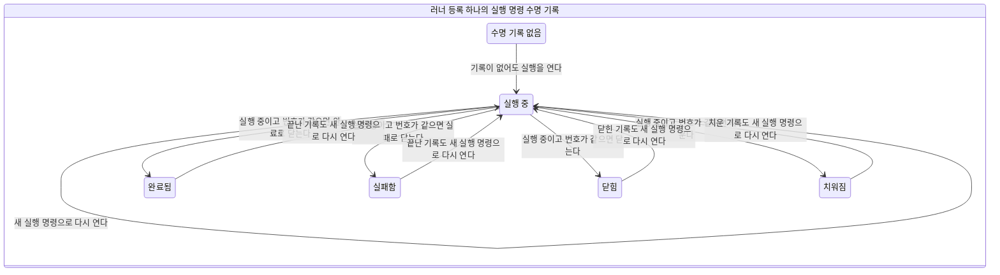
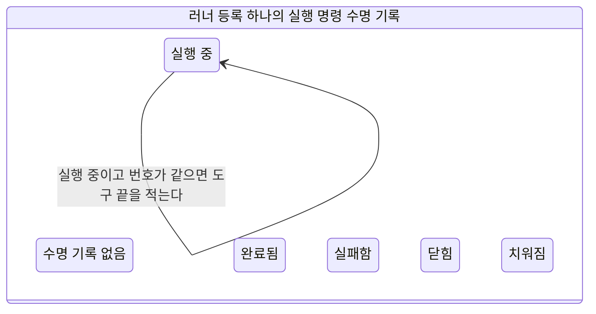

# 러너 수명 기록 상태

이 문서는 `soul-server-ts/src/runner/state/`의 XState 정의에서 만든 생성물이다. 정의를 고치면 아래 명령으로 다시 만든다. 리포의 파일과 생성 결과가 다르면 시험이 실패한다.

## 저장 상태

| 상태 | 저장 문자열 |
| :-- | :-- |
| 기록 없음 (NULL) | NULL |
| running | running |
| completed | completed |
| failed | failed |
| closed | closed |
| reaped | reaped |

## 수명 기록 결정표

상태, 걸음, 실행 명령 번호 일치의 모든 조합이다. 빈 칸은 없다. `begin`은 번호와 무관하게 어느 상태에서나 적용한다. 나머지 걸음은 running이고 번호가 같을 때만 적용한다. closed와 reaped에 온 늦은 끝남은 수명 기록을 바꾸지 않고 무시한다.

| 상태 | 걸음 | 번호 일치 | 판정 |
| :-- | :-- | :-- | :-- |
| 기록 없음 (NULL) | begin | 같음 | 적용 |
| 기록 없음 (NULL) | begin | 다름 | 적용 |
| 기록 없음 (NULL) | progress | 같음 | 거부 |
| 기록 없음 (NULL) | progress | 다름 | 거부 |
| 기록 없음 (NULL) | liveness | 같음 | 거부 |
| 기록 없음 (NULL) | liveness | 다름 | 거부 |
| 기록 없음 (NULL) | toolStarted | 같음 | 거부 |
| 기록 없음 (NULL) | toolStarted | 다름 | 거부 |
| 기록 없음 (NULL) | toolFinished | 같음 | 거부 |
| 기록 없음 (NULL) | toolFinished | 다름 | 거부 |
| 기록 없음 (NULL) | finish(completed) | 같음 | 거부 |
| 기록 없음 (NULL) | finish(completed) | 다름 | 거부 |
| 기록 없음 (NULL) | finish(failed) | 같음 | 거부 |
| 기록 없음 (NULL) | finish(failed) | 다름 | 거부 |
| 기록 없음 (NULL) | finish(closed) | 같음 | 거부 |
| 기록 없음 (NULL) | finish(closed) | 다름 | 거부 |
| 기록 없음 (NULL) | reap | 같음 | 거부 |
| 기록 없음 (NULL) | reap | 다름 | 거부 |
| running | begin | 같음 | 적용 |
| running | begin | 다름 | 적용 |
| running | progress | 같음 | 적용 |
| running | progress | 다름 | 거부 |
| running | liveness | 같음 | 적용 |
| running | liveness | 다름 | 거부 |
| running | toolStarted | 같음 | 적용 |
| running | toolStarted | 다름 | 거부 |
| running | toolFinished | 같음 | 적용 |
| running | toolFinished | 다름 | 거부 |
| running | finish(completed) | 같음 | 적용 |
| running | finish(completed) | 다름 | 거부 |
| running | finish(failed) | 같음 | 적용 |
| running | finish(failed) | 다름 | 거부 |
| running | finish(closed) | 같음 | 적용 |
| running | finish(closed) | 다름 | 거부 |
| running | reap | 같음 | 적용 |
| running | reap | 다름 | 거부 |
| completed | begin | 같음 | 적용 |
| completed | begin | 다름 | 적용 |
| completed | progress | 같음 | 거부 |
| completed | progress | 다름 | 거부 |
| completed | liveness | 같음 | 거부 |
| completed | liveness | 다름 | 거부 |
| completed | toolStarted | 같음 | 거부 |
| completed | toolStarted | 다름 | 거부 |
| completed | toolFinished | 같음 | 거부 |
| completed | toolFinished | 다름 | 거부 |
| completed | finish(completed) | 같음 | 거부 |
| completed | finish(completed) | 다름 | 거부 |
| completed | finish(failed) | 같음 | 거부 |
| completed | finish(failed) | 다름 | 거부 |
| completed | finish(closed) | 같음 | 거부 |
| completed | finish(closed) | 다름 | 거부 |
| completed | reap | 같음 | 거부 |
| completed | reap | 다름 | 거부 |
| failed | begin | 같음 | 적용 |
| failed | begin | 다름 | 적용 |
| failed | progress | 같음 | 거부 |
| failed | progress | 다름 | 거부 |
| failed | liveness | 같음 | 거부 |
| failed | liveness | 다름 | 거부 |
| failed | toolStarted | 같음 | 거부 |
| failed | toolStarted | 다름 | 거부 |
| failed | toolFinished | 같음 | 거부 |
| failed | toolFinished | 다름 | 거부 |
| failed | finish(completed) | 같음 | 거부 |
| failed | finish(completed) | 다름 | 거부 |
| failed | finish(failed) | 같음 | 거부 |
| failed | finish(failed) | 다름 | 거부 |
| failed | finish(closed) | 같음 | 거부 |
| failed | finish(closed) | 다름 | 거부 |
| failed | reap | 같음 | 거부 |
| failed | reap | 다름 | 거부 |
| closed | begin | 같음 | 적용 |
| closed | begin | 다름 | 적용 |
| closed | progress | 같음 | 거부 |
| closed | progress | 다름 | 거부 |
| closed | liveness | 같음 | 거부 |
| closed | liveness | 다름 | 거부 |
| closed | toolStarted | 같음 | 거부 |
| closed | toolStarted | 다름 | 거부 |
| closed | toolFinished | 같음 | 거부 |
| closed | toolFinished | 다름 | 거부 |
| closed | finish(completed) | 같음 | 무시 |
| closed | finish(completed) | 다름 | 거부 |
| closed | finish(failed) | 같음 | 무시 |
| closed | finish(failed) | 다름 | 거부 |
| closed | finish(closed) | 같음 | 무시 |
| closed | finish(closed) | 다름 | 거부 |
| closed | reap | 같음 | 거부 |
| closed | reap | 다름 | 거부 |
| reaped | begin | 같음 | 적용 |
| reaped | begin | 다름 | 적용 |
| reaped | progress | 같음 | 거부 |
| reaped | progress | 다름 | 거부 |
| reaped | liveness | 같음 | 거부 |
| reaped | liveness | 다름 | 거부 |
| reaped | toolStarted | 같음 | 거부 |
| reaped | toolStarted | 다름 | 거부 |
| reaped | toolFinished | 같음 | 거부 |
| reaped | toolFinished | 다름 | 거부 |
| reaped | finish(completed) | 같음 | 무시 |
| reaped | finish(completed) | 다름 | 거부 |
| reaped | finish(failed) | 같음 | 무시 |
| reaped | finish(failed) | 다름 | 거부 |
| reaped | finish(closed) | 같음 | 무시 |
| reaped | finish(closed) | 다름 | 거부 |
| reaped | reap | 같음 | 거부 |
| reaped | reap | 다름 | 거부 |

## 복구 가름 결정표

은퇴 표시, 수명 상태, pid 생존, 부트스트랩 임대 경과의 모든 조합이다. 판정 순서는 은퇴, 치워짐, 닫힘, 기록 없음, 끝남, 실행 중 순이다.

| 은퇴 표시 | 수명 상태 | pid 생존 | 임대 경과 | 판정 |
| :-- | :-- | :-- | :-- | :-- |
| 없음 | 기록 없음 (NULL) | 죽음 | 남음 | wait_for_bootstrap |
| 없음 | 기록 없음 (NULL) | 죽음 | 지남 | reap_dead |
| 없음 | 기록 없음 (NULL) | 살아 있음 | 남음 | adopt_prebootstrap |
| 없음 | 기록 없음 (NULL) | 살아 있음 | 지남 | adopt_prebootstrap |
| 없음 | running | 죽음 | 남음 | reap_dead |
| 없음 | running | 죽음 | 지남 | reap_dead |
| 없음 | running | 살아 있음 | 남음 | adopt_running |
| 없음 | running | 살아 있음 | 지남 | adopt_running |
| 없음 | completed | 죽음 | 남음 | replay_terminal_dead |
| 없음 | completed | 죽음 | 지남 | replay_terminal_dead |
| 없음 | completed | 살아 있음 | 남음 | replay_terminal |
| 없음 | completed | 살아 있음 | 지남 | replay_terminal |
| 없음 | failed | 죽음 | 남음 | replay_terminal_dead |
| 없음 | failed | 죽음 | 지남 | replay_terminal_dead |
| 없음 | failed | 살아 있음 | 남음 | replay_terminal |
| 없음 | failed | 살아 있음 | 지남 | replay_terminal |
| 없음 | closed | 죽음 | 남음 | closed |
| 없음 | closed | 죽음 | 지남 | closed |
| 없음 | closed | 살아 있음 | 남음 | closed |
| 없음 | closed | 살아 있음 | 지남 | closed |
| 없음 | reaped | 죽음 | 남음 | already_reaped |
| 없음 | reaped | 죽음 | 지남 | already_reaped |
| 없음 | reaped | 살아 있음 | 남음 | already_reaped |
| 없음 | reaped | 살아 있음 | 지남 | already_reaped |
| 있음 | 기록 없음 (NULL) | 죽음 | 남음 | retired_terminal |
| 있음 | 기록 없음 (NULL) | 죽음 | 지남 | retired_terminal |
| 있음 | 기록 없음 (NULL) | 살아 있음 | 남음 | retired_terminal |
| 있음 | 기록 없음 (NULL) | 살아 있음 | 지남 | retired_terminal |
| 있음 | running | 죽음 | 남음 | retired_terminal |
| 있음 | running | 죽음 | 지남 | retired_terminal |
| 있음 | running | 살아 있음 | 남음 | retired_terminal |
| 있음 | running | 살아 있음 | 지남 | retired_terminal |
| 있음 | completed | 죽음 | 남음 | retired_terminal |
| 있음 | completed | 죽음 | 지남 | retired_terminal |
| 있음 | completed | 살아 있음 | 남음 | retired_terminal |
| 있음 | completed | 살아 있음 | 지남 | retired_terminal |
| 있음 | failed | 죽음 | 남음 | retired_terminal |
| 있음 | failed | 죽음 | 지남 | retired_terminal |
| 있음 | failed | 살아 있음 | 남음 | retired_terminal |
| 있음 | failed | 살아 있음 | 지남 | retired_terminal |
| 있음 | closed | 죽음 | 남음 | retired_terminal |
| 있음 | closed | 죽음 | 지남 | retired_terminal |
| 있음 | closed | 살아 있음 | 남음 | retired_terminal |
| 있음 | closed | 살아 있음 | 지남 | retired_terminal |
| 있음 | reaped | 죽음 | 남음 | retired_terminal |
| 있음 | reaped | 죽음 | 지남 | retired_terminal |
| 있음 | reaped | 살아 있음 | 남음 | retired_terminal |
| 있음 | reaped | 살아 있음 | 지남 | retired_terminal |

## 그림

### 수명 기록 전이



begin은 어느 상태에서나 running으로 다시 연다. 끝남과 치우기는 running에서만 적용된다. 전이 화살표 10개.

### 실행 중 관찰



진행, 생존, 도구 시작과 끝은 running이고 실행 명령 번호가 같을 때만 적는다. 전이 화살표 4개.

## 다시 만들기

```bash
corepack pnpm@10.32.1 --dir soul-server-ts exec tsx scripts/runner-state-charts.ts
```

결정표는 수명 기록 108행, 복구 가름 48행이다. 복구 판정 값은 wait_for_bootstrap, adopt_prebootstrap, adopt_running, replay_terminal, replay_terminal_dead, retired_terminal, reap_dead, already_reaped, closed다.
