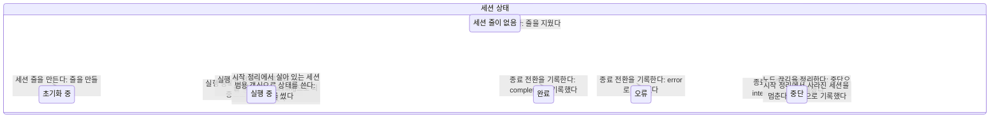
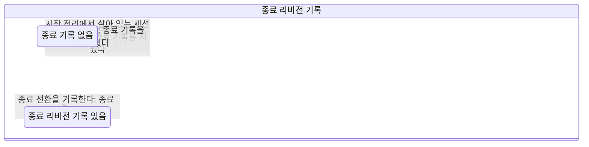
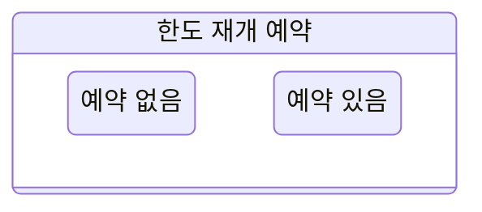

# 세션 상태 결정 규칙

이 문서는 세션 결정 기계와 시험 세계에서 만든 생성물이다. 동작 기준 커밋은 4df27484이다. 저장 칸, SQL 함수, 판정 함수가 실제로 가르는 것만 사실로 두고 그림과 표와 검사를 함께 생성한다.

세션 하나는 한 줄이다. 상태, 종료 리비전 기록, 검수 상태가 저장 영역이고 한도 재개 예약은 이번 물결에서 읽기 전용 투영이다. 연결 여부, 워크트리 준비, 노드 보고는 저장 영역이 아니라 판정 사실이다.

결정표 544줄. 모든 명령이 모든 표 상태 값에서 판정을 낸다. 빈 칸은 없다.

## 저장 상태 값

| 상태 | status | termination_event_id | review_state |
| :-- | :-- | :-- | :-- |
| 줄 없음 | null | null | not_required |
| 초기화 중 | initializing | null | not_required |
| 초기화 중 · 종료 기록 있음 | initializing | 1 | not_required |
| 실행 중 · 검수 확인 | running | null | acknowledged |
| 실행 중 · 종료 기록 있음 | running | 1 | not_required |
| 완료 · 종료 기록 있음 · 검수 대기 | completed | 1 | needs_review |
| 오류 · 종료 기록 있음 · 검수 대기 | error | 1 | needs_review |
| 중단 · 검수 대기 | interrupted | null | needs_review |
| 중단 · 종료 기록 있음 · 검수 대기 | interrupted | 1 | needs_review |

종료 리비전 기록은 값이 아니라 사실이다. 실제 종료 사건 번호는 명령이 나르며 기계는 번호를 저장하지 않는다. 검수 칸은 검수 필요 여부와 별개 칸이라 같은 상태에서도 세 값이 모두 가능하다.

## 그림

### status 세션 상태



상태를 옮기는 명령만 보인다. 같은 상태로 다시 쓰는 전이는 화살표가 생기지 않는다. 전이 화살표 11개.

### termination 종료 리비전 기록



종료 리비전을 쓰거나 지우는 명령만 보인다. 실행 등록과 실행 중 전환은 종료 재개일 때만 기록을 지운다. 전이 화살표 5개.

### review 검수 상태

```mermaid
stateDiagram-v2
direction TB
classDef breaks fill:#ffecee,stroke:#e72e3b,stroke-width:2px,color:#cd2834
classDef hole fill:#ffffff,stroke:#9a9a9a,stroke-dasharray:4 3
state "검수 상태" as sessionReview {
    direction TB
    state "검수 불필요" as r_not_required
    state "검수 대기" as r_needs_review
    state "검수 확인" as r_acknowledged
}
sessionReview --> r_not_required: 세션 줄을 만든다: not_required로 썼다
sessionReview --> r_needs_review: 세션 줄을 만든다: needs_review로 썼다
sessionReview --> r_acknowledged: 세션 줄을 만든다: acknowledged로 썼다
sessionReview --> r_not_required: 실행 등록을 기록한다: not_required로 썼다
sessionReview --> r_needs_review: 실행 등록을 기록한다: needs_review로 썼다
sessionReview --> r_acknowledged: 실행 등록을 기록한다: acknowledged로 썼다
sessionReview --> r_not_required: 실행 중 전환을 기록한다: not_required로 썼다
sessionReview --> r_needs_review: 실행 중 전환을 기록한다: needs_review로 썼다
sessionReview --> r_acknowledged: 실행 중 전환을 기록한다: acknowledged로 썼다
sessionReview --> r_not_required: 종료 전환을 기록한다: not_required로 썼다
sessionReview --> r_needs_review: 종료 전환을 기록한다: needs_review로 썼다
sessionReview --> r_acknowledged: 종료 전환을 기록한다: acknowledged로 썼다
sessionReview --> r_not_required: 노드 끊김을 정리한다: not_required로 썼다
sessionReview --> r_needs_review: 노드 끊김을 정리한다: needs_review로 썼다
sessionReview --> r_acknowledged: 노드 끊김을 정리한다: acknowledged로 썼다
sessionReview --> r_not_required: 시작 정리에서 사라진 세션을 멈춘다: not_required로 썼다
sessionReview --> r_needs_review: 시작 정리에서 사라진 세션을 멈춘다: needs_review로 썼다
sessionReview --> r_acknowledged: 시작 정리에서 사라진 세션을 멈춘다: acknowledged로 썼다
sessionReview --> r_not_required: 시작 정리에서 살아 있는 세션을 되살린다: 검수 불필요로 되돌렸다
sessionReview --> r_acknowledged: 검수를 확인한다: 검수를 확인했다
sessionReview --> r_not_required: 세션을 지운다: 검수 칸을 지웠다
```



검수 칸을 쓰는 명령만 보인다. 검수 확인은 needs_review에서만 acknowledged로 쓴다. 전이 화살표 21개.

### reservation 한도 재개 예약



이번 물결에는 예약을 쓰는 명령이 없다. 예약 영역은 읽기 전용 투영이다. 전이 화살표 0개.

## 명령

| 명령 | 하는 일 |
| :-- | :-- |
| 세션 줄을 만든다 | 같은 세션 줄이 없을 때 새 줄을 만든다. 상태와 검수 칸은 등록 입력이 정하며, 만든 뒤에는 initializing이다. |
| 실행 등록을 기록한다 | 세션 줄을 잠그고 실행 등록을 적는다. 사건을 보낸 노드가 소유 노드와 다르면 거절한다. 워크트리가 있으면 준비 상태와 다른 활성 세션 점유를 먼저 본다. 종료 재개면 기대한 종료 리비전이 같을 때만 running으로 되살리고 종료 칸을 지운다. 재개가 아니면 종료 상태가 아닌 줄만 running으로 옮기며 종료 사유와 설명은 지우되 종료 리비전은 남긴다. |
| 실행 중 전환을 기록한다 | 실행 등록과 같은 소유 노드 검사, 워크트리 게이트, 종료 재개 규칙을 쓴다. 등록 id는 쓰지 않고 상태와 검수 칸만 고친다. 잇기(전이 id가 adopt:로 시작)는 종료 기록이 없는 끊김 중단만 되살리고, 이미 끝난 세션이면 거절한다. |
| 종료 전환을 기록한다 | 사건을 보낸 노드가 소유 노드와 다르면 거절한다. 기대한 종료 사건 번호가 양수일 때만 쓴다. 이미 완료나 오류로 끝난 줄, 종료 리비전이 기록된 중단 줄은 건드리지 않는다. 기존 종료 리비전이 없거나 새 사건 번호보다 작을 때만 종료 상태와 사유, 검수 칸, 마지막 발화를 적는다. |
| 노드 끊김을 정리한다 | 노드가 실행 중이던 세션을 끊김으로 정리한다. 이 노드의 initializing이나 running 줄만 interrupted로 옮기고 종료 사유를 killed, 검수 칸을 review_required에 따라 정한다. 종료 리비전 칸은 건드리지 않는다. |
| 시작 정리에서 사라진 세션을 멈춘다 | 시작 시점에 잡아 둔 대상과 지금 줄이 같고, 노드의 실행 목록에 없으며, 아직 활성인 줄만 interrupted로 옮긴다. 줄과 대상의 종료 칸과 실행 id가 다르면 건드리지 않는다. 종료 리비전 칸은 건드리지 않는다. |
| 시작 정리에서 살아 있는 세션을 되살린다 | 끊김 종료가 리비전 없이 기록된 줄을 노드가 실행 중이라고 보고하고 워크트리가 준비됐을 때만 running으로 되살린다. 종료 칸을 지우고 검수 칸을 not_required로 둔다. |
| 옛 실행 등록 사건을 막는다 | 세션 줄이 없으면 예외를 던진다. 사건의 실행 등록 id가 세션의 현재 등록과 다르면 사건을 적용하지 않고 dead-letter로 보낸다. 저장 상태는 바꾸지 않는다. |
| 범용 갱신으로 상태를 쓴다 | session_update의 허용 열에 status가 있어 상태를 그대로 쓸 수 있다. 다른 상태 칸과 종료 칸은 건드리지 않는다. 종료 세션을 running으로 되살리는 길이 열려 있는 알려진 구멍이다. |
| 검수를 확인한다 | 잠근 줄의 review_required와 review_state를 읽어 not_found, not_required, already_acknowledged, not_pending, acknowledged 가운데 하나를 낸다. needs_review일 때만 acknowledged로 쓴다. |
| 세션을 지운다 | 노드가 붙어 있으면 상태와 무관하게 노드에 삭제를 보낸다. 노드가 거절하면 409, 응답을 기다리는 중이면 accepted, 노드가 못 지우거나 옛 판이면 활성 세션만 409로 막고 끝난 세션은 orch가 직접 지운다. |
| 한도 재개 예약을 판정한다 | 예약에 적힌 종료 리비전, 노드의 지역 작업 상태, 세션 줄, 한도 창과 종료 사슬을 차례로 본다. 모두 통과할 때만 깨우고, 지역 작업이 바쁘면 미루며, 나머지는 예약을 닫는다. 저장 상태는 바꾸지 않는다. |

## 결정표

상태 칸은 저장 상태 값, 사실 칸은 그 명령이 읽는 환경과 입력이다. 판정이 적용이 아니면 저장 상태는 그대로다.

| 상태 | 사실 | 판정 | 사유 | 다음 상태 |
| :-- | :-- | :-- | :-- | :-- |
| 줄 없음 | 없음 | 적용 | 세션 줄을 만들었다 | 초기화 중 |
| 초기화 중 | 없음 | 거절 | 같은 세션 줄이 이미 있다 | 그대로 |
| 초기화 중 · 종료 기록 있음 | 없음 | 거절 | 같은 세션 줄이 이미 있다 | 그대로 |
| 실행 중 · 검수 확인 | 없음 | 거절 | 같은 세션 줄이 이미 있다 | 그대로 |
| 실행 중 · 종료 기록 있음 | 없음 | 거절 | 같은 세션 줄이 이미 있다 | 그대로 |
| 완료 · 종료 기록 있음 · 검수 대기 | 없음 | 거절 | 같은 세션 줄이 이미 있다 | 그대로 |
| 오류 · 종료 기록 있음 · 검수 대기 | 없음 | 거절 | 같은 세션 줄이 이미 있다 | 그대로 |
| 중단 · 검수 대기 | 없음 | 거절 | 같은 세션 줄이 이미 있다 | 그대로 |
| 중단 · 종료 기록 있음 · 검수 대기 | 없음 | 거절 | 같은 세션 줄이 이미 있다 | 그대로 |
| 줄 없음 | resume=새 실행<br>worktree=워크트리 없음<br>worktreeBusy=점유 없음<br>owner=소유 노드와 같음 | 거절 | 세션 줄이 없다 | 그대로 |
| 줄 없음 | resume=종료 재개, 리비전 일치<br>worktree=워크트리 없음<br>worktreeBusy=점유 없음<br>owner=소유 노드와 같음 | 거절 | 세션 줄이 없다 | 그대로 |
| 줄 없음 | resume=종료 재개, 리비전 불일치<br>worktree=워크트리 없음<br>worktreeBusy=점유 없음<br>owner=소유 노드와 같음 | 거절 | 세션 줄이 없다 | 그대로 |
| 줄 없음 | resume=새 실행<br>worktree=워크트리 없음<br>worktreeBusy=점유 없음<br>owner=소유 노드와 다름 | 거절 | 세션 줄이 없다 | 그대로 |
| 초기화 중 | resume=새 실행<br>worktree=워크트리 없음<br>worktreeBusy=점유 없음<br>owner=소유 노드와 같음 | 적용 | 실행 등록을 기록하고 실행 중으로 옮겼다 | 실행 중 · 검수 대기 |
| 초기화 중 | resume=새 실행<br>worktree=준비됨<br>worktreeBusy=점유 없음<br>owner=소유 노드와 같음 | 적용 | 실행 등록을 기록하고 실행 중으로 옮겼다 | 실행 중 · 검수 대기 |
| 초기화 중 | resume=새 실행<br>worktree=준비 안 됨<br>worktreeBusy=점유 없음<br>owner=소유 노드와 같음 | 거절 | 워크트리 줄이 없거나 준비되지 않았거나 설치가 필요하다 | 그대로 |
| 초기화 중 | resume=새 실행<br>worktree=설치 필요<br>worktreeBusy=점유 없음<br>owner=소유 노드와 같음 | 거절 | 워크트리 줄이 없거나 준비되지 않았거나 설치가 필요하다 | 그대로 |
| 초기화 중 | resume=종료 재개, 리비전 일치<br>worktree=워크트리 없음<br>worktreeBusy=점유 없음<br>owner=소유 노드와 같음 | 거절 | 종료 재개인데 세션이 종료 상태가 아니다 | 그대로 |
| 초기화 중 | resume=종료 재개, 리비전 일치<br>worktree=준비됨<br>worktreeBusy=점유 없음<br>owner=소유 노드와 같음 | 거절 | 종료 재개인데 세션이 종료 상태가 아니다 | 그대로 |
| 초기화 중 | resume=종료 재개, 리비전 일치<br>worktree=준비 안 됨<br>worktreeBusy=점유 없음<br>owner=소유 노드와 같음 | 거절 | 워크트리 줄이 없거나 준비되지 않았거나 설치가 필요하다 | 그대로 |
| 초기화 중 | resume=종료 재개, 리비전 일치<br>worktree=설치 필요<br>worktreeBusy=점유 없음<br>owner=소유 노드와 같음 | 거절 | 워크트리 줄이 없거나 준비되지 않았거나 설치가 필요하다 | 그대로 |
| 초기화 중 | resume=종료 재개, 리비전 불일치<br>worktree=워크트리 없음<br>worktreeBusy=점유 없음<br>owner=소유 노드와 같음 | 거절 | 종료 재개인데 세션이 종료 상태가 아니다 | 그대로 |
| 초기화 중 | resume=종료 재개, 리비전 불일치<br>worktree=준비됨<br>worktreeBusy=점유 없음<br>owner=소유 노드와 같음 | 거절 | 종료 재개인데 세션이 종료 상태가 아니다 | 그대로 |
| 초기화 중 | resume=종료 재개, 리비전 불일치<br>worktree=준비 안 됨<br>worktreeBusy=점유 없음<br>owner=소유 노드와 같음 | 거절 | 워크트리 줄이 없거나 준비되지 않았거나 설치가 필요하다 | 그대로 |
| 초기화 중 | resume=종료 재개, 리비전 불일치<br>worktree=설치 필요<br>worktreeBusy=점유 없음<br>owner=소유 노드와 같음 | 거절 | 워크트리 줄이 없거나 준비되지 않았거나 설치가 필요하다 | 그대로 |
| 초기화 중 | resume=새 실행<br>worktree=준비됨<br>worktreeBusy=점유 없음<br>owner=소유 노드와 다름 | 거절 | 사건을 보낸 노드가 세션의 소유 노드와 다르다 | 그대로 |
| 초기화 중 · 종료 기록 있음 | resume=새 실행<br>worktree=워크트리 없음<br>worktreeBusy=점유 없음<br>owner=소유 노드와 같음 | 적용 | 실행 등록을 기록하고 실행 중으로 옮겼다 | 실행 중 · 종료 기록 있음 · 검수 대기 |
| 초기화 중 · 종료 기록 있음 | resume=새 실행<br>worktree=준비됨<br>worktreeBusy=점유 없음<br>owner=소유 노드와 같음 | 적용 | 실행 등록을 기록하고 실행 중으로 옮겼다 | 실행 중 · 종료 기록 있음 · 검수 대기 |
| 초기화 중 · 종료 기록 있음 | resume=새 실행<br>worktree=준비 안 됨<br>worktreeBusy=점유 없음<br>owner=소유 노드와 같음 | 거절 | 워크트리 줄이 없거나 준비되지 않았거나 설치가 필요하다 | 그대로 |
| 초기화 중 · 종료 기록 있음 | resume=새 실행<br>worktree=설치 필요<br>worktreeBusy=점유 없음<br>owner=소유 노드와 같음 | 거절 | 워크트리 줄이 없거나 준비되지 않았거나 설치가 필요하다 | 그대로 |
| 초기화 중 · 종료 기록 있음 | resume=종료 재개, 리비전 일치<br>worktree=워크트리 없음<br>worktreeBusy=점유 없음<br>owner=소유 노드와 같음 | 거절 | 종료 재개인데 세션이 종료 상태가 아니다 | 그대로 |
| 초기화 중 · 종료 기록 있음 | resume=종료 재개, 리비전 일치<br>worktree=준비됨<br>worktreeBusy=점유 없음<br>owner=소유 노드와 같음 | 거절 | 종료 재개인데 세션이 종료 상태가 아니다 | 그대로 |
| 초기화 중 · 종료 기록 있음 | resume=종료 재개, 리비전 일치<br>worktree=준비 안 됨<br>worktreeBusy=점유 없음<br>owner=소유 노드와 같음 | 거절 | 워크트리 줄이 없거나 준비되지 않았거나 설치가 필요하다 | 그대로 |
| 초기화 중 · 종료 기록 있음 | resume=종료 재개, 리비전 일치<br>worktree=설치 필요<br>worktreeBusy=점유 없음<br>owner=소유 노드와 같음 | 거절 | 워크트리 줄이 없거나 준비되지 않았거나 설치가 필요하다 | 그대로 |
| 초기화 중 · 종료 기록 있음 | resume=종료 재개, 리비전 불일치<br>worktree=워크트리 없음<br>worktreeBusy=점유 없음<br>owner=소유 노드와 같음 | 거절 | 종료 재개인데 세션이 종료 상태가 아니다 | 그대로 |
| 초기화 중 · 종료 기록 있음 | resume=종료 재개, 리비전 불일치<br>worktree=준비됨<br>worktreeBusy=점유 없음<br>owner=소유 노드와 같음 | 거절 | 종료 재개인데 세션이 종료 상태가 아니다 | 그대로 |
| 초기화 중 · 종료 기록 있음 | resume=종료 재개, 리비전 불일치<br>worktree=준비 안 됨<br>worktreeBusy=점유 없음<br>owner=소유 노드와 같음 | 거절 | 워크트리 줄이 없거나 준비되지 않았거나 설치가 필요하다 | 그대로 |
| 초기화 중 · 종료 기록 있음 | resume=종료 재개, 리비전 불일치<br>worktree=설치 필요<br>worktreeBusy=점유 없음<br>owner=소유 노드와 같음 | 거절 | 워크트리 줄이 없거나 준비되지 않았거나 설치가 필요하다 | 그대로 |
| 초기화 중 · 종료 기록 있음 | resume=종료 재개, 리비전 일치<br>worktree=준비됨<br>worktreeBusy=점유 없음<br>owner=소유 노드와 다름 | 거절 | 사건을 보낸 노드가 세션의 소유 노드와 다르다 | 그대로 |
| 실행 중 · 검수 확인 | resume=새 실행<br>worktree=워크트리 없음<br>worktreeBusy=점유 없음<br>owner=소유 노드와 같음 | 적용 | 실행 등록을 기록하고 실행 중으로 옮겼다 | 실행 중 · 검수 대기 |
| 실행 중 · 검수 확인 | resume=새 실행<br>worktree=준비됨<br>worktreeBusy=점유 없음<br>owner=소유 노드와 같음 | 적용 | 실행 등록을 기록하고 실행 중으로 옮겼다 | 실행 중 · 검수 대기 |
| 실행 중 · 검수 확인 | resume=새 실행<br>worktree=준비 안 됨<br>worktreeBusy=점유 없음<br>owner=소유 노드와 같음 | 거절 | 워크트리 줄이 없거나 준비되지 않았거나 설치가 필요하다 | 그대로 |
| 실행 중 · 검수 확인 | resume=새 실행<br>worktree=설치 필요<br>worktreeBusy=점유 없음<br>owner=소유 노드와 같음 | 거절 | 워크트리 줄이 없거나 준비되지 않았거나 설치가 필요하다 | 그대로 |
| 실행 중 · 검수 확인 | resume=종료 재개, 리비전 일치<br>worktree=워크트리 없음<br>worktreeBusy=점유 없음<br>owner=소유 노드와 같음 | 거절 | 종료 재개인데 세션이 종료 상태가 아니다 | 그대로 |
| 실행 중 · 검수 확인 | resume=종료 재개, 리비전 일치<br>worktree=준비됨<br>worktreeBusy=점유 없음<br>owner=소유 노드와 같음 | 거절 | 종료 재개인데 세션이 종료 상태가 아니다 | 그대로 |
| 실행 중 · 검수 확인 | resume=종료 재개, 리비전 일치<br>worktree=준비 안 됨<br>worktreeBusy=점유 없음<br>owner=소유 노드와 같음 | 거절 | 워크트리 줄이 없거나 준비되지 않았거나 설치가 필요하다 | 그대로 |
| 실행 중 · 검수 확인 | resume=종료 재개, 리비전 일치<br>worktree=설치 필요<br>worktreeBusy=점유 없음<br>owner=소유 노드와 같음 | 거절 | 워크트리 줄이 없거나 준비되지 않았거나 설치가 필요하다 | 그대로 |
| 실행 중 · 검수 확인 | resume=종료 재개, 리비전 불일치<br>worktree=워크트리 없음<br>worktreeBusy=점유 없음<br>owner=소유 노드와 같음 | 거절 | 종료 재개인데 세션이 종료 상태가 아니다 | 그대로 |
| 실행 중 · 검수 확인 | resume=종료 재개, 리비전 불일치<br>worktree=준비됨<br>worktreeBusy=점유 없음<br>owner=소유 노드와 같음 | 거절 | 종료 재개인데 세션이 종료 상태가 아니다 | 그대로 |
| 실행 중 · 검수 확인 | resume=종료 재개, 리비전 불일치<br>worktree=준비 안 됨<br>worktreeBusy=점유 없음<br>owner=소유 노드와 같음 | 거절 | 워크트리 줄이 없거나 준비되지 않았거나 설치가 필요하다 | 그대로 |
| 실행 중 · 검수 확인 | resume=종료 재개, 리비전 불일치<br>worktree=설치 필요<br>worktreeBusy=점유 없음<br>owner=소유 노드와 같음 | 거절 | 워크트리 줄이 없거나 준비되지 않았거나 설치가 필요하다 | 그대로 |
| 실행 중 · 검수 확인 | resume=새 실행<br>worktree=준비됨<br>worktreeBusy=점유 없음<br>owner=소유 노드와 다름 | 거절 | 사건을 보낸 노드가 세션의 소유 노드와 다르다 | 그대로 |
| 실행 중 · 종료 기록 있음 | resume=새 실행<br>worktree=워크트리 없음<br>worktreeBusy=점유 없음<br>owner=소유 노드와 같음 | 적용 | 실행 등록을 기록하고 실행 중으로 옮겼다 | 실행 중 · 종료 기록 있음 · 검수 대기 |
| 실행 중 · 종료 기록 있음 | resume=새 실행<br>worktree=준비됨<br>worktreeBusy=점유 없음<br>owner=소유 노드와 같음 | 적용 | 실행 등록을 기록하고 실행 중으로 옮겼다 | 실행 중 · 종료 기록 있음 · 검수 대기 |
| 실행 중 · 종료 기록 있음 | resume=새 실행<br>worktree=준비 안 됨<br>worktreeBusy=점유 없음<br>owner=소유 노드와 같음 | 거절 | 워크트리 줄이 없거나 준비되지 않았거나 설치가 필요하다 | 그대로 |
| 실행 중 · 종료 기록 있음 | resume=새 실행<br>worktree=설치 필요<br>worktreeBusy=점유 없음<br>owner=소유 노드와 같음 | 거절 | 워크트리 줄이 없거나 준비되지 않았거나 설치가 필요하다 | 그대로 |
| 실행 중 · 종료 기록 있음 | resume=종료 재개, 리비전 일치<br>worktree=워크트리 없음<br>worktreeBusy=점유 없음<br>owner=소유 노드와 같음 | 거절 | 종료 재개인데 세션이 종료 상태가 아니다 | 그대로 |
| 실행 중 · 종료 기록 있음 | resume=종료 재개, 리비전 일치<br>worktree=준비됨<br>worktreeBusy=점유 없음<br>owner=소유 노드와 같음 | 거절 | 종료 재개인데 세션이 종료 상태가 아니다 | 그대로 |
| 실행 중 · 종료 기록 있음 | resume=종료 재개, 리비전 일치<br>worktree=준비 안 됨<br>worktreeBusy=점유 없음<br>owner=소유 노드와 같음 | 거절 | 워크트리 줄이 없거나 준비되지 않았거나 설치가 필요하다 | 그대로 |
| 실행 중 · 종료 기록 있음 | resume=종료 재개, 리비전 일치<br>worktree=설치 필요<br>worktreeBusy=점유 없음<br>owner=소유 노드와 같음 | 거절 | 워크트리 줄이 없거나 준비되지 않았거나 설치가 필요하다 | 그대로 |
| 실행 중 · 종료 기록 있음 | resume=종료 재개, 리비전 불일치<br>worktree=워크트리 없음<br>worktreeBusy=점유 없음<br>owner=소유 노드와 같음 | 거절 | 종료 재개인데 세션이 종료 상태가 아니다 | 그대로 |
| 실행 중 · 종료 기록 있음 | resume=종료 재개, 리비전 불일치<br>worktree=준비됨<br>worktreeBusy=점유 없음<br>owner=소유 노드와 같음 | 거절 | 종료 재개인데 세션이 종료 상태가 아니다 | 그대로 |
| 실행 중 · 종료 기록 있음 | resume=종료 재개, 리비전 불일치<br>worktree=준비 안 됨<br>worktreeBusy=점유 없음<br>owner=소유 노드와 같음 | 거절 | 워크트리 줄이 없거나 준비되지 않았거나 설치가 필요하다 | 그대로 |
| 실행 중 · 종료 기록 있음 | resume=종료 재개, 리비전 불일치<br>worktree=설치 필요<br>worktreeBusy=점유 없음<br>owner=소유 노드와 같음 | 거절 | 워크트리 줄이 없거나 준비되지 않았거나 설치가 필요하다 | 그대로 |
| 실행 중 · 종료 기록 있음 | resume=종료 재개, 리비전 일치<br>worktree=준비됨<br>worktreeBusy=점유 없음<br>owner=소유 노드와 다름 | 거절 | 사건을 보낸 노드가 세션의 소유 노드와 다르다 | 그대로 |
| 완료 · 종료 기록 있음 · 검수 대기 | resume=새 실행<br>worktree=워크트리 없음<br>worktreeBusy=점유 없음<br>owner=소유 노드와 같음 | 거절 | 종료 재개 표시 없이 종료 세션을 실행 중으로 바꾸려 한다 | 그대로 |
| 완료 · 종료 기록 있음 · 검수 대기 | resume=새 실행<br>worktree=준비됨<br>worktreeBusy=점유 없음<br>owner=소유 노드와 같음 | 거절 | 종료 재개 표시 없이 종료 세션을 실행 중으로 바꾸려 한다 | 그대로 |
| 완료 · 종료 기록 있음 · 검수 대기 | resume=새 실행<br>worktree=준비됨<br>worktreeBusy=다른 활성 세션 점유<br>owner=소유 노드와 같음 | 거절 | 같은 워크트리를 다른 활성 세션이 쓴다 | 그대로 |
| 완료 · 종료 기록 있음 · 검수 대기 | resume=새 실행<br>worktree=준비 안 됨<br>worktreeBusy=점유 없음<br>owner=소유 노드와 같음 | 거절 | 워크트리 줄이 없거나 준비되지 않았거나 설치가 필요하다 | 그대로 |
| 완료 · 종료 기록 있음 · 검수 대기 | resume=새 실행<br>worktree=설치 필요<br>worktreeBusy=점유 없음<br>owner=소유 노드와 같음 | 거절 | 워크트리 줄이 없거나 준비되지 않았거나 설치가 필요하다 | 그대로 |
| 완료 · 종료 기록 있음 · 검수 대기 | resume=종료 재개, 리비전 일치<br>worktree=워크트리 없음<br>worktreeBusy=점유 없음<br>owner=소유 노드와 같음 | 적용 | 종료 세션을 실행 등록으로 재개했다 | 실행 중 · 검수 대기 |
| 완료 · 종료 기록 있음 · 검수 대기 | resume=종료 재개, 리비전 일치<br>worktree=준비됨<br>worktreeBusy=점유 없음<br>owner=소유 노드와 같음 | 적용 | 종료 세션을 실행 등록으로 재개했다 | 실행 중 · 검수 대기 |
| 완료 · 종료 기록 있음 · 검수 대기 | resume=종료 재개, 리비전 일치<br>worktree=준비됨<br>worktreeBusy=다른 활성 세션 점유<br>owner=소유 노드와 같음 | 거절 | 같은 워크트리를 다른 활성 세션이 쓴다 | 그대로 |
| 완료 · 종료 기록 있음 · 검수 대기 | resume=종료 재개, 리비전 일치<br>worktree=준비 안 됨<br>worktreeBusy=점유 없음<br>owner=소유 노드와 같음 | 거절 | 워크트리 줄이 없거나 준비되지 않았거나 설치가 필요하다 | 그대로 |
| 완료 · 종료 기록 있음 · 검수 대기 | resume=종료 재개, 리비전 일치<br>worktree=설치 필요<br>worktreeBusy=점유 없음<br>owner=소유 노드와 같음 | 거절 | 워크트리 줄이 없거나 준비되지 않았거나 설치가 필요하다 | 그대로 |
| 완료 · 종료 기록 있음 · 검수 대기 | resume=종료 재개, 리비전 불일치<br>worktree=워크트리 없음<br>worktreeBusy=점유 없음<br>owner=소유 노드와 같음 | 거절 | 기대한 종료 리비전과 다르다 | 그대로 |
| 완료 · 종료 기록 있음 · 검수 대기 | resume=종료 재개, 리비전 불일치<br>worktree=준비됨<br>worktreeBusy=점유 없음<br>owner=소유 노드와 같음 | 거절 | 기대한 종료 리비전과 다르다 | 그대로 |
| 완료 · 종료 기록 있음 · 검수 대기 | resume=종료 재개, 리비전 불일치<br>worktree=준비됨<br>worktreeBusy=다른 활성 세션 점유<br>owner=소유 노드와 같음 | 거절 | 같은 워크트리를 다른 활성 세션이 쓴다 | 그대로 |
| 완료 · 종료 기록 있음 · 검수 대기 | resume=종료 재개, 리비전 불일치<br>worktree=준비 안 됨<br>worktreeBusy=점유 없음<br>owner=소유 노드와 같음 | 거절 | 워크트리 줄이 없거나 준비되지 않았거나 설치가 필요하다 | 그대로 |
| 완료 · 종료 기록 있음 · 검수 대기 | resume=종료 재개, 리비전 불일치<br>worktree=설치 필요<br>worktreeBusy=점유 없음<br>owner=소유 노드와 같음 | 거절 | 워크트리 줄이 없거나 준비되지 않았거나 설치가 필요하다 | 그대로 |
| 완료 · 종료 기록 있음 · 검수 대기 | resume=종료 재개, 리비전 일치<br>worktree=준비됨<br>worktreeBusy=점유 없음<br>owner=소유 노드와 다름 | 거절 | 사건을 보낸 노드가 세션의 소유 노드와 다르다 | 그대로 |
| 오류 · 종료 기록 있음 · 검수 대기 | resume=새 실행<br>worktree=워크트리 없음<br>worktreeBusy=점유 없음<br>owner=소유 노드와 같음 | 거절 | 종료 재개 표시 없이 종료 세션을 실행 중으로 바꾸려 한다 | 그대로 |
| 오류 · 종료 기록 있음 · 검수 대기 | resume=새 실행<br>worktree=준비됨<br>worktreeBusy=점유 없음<br>owner=소유 노드와 같음 | 거절 | 종료 재개 표시 없이 종료 세션을 실행 중으로 바꾸려 한다 | 그대로 |
| 오류 · 종료 기록 있음 · 검수 대기 | resume=새 실행<br>worktree=준비됨<br>worktreeBusy=다른 활성 세션 점유<br>owner=소유 노드와 같음 | 거절 | 같은 워크트리를 다른 활성 세션이 쓴다 | 그대로 |
| 오류 · 종료 기록 있음 · 검수 대기 | resume=새 실행<br>worktree=준비 안 됨<br>worktreeBusy=점유 없음<br>owner=소유 노드와 같음 | 거절 | 워크트리 줄이 없거나 준비되지 않았거나 설치가 필요하다 | 그대로 |
| 오류 · 종료 기록 있음 · 검수 대기 | resume=새 실행<br>worktree=설치 필요<br>worktreeBusy=점유 없음<br>owner=소유 노드와 같음 | 거절 | 워크트리 줄이 없거나 준비되지 않았거나 설치가 필요하다 | 그대로 |
| 오류 · 종료 기록 있음 · 검수 대기 | resume=종료 재개, 리비전 일치<br>worktree=워크트리 없음<br>worktreeBusy=점유 없음<br>owner=소유 노드와 같음 | 적용 | 종료 세션을 실행 등록으로 재개했다 | 실행 중 · 검수 대기 |
| 오류 · 종료 기록 있음 · 검수 대기 | resume=종료 재개, 리비전 일치<br>worktree=준비됨<br>worktreeBusy=점유 없음<br>owner=소유 노드와 같음 | 적용 | 종료 세션을 실행 등록으로 재개했다 | 실행 중 · 검수 대기 |
| 오류 · 종료 기록 있음 · 검수 대기 | resume=종료 재개, 리비전 일치<br>worktree=준비됨<br>worktreeBusy=다른 활성 세션 점유<br>owner=소유 노드와 같음 | 거절 | 같은 워크트리를 다른 활성 세션이 쓴다 | 그대로 |
| 오류 · 종료 기록 있음 · 검수 대기 | resume=종료 재개, 리비전 일치<br>worktree=준비 안 됨<br>worktreeBusy=점유 없음<br>owner=소유 노드와 같음 | 거절 | 워크트리 줄이 없거나 준비되지 않았거나 설치가 필요하다 | 그대로 |
| 오류 · 종료 기록 있음 · 검수 대기 | resume=종료 재개, 리비전 일치<br>worktree=설치 필요<br>worktreeBusy=점유 없음<br>owner=소유 노드와 같음 | 거절 | 워크트리 줄이 없거나 준비되지 않았거나 설치가 필요하다 | 그대로 |
| 오류 · 종료 기록 있음 · 검수 대기 | resume=종료 재개, 리비전 불일치<br>worktree=워크트리 없음<br>worktreeBusy=점유 없음<br>owner=소유 노드와 같음 | 거절 | 기대한 종료 리비전과 다르다 | 그대로 |
| 오류 · 종료 기록 있음 · 검수 대기 | resume=종료 재개, 리비전 불일치<br>worktree=준비됨<br>worktreeBusy=점유 없음<br>owner=소유 노드와 같음 | 거절 | 기대한 종료 리비전과 다르다 | 그대로 |
| 오류 · 종료 기록 있음 · 검수 대기 | resume=종료 재개, 리비전 불일치<br>worktree=준비됨<br>worktreeBusy=다른 활성 세션 점유<br>owner=소유 노드와 같음 | 거절 | 같은 워크트리를 다른 활성 세션이 쓴다 | 그대로 |
| 오류 · 종료 기록 있음 · 검수 대기 | resume=종료 재개, 리비전 불일치<br>worktree=준비 안 됨<br>worktreeBusy=점유 없음<br>owner=소유 노드와 같음 | 거절 | 워크트리 줄이 없거나 준비되지 않았거나 설치가 필요하다 | 그대로 |
| 오류 · 종료 기록 있음 · 검수 대기 | resume=종료 재개, 리비전 불일치<br>worktree=설치 필요<br>worktreeBusy=점유 없음<br>owner=소유 노드와 같음 | 거절 | 워크트리 줄이 없거나 준비되지 않았거나 설치가 필요하다 | 그대로 |
| 오류 · 종료 기록 있음 · 검수 대기 | resume=종료 재개, 리비전 일치<br>worktree=준비됨<br>worktreeBusy=점유 없음<br>owner=소유 노드와 다름 | 거절 | 사건을 보낸 노드가 세션의 소유 노드와 다르다 | 그대로 |
| 중단 · 검수 대기 | resume=새 실행<br>worktree=워크트리 없음<br>worktreeBusy=점유 없음<br>owner=소유 노드와 같음 | 거절 | 종료 재개 표시 없이 종료 세션을 실행 중으로 바꾸려 한다 | 그대로 |
| 중단 · 검수 대기 | resume=새 실행<br>worktree=준비됨<br>worktreeBusy=점유 없음<br>owner=소유 노드와 같음 | 거절 | 종료 재개 표시 없이 종료 세션을 실행 중으로 바꾸려 한다 | 그대로 |
| 중단 · 검수 대기 | resume=새 실행<br>worktree=준비됨<br>worktreeBusy=다른 활성 세션 점유<br>owner=소유 노드와 같음 | 거절 | 같은 워크트리를 다른 활성 세션이 쓴다 | 그대로 |
| 중단 · 검수 대기 | resume=새 실행<br>worktree=준비 안 됨<br>worktreeBusy=점유 없음<br>owner=소유 노드와 같음 | 거절 | 워크트리 줄이 없거나 준비되지 않았거나 설치가 필요하다 | 그대로 |
| 중단 · 검수 대기 | resume=새 실행<br>worktree=설치 필요<br>worktreeBusy=점유 없음<br>owner=소유 노드와 같음 | 거절 | 워크트리 줄이 없거나 준비되지 않았거나 설치가 필요하다 | 그대로 |
| 중단 · 검수 대기 | resume=종료 재개, 리비전 일치<br>worktree=워크트리 없음<br>worktreeBusy=점유 없음<br>owner=소유 노드와 같음 | 적용 | 종료 세션을 실행 등록으로 재개했다 | 실행 중 · 검수 대기 |
| 중단 · 검수 대기 | resume=종료 재개, 리비전 일치<br>worktree=준비됨<br>worktreeBusy=점유 없음<br>owner=소유 노드와 같음 | 적용 | 종료 세션을 실행 등록으로 재개했다 | 실행 중 · 검수 대기 |
| 중단 · 검수 대기 | resume=종료 재개, 리비전 일치<br>worktree=준비됨<br>worktreeBusy=다른 활성 세션 점유<br>owner=소유 노드와 같음 | 거절 | 같은 워크트리를 다른 활성 세션이 쓴다 | 그대로 |
| 중단 · 검수 대기 | resume=종료 재개, 리비전 일치<br>worktree=준비 안 됨<br>worktreeBusy=점유 없음<br>owner=소유 노드와 같음 | 거절 | 워크트리 줄이 없거나 준비되지 않았거나 설치가 필요하다 | 그대로 |
| 중단 · 검수 대기 | resume=종료 재개, 리비전 일치<br>worktree=설치 필요<br>worktreeBusy=점유 없음<br>owner=소유 노드와 같음 | 거절 | 워크트리 줄이 없거나 준비되지 않았거나 설치가 필요하다 | 그대로 |
| 중단 · 검수 대기 | resume=종료 재개, 리비전 불일치<br>worktree=워크트리 없음<br>worktreeBusy=점유 없음<br>owner=소유 노드와 같음 | 거절 | 기대한 종료 리비전과 다르다 | 그대로 |
| 중단 · 검수 대기 | resume=종료 재개, 리비전 불일치<br>worktree=준비됨<br>worktreeBusy=점유 없음<br>owner=소유 노드와 같음 | 거절 | 기대한 종료 리비전과 다르다 | 그대로 |
| 중단 · 검수 대기 | resume=종료 재개, 리비전 불일치<br>worktree=준비됨<br>worktreeBusy=다른 활성 세션 점유<br>owner=소유 노드와 같음 | 거절 | 같은 워크트리를 다른 활성 세션이 쓴다 | 그대로 |
| 중단 · 검수 대기 | resume=종료 재개, 리비전 불일치<br>worktree=준비 안 됨<br>worktreeBusy=점유 없음<br>owner=소유 노드와 같음 | 거절 | 워크트리 줄이 없거나 준비되지 않았거나 설치가 필요하다 | 그대로 |
| 중단 · 검수 대기 | resume=종료 재개, 리비전 불일치<br>worktree=설치 필요<br>worktreeBusy=점유 없음<br>owner=소유 노드와 같음 | 거절 | 워크트리 줄이 없거나 준비되지 않았거나 설치가 필요하다 | 그대로 |
| 중단 · 검수 대기 | resume=새 실행<br>worktree=준비됨<br>worktreeBusy=점유 없음<br>owner=소유 노드와 다름 | 거절 | 사건을 보낸 노드가 세션의 소유 노드와 다르다 | 그대로 |
| 중단 · 종료 기록 있음 · 검수 대기 | resume=새 실행<br>worktree=워크트리 없음<br>worktreeBusy=점유 없음<br>owner=소유 노드와 같음 | 거절 | 종료 재개 표시 없이 종료 세션을 실행 중으로 바꾸려 한다 | 그대로 |
| 중단 · 종료 기록 있음 · 검수 대기 | resume=새 실행<br>worktree=준비됨<br>worktreeBusy=점유 없음<br>owner=소유 노드와 같음 | 거절 | 종료 재개 표시 없이 종료 세션을 실행 중으로 바꾸려 한다 | 그대로 |
| 중단 · 종료 기록 있음 · 검수 대기 | resume=새 실행<br>worktree=준비됨<br>worktreeBusy=다른 활성 세션 점유<br>owner=소유 노드와 같음 | 거절 | 같은 워크트리를 다른 활성 세션이 쓴다 | 그대로 |
| 중단 · 종료 기록 있음 · 검수 대기 | resume=새 실행<br>worktree=준비 안 됨<br>worktreeBusy=점유 없음<br>owner=소유 노드와 같음 | 거절 | 워크트리 줄이 없거나 준비되지 않았거나 설치가 필요하다 | 그대로 |
| 중단 · 종료 기록 있음 · 검수 대기 | resume=새 실행<br>worktree=설치 필요<br>worktreeBusy=점유 없음<br>owner=소유 노드와 같음 | 거절 | 워크트리 줄이 없거나 준비되지 않았거나 설치가 필요하다 | 그대로 |
| 중단 · 종료 기록 있음 · 검수 대기 | resume=종료 재개, 리비전 일치<br>worktree=워크트리 없음<br>worktreeBusy=점유 없음<br>owner=소유 노드와 같음 | 적용 | 종료 세션을 실행 등록으로 재개했다 | 실행 중 · 검수 대기 |
| 중단 · 종료 기록 있음 · 검수 대기 | resume=종료 재개, 리비전 일치<br>worktree=준비됨<br>worktreeBusy=점유 없음<br>owner=소유 노드와 같음 | 적용 | 종료 세션을 실행 등록으로 재개했다 | 실행 중 · 검수 대기 |
| 중단 · 종료 기록 있음 · 검수 대기 | resume=종료 재개, 리비전 일치<br>worktree=준비됨<br>worktreeBusy=다른 활성 세션 점유<br>owner=소유 노드와 같음 | 거절 | 같은 워크트리를 다른 활성 세션이 쓴다 | 그대로 |
| 중단 · 종료 기록 있음 · 검수 대기 | resume=종료 재개, 리비전 일치<br>worktree=준비 안 됨<br>worktreeBusy=점유 없음<br>owner=소유 노드와 같음 | 거절 | 워크트리 줄이 없거나 준비되지 않았거나 설치가 필요하다 | 그대로 |
| 중단 · 종료 기록 있음 · 검수 대기 | resume=종료 재개, 리비전 일치<br>worktree=설치 필요<br>worktreeBusy=점유 없음<br>owner=소유 노드와 같음 | 거절 | 워크트리 줄이 없거나 준비되지 않았거나 설치가 필요하다 | 그대로 |
| 중단 · 종료 기록 있음 · 검수 대기 | resume=종료 재개, 리비전 불일치<br>worktree=워크트리 없음<br>worktreeBusy=점유 없음<br>owner=소유 노드와 같음 | 거절 | 기대한 종료 리비전과 다르다 | 그대로 |
| 중단 · 종료 기록 있음 · 검수 대기 | resume=종료 재개, 리비전 불일치<br>worktree=준비됨<br>worktreeBusy=점유 없음<br>owner=소유 노드와 같음 | 거절 | 기대한 종료 리비전과 다르다 | 그대로 |
| 중단 · 종료 기록 있음 · 검수 대기 | resume=종료 재개, 리비전 불일치<br>worktree=준비됨<br>worktreeBusy=다른 활성 세션 점유<br>owner=소유 노드와 같음 | 거절 | 같은 워크트리를 다른 활성 세션이 쓴다 | 그대로 |
| 중단 · 종료 기록 있음 · 검수 대기 | resume=종료 재개, 리비전 불일치<br>worktree=준비 안 됨<br>worktreeBusy=점유 없음<br>owner=소유 노드와 같음 | 거절 | 워크트리 줄이 없거나 준비되지 않았거나 설치가 필요하다 | 그대로 |
| 중단 · 종료 기록 있음 · 검수 대기 | resume=종료 재개, 리비전 불일치<br>worktree=설치 필요<br>worktreeBusy=점유 없음<br>owner=소유 노드와 같음 | 거절 | 워크트리 줄이 없거나 준비되지 않았거나 설치가 필요하다 | 그대로 |
| 중단 · 종료 기록 있음 · 검수 대기 | resume=종료 재개, 리비전 일치<br>worktree=준비됨<br>worktreeBusy=점유 없음<br>owner=소유 노드와 다름 | 거절 | 사건을 보낸 노드가 세션의 소유 노드와 다르다 | 그대로 |
| 줄 없음 | resume=새 실행<br>worktree=워크트리 없음<br>worktreeBusy=점유 없음<br>owner=소유 노드와 같음<br>adopt=잇기 아님 | 거절 | 세션 줄이 없다 | 그대로 |
| 줄 없음 | resume=새 실행<br>worktree=워크트리 없음<br>worktreeBusy=점유 없음<br>owner=소유 노드와 같음<br>adopt=잇기 | 거절 | 세션 줄이 없다 | 그대로 |
| 줄 없음 | resume=종료 재개, 리비전 일치<br>worktree=워크트리 없음<br>worktreeBusy=점유 없음<br>owner=소유 노드와 같음<br>adopt=잇기 아님 | 거절 | 세션 줄이 없다 | 그대로 |
| 줄 없음 | resume=종료 재개, 리비전 불일치<br>worktree=워크트리 없음<br>worktreeBusy=점유 없음<br>owner=소유 노드와 같음<br>adopt=잇기 아님 | 거절 | 세션 줄이 없다 | 그대로 |
| 줄 없음 | resume=새 실행<br>worktree=워크트리 없음<br>worktreeBusy=점유 없음<br>owner=소유 노드와 다름<br>adopt=잇기 아님 | 거절 | 세션 줄이 없다 | 그대로 |
| 초기화 중 | resume=새 실행<br>worktree=워크트리 없음<br>worktreeBusy=점유 없음<br>owner=소유 노드와 같음<br>adopt=잇기 아님 | 적용 | 실행 등록을 기록하고 실행 중으로 옮겼다 | 실행 중 · 검수 대기 |
| 초기화 중 | resume=새 실행<br>worktree=워크트리 없음<br>worktreeBusy=점유 없음<br>owner=소유 노드와 같음<br>adopt=잇기 | 적용 | 실행 등록을 기록하고 실행 중으로 옮겼다 | 실행 중 · 검수 대기 |
| 초기화 중 | resume=새 실행<br>worktree=준비됨<br>worktreeBusy=점유 없음<br>owner=소유 노드와 같음<br>adopt=잇기 아님 | 적용 | 실행 등록을 기록하고 실행 중으로 옮겼다 | 실행 중 · 검수 대기 |
| 초기화 중 | resume=새 실행<br>worktree=준비됨<br>worktreeBusy=점유 없음<br>owner=소유 노드와 같음<br>adopt=잇기 | 적용 | 실행 등록을 기록하고 실행 중으로 옮겼다 | 실행 중 · 검수 대기 |
| 초기화 중 | resume=새 실행<br>worktree=준비 안 됨<br>worktreeBusy=점유 없음<br>owner=소유 노드와 같음<br>adopt=잇기 아님 | 거절 | 워크트리 줄이 없거나 준비되지 않았거나 설치가 필요하다 | 그대로 |
| 초기화 중 | resume=새 실행<br>worktree=준비 안 됨<br>worktreeBusy=점유 없음<br>owner=소유 노드와 같음<br>adopt=잇기 | 거절 | 워크트리 줄이 없거나 준비되지 않았거나 설치가 필요하다 | 그대로 |
| 초기화 중 | resume=새 실행<br>worktree=설치 필요<br>worktreeBusy=점유 없음<br>owner=소유 노드와 같음<br>adopt=잇기 아님 | 거절 | 워크트리 줄이 없거나 준비되지 않았거나 설치가 필요하다 | 그대로 |
| 초기화 중 | resume=새 실행<br>worktree=설치 필요<br>worktreeBusy=점유 없음<br>owner=소유 노드와 같음<br>adopt=잇기 | 거절 | 워크트리 줄이 없거나 준비되지 않았거나 설치가 필요하다 | 그대로 |
| 초기화 중 | resume=종료 재개, 리비전 일치<br>worktree=워크트리 없음<br>worktreeBusy=점유 없음<br>owner=소유 노드와 같음<br>adopt=잇기 아님 | 거절 | 종료 재개인데 세션이 종료 상태가 아니다 | 그대로 |
| 초기화 중 | resume=종료 재개, 리비전 일치<br>worktree=준비됨<br>worktreeBusy=점유 없음<br>owner=소유 노드와 같음<br>adopt=잇기 아님 | 거절 | 종료 재개인데 세션이 종료 상태가 아니다 | 그대로 |
| 초기화 중 | resume=종료 재개, 리비전 일치<br>worktree=준비 안 됨<br>worktreeBusy=점유 없음<br>owner=소유 노드와 같음<br>adopt=잇기 아님 | 거절 | 워크트리 줄이 없거나 준비되지 않았거나 설치가 필요하다 | 그대로 |
| 초기화 중 | resume=종료 재개, 리비전 일치<br>worktree=설치 필요<br>worktreeBusy=점유 없음<br>owner=소유 노드와 같음<br>adopt=잇기 아님 | 거절 | 워크트리 줄이 없거나 준비되지 않았거나 설치가 필요하다 | 그대로 |
| 초기화 중 | resume=종료 재개, 리비전 불일치<br>worktree=워크트리 없음<br>worktreeBusy=점유 없음<br>owner=소유 노드와 같음<br>adopt=잇기 아님 | 거절 | 종료 재개인데 세션이 종료 상태가 아니다 | 그대로 |
| 초기화 중 | resume=종료 재개, 리비전 불일치<br>worktree=준비됨<br>worktreeBusy=점유 없음<br>owner=소유 노드와 같음<br>adopt=잇기 아님 | 거절 | 종료 재개인데 세션이 종료 상태가 아니다 | 그대로 |
| 초기화 중 | resume=종료 재개, 리비전 불일치<br>worktree=준비 안 됨<br>worktreeBusy=점유 없음<br>owner=소유 노드와 같음<br>adopt=잇기 아님 | 거절 | 워크트리 줄이 없거나 준비되지 않았거나 설치가 필요하다 | 그대로 |
| 초기화 중 | resume=종료 재개, 리비전 불일치<br>worktree=설치 필요<br>worktreeBusy=점유 없음<br>owner=소유 노드와 같음<br>adopt=잇기 아님 | 거절 | 워크트리 줄이 없거나 준비되지 않았거나 설치가 필요하다 | 그대로 |
| 초기화 중 | resume=새 실행<br>worktree=준비됨<br>worktreeBusy=점유 없음<br>owner=소유 노드와 다름<br>adopt=잇기 아님 | 거절 | 사건을 보낸 노드가 세션의 소유 노드와 다르다 | 그대로 |
| 초기화 중 · 종료 기록 있음 | resume=새 실행<br>worktree=워크트리 없음<br>worktreeBusy=점유 없음<br>owner=소유 노드와 같음<br>adopt=잇기 아님 | 적용 | 실행 등록을 기록하고 실행 중으로 옮겼다 | 실행 중 · 종료 기록 있음 · 검수 대기 |
| 초기화 중 · 종료 기록 있음 | resume=새 실행<br>worktree=워크트리 없음<br>worktreeBusy=점유 없음<br>owner=소유 노드와 같음<br>adopt=잇기 | 적용 | 실행 등록을 기록하고 실행 중으로 옮겼다 | 실행 중 · 종료 기록 있음 · 검수 대기 |
| 초기화 중 · 종료 기록 있음 | resume=새 실행<br>worktree=준비됨<br>worktreeBusy=점유 없음<br>owner=소유 노드와 같음<br>adopt=잇기 아님 | 적용 | 실행 등록을 기록하고 실행 중으로 옮겼다 | 실행 중 · 종료 기록 있음 · 검수 대기 |
| 초기화 중 · 종료 기록 있음 | resume=새 실행<br>worktree=준비됨<br>worktreeBusy=점유 없음<br>owner=소유 노드와 같음<br>adopt=잇기 | 적용 | 실행 등록을 기록하고 실행 중으로 옮겼다 | 실행 중 · 종료 기록 있음 · 검수 대기 |
| 초기화 중 · 종료 기록 있음 | resume=새 실행<br>worktree=준비 안 됨<br>worktreeBusy=점유 없음<br>owner=소유 노드와 같음<br>adopt=잇기 아님 | 거절 | 워크트리 줄이 없거나 준비되지 않았거나 설치가 필요하다 | 그대로 |
| 초기화 중 · 종료 기록 있음 | resume=새 실행<br>worktree=준비 안 됨<br>worktreeBusy=점유 없음<br>owner=소유 노드와 같음<br>adopt=잇기 | 거절 | 워크트리 줄이 없거나 준비되지 않았거나 설치가 필요하다 | 그대로 |
| 초기화 중 · 종료 기록 있음 | resume=새 실행<br>worktree=설치 필요<br>worktreeBusy=점유 없음<br>owner=소유 노드와 같음<br>adopt=잇기 아님 | 거절 | 워크트리 줄이 없거나 준비되지 않았거나 설치가 필요하다 | 그대로 |
| 초기화 중 · 종료 기록 있음 | resume=새 실행<br>worktree=설치 필요<br>worktreeBusy=점유 없음<br>owner=소유 노드와 같음<br>adopt=잇기 | 거절 | 워크트리 줄이 없거나 준비되지 않았거나 설치가 필요하다 | 그대로 |
| 초기화 중 · 종료 기록 있음 | resume=종료 재개, 리비전 일치<br>worktree=워크트리 없음<br>worktreeBusy=점유 없음<br>owner=소유 노드와 같음<br>adopt=잇기 아님 | 거절 | 종료 재개인데 세션이 종료 상태가 아니다 | 그대로 |
| 초기화 중 · 종료 기록 있음 | resume=종료 재개, 리비전 일치<br>worktree=준비됨<br>worktreeBusy=점유 없음<br>owner=소유 노드와 같음<br>adopt=잇기 아님 | 거절 | 종료 재개인데 세션이 종료 상태가 아니다 | 그대로 |
| 초기화 중 · 종료 기록 있음 | resume=종료 재개, 리비전 일치<br>worktree=준비 안 됨<br>worktreeBusy=점유 없음<br>owner=소유 노드와 같음<br>adopt=잇기 아님 | 거절 | 워크트리 줄이 없거나 준비되지 않았거나 설치가 필요하다 | 그대로 |
| 초기화 중 · 종료 기록 있음 | resume=종료 재개, 리비전 일치<br>worktree=설치 필요<br>worktreeBusy=점유 없음<br>owner=소유 노드와 같음<br>adopt=잇기 아님 | 거절 | 워크트리 줄이 없거나 준비되지 않았거나 설치가 필요하다 | 그대로 |
| 초기화 중 · 종료 기록 있음 | resume=종료 재개, 리비전 불일치<br>worktree=워크트리 없음<br>worktreeBusy=점유 없음<br>owner=소유 노드와 같음<br>adopt=잇기 아님 | 거절 | 종료 재개인데 세션이 종료 상태가 아니다 | 그대로 |
| 초기화 중 · 종료 기록 있음 | resume=종료 재개, 리비전 불일치<br>worktree=준비됨<br>worktreeBusy=점유 없음<br>owner=소유 노드와 같음<br>adopt=잇기 아님 | 거절 | 종료 재개인데 세션이 종료 상태가 아니다 | 그대로 |
| 초기화 중 · 종료 기록 있음 | resume=종료 재개, 리비전 불일치<br>worktree=준비 안 됨<br>worktreeBusy=점유 없음<br>owner=소유 노드와 같음<br>adopt=잇기 아님 | 거절 | 워크트리 줄이 없거나 준비되지 않았거나 설치가 필요하다 | 그대로 |
| 초기화 중 · 종료 기록 있음 | resume=종료 재개, 리비전 불일치<br>worktree=설치 필요<br>worktreeBusy=점유 없음<br>owner=소유 노드와 같음<br>adopt=잇기 아님 | 거절 | 워크트리 줄이 없거나 준비되지 않았거나 설치가 필요하다 | 그대로 |
| 초기화 중 · 종료 기록 있음 | resume=종료 재개, 리비전 일치<br>worktree=준비됨<br>worktreeBusy=점유 없음<br>owner=소유 노드와 다름<br>adopt=잇기 아님 | 거절 | 사건을 보낸 노드가 세션의 소유 노드와 다르다 | 그대로 |
| 실행 중 · 검수 확인 | resume=새 실행<br>worktree=워크트리 없음<br>worktreeBusy=점유 없음<br>owner=소유 노드와 같음<br>adopt=잇기 아님 | 적용 | 실행 등록을 기록하고 실행 중으로 옮겼다 | 실행 중 · 검수 대기 |
| 실행 중 · 검수 확인 | resume=새 실행<br>worktree=워크트리 없음<br>worktreeBusy=점유 없음<br>owner=소유 노드와 같음<br>adopt=잇기 | 적용 | 실행 등록을 기록하고 실행 중으로 옮겼다 | 실행 중 · 검수 대기 |
| 실행 중 · 검수 확인 | resume=새 실행<br>worktree=준비됨<br>worktreeBusy=점유 없음<br>owner=소유 노드와 같음<br>adopt=잇기 아님 | 적용 | 실행 등록을 기록하고 실행 중으로 옮겼다 | 실행 중 · 검수 대기 |
| 실행 중 · 검수 확인 | resume=새 실행<br>worktree=준비됨<br>worktreeBusy=점유 없음<br>owner=소유 노드와 같음<br>adopt=잇기 | 적용 | 실행 등록을 기록하고 실행 중으로 옮겼다 | 실행 중 · 검수 대기 |
| 실행 중 · 검수 확인 | resume=새 실행<br>worktree=준비 안 됨<br>worktreeBusy=점유 없음<br>owner=소유 노드와 같음<br>adopt=잇기 아님 | 거절 | 워크트리 줄이 없거나 준비되지 않았거나 설치가 필요하다 | 그대로 |
| 실행 중 · 검수 확인 | resume=새 실행<br>worktree=준비 안 됨<br>worktreeBusy=점유 없음<br>owner=소유 노드와 같음<br>adopt=잇기 | 거절 | 워크트리 줄이 없거나 준비되지 않았거나 설치가 필요하다 | 그대로 |
| 실행 중 · 검수 확인 | resume=새 실행<br>worktree=설치 필요<br>worktreeBusy=점유 없음<br>owner=소유 노드와 같음<br>adopt=잇기 아님 | 거절 | 워크트리 줄이 없거나 준비되지 않았거나 설치가 필요하다 | 그대로 |
| 실행 중 · 검수 확인 | resume=새 실행<br>worktree=설치 필요<br>worktreeBusy=점유 없음<br>owner=소유 노드와 같음<br>adopt=잇기 | 거절 | 워크트리 줄이 없거나 준비되지 않았거나 설치가 필요하다 | 그대로 |
| 실행 중 · 검수 확인 | resume=종료 재개, 리비전 일치<br>worktree=워크트리 없음<br>worktreeBusy=점유 없음<br>owner=소유 노드와 같음<br>adopt=잇기 아님 | 거절 | 종료 재개인데 세션이 종료 상태가 아니다 | 그대로 |
| 실행 중 · 검수 확인 | resume=종료 재개, 리비전 일치<br>worktree=준비됨<br>worktreeBusy=점유 없음<br>owner=소유 노드와 같음<br>adopt=잇기 아님 | 거절 | 종료 재개인데 세션이 종료 상태가 아니다 | 그대로 |
| 실행 중 · 검수 확인 | resume=종료 재개, 리비전 일치<br>worktree=준비 안 됨<br>worktreeBusy=점유 없음<br>owner=소유 노드와 같음<br>adopt=잇기 아님 | 거절 | 워크트리 줄이 없거나 준비되지 않았거나 설치가 필요하다 | 그대로 |
| 실행 중 · 검수 확인 | resume=종료 재개, 리비전 일치<br>worktree=설치 필요<br>worktreeBusy=점유 없음<br>owner=소유 노드와 같음<br>adopt=잇기 아님 | 거절 | 워크트리 줄이 없거나 준비되지 않았거나 설치가 필요하다 | 그대로 |
| 실행 중 · 검수 확인 | resume=종료 재개, 리비전 불일치<br>worktree=워크트리 없음<br>worktreeBusy=점유 없음<br>owner=소유 노드와 같음<br>adopt=잇기 아님 | 거절 | 종료 재개인데 세션이 종료 상태가 아니다 | 그대로 |
| 실행 중 · 검수 확인 | resume=종료 재개, 리비전 불일치<br>worktree=준비됨<br>worktreeBusy=점유 없음<br>owner=소유 노드와 같음<br>adopt=잇기 아님 | 거절 | 종료 재개인데 세션이 종료 상태가 아니다 | 그대로 |
| 실행 중 · 검수 확인 | resume=종료 재개, 리비전 불일치<br>worktree=준비 안 됨<br>worktreeBusy=점유 없음<br>owner=소유 노드와 같음<br>adopt=잇기 아님 | 거절 | 워크트리 줄이 없거나 준비되지 않았거나 설치가 필요하다 | 그대로 |
| 실행 중 · 검수 확인 | resume=종료 재개, 리비전 불일치<br>worktree=설치 필요<br>worktreeBusy=점유 없음<br>owner=소유 노드와 같음<br>adopt=잇기 아님 | 거절 | 워크트리 줄이 없거나 준비되지 않았거나 설치가 필요하다 | 그대로 |
| 실행 중 · 검수 확인 | resume=새 실행<br>worktree=준비됨<br>worktreeBusy=점유 없음<br>owner=소유 노드와 다름<br>adopt=잇기 아님 | 거절 | 사건을 보낸 노드가 세션의 소유 노드와 다르다 | 그대로 |
| 실행 중 · 종료 기록 있음 | resume=새 실행<br>worktree=워크트리 없음<br>worktreeBusy=점유 없음<br>owner=소유 노드와 같음<br>adopt=잇기 아님 | 적용 | 실행 등록을 기록하고 실행 중으로 옮겼다 | 실행 중 · 종료 기록 있음 · 검수 대기 |
| 실행 중 · 종료 기록 있음 | resume=새 실행<br>worktree=워크트리 없음<br>worktreeBusy=점유 없음<br>owner=소유 노드와 같음<br>adopt=잇기 | 적용 | 실행 등록을 기록하고 실행 중으로 옮겼다 | 실행 중 · 종료 기록 있음 · 검수 대기 |
| 실행 중 · 종료 기록 있음 | resume=새 실행<br>worktree=준비됨<br>worktreeBusy=점유 없음<br>owner=소유 노드와 같음<br>adopt=잇기 아님 | 적용 | 실행 등록을 기록하고 실행 중으로 옮겼다 | 실행 중 · 종료 기록 있음 · 검수 대기 |
| 실행 중 · 종료 기록 있음 | resume=새 실행<br>worktree=준비됨<br>worktreeBusy=점유 없음<br>owner=소유 노드와 같음<br>adopt=잇기 | 적용 | 실행 등록을 기록하고 실행 중으로 옮겼다 | 실행 중 · 종료 기록 있음 · 검수 대기 |
| 실행 중 · 종료 기록 있음 | resume=새 실행<br>worktree=준비 안 됨<br>worktreeBusy=점유 없음<br>owner=소유 노드와 같음<br>adopt=잇기 아님 | 거절 | 워크트리 줄이 없거나 준비되지 않았거나 설치가 필요하다 | 그대로 |
| 실행 중 · 종료 기록 있음 | resume=새 실행<br>worktree=준비 안 됨<br>worktreeBusy=점유 없음<br>owner=소유 노드와 같음<br>adopt=잇기 | 거절 | 워크트리 줄이 없거나 준비되지 않았거나 설치가 필요하다 | 그대로 |
| 실행 중 · 종료 기록 있음 | resume=새 실행<br>worktree=설치 필요<br>worktreeBusy=점유 없음<br>owner=소유 노드와 같음<br>adopt=잇기 아님 | 거절 | 워크트리 줄이 없거나 준비되지 않았거나 설치가 필요하다 | 그대로 |
| 실행 중 · 종료 기록 있음 | resume=새 실행<br>worktree=설치 필요<br>worktreeBusy=점유 없음<br>owner=소유 노드와 같음<br>adopt=잇기 | 거절 | 워크트리 줄이 없거나 준비되지 않았거나 설치가 필요하다 | 그대로 |
| 실행 중 · 종료 기록 있음 | resume=종료 재개, 리비전 일치<br>worktree=워크트리 없음<br>worktreeBusy=점유 없음<br>owner=소유 노드와 같음<br>adopt=잇기 아님 | 거절 | 종료 재개인데 세션이 종료 상태가 아니다 | 그대로 |
| 실행 중 · 종료 기록 있음 | resume=종료 재개, 리비전 일치<br>worktree=준비됨<br>worktreeBusy=점유 없음<br>owner=소유 노드와 같음<br>adopt=잇기 아님 | 거절 | 종료 재개인데 세션이 종료 상태가 아니다 | 그대로 |
| 실행 중 · 종료 기록 있음 | resume=종료 재개, 리비전 일치<br>worktree=준비 안 됨<br>worktreeBusy=점유 없음<br>owner=소유 노드와 같음<br>adopt=잇기 아님 | 거절 | 워크트리 줄이 없거나 준비되지 않았거나 설치가 필요하다 | 그대로 |
| 실행 중 · 종료 기록 있음 | resume=종료 재개, 리비전 일치<br>worktree=설치 필요<br>worktreeBusy=점유 없음<br>owner=소유 노드와 같음<br>adopt=잇기 아님 | 거절 | 워크트리 줄이 없거나 준비되지 않았거나 설치가 필요하다 | 그대로 |
| 실행 중 · 종료 기록 있음 | resume=종료 재개, 리비전 불일치<br>worktree=워크트리 없음<br>worktreeBusy=점유 없음<br>owner=소유 노드와 같음<br>adopt=잇기 아님 | 거절 | 종료 재개인데 세션이 종료 상태가 아니다 | 그대로 |
| 실행 중 · 종료 기록 있음 | resume=종료 재개, 리비전 불일치<br>worktree=준비됨<br>worktreeBusy=점유 없음<br>owner=소유 노드와 같음<br>adopt=잇기 아님 | 거절 | 종료 재개인데 세션이 종료 상태가 아니다 | 그대로 |
| 실행 중 · 종료 기록 있음 | resume=종료 재개, 리비전 불일치<br>worktree=준비 안 됨<br>worktreeBusy=점유 없음<br>owner=소유 노드와 같음<br>adopt=잇기 아님 | 거절 | 워크트리 줄이 없거나 준비되지 않았거나 설치가 필요하다 | 그대로 |
| 실행 중 · 종료 기록 있음 | resume=종료 재개, 리비전 불일치<br>worktree=설치 필요<br>worktreeBusy=점유 없음<br>owner=소유 노드와 같음<br>adopt=잇기 아님 | 거절 | 워크트리 줄이 없거나 준비되지 않았거나 설치가 필요하다 | 그대로 |
| 실행 중 · 종료 기록 있음 | resume=종료 재개, 리비전 일치<br>worktree=준비됨<br>worktreeBusy=점유 없음<br>owner=소유 노드와 다름<br>adopt=잇기 아님 | 거절 | 사건을 보낸 노드가 세션의 소유 노드와 다르다 | 그대로 |
| 완료 · 종료 기록 있음 · 검수 대기 | resume=새 실행<br>worktree=워크트리 없음<br>worktreeBusy=점유 없음<br>owner=소유 노드와 같음<br>adopt=잇기 아님 | 거절 | 종료 재개 표시 없이 종료 세션을 실행 중으로 바꾸려 한다 | 그대로 |
| 완료 · 종료 기록 있음 · 검수 대기 | resume=새 실행<br>worktree=워크트리 없음<br>worktreeBusy=점유 없음<br>owner=소유 노드와 같음<br>adopt=잇기 | 거절 | 잇기가 이미 끝난 세션을 되살리려 한다 | 그대로 |
| 완료 · 종료 기록 있음 · 검수 대기 | resume=새 실행<br>worktree=준비됨<br>worktreeBusy=점유 없음<br>owner=소유 노드와 같음<br>adopt=잇기 아님 | 거절 | 종료 재개 표시 없이 종료 세션을 실행 중으로 바꾸려 한다 | 그대로 |
| 완료 · 종료 기록 있음 · 검수 대기 | resume=새 실행<br>worktree=준비됨<br>worktreeBusy=점유 없음<br>owner=소유 노드와 같음<br>adopt=잇기 | 거절 | 잇기가 이미 끝난 세션을 되살리려 한다 | 그대로 |
| 완료 · 종료 기록 있음 · 검수 대기 | resume=새 실행<br>worktree=준비됨<br>worktreeBusy=다른 활성 세션 점유<br>owner=소유 노드와 같음<br>adopt=잇기 아님 | 거절 | 같은 워크트리를 다른 활성 세션이 쓴다 | 그대로 |
| 완료 · 종료 기록 있음 · 검수 대기 | resume=새 실행<br>worktree=준비됨<br>worktreeBusy=다른 활성 세션 점유<br>owner=소유 노드와 같음<br>adopt=잇기 | 거절 | 잇기가 이미 끝난 세션을 되살리려 한다 | 그대로 |
| 완료 · 종료 기록 있음 · 검수 대기 | resume=새 실행<br>worktree=준비 안 됨<br>worktreeBusy=점유 없음<br>owner=소유 노드와 같음<br>adopt=잇기 아님 | 거절 | 워크트리 줄이 없거나 준비되지 않았거나 설치가 필요하다 | 그대로 |
| 완료 · 종료 기록 있음 · 검수 대기 | resume=새 실행<br>worktree=준비 안 됨<br>worktreeBusy=점유 없음<br>owner=소유 노드와 같음<br>adopt=잇기 | 거절 | 잇기가 이미 끝난 세션을 되살리려 한다 | 그대로 |
| 완료 · 종료 기록 있음 · 검수 대기 | resume=새 실행<br>worktree=설치 필요<br>worktreeBusy=점유 없음<br>owner=소유 노드와 같음<br>adopt=잇기 아님 | 거절 | 워크트리 줄이 없거나 준비되지 않았거나 설치가 필요하다 | 그대로 |
| 완료 · 종료 기록 있음 · 검수 대기 | resume=새 실행<br>worktree=설치 필요<br>worktreeBusy=점유 없음<br>owner=소유 노드와 같음<br>adopt=잇기 | 거절 | 잇기가 이미 끝난 세션을 되살리려 한다 | 그대로 |
| 완료 · 종료 기록 있음 · 검수 대기 | resume=종료 재개, 리비전 일치<br>worktree=워크트리 없음<br>worktreeBusy=점유 없음<br>owner=소유 노드와 같음<br>adopt=잇기 아님 | 적용 | 종료 세션을 실행 등록으로 재개했다 | 실행 중 · 검수 대기 |
| 완료 · 종료 기록 있음 · 검수 대기 | resume=종료 재개, 리비전 일치<br>worktree=준비됨<br>worktreeBusy=점유 없음<br>owner=소유 노드와 같음<br>adopt=잇기 아님 | 적용 | 종료 세션을 실행 등록으로 재개했다 | 실행 중 · 검수 대기 |
| 완료 · 종료 기록 있음 · 검수 대기 | resume=종료 재개, 리비전 일치<br>worktree=준비됨<br>worktreeBusy=다른 활성 세션 점유<br>owner=소유 노드와 같음<br>adopt=잇기 아님 | 거절 | 같은 워크트리를 다른 활성 세션이 쓴다 | 그대로 |
| 완료 · 종료 기록 있음 · 검수 대기 | resume=종료 재개, 리비전 일치<br>worktree=준비 안 됨<br>worktreeBusy=점유 없음<br>owner=소유 노드와 같음<br>adopt=잇기 아님 | 거절 | 워크트리 줄이 없거나 준비되지 않았거나 설치가 필요하다 | 그대로 |
| 완료 · 종료 기록 있음 · 검수 대기 | resume=종료 재개, 리비전 일치<br>worktree=설치 필요<br>worktreeBusy=점유 없음<br>owner=소유 노드와 같음<br>adopt=잇기 아님 | 거절 | 워크트리 줄이 없거나 준비되지 않았거나 설치가 필요하다 | 그대로 |
| 완료 · 종료 기록 있음 · 검수 대기 | resume=종료 재개, 리비전 불일치<br>worktree=워크트리 없음<br>worktreeBusy=점유 없음<br>owner=소유 노드와 같음<br>adopt=잇기 아님 | 거절 | 기대한 종료 리비전과 다르다 | 그대로 |
| 완료 · 종료 기록 있음 · 검수 대기 | resume=종료 재개, 리비전 불일치<br>worktree=준비됨<br>worktreeBusy=점유 없음<br>owner=소유 노드와 같음<br>adopt=잇기 아님 | 거절 | 기대한 종료 리비전과 다르다 | 그대로 |
| 완료 · 종료 기록 있음 · 검수 대기 | resume=종료 재개, 리비전 불일치<br>worktree=준비됨<br>worktreeBusy=다른 활성 세션 점유<br>owner=소유 노드와 같음<br>adopt=잇기 아님 | 거절 | 같은 워크트리를 다른 활성 세션이 쓴다 | 그대로 |
| 완료 · 종료 기록 있음 · 검수 대기 | resume=종료 재개, 리비전 불일치<br>worktree=준비 안 됨<br>worktreeBusy=점유 없음<br>owner=소유 노드와 같음<br>adopt=잇기 아님 | 거절 | 워크트리 줄이 없거나 준비되지 않았거나 설치가 필요하다 | 그대로 |
| 완료 · 종료 기록 있음 · 검수 대기 | resume=종료 재개, 리비전 불일치<br>worktree=설치 필요<br>worktreeBusy=점유 없음<br>owner=소유 노드와 같음<br>adopt=잇기 아님 | 거절 | 워크트리 줄이 없거나 준비되지 않았거나 설치가 필요하다 | 그대로 |
| 완료 · 종료 기록 있음 · 검수 대기 | resume=종료 재개, 리비전 일치<br>worktree=준비됨<br>worktreeBusy=점유 없음<br>owner=소유 노드와 다름<br>adopt=잇기 아님 | 거절 | 사건을 보낸 노드가 세션의 소유 노드와 다르다 | 그대로 |
| 오류 · 종료 기록 있음 · 검수 대기 | resume=새 실행<br>worktree=워크트리 없음<br>worktreeBusy=점유 없음<br>owner=소유 노드와 같음<br>adopt=잇기 아님 | 거절 | 종료 재개 표시 없이 종료 세션을 실행 중으로 바꾸려 한다 | 그대로 |
| 오류 · 종료 기록 있음 · 검수 대기 | resume=새 실행<br>worktree=워크트리 없음<br>worktreeBusy=점유 없음<br>owner=소유 노드와 같음<br>adopt=잇기 | 거절 | 잇기가 이미 끝난 세션을 되살리려 한다 | 그대로 |
| 오류 · 종료 기록 있음 · 검수 대기 | resume=새 실행<br>worktree=준비됨<br>worktreeBusy=점유 없음<br>owner=소유 노드와 같음<br>adopt=잇기 아님 | 거절 | 종료 재개 표시 없이 종료 세션을 실행 중으로 바꾸려 한다 | 그대로 |
| 오류 · 종료 기록 있음 · 검수 대기 | resume=새 실행<br>worktree=준비됨<br>worktreeBusy=점유 없음<br>owner=소유 노드와 같음<br>adopt=잇기 | 거절 | 잇기가 이미 끝난 세션을 되살리려 한다 | 그대로 |
| 오류 · 종료 기록 있음 · 검수 대기 | resume=새 실행<br>worktree=준비됨<br>worktreeBusy=다른 활성 세션 점유<br>owner=소유 노드와 같음<br>adopt=잇기 아님 | 거절 | 같은 워크트리를 다른 활성 세션이 쓴다 | 그대로 |
| 오류 · 종료 기록 있음 · 검수 대기 | resume=새 실행<br>worktree=준비됨<br>worktreeBusy=다른 활성 세션 점유<br>owner=소유 노드와 같음<br>adopt=잇기 | 거절 | 잇기가 이미 끝난 세션을 되살리려 한다 | 그대로 |
| 오류 · 종료 기록 있음 · 검수 대기 | resume=새 실행<br>worktree=준비 안 됨<br>worktreeBusy=점유 없음<br>owner=소유 노드와 같음<br>adopt=잇기 아님 | 거절 | 워크트리 줄이 없거나 준비되지 않았거나 설치가 필요하다 | 그대로 |
| 오류 · 종료 기록 있음 · 검수 대기 | resume=새 실행<br>worktree=준비 안 됨<br>worktreeBusy=점유 없음<br>owner=소유 노드와 같음<br>adopt=잇기 | 거절 | 잇기가 이미 끝난 세션을 되살리려 한다 | 그대로 |
| 오류 · 종료 기록 있음 · 검수 대기 | resume=새 실행<br>worktree=설치 필요<br>worktreeBusy=점유 없음<br>owner=소유 노드와 같음<br>adopt=잇기 아님 | 거절 | 워크트리 줄이 없거나 준비되지 않았거나 설치가 필요하다 | 그대로 |
| 오류 · 종료 기록 있음 · 검수 대기 | resume=새 실행<br>worktree=설치 필요<br>worktreeBusy=점유 없음<br>owner=소유 노드와 같음<br>adopt=잇기 | 거절 | 잇기가 이미 끝난 세션을 되살리려 한다 | 그대로 |
| 오류 · 종료 기록 있음 · 검수 대기 | resume=종료 재개, 리비전 일치<br>worktree=워크트리 없음<br>worktreeBusy=점유 없음<br>owner=소유 노드와 같음<br>adopt=잇기 아님 | 적용 | 종료 세션을 실행 등록으로 재개했다 | 실행 중 · 검수 대기 |
| 오류 · 종료 기록 있음 · 검수 대기 | resume=종료 재개, 리비전 일치<br>worktree=준비됨<br>worktreeBusy=점유 없음<br>owner=소유 노드와 같음<br>adopt=잇기 아님 | 적용 | 종료 세션을 실행 등록으로 재개했다 | 실행 중 · 검수 대기 |
| 오류 · 종료 기록 있음 · 검수 대기 | resume=종료 재개, 리비전 일치<br>worktree=준비됨<br>worktreeBusy=다른 활성 세션 점유<br>owner=소유 노드와 같음<br>adopt=잇기 아님 | 거절 | 같은 워크트리를 다른 활성 세션이 쓴다 | 그대로 |
| 오류 · 종료 기록 있음 · 검수 대기 | resume=종료 재개, 리비전 일치<br>worktree=준비 안 됨<br>worktreeBusy=점유 없음<br>owner=소유 노드와 같음<br>adopt=잇기 아님 | 거절 | 워크트리 줄이 없거나 준비되지 않았거나 설치가 필요하다 | 그대로 |
| 오류 · 종료 기록 있음 · 검수 대기 | resume=종료 재개, 리비전 일치<br>worktree=설치 필요<br>worktreeBusy=점유 없음<br>owner=소유 노드와 같음<br>adopt=잇기 아님 | 거절 | 워크트리 줄이 없거나 준비되지 않았거나 설치가 필요하다 | 그대로 |
| 오류 · 종료 기록 있음 · 검수 대기 | resume=종료 재개, 리비전 불일치<br>worktree=워크트리 없음<br>worktreeBusy=점유 없음<br>owner=소유 노드와 같음<br>adopt=잇기 아님 | 거절 | 기대한 종료 리비전과 다르다 | 그대로 |
| 오류 · 종료 기록 있음 · 검수 대기 | resume=종료 재개, 리비전 불일치<br>worktree=준비됨<br>worktreeBusy=점유 없음<br>owner=소유 노드와 같음<br>adopt=잇기 아님 | 거절 | 기대한 종료 리비전과 다르다 | 그대로 |
| 오류 · 종료 기록 있음 · 검수 대기 | resume=종료 재개, 리비전 불일치<br>worktree=준비됨<br>worktreeBusy=다른 활성 세션 점유<br>owner=소유 노드와 같음<br>adopt=잇기 아님 | 거절 | 같은 워크트리를 다른 활성 세션이 쓴다 | 그대로 |
| 오류 · 종료 기록 있음 · 검수 대기 | resume=종료 재개, 리비전 불일치<br>worktree=준비 안 됨<br>worktreeBusy=점유 없음<br>owner=소유 노드와 같음<br>adopt=잇기 아님 | 거절 | 워크트리 줄이 없거나 준비되지 않았거나 설치가 필요하다 | 그대로 |
| 오류 · 종료 기록 있음 · 검수 대기 | resume=종료 재개, 리비전 불일치<br>worktree=설치 필요<br>worktreeBusy=점유 없음<br>owner=소유 노드와 같음<br>adopt=잇기 아님 | 거절 | 워크트리 줄이 없거나 준비되지 않았거나 설치가 필요하다 | 그대로 |
| 오류 · 종료 기록 있음 · 검수 대기 | resume=종료 재개, 리비전 일치<br>worktree=준비됨<br>worktreeBusy=점유 없음<br>owner=소유 노드와 다름<br>adopt=잇기 아님 | 거절 | 사건을 보낸 노드가 세션의 소유 노드와 다르다 | 그대로 |
| 중단 · 검수 대기 | resume=새 실행<br>worktree=워크트리 없음<br>worktreeBusy=점유 없음<br>owner=소유 노드와 같음<br>adopt=잇기 아님 | 거절 | 종료 재개 표시 없이 종료 세션을 실행 중으로 바꾸려 한다 | 그대로 |
| 중단 · 검수 대기 | resume=새 실행<br>worktree=워크트리 없음<br>worktreeBusy=점유 없음<br>owner=소유 노드와 같음<br>adopt=잇기 | 적용 | 잇기로 끊김 중단을 되살렸다 | 실행 중 · 검수 대기 |
| 중단 · 검수 대기 | resume=새 실행<br>worktree=준비됨<br>worktreeBusy=점유 없음<br>owner=소유 노드와 같음<br>adopt=잇기 아님 | 거절 | 종료 재개 표시 없이 종료 세션을 실행 중으로 바꾸려 한다 | 그대로 |
| 중단 · 검수 대기 | resume=새 실행<br>worktree=준비됨<br>worktreeBusy=점유 없음<br>owner=소유 노드와 같음<br>adopt=잇기 | 적용 | 잇기로 끊김 중단을 되살렸다 | 실행 중 · 검수 대기 |
| 중단 · 검수 대기 | resume=새 실행<br>worktree=준비됨<br>worktreeBusy=다른 활성 세션 점유<br>owner=소유 노드와 같음<br>adopt=잇기 아님 | 거절 | 같은 워크트리를 다른 활성 세션이 쓴다 | 그대로 |
| 중단 · 검수 대기 | resume=새 실행<br>worktree=준비됨<br>worktreeBusy=다른 활성 세션 점유<br>owner=소유 노드와 같음<br>adopt=잇기 | 거절 | 같은 워크트리를 다른 활성 세션이 쓴다 | 그대로 |
| 중단 · 검수 대기 | resume=새 실행<br>worktree=준비 안 됨<br>worktreeBusy=점유 없음<br>owner=소유 노드와 같음<br>adopt=잇기 아님 | 거절 | 워크트리 줄이 없거나 준비되지 않았거나 설치가 필요하다 | 그대로 |
| 중단 · 검수 대기 | resume=새 실행<br>worktree=준비 안 됨<br>worktreeBusy=점유 없음<br>owner=소유 노드와 같음<br>adopt=잇기 | 거절 | 워크트리 줄이 없거나 준비되지 않았거나 설치가 필요하다 | 그대로 |
| 중단 · 검수 대기 | resume=새 실행<br>worktree=설치 필요<br>worktreeBusy=점유 없음<br>owner=소유 노드와 같음<br>adopt=잇기 아님 | 거절 | 워크트리 줄이 없거나 준비되지 않았거나 설치가 필요하다 | 그대로 |
| 중단 · 검수 대기 | resume=새 실행<br>worktree=설치 필요<br>worktreeBusy=점유 없음<br>owner=소유 노드와 같음<br>adopt=잇기 | 거절 | 워크트리 줄이 없거나 준비되지 않았거나 설치가 필요하다 | 그대로 |
| 중단 · 검수 대기 | resume=종료 재개, 리비전 일치<br>worktree=워크트리 없음<br>worktreeBusy=점유 없음<br>owner=소유 노드와 같음<br>adopt=잇기 아님 | 적용 | 종료 세션을 실행 등록으로 재개했다 | 실행 중 · 검수 대기 |
| 중단 · 검수 대기 | resume=종료 재개, 리비전 일치<br>worktree=준비됨<br>worktreeBusy=점유 없음<br>owner=소유 노드와 같음<br>adopt=잇기 아님 | 적용 | 종료 세션을 실행 등록으로 재개했다 | 실행 중 · 검수 대기 |
| 중단 · 검수 대기 | resume=종료 재개, 리비전 일치<br>worktree=준비됨<br>worktreeBusy=다른 활성 세션 점유<br>owner=소유 노드와 같음<br>adopt=잇기 아님 | 거절 | 같은 워크트리를 다른 활성 세션이 쓴다 | 그대로 |
| 중단 · 검수 대기 | resume=종료 재개, 리비전 일치<br>worktree=준비 안 됨<br>worktreeBusy=점유 없음<br>owner=소유 노드와 같음<br>adopt=잇기 아님 | 거절 | 워크트리 줄이 없거나 준비되지 않았거나 설치가 필요하다 | 그대로 |
| 중단 · 검수 대기 | resume=종료 재개, 리비전 일치<br>worktree=설치 필요<br>worktreeBusy=점유 없음<br>owner=소유 노드와 같음<br>adopt=잇기 아님 | 거절 | 워크트리 줄이 없거나 준비되지 않았거나 설치가 필요하다 | 그대로 |
| 중단 · 검수 대기 | resume=종료 재개, 리비전 불일치<br>worktree=워크트리 없음<br>worktreeBusy=점유 없음<br>owner=소유 노드와 같음<br>adopt=잇기 아님 | 거절 | 기대한 종료 리비전과 다르다 | 그대로 |
| 중단 · 검수 대기 | resume=종료 재개, 리비전 불일치<br>worktree=준비됨<br>worktreeBusy=점유 없음<br>owner=소유 노드와 같음<br>adopt=잇기 아님 | 거절 | 기대한 종료 리비전과 다르다 | 그대로 |
| 중단 · 검수 대기 | resume=종료 재개, 리비전 불일치<br>worktree=준비됨<br>worktreeBusy=다른 활성 세션 점유<br>owner=소유 노드와 같음<br>adopt=잇기 아님 | 거절 | 같은 워크트리를 다른 활성 세션이 쓴다 | 그대로 |
| 중단 · 검수 대기 | resume=종료 재개, 리비전 불일치<br>worktree=준비 안 됨<br>worktreeBusy=점유 없음<br>owner=소유 노드와 같음<br>adopt=잇기 아님 | 거절 | 워크트리 줄이 없거나 준비되지 않았거나 설치가 필요하다 | 그대로 |
| 중단 · 검수 대기 | resume=종료 재개, 리비전 불일치<br>worktree=설치 필요<br>worktreeBusy=점유 없음<br>owner=소유 노드와 같음<br>adopt=잇기 아님 | 거절 | 워크트리 줄이 없거나 준비되지 않았거나 설치가 필요하다 | 그대로 |
| 중단 · 검수 대기 | resume=새 실행<br>worktree=준비됨<br>worktreeBusy=점유 없음<br>owner=소유 노드와 다름<br>adopt=잇기 아님 | 거절 | 사건을 보낸 노드가 세션의 소유 노드와 다르다 | 그대로 |
| 중단 · 종료 기록 있음 · 검수 대기 | resume=새 실행<br>worktree=워크트리 없음<br>worktreeBusy=점유 없음<br>owner=소유 노드와 같음<br>adopt=잇기 아님 | 거절 | 종료 재개 표시 없이 종료 세션을 실행 중으로 바꾸려 한다 | 그대로 |
| 중단 · 종료 기록 있음 · 검수 대기 | resume=새 실행<br>worktree=워크트리 없음<br>worktreeBusy=점유 없음<br>owner=소유 노드와 같음<br>adopt=잇기 | 거절 | 잇기가 이미 끝난 세션을 되살리려 한다 | 그대로 |
| 중단 · 종료 기록 있음 · 검수 대기 | resume=새 실행<br>worktree=준비됨<br>worktreeBusy=점유 없음<br>owner=소유 노드와 같음<br>adopt=잇기 아님 | 거절 | 종료 재개 표시 없이 종료 세션을 실행 중으로 바꾸려 한다 | 그대로 |
| 중단 · 종료 기록 있음 · 검수 대기 | resume=새 실행<br>worktree=준비됨<br>worktreeBusy=점유 없음<br>owner=소유 노드와 같음<br>adopt=잇기 | 거절 | 잇기가 이미 끝난 세션을 되살리려 한다 | 그대로 |
| 중단 · 종료 기록 있음 · 검수 대기 | resume=새 실행<br>worktree=준비됨<br>worktreeBusy=다른 활성 세션 점유<br>owner=소유 노드와 같음<br>adopt=잇기 아님 | 거절 | 같은 워크트리를 다른 활성 세션이 쓴다 | 그대로 |
| 중단 · 종료 기록 있음 · 검수 대기 | resume=새 실행<br>worktree=준비됨<br>worktreeBusy=다른 활성 세션 점유<br>owner=소유 노드와 같음<br>adopt=잇기 | 거절 | 잇기가 이미 끝난 세션을 되살리려 한다 | 그대로 |
| 중단 · 종료 기록 있음 · 검수 대기 | resume=새 실행<br>worktree=준비 안 됨<br>worktreeBusy=점유 없음<br>owner=소유 노드와 같음<br>adopt=잇기 아님 | 거절 | 워크트리 줄이 없거나 준비되지 않았거나 설치가 필요하다 | 그대로 |
| 중단 · 종료 기록 있음 · 검수 대기 | resume=새 실행<br>worktree=준비 안 됨<br>worktreeBusy=점유 없음<br>owner=소유 노드와 같음<br>adopt=잇기 | 거절 | 잇기가 이미 끝난 세션을 되살리려 한다 | 그대로 |
| 중단 · 종료 기록 있음 · 검수 대기 | resume=새 실행<br>worktree=설치 필요<br>worktreeBusy=점유 없음<br>owner=소유 노드와 같음<br>adopt=잇기 아님 | 거절 | 워크트리 줄이 없거나 준비되지 않았거나 설치가 필요하다 | 그대로 |
| 중단 · 종료 기록 있음 · 검수 대기 | resume=새 실행<br>worktree=설치 필요<br>worktreeBusy=점유 없음<br>owner=소유 노드와 같음<br>adopt=잇기 | 거절 | 잇기가 이미 끝난 세션을 되살리려 한다 | 그대로 |
| 중단 · 종료 기록 있음 · 검수 대기 | resume=종료 재개, 리비전 일치<br>worktree=워크트리 없음<br>worktreeBusy=점유 없음<br>owner=소유 노드와 같음<br>adopt=잇기 아님 | 적용 | 종료 세션을 실행 등록으로 재개했다 | 실행 중 · 검수 대기 |
| 중단 · 종료 기록 있음 · 검수 대기 | resume=종료 재개, 리비전 일치<br>worktree=준비됨<br>worktreeBusy=점유 없음<br>owner=소유 노드와 같음<br>adopt=잇기 아님 | 적용 | 종료 세션을 실행 등록으로 재개했다 | 실행 중 · 검수 대기 |
| 중단 · 종료 기록 있음 · 검수 대기 | resume=종료 재개, 리비전 일치<br>worktree=준비됨<br>worktreeBusy=다른 활성 세션 점유<br>owner=소유 노드와 같음<br>adopt=잇기 아님 | 거절 | 같은 워크트리를 다른 활성 세션이 쓴다 | 그대로 |
| 중단 · 종료 기록 있음 · 검수 대기 | resume=종료 재개, 리비전 일치<br>worktree=준비 안 됨<br>worktreeBusy=점유 없음<br>owner=소유 노드와 같음<br>adopt=잇기 아님 | 거절 | 워크트리 줄이 없거나 준비되지 않았거나 설치가 필요하다 | 그대로 |
| 중단 · 종료 기록 있음 · 검수 대기 | resume=종료 재개, 리비전 일치<br>worktree=설치 필요<br>worktreeBusy=점유 없음<br>owner=소유 노드와 같음<br>adopt=잇기 아님 | 거절 | 워크트리 줄이 없거나 준비되지 않았거나 설치가 필요하다 | 그대로 |
| 중단 · 종료 기록 있음 · 검수 대기 | resume=종료 재개, 리비전 불일치<br>worktree=워크트리 없음<br>worktreeBusy=점유 없음<br>owner=소유 노드와 같음<br>adopt=잇기 아님 | 거절 | 기대한 종료 리비전과 다르다 | 그대로 |
| 중단 · 종료 기록 있음 · 검수 대기 | resume=종료 재개, 리비전 불일치<br>worktree=준비됨<br>worktreeBusy=점유 없음<br>owner=소유 노드와 같음<br>adopt=잇기 아님 | 거절 | 기대한 종료 리비전과 다르다 | 그대로 |
| 중단 · 종료 기록 있음 · 검수 대기 | resume=종료 재개, 리비전 불일치<br>worktree=준비됨<br>worktreeBusy=다른 활성 세션 점유<br>owner=소유 노드와 같음<br>adopt=잇기 아님 | 거절 | 같은 워크트리를 다른 활성 세션이 쓴다 | 그대로 |
| 중단 · 종료 기록 있음 · 검수 대기 | resume=종료 재개, 리비전 불일치<br>worktree=준비 안 됨<br>worktreeBusy=점유 없음<br>owner=소유 노드와 같음<br>adopt=잇기 아님 | 거절 | 워크트리 줄이 없거나 준비되지 않았거나 설치가 필요하다 | 그대로 |
| 중단 · 종료 기록 있음 · 검수 대기 | resume=종료 재개, 리비전 불일치<br>worktree=설치 필요<br>worktreeBusy=점유 없음<br>owner=소유 노드와 같음<br>adopt=잇기 아님 | 거절 | 워크트리 줄이 없거나 준비되지 않았거나 설치가 필요하다 | 그대로 |
| 중단 · 종료 기록 있음 · 검수 대기 | resume=종료 재개, 리비전 일치<br>worktree=준비됨<br>worktreeBusy=점유 없음<br>owner=소유 노드와 다름<br>adopt=잇기 아님 | 거절 | 사건을 보낸 노드가 세션의 소유 노드와 다르다 | 그대로 |
| 줄 없음 | revision=기록 없음<br>eventId=양수<br>owner=소유 노드와 같음 | 거절 | 세션 줄이 없다 | 그대로 |
| 줄 없음 | revision=기록 없음<br>eventId=양수 아님<br>owner=소유 노드와 같음 | 거절 | 세션 줄이 없다 | 그대로 |
| 줄 없음 | revision=기록 없음<br>eventId=양수<br>owner=소유 노드와 다름 | 거절 | 세션 줄이 없다 | 그대로 |
| 초기화 중 | revision=기록 없음<br>eventId=양수<br>owner=소유 노드와 같음 | 적용 | 종료를 기록했다 | 완료 · 종료 기록 있음 · 검수 대기 |
| 초기화 중 | revision=기록 없음<br>eventId=양수<br>owner=소유 노드와 다름 | 거절 | 사건을 보낸 노드가 세션의 소유 노드와 다르다 | 그대로 |
| 초기화 중 · 종료 기록 있음 | revision=기존보다 새로움<br>eventId=양수<br>owner=소유 노드와 같음 | 적용 | 종료를 기록했다 | 완료 · 종료 기록 있음 · 검수 대기 |
| 초기화 중 · 종료 기록 있음 | revision=기존과 같음<br>eventId=양수<br>owner=소유 노드와 같음 | 거절 | 새 종료 사건 번호가 기존 기록보다 새롭지 않다 | 그대로 |
| 초기화 중 · 종료 기록 있음 | revision=기존보다 오래됨<br>eventId=양수<br>owner=소유 노드와 같음 | 거절 | 새 종료 사건 번호가 기존 기록보다 새롭지 않다 | 그대로 |
| 초기화 중 · 종료 기록 있음 | revision=기존보다 새로움<br>eventId=양수<br>owner=소유 노드와 다름 | 거절 | 사건을 보낸 노드가 세션의 소유 노드와 다르다 | 그대로 |
| 실행 중 · 검수 확인 | revision=기록 없음<br>eventId=양수<br>owner=소유 노드와 같음 | 적용 | 종료를 기록했다 | 완료 · 종료 기록 있음 · 검수 대기 |
| 실행 중 · 검수 확인 | revision=기록 없음<br>eventId=양수<br>owner=소유 노드와 다름 | 거절 | 사건을 보낸 노드가 세션의 소유 노드와 다르다 | 그대로 |
| 실행 중 · 종료 기록 있음 | revision=기존보다 새로움<br>eventId=양수<br>owner=소유 노드와 같음 | 적용 | 종료를 기록했다 | 완료 · 종료 기록 있음 · 검수 대기 |
| 실행 중 · 종료 기록 있음 | revision=기존과 같음<br>eventId=양수<br>owner=소유 노드와 같음 | 거절 | 새 종료 사건 번호가 기존 기록보다 새롭지 않다 | 그대로 |
| 실행 중 · 종료 기록 있음 | revision=기존보다 오래됨<br>eventId=양수<br>owner=소유 노드와 같음 | 거절 | 새 종료 사건 번호가 기존 기록보다 새롭지 않다 | 그대로 |
| 실행 중 · 종료 기록 있음 | revision=기존보다 새로움<br>eventId=양수<br>owner=소유 노드와 다름 | 거절 | 사건을 보낸 노드가 세션의 소유 노드와 다르다 | 그대로 |
| 완료 · 종료 기록 있음 · 검수 대기 | revision=기존보다 새로움<br>eventId=양수<br>owner=소유 노드와 같음 | 거절 | 이미 완료나 오류로 끝났거나, 중단 종료가 리비전과 함께 기록됐다 | 그대로 |
| 완료 · 종료 기록 있음 · 검수 대기 | revision=기존과 같음<br>eventId=양수<br>owner=소유 노드와 같음 | 거절 | 이미 완료나 오류로 끝났거나, 중단 종료가 리비전과 함께 기록됐다 | 그대로 |
| 완료 · 종료 기록 있음 · 검수 대기 | revision=기존보다 오래됨<br>eventId=양수<br>owner=소유 노드와 같음 | 거절 | 이미 완료나 오류로 끝났거나, 중단 종료가 리비전과 함께 기록됐다 | 그대로 |
| 완료 · 종료 기록 있음 · 검수 대기 | revision=기존보다 새로움<br>eventId=양수<br>owner=소유 노드와 다름 | 거절 | 사건을 보낸 노드가 세션의 소유 노드와 다르다 | 그대로 |
| 오류 · 종료 기록 있음 · 검수 대기 | revision=기존보다 새로움<br>eventId=양수<br>owner=소유 노드와 같음 | 거절 | 이미 완료나 오류로 끝났거나, 중단 종료가 리비전과 함께 기록됐다 | 그대로 |
| 오류 · 종료 기록 있음 · 검수 대기 | revision=기존과 같음<br>eventId=양수<br>owner=소유 노드와 같음 | 거절 | 이미 완료나 오류로 끝났거나, 중단 종료가 리비전과 함께 기록됐다 | 그대로 |
| 오류 · 종료 기록 있음 · 검수 대기 | revision=기존보다 오래됨<br>eventId=양수<br>owner=소유 노드와 같음 | 거절 | 이미 완료나 오류로 끝났거나, 중단 종료가 리비전과 함께 기록됐다 | 그대로 |
| 오류 · 종료 기록 있음 · 검수 대기 | revision=기존보다 새로움<br>eventId=양수<br>owner=소유 노드와 다름 | 거절 | 사건을 보낸 노드가 세션의 소유 노드와 다르다 | 그대로 |
| 중단 · 검수 대기 | revision=기록 없음<br>eventId=양수<br>owner=소유 노드와 같음 | 적용 | 종료를 기록했다 | 완료 · 종료 기록 있음 · 검수 대기 |
| 중단 · 검수 대기 | revision=기록 없음<br>eventId=양수<br>owner=소유 노드와 다름 | 거절 | 사건을 보낸 노드가 세션의 소유 노드와 다르다 | 그대로 |
| 중단 · 종료 기록 있음 · 검수 대기 | revision=기존보다 새로움<br>eventId=양수<br>owner=소유 노드와 같음 | 거절 | 이미 완료나 오류로 끝났거나, 중단 종료가 리비전과 함께 기록됐다 | 그대로 |
| 중단 · 종료 기록 있음 · 검수 대기 | revision=기존과 같음<br>eventId=양수<br>owner=소유 노드와 같음 | 거절 | 이미 완료나 오류로 끝났거나, 중단 종료가 리비전과 함께 기록됐다 | 그대로 |
| 중단 · 종료 기록 있음 · 검수 대기 | revision=기존보다 오래됨<br>eventId=양수<br>owner=소유 노드와 같음 | 거절 | 이미 완료나 오류로 끝났거나, 중단 종료가 리비전과 함께 기록됐다 | 그대로 |
| 중단 · 종료 기록 있음 · 검수 대기 | revision=기존보다 새로움<br>eventId=양수<br>owner=소유 노드와 다름 | 거절 | 사건을 보낸 노드가 세션의 소유 노드와 다르다 | 그대로 |
| 줄 없음 | nodeOwns=다른 노드 | 무시 | 다른 노드의 세션이다 | 그대로 |
| 줄 없음 | nodeOwns=이 노드 | 무시 | 초기화 중이거나 실행 중인 세션이 아니다 | 그대로 |
| 초기화 중 | nodeOwns=다른 노드 | 무시 | 다른 노드의 세션이다 | 그대로 |
| 초기화 중 | nodeOwns=이 노드 | 적용 | 노드 끊김을 중단 종료로 기록했다 | 중단 · 검수 대기 |
| 초기화 중 · 종료 기록 있음 | nodeOwns=다른 노드 | 무시 | 다른 노드의 세션이다 | 그대로 |
| 초기화 중 · 종료 기록 있음 | nodeOwns=이 노드 | 적용 | 노드 끊김을 중단 종료로 기록했다 | 중단 · 종료 기록 있음 · 검수 대기 |
| 실행 중 · 검수 확인 | nodeOwns=다른 노드 | 무시 | 다른 노드의 세션이다 | 그대로 |
| 실행 중 · 검수 확인 | nodeOwns=이 노드 | 적용 | 노드 끊김을 중단 종료로 기록했다 | 중단 · 검수 대기 |
| 실행 중 · 종료 기록 있음 | nodeOwns=다른 노드 | 무시 | 다른 노드의 세션이다 | 그대로 |
| 실행 중 · 종료 기록 있음 | nodeOwns=이 노드 | 적용 | 노드 끊김을 중단 종료로 기록했다 | 중단 · 종료 기록 있음 · 검수 대기 |
| 완료 · 종료 기록 있음 · 검수 대기 | nodeOwns=다른 노드 | 무시 | 다른 노드의 세션이다 | 그대로 |
| 완료 · 종료 기록 있음 · 검수 대기 | nodeOwns=이 노드 | 무시 | 초기화 중이거나 실행 중인 세션이 아니다 | 그대로 |
| 오류 · 종료 기록 있음 · 검수 대기 | nodeOwns=다른 노드 | 무시 | 다른 노드의 세션이다 | 그대로 |
| 오류 · 종료 기록 있음 · 검수 대기 | nodeOwns=이 노드 | 무시 | 초기화 중이거나 실행 중인 세션이 아니다 | 그대로 |
| 중단 · 검수 대기 | nodeOwns=다른 노드 | 무시 | 다른 노드의 세션이다 | 그대로 |
| 중단 · 검수 대기 | nodeOwns=이 노드 | 무시 | 초기화 중이거나 실행 중인 세션이 아니다 | 그대로 |
| 중단 · 종료 기록 있음 · 검수 대기 | nodeOwns=다른 노드 | 무시 | 다른 노드의 세션이다 | 그대로 |
| 중단 · 종료 기록 있음 · 검수 대기 | nodeOwns=이 노드 | 무시 | 초기화 중이거나 실행 중인 세션이 아니다 | 그대로 |
| 줄 없음 | targetMatches=대상과 다름<br>inRunningList=노드 보고에 없음 | 무시 | 초기화 중이거나 실행 중인 세션이 아니다 | 그대로 |
| 줄 없음 | targetMatches=대상과 다름<br>inRunningList=노드 보고에 있음 | 무시 | 초기화 중이거나 실행 중인 세션이 아니다 | 그대로 |
| 초기화 중 | targetMatches=대상과 다름<br>inRunningList=노드 보고에 없음 | 무시 | 시작 시점에 잡아 둔 대상과 지금 줄이 다르다 | 그대로 |
| 초기화 중 | targetMatches=대상과 다름<br>inRunningList=노드 보고에 있음 | 무시 | 시작 시점에 잡아 둔 대상과 지금 줄이 다르다 | 그대로 |
| 초기화 중 | targetMatches=대상과 일치<br>inRunningList=노드 보고에 없음 | 적용 | 시작 정리에서 사라진 세션을 중단 종료로 기록했다 | 중단 · 검수 대기 |
| 초기화 중 | targetMatches=대상과 일치<br>inRunningList=노드 보고에 있음 | 무시 | 노드가 아직 실행 중이라고 보고했다 | 그대로 |
| 초기화 중 · 종료 기록 있음 | targetMatches=대상과 다름<br>inRunningList=노드 보고에 없음 | 무시 | 시작 시점에 잡아 둔 대상과 지금 줄이 다르다 | 그대로 |
| 초기화 중 · 종료 기록 있음 | targetMatches=대상과 다름<br>inRunningList=노드 보고에 있음 | 무시 | 시작 시점에 잡아 둔 대상과 지금 줄이 다르다 | 그대로 |
| 초기화 중 · 종료 기록 있음 | targetMatches=대상과 일치<br>inRunningList=노드 보고에 없음 | 적용 | 시작 정리에서 사라진 세션을 중단 종료로 기록했다 | 중단 · 종료 기록 있음 · 검수 대기 |
| 초기화 중 · 종료 기록 있음 | targetMatches=대상과 일치<br>inRunningList=노드 보고에 있음 | 무시 | 노드가 아직 실행 중이라고 보고했다 | 그대로 |
| 실행 중 · 검수 확인 | targetMatches=대상과 다름<br>inRunningList=노드 보고에 없음 | 무시 | 시작 시점에 잡아 둔 대상과 지금 줄이 다르다 | 그대로 |
| 실행 중 · 검수 확인 | targetMatches=대상과 다름<br>inRunningList=노드 보고에 있음 | 무시 | 시작 시점에 잡아 둔 대상과 지금 줄이 다르다 | 그대로 |
| 실행 중 · 검수 확인 | targetMatches=대상과 일치<br>inRunningList=노드 보고에 없음 | 적용 | 시작 정리에서 사라진 세션을 중단 종료로 기록했다 | 중단 · 검수 대기 |
| 실행 중 · 검수 확인 | targetMatches=대상과 일치<br>inRunningList=노드 보고에 있음 | 무시 | 노드가 아직 실행 중이라고 보고했다 | 그대로 |
| 실행 중 · 종료 기록 있음 | targetMatches=대상과 다름<br>inRunningList=노드 보고에 없음 | 무시 | 시작 시점에 잡아 둔 대상과 지금 줄이 다르다 | 그대로 |
| 실행 중 · 종료 기록 있음 | targetMatches=대상과 다름<br>inRunningList=노드 보고에 있음 | 무시 | 시작 시점에 잡아 둔 대상과 지금 줄이 다르다 | 그대로 |
| 실행 중 · 종료 기록 있음 | targetMatches=대상과 일치<br>inRunningList=노드 보고에 없음 | 적용 | 시작 정리에서 사라진 세션을 중단 종료로 기록했다 | 중단 · 종료 기록 있음 · 검수 대기 |
| 실행 중 · 종료 기록 있음 | targetMatches=대상과 일치<br>inRunningList=노드 보고에 있음 | 무시 | 노드가 아직 실행 중이라고 보고했다 | 그대로 |
| 완료 · 종료 기록 있음 · 검수 대기 | targetMatches=대상과 다름<br>inRunningList=노드 보고에 없음 | 무시 | 초기화 중이거나 실행 중인 세션이 아니다 | 그대로 |
| 완료 · 종료 기록 있음 · 검수 대기 | targetMatches=대상과 다름<br>inRunningList=노드 보고에 있음 | 무시 | 초기화 중이거나 실행 중인 세션이 아니다 | 그대로 |
| 오류 · 종료 기록 있음 · 검수 대기 | targetMatches=대상과 다름<br>inRunningList=노드 보고에 없음 | 무시 | 초기화 중이거나 실행 중인 세션이 아니다 | 그대로 |
| 오류 · 종료 기록 있음 · 검수 대기 | targetMatches=대상과 다름<br>inRunningList=노드 보고에 있음 | 무시 | 초기화 중이거나 실행 중인 세션이 아니다 | 그대로 |
| 중단 · 검수 대기 | targetMatches=대상과 다름<br>inRunningList=노드 보고에 없음 | 무시 | 초기화 중이거나 실행 중인 세션이 아니다 | 그대로 |
| 중단 · 검수 대기 | targetMatches=대상과 다름<br>inRunningList=노드 보고에 있음 | 무시 | 초기화 중이거나 실행 중인 세션이 아니다 | 그대로 |
| 중단 · 종료 기록 있음 · 검수 대기 | targetMatches=대상과 다름<br>inRunningList=노드 보고에 없음 | 무시 | 초기화 중이거나 실행 중인 세션이 아니다 | 그대로 |
| 중단 · 종료 기록 있음 · 검수 대기 | targetMatches=대상과 다름<br>inRunningList=노드 보고에 있음 | 무시 | 초기화 중이거나 실행 중인 세션이 아니다 | 그대로 |
| 줄 없음 | inRunningList=노드 보고에 없음<br>worktreeReady=준비 안 됨 | 무시 | 끊김 종료가 리비전 없이 기록된 세션이 아니다 | 그대로 |
| 줄 없음 | inRunningList=노드 보고에 없음<br>worktreeReady=준비됨 | 무시 | 끊김 종료가 리비전 없이 기록된 세션이 아니다 | 그대로 |
| 줄 없음 | inRunningList=노드 보고에 있음<br>worktreeReady=준비 안 됨 | 무시 | 끊김 종료가 리비전 없이 기록된 세션이 아니다 | 그대로 |
| 줄 없음 | inRunningList=노드 보고에 있음<br>worktreeReady=준비됨 | 무시 | 끊김 종료가 리비전 없이 기록된 세션이 아니다 | 그대로 |
| 초기화 중 | inRunningList=노드 보고에 없음<br>worktreeReady=준비 안 됨 | 무시 | 끊김 종료가 리비전 없이 기록된 세션이 아니다 | 그대로 |
| 초기화 중 | inRunningList=노드 보고에 없음<br>worktreeReady=준비됨 | 무시 | 끊김 종료가 리비전 없이 기록된 세션이 아니다 | 그대로 |
| 초기화 중 | inRunningList=노드 보고에 있음<br>worktreeReady=준비 안 됨 | 무시 | 끊김 종료가 리비전 없이 기록된 세션이 아니다 | 그대로 |
| 초기화 중 | inRunningList=노드 보고에 있음<br>worktreeReady=준비됨 | 무시 | 끊김 종료가 리비전 없이 기록된 세션이 아니다 | 그대로 |
| 초기화 중 · 종료 기록 있음 | inRunningList=노드 보고에 없음<br>worktreeReady=준비 안 됨 | 무시 | 끊김 종료가 리비전 없이 기록된 세션이 아니다 | 그대로 |
| 초기화 중 · 종료 기록 있음 | inRunningList=노드 보고에 없음<br>worktreeReady=준비됨 | 무시 | 끊김 종료가 리비전 없이 기록된 세션이 아니다 | 그대로 |
| 초기화 중 · 종료 기록 있음 | inRunningList=노드 보고에 있음<br>worktreeReady=준비 안 됨 | 무시 | 끊김 종료가 리비전 없이 기록된 세션이 아니다 | 그대로 |
| 초기화 중 · 종료 기록 있음 | inRunningList=노드 보고에 있음<br>worktreeReady=준비됨 | 무시 | 끊김 종료가 리비전 없이 기록된 세션이 아니다 | 그대로 |
| 실행 중 · 검수 확인 | inRunningList=노드 보고에 없음<br>worktreeReady=준비 안 됨 | 무시 | 끊김 종료가 리비전 없이 기록된 세션이 아니다 | 그대로 |
| 실행 중 · 검수 확인 | inRunningList=노드 보고에 없음<br>worktreeReady=준비됨 | 무시 | 끊김 종료가 리비전 없이 기록된 세션이 아니다 | 그대로 |
| 실행 중 · 검수 확인 | inRunningList=노드 보고에 있음<br>worktreeReady=준비 안 됨 | 무시 | 끊김 종료가 리비전 없이 기록된 세션이 아니다 | 그대로 |
| 실행 중 · 검수 확인 | inRunningList=노드 보고에 있음<br>worktreeReady=준비됨 | 무시 | 끊김 종료가 리비전 없이 기록된 세션이 아니다 | 그대로 |
| 실행 중 · 종료 기록 있음 | inRunningList=노드 보고에 없음<br>worktreeReady=준비 안 됨 | 무시 | 끊김 종료가 리비전 없이 기록된 세션이 아니다 | 그대로 |
| 실행 중 · 종료 기록 있음 | inRunningList=노드 보고에 없음<br>worktreeReady=준비됨 | 무시 | 끊김 종료가 리비전 없이 기록된 세션이 아니다 | 그대로 |
| 실행 중 · 종료 기록 있음 | inRunningList=노드 보고에 있음<br>worktreeReady=준비 안 됨 | 무시 | 끊김 종료가 리비전 없이 기록된 세션이 아니다 | 그대로 |
| 실행 중 · 종료 기록 있음 | inRunningList=노드 보고에 있음<br>worktreeReady=준비됨 | 무시 | 끊김 종료가 리비전 없이 기록된 세션이 아니다 | 그대로 |
| 완료 · 종료 기록 있음 · 검수 대기 | inRunningList=노드 보고에 없음<br>worktreeReady=준비 안 됨 | 무시 | 끊김 종료가 리비전 없이 기록된 세션이 아니다 | 그대로 |
| 완료 · 종료 기록 있음 · 검수 대기 | inRunningList=노드 보고에 없음<br>worktreeReady=준비됨 | 무시 | 끊김 종료가 리비전 없이 기록된 세션이 아니다 | 그대로 |
| 완료 · 종료 기록 있음 · 검수 대기 | inRunningList=노드 보고에 있음<br>worktreeReady=준비 안 됨 | 무시 | 끊김 종료가 리비전 없이 기록된 세션이 아니다 | 그대로 |
| 완료 · 종료 기록 있음 · 검수 대기 | inRunningList=노드 보고에 있음<br>worktreeReady=준비됨 | 무시 | 끊김 종료가 리비전 없이 기록된 세션이 아니다 | 그대로 |
| 오류 · 종료 기록 있음 · 검수 대기 | inRunningList=노드 보고에 없음<br>worktreeReady=준비 안 됨 | 무시 | 끊김 종료가 리비전 없이 기록된 세션이 아니다 | 그대로 |
| 오류 · 종료 기록 있음 · 검수 대기 | inRunningList=노드 보고에 없음<br>worktreeReady=준비됨 | 무시 | 끊김 종료가 리비전 없이 기록된 세션이 아니다 | 그대로 |
| 오류 · 종료 기록 있음 · 검수 대기 | inRunningList=노드 보고에 있음<br>worktreeReady=준비 안 됨 | 무시 | 끊김 종료가 리비전 없이 기록된 세션이 아니다 | 그대로 |
| 오류 · 종료 기록 있음 · 검수 대기 | inRunningList=노드 보고에 있음<br>worktreeReady=준비됨 | 무시 | 끊김 종료가 리비전 없이 기록된 세션이 아니다 | 그대로 |
| 중단 · 검수 대기 | inRunningList=노드 보고에 없음<br>worktreeReady=준비 안 됨 | 무시 | 노드의 실행 목록에 없다 | 그대로 |
| 중단 · 검수 대기 | inRunningList=노드 보고에 없음<br>worktreeReady=준비됨 | 무시 | 노드의 실행 목록에 없다 | 그대로 |
| 중단 · 검수 대기 | inRunningList=노드 보고에 있음<br>worktreeReady=준비 안 됨 | 무시 | 워크트리가 준비되지 않았거나 다른 활성 세션이 쓴다 | 그대로 |
| 중단 · 검수 대기 | inRunningList=노드 보고에 있음<br>worktreeReady=준비됨 | 적용 | 시작 정리에서 세션을 실행 중으로 되살렸다 | 실행 중 |
| 중단 · 종료 기록 있음 · 검수 대기 | inRunningList=노드 보고에 없음<br>worktreeReady=준비 안 됨 | 무시 | 끊김 종료가 리비전 없이 기록된 세션이 아니다 | 그대로 |
| 중단 · 종료 기록 있음 · 검수 대기 | inRunningList=노드 보고에 없음<br>worktreeReady=준비됨 | 무시 | 끊김 종료가 리비전 없이 기록된 세션이 아니다 | 그대로 |
| 중단 · 종료 기록 있음 · 검수 대기 | inRunningList=노드 보고에 있음<br>worktreeReady=준비 안 됨 | 무시 | 끊김 종료가 리비전 없이 기록된 세션이 아니다 | 그대로 |
| 중단 · 종료 기록 있음 · 검수 대기 | inRunningList=노드 보고에 있음<br>worktreeReady=준비됨 | 무시 | 끊김 종료가 리비전 없이 기록된 세션이 아니다 | 그대로 |
| 줄 없음 | registration=사건에 없음 | 거절 | 세션 줄이 없다 | 그대로 |
| 줄 없음 | registration=현재와 같음 | 거절 | 세션 줄이 없다 | 그대로 |
| 줄 없음 | registration=현재와 다름 | 거절 | 세션 줄이 없다 | 그대로 |
| 초기화 중 | registration=사건에 없음 | 적용 | 실행 등록이 현재와 같아 사건을 받는다 | 초기화 중 |
| 초기화 중 | registration=현재와 같음 | 적용 | 실행 등록이 현재와 같아 사건을 받는다 | 초기화 중 |
| 초기화 중 | registration=현재와 다름 | 거절 | 사건의 실행 등록이 세션의 현재 등록과 다르다 | 그대로 |
| 초기화 중 · 종료 기록 있음 | registration=사건에 없음 | 적용 | 실행 등록이 현재와 같아 사건을 받는다 | 초기화 중 · 종료 기록 있음 |
| 초기화 중 · 종료 기록 있음 | registration=현재와 같음 | 적용 | 실행 등록이 현재와 같아 사건을 받는다 | 초기화 중 · 종료 기록 있음 |
| 초기화 중 · 종료 기록 있음 | registration=현재와 다름 | 거절 | 사건의 실행 등록이 세션의 현재 등록과 다르다 | 그대로 |
| 실행 중 · 검수 확인 | registration=사건에 없음 | 적용 | 실행 등록이 현재와 같아 사건을 받는다 | 실행 중 · 검수 확인 |
| 실행 중 · 검수 확인 | registration=현재와 같음 | 적용 | 실행 등록이 현재와 같아 사건을 받는다 | 실행 중 · 검수 확인 |
| 실행 중 · 검수 확인 | registration=현재와 다름 | 거절 | 사건의 실행 등록이 세션의 현재 등록과 다르다 | 그대로 |
| 실행 중 · 종료 기록 있음 | registration=사건에 없음 | 적용 | 실행 등록이 현재와 같아 사건을 받는다 | 실행 중 · 종료 기록 있음 |
| 실행 중 · 종료 기록 있음 | registration=현재와 같음 | 적용 | 실행 등록이 현재와 같아 사건을 받는다 | 실행 중 · 종료 기록 있음 |
| 실행 중 · 종료 기록 있음 | registration=현재와 다름 | 거절 | 사건의 실행 등록이 세션의 현재 등록과 다르다 | 그대로 |
| 완료 · 종료 기록 있음 · 검수 대기 | registration=사건에 없음 | 적용 | 실행 등록이 현재와 같아 사건을 받는다 | 완료 · 종료 기록 있음 · 검수 대기 |
| 완료 · 종료 기록 있음 · 검수 대기 | registration=현재와 같음 | 적용 | 실행 등록이 현재와 같아 사건을 받는다 | 완료 · 종료 기록 있음 · 검수 대기 |
| 완료 · 종료 기록 있음 · 검수 대기 | registration=현재와 다름 | 거절 | 사건의 실행 등록이 세션의 현재 등록과 다르다 | 그대로 |
| 오류 · 종료 기록 있음 · 검수 대기 | registration=사건에 없음 | 적용 | 실행 등록이 현재와 같아 사건을 받는다 | 오류 · 종료 기록 있음 · 검수 대기 |
| 오류 · 종료 기록 있음 · 검수 대기 | registration=현재와 같음 | 적용 | 실행 등록이 현재와 같아 사건을 받는다 | 오류 · 종료 기록 있음 · 검수 대기 |
| 오류 · 종료 기록 있음 · 검수 대기 | registration=현재와 다름 | 거절 | 사건의 실행 등록이 세션의 현재 등록과 다르다 | 그대로 |
| 중단 · 검수 대기 | registration=사건에 없음 | 적용 | 실행 등록이 현재와 같아 사건을 받는다 | 중단 · 검수 대기 |
| 중단 · 검수 대기 | registration=현재와 같음 | 적용 | 실행 등록이 현재와 같아 사건을 받는다 | 중단 · 검수 대기 |
| 중단 · 검수 대기 | registration=현재와 다름 | 거절 | 사건의 실행 등록이 세션의 현재 등록과 다르다 | 그대로 |
| 중단 · 종료 기록 있음 · 검수 대기 | registration=사건에 없음 | 적용 | 실행 등록이 현재와 같아 사건을 받는다 | 중단 · 종료 기록 있음 · 검수 대기 |
| 중단 · 종료 기록 있음 · 검수 대기 | registration=현재와 같음 | 적용 | 실행 등록이 현재와 같아 사건을 받는다 | 중단 · 종료 기록 있음 · 검수 대기 |
| 중단 · 종료 기록 있음 · 검수 대기 | registration=현재와 다름 | 거절 | 사건의 실행 등록이 세션의 현재 등록과 다르다 | 그대로 |
| 줄 없음 | 없음 | 무시 | 세션 줄이 없다 | 그대로 |
| 초기화 중 | 없음 | 적용 | 범용 갱신으로 상태를 썼다 | 실행 중 |
| 초기화 중 · 종료 기록 있음 | 없음 | 적용 | 범용 갱신으로 상태를 썼다 | 실행 중 · 종료 기록 있음 |
| 실행 중 · 검수 확인 | 없음 | 적용 | 범용 갱신으로 상태를 썼다 | 실행 중 · 검수 확인 |
| 실행 중 · 종료 기록 있음 | 없음 | 적용 | 범용 갱신으로 상태를 썼다 | 실행 중 · 종료 기록 있음 |
| 완료 · 종료 기록 있음 · 검수 대기 | 없음 | 적용 | 범용 갱신으로 상태를 썼다 | 실행 중 · 종료 기록 있음 · 검수 대기 |
| 오류 · 종료 기록 있음 · 검수 대기 | 없음 | 적용 | 범용 갱신으로 상태를 썼다 | 실행 중 · 종료 기록 있음 · 검수 대기 |
| 중단 · 검수 대기 | 없음 | 적용 | 범용 갱신으로 상태를 썼다 | 실행 중 · 검수 대기 |
| 중단 · 종료 기록 있음 · 검수 대기 | 없음 | 적용 | 범용 갱신으로 상태를 썼다 | 실행 중 · 종료 기록 있음 · 검수 대기 |
| 줄 없음 | reviewRequired=검수 불필요 | 거절 | 세션 줄이 없다 | 그대로 |
| 줄 없음 | reviewRequired=검수 필요 | 거절 | 세션 줄이 없다 | 그대로 |
| 초기화 중 | reviewRequired=검수 불필요 | 거절 | 검수가 필요 없는 세션이다 | 그대로 |
| 초기화 중 | reviewRequired=검수 필요 | 거절 | 검수 대기 상태가 아니다 | 그대로 |
| 실행 중 | reviewRequired=검수 불필요 | 거절 | 검수가 필요 없는 세션이다 | 그대로 |
| 실행 중 | reviewRequired=검수 필요 | 거절 | 검수 대기 상태가 아니다 | 그대로 |
| 실행 중 · 검수 확인 | reviewRequired=검수 불필요 | 거절 | 검수가 필요 없는 세션이다 | 그대로 |
| 실행 중 · 검수 확인 | reviewRequired=검수 필요 | 거절 | 이미 검수를 확인했다 | 그대로 |
| 완료 · 종료 기록 있음 | reviewRequired=검수 불필요 | 거절 | 검수가 필요 없는 세션이다 | 그대로 |
| 완료 · 종료 기록 있음 | reviewRequired=검수 필요 | 거절 | 검수 대기 상태가 아니다 | 그대로 |
| 완료 · 종료 기록 있음 · 검수 대기 | reviewRequired=검수 불필요 | 거절 | 검수가 필요 없는 세션이다 | 그대로 |
| 완료 · 종료 기록 있음 · 검수 대기 | reviewRequired=검수 필요 | 적용 | 검수를 확인했다 | 완료 · 종료 기록 있음 · 검수 확인 |
| 완료 · 종료 기록 있음 · 검수 확인 | reviewRequired=검수 불필요 | 거절 | 검수가 필요 없는 세션이다 | 그대로 |
| 완료 · 종료 기록 있음 · 검수 확인 | reviewRequired=검수 필요 | 거절 | 이미 검수를 확인했다 | 그대로 |
| 줄 없음 | path=노드가 지움 | 거절 | 세션을 찾을 수 없다 | 그대로 |
| 줄 없음 | path=노드가 거절 | 거절 | 세션을 찾을 수 없다 | 그대로 |
| 줄 없음 | path=응답 대기 | 거절 | 세션을 찾을 수 없다 | 그대로 |
| 줄 없음 | path=노드가 못 지움 | 거절 | 세션을 찾을 수 없다 | 그대로 |
| 줄 없음 | path=노드 연결 없음 | 거절 | 세션을 찾을 수 없다 | 그대로 |
| 초기화 중 | path=노드가 지움 | 적용 | 세션 줄을 지웠다 | 줄 없음 |
| 초기화 중 | path=노드가 거절 | 거절 | 노드가 삭제를 거절했다 | 그대로 |
| 초기화 중 | path=응답 대기 | 무시 | 노드의 삭제 응답을 기다리는 중이다 | 그대로 |
| 초기화 중 | path=노드가 못 지움 | 거절 | 실행 중인 세션은 멈춘 뒤 지워야 한다 | 그대로 |
| 초기화 중 | path=노드 연결 없음 | 거절 | 노드 연결을 기다리는 중이다 | 그대로 |
| 초기화 중 · 종료 기록 있음 | path=노드가 지움 | 적용 | 세션 줄을 지웠다 | 줄 없음 |
| 초기화 중 · 종료 기록 있음 | path=노드가 거절 | 거절 | 노드가 삭제를 거절했다 | 그대로 |
| 초기화 중 · 종료 기록 있음 | path=응답 대기 | 무시 | 노드의 삭제 응답을 기다리는 중이다 | 그대로 |
| 초기화 중 · 종료 기록 있음 | path=노드가 못 지움 | 거절 | 실행 중인 세션은 멈춘 뒤 지워야 한다 | 그대로 |
| 초기화 중 · 종료 기록 있음 | path=노드 연결 없음 | 거절 | 노드 연결을 기다리는 중이다 | 그대로 |
| 실행 중 · 검수 확인 | path=노드가 지움 | 적용 | 세션 줄을 지웠다 | 줄 없음 |
| 실행 중 · 검수 확인 | path=노드가 거절 | 거절 | 노드가 삭제를 거절했다 | 그대로 |
| 실행 중 · 검수 확인 | path=응답 대기 | 무시 | 노드의 삭제 응답을 기다리는 중이다 | 그대로 |
| 실행 중 · 검수 확인 | path=노드가 못 지움 | 거절 | 실행 중인 세션은 멈춘 뒤 지워야 한다 | 그대로 |
| 실행 중 · 검수 확인 | path=노드 연결 없음 | 거절 | 노드 연결을 기다리는 중이다 | 그대로 |
| 실행 중 · 종료 기록 있음 | path=노드가 지움 | 적용 | 세션 줄을 지웠다 | 줄 없음 |
| 실행 중 · 종료 기록 있음 | path=노드가 거절 | 거절 | 노드가 삭제를 거절했다 | 그대로 |
| 실행 중 · 종료 기록 있음 | path=응답 대기 | 무시 | 노드의 삭제 응답을 기다리는 중이다 | 그대로 |
| 실행 중 · 종료 기록 있음 | path=노드가 못 지움 | 거절 | 실행 중인 세션은 멈춘 뒤 지워야 한다 | 그대로 |
| 실행 중 · 종료 기록 있음 | path=노드 연결 없음 | 거절 | 노드 연결을 기다리는 중이다 | 그대로 |
| 완료 · 종료 기록 있음 · 검수 대기 | path=노드가 지움 | 적용 | 세션 줄을 지웠다 | 줄 없음 |
| 완료 · 종료 기록 있음 · 검수 대기 | path=노드가 거절 | 거절 | 노드가 삭제를 거절했다 | 그대로 |
| 완료 · 종료 기록 있음 · 검수 대기 | path=응답 대기 | 무시 | 노드의 삭제 응답을 기다리는 중이다 | 그대로 |
| 완료 · 종료 기록 있음 · 검수 대기 | path=노드가 못 지움 | 적용 | 세션 줄을 지웠다 | 줄 없음 |
| 완료 · 종료 기록 있음 · 검수 대기 | path=노드 연결 없음 | 적용 | 세션 줄을 지웠다 | 줄 없음 |
| 오류 · 종료 기록 있음 · 검수 대기 | path=노드가 지움 | 적용 | 세션 줄을 지웠다 | 줄 없음 |
| 오류 · 종료 기록 있음 · 검수 대기 | path=노드가 거절 | 거절 | 노드가 삭제를 거절했다 | 그대로 |
| 오류 · 종료 기록 있음 · 검수 대기 | path=응답 대기 | 무시 | 노드의 삭제 응답을 기다리는 중이다 | 그대로 |
| 오류 · 종료 기록 있음 · 검수 대기 | path=노드가 못 지움 | 적용 | 세션 줄을 지웠다 | 줄 없음 |
| 오류 · 종료 기록 있음 · 검수 대기 | path=노드 연결 없음 | 적용 | 세션 줄을 지웠다 | 줄 없음 |
| 중단 · 검수 대기 | path=노드가 지움 | 적용 | 세션 줄을 지웠다 | 줄 없음 |
| 중단 · 검수 대기 | path=노드가 거절 | 거절 | 노드가 삭제를 거절했다 | 그대로 |
| 중단 · 검수 대기 | path=응답 대기 | 무시 | 노드의 삭제 응답을 기다리는 중이다 | 그대로 |
| 중단 · 검수 대기 | path=노드가 못 지움 | 적용 | 세션 줄을 지웠다 | 줄 없음 |
| 중단 · 검수 대기 | path=노드 연결 없음 | 적용 | 세션 줄을 지웠다 | 줄 없음 |
| 중단 · 종료 기록 있음 · 검수 대기 | path=노드가 지움 | 적용 | 세션 줄을 지웠다 | 줄 없음 |
| 중단 · 종료 기록 있음 · 검수 대기 | path=노드가 거절 | 거절 | 노드가 삭제를 거절했다 | 그대로 |
| 중단 · 종료 기록 있음 · 검수 대기 | path=응답 대기 | 무시 | 노드의 삭제 응답을 기다리는 중이다 | 그대로 |
| 중단 · 종료 기록 있음 · 검수 대기 | path=노드가 못 지움 | 적용 | 세션 줄을 지웠다 | 줄 없음 |
| 중단 · 종료 기록 있음 · 검수 대기 | path=노드 연결 없음 | 적용 | 세션 줄을 지웠다 | 줄 없음 |
| 줄 없음 | originalRevision=읽을 수 없음<br>localTaskBusy=한가함<br>termination=한도 종료 아님<br>chainContinued=이어짐 | 거절 | 예약에 기록한 종료 리비전을 읽을 수 없다 | 그대로 |
| 줄 없음 | originalRevision=읽을 수 있음<br>localTaskBusy=한가함<br>termination=한도 종료, 리비전 있음<br>chainContinued=끊김 | 거절 | 세션 줄이 없다 | 그대로 |
| 줄 없음 | originalRevision=읽을 수 있음<br>localTaskBusy=한가함<br>termination=한도 종료, 리비전 있음<br>chainContinued=이어짐 | 거절 | 세션 줄이 없다 | 그대로 |
| 줄 없음 | originalRevision=읽을 수 있음<br>localTaskBusy=한가함<br>termination=한도 종료, 리비전 없음<br>chainContinued=이어짐 | 거절 | 세션 줄이 없다 | 그대로 |
| 줄 없음 | originalRevision=읽을 수 있음<br>localTaskBusy=한가함<br>termination=한도 종료 아님<br>chainContinued=이어짐 | 거절 | 세션 줄이 없다 | 그대로 |
| 줄 없음 | originalRevision=읽을 수 있음<br>localTaskBusy=바쁨<br>termination=한도 종료 아님<br>chainContinued=이어짐 | 무시 | 노드의 지역 작업이 아직 바쁘다 | 그대로 |
| 초기화 중 | originalRevision=읽을 수 없음<br>localTaskBusy=한가함<br>termination=한도 종료 아님<br>chainContinued=이어짐 | 거절 | 예약에 기록한 종료 리비전을 읽을 수 없다 | 그대로 |
| 초기화 중 | originalRevision=읽을 수 있음<br>localTaskBusy=한가함<br>termination=한도 종료, 리비전 있음<br>chainContinued=끊김 | 거절 | 세션이 이미 실행 중이거나 초기화 중이다 | 그대로 |
| 초기화 중 | originalRevision=읽을 수 있음<br>localTaskBusy=한가함<br>termination=한도 종료, 리비전 있음<br>chainContinued=이어짐 | 거절 | 세션이 이미 실행 중이거나 초기화 중이다 | 그대로 |
| 초기화 중 | originalRevision=읽을 수 있음<br>localTaskBusy=한가함<br>termination=한도 종료, 리비전 없음<br>chainContinued=이어짐 | 거절 | 세션이 이미 실행 중이거나 초기화 중이다 | 그대로 |
| 초기화 중 | originalRevision=읽을 수 있음<br>localTaskBusy=한가함<br>termination=한도 종료 아님<br>chainContinued=이어짐 | 거절 | 세션이 이미 실행 중이거나 초기화 중이다 | 그대로 |
| 초기화 중 | originalRevision=읽을 수 있음<br>localTaskBusy=바쁨<br>termination=한도 종료 아님<br>chainContinued=이어짐 | 무시 | 노드의 지역 작업이 아직 바쁘다 | 그대로 |
| 초기화 중 · 종료 기록 있음 | originalRevision=읽을 수 없음<br>localTaskBusy=한가함<br>termination=한도 종료 아님<br>chainContinued=이어짐 | 거절 | 예약에 기록한 종료 리비전을 읽을 수 없다 | 그대로 |
| 초기화 중 · 종료 기록 있음 | originalRevision=읽을 수 있음<br>localTaskBusy=한가함<br>termination=한도 종료, 리비전 있음<br>chainContinued=끊김 | 거절 | 세션이 이미 실행 중이거나 초기화 중이다 | 그대로 |
| 초기화 중 · 종료 기록 있음 | originalRevision=읽을 수 있음<br>localTaskBusy=한가함<br>termination=한도 종료, 리비전 있음<br>chainContinued=이어짐 | 거절 | 세션이 이미 실행 중이거나 초기화 중이다 | 그대로 |
| 초기화 중 · 종료 기록 있음 | originalRevision=읽을 수 있음<br>localTaskBusy=한가함<br>termination=한도 종료, 리비전 없음<br>chainContinued=이어짐 | 거절 | 세션이 이미 실행 중이거나 초기화 중이다 | 그대로 |
| 초기화 중 · 종료 기록 있음 | originalRevision=읽을 수 있음<br>localTaskBusy=한가함<br>termination=한도 종료 아님<br>chainContinued=이어짐 | 거절 | 세션이 이미 실행 중이거나 초기화 중이다 | 그대로 |
| 초기화 중 · 종료 기록 있음 | originalRevision=읽을 수 있음<br>localTaskBusy=바쁨<br>termination=한도 종료 아님<br>chainContinued=이어짐 | 무시 | 노드의 지역 작업이 아직 바쁘다 | 그대로 |
| 실행 중 · 검수 확인 | originalRevision=읽을 수 없음<br>localTaskBusy=한가함<br>termination=한도 종료 아님<br>chainContinued=이어짐 | 거절 | 예약에 기록한 종료 리비전을 읽을 수 없다 | 그대로 |
| 실행 중 · 검수 확인 | originalRevision=읽을 수 있음<br>localTaskBusy=한가함<br>termination=한도 종료, 리비전 있음<br>chainContinued=끊김 | 거절 | 세션이 이미 실행 중이거나 초기화 중이다 | 그대로 |
| 실행 중 · 검수 확인 | originalRevision=읽을 수 있음<br>localTaskBusy=한가함<br>termination=한도 종료, 리비전 있음<br>chainContinued=이어짐 | 거절 | 세션이 이미 실행 중이거나 초기화 중이다 | 그대로 |
| 실행 중 · 검수 확인 | originalRevision=읽을 수 있음<br>localTaskBusy=한가함<br>termination=한도 종료, 리비전 없음<br>chainContinued=이어짐 | 거절 | 세션이 이미 실행 중이거나 초기화 중이다 | 그대로 |
| 실행 중 · 검수 확인 | originalRevision=읽을 수 있음<br>localTaskBusy=한가함<br>termination=한도 종료 아님<br>chainContinued=이어짐 | 거절 | 세션이 이미 실행 중이거나 초기화 중이다 | 그대로 |
| 실행 중 · 검수 확인 | originalRevision=읽을 수 있음<br>localTaskBusy=바쁨<br>termination=한도 종료 아님<br>chainContinued=이어짐 | 무시 | 노드의 지역 작업이 아직 바쁘다 | 그대로 |
| 실행 중 · 종료 기록 있음 | originalRevision=읽을 수 없음<br>localTaskBusy=한가함<br>termination=한도 종료 아님<br>chainContinued=이어짐 | 거절 | 예약에 기록한 종료 리비전을 읽을 수 없다 | 그대로 |
| 실행 중 · 종료 기록 있음 | originalRevision=읽을 수 있음<br>localTaskBusy=한가함<br>termination=한도 종료, 리비전 있음<br>chainContinued=끊김 | 거절 | 세션이 이미 실행 중이거나 초기화 중이다 | 그대로 |
| 실행 중 · 종료 기록 있음 | originalRevision=읽을 수 있음<br>localTaskBusy=한가함<br>termination=한도 종료, 리비전 있음<br>chainContinued=이어짐 | 거절 | 세션이 이미 실행 중이거나 초기화 중이다 | 그대로 |
| 실행 중 · 종료 기록 있음 | originalRevision=읽을 수 있음<br>localTaskBusy=한가함<br>termination=한도 종료, 리비전 없음<br>chainContinued=이어짐 | 거절 | 세션이 이미 실행 중이거나 초기화 중이다 | 그대로 |
| 실행 중 · 종료 기록 있음 | originalRevision=읽을 수 있음<br>localTaskBusy=한가함<br>termination=한도 종료 아님<br>chainContinued=이어짐 | 거절 | 세션이 이미 실행 중이거나 초기화 중이다 | 그대로 |
| 실행 중 · 종료 기록 있음 | originalRevision=읽을 수 있음<br>localTaskBusy=바쁨<br>termination=한도 종료 아님<br>chainContinued=이어짐 | 무시 | 노드의 지역 작업이 아직 바쁘다 | 그대로 |
| 완료 · 종료 기록 있음 · 검수 대기 | originalRevision=읽을 수 없음<br>localTaskBusy=한가함<br>termination=한도 종료 아님<br>chainContinued=이어짐 | 거절 | 예약에 기록한 종료 리비전을 읽을 수 없다 | 그대로 |
| 완료 · 종료 기록 있음 · 검수 대기 | originalRevision=읽을 수 있음<br>localTaskBusy=한가함<br>termination=한도 종료, 리비전 있음<br>chainContinued=끊김 | 거절 | 현재 세션이 한도 종료가 아니다 | 그대로 |
| 완료 · 종료 기록 있음 · 검수 대기 | originalRevision=읽을 수 있음<br>localTaskBusy=한가함<br>termination=한도 종료, 리비전 있음<br>chainContinued=이어짐 | 거절 | 현재 세션이 한도 종료가 아니다 | 그대로 |
| 완료 · 종료 기록 있음 · 검수 대기 | originalRevision=읽을 수 있음<br>localTaskBusy=한가함<br>termination=한도 종료, 리비전 없음<br>chainContinued=이어짐 | 거절 | 현재 세션이 한도 종료가 아니다 | 그대로 |
| 완료 · 종료 기록 있음 · 검수 대기 | originalRevision=읽을 수 있음<br>localTaskBusy=한가함<br>termination=한도 종료 아님<br>chainContinued=이어짐 | 거절 | 현재 세션이 한도 종료가 아니다 | 그대로 |
| 완료 · 종료 기록 있음 · 검수 대기 | originalRevision=읽을 수 있음<br>localTaskBusy=바쁨<br>termination=한도 종료 아님<br>chainContinued=이어짐 | 무시 | 노드의 지역 작업이 아직 바쁘다 | 그대로 |
| 오류 · 종료 기록 있음 · 검수 대기 | originalRevision=읽을 수 없음<br>localTaskBusy=한가함<br>termination=한도 종료 아님<br>chainContinued=이어짐 | 거절 | 예약에 기록한 종료 리비전을 읽을 수 없다 | 그대로 |
| 오류 · 종료 기록 있음 · 검수 대기 | originalRevision=읽을 수 있음<br>localTaskBusy=한가함<br>termination=한도 종료, 리비전 있음<br>chainContinued=끊김 | 거절 | 한도 창이나 종료 사슬이 예약과 다르다 | 그대로 |
| 오류 · 종료 기록 있음 · 검수 대기 | originalRevision=읽을 수 있음<br>localTaskBusy=한가함<br>termination=한도 종료, 리비전 있음<br>chainContinued=이어짐 | 적용 | 한도 재개를 실행한다 | 오류 · 종료 기록 있음 · 검수 대기 |
| 오류 · 종료 기록 있음 · 검수 대기 | originalRevision=읽을 수 있음<br>localTaskBusy=한가함<br>termination=한도 종료, 리비전 없음<br>chainContinued=이어짐 | 거절 | 현재 세션의 종료 리비전이 없다 | 그대로 |
| 오류 · 종료 기록 있음 · 검수 대기 | originalRevision=읽을 수 있음<br>localTaskBusy=한가함<br>termination=한도 종료 아님<br>chainContinued=이어짐 | 거절 | 현재 세션이 한도 종료가 아니다 | 그대로 |
| 오류 · 종료 기록 있음 · 검수 대기 | originalRevision=읽을 수 있음<br>localTaskBusy=바쁨<br>termination=한도 종료 아님<br>chainContinued=이어짐 | 무시 | 노드의 지역 작업이 아직 바쁘다 | 그대로 |
| 중단 · 검수 대기 | originalRevision=읽을 수 없음<br>localTaskBusy=한가함<br>termination=한도 종료 아님<br>chainContinued=이어짐 | 거절 | 예약에 기록한 종료 리비전을 읽을 수 없다 | 그대로 |
| 중단 · 검수 대기 | originalRevision=읽을 수 있음<br>localTaskBusy=한가함<br>termination=한도 종료, 리비전 있음<br>chainContinued=끊김 | 거절 | 현재 세션이 한도 종료가 아니다 | 그대로 |
| 중단 · 검수 대기 | originalRevision=읽을 수 있음<br>localTaskBusy=한가함<br>termination=한도 종료, 리비전 있음<br>chainContinued=이어짐 | 거절 | 현재 세션이 한도 종료가 아니다 | 그대로 |
| 중단 · 검수 대기 | originalRevision=읽을 수 있음<br>localTaskBusy=한가함<br>termination=한도 종료, 리비전 없음<br>chainContinued=이어짐 | 거절 | 현재 세션이 한도 종료가 아니다 | 그대로 |
| 중단 · 검수 대기 | originalRevision=읽을 수 있음<br>localTaskBusy=한가함<br>termination=한도 종료 아님<br>chainContinued=이어짐 | 거절 | 현재 세션이 한도 종료가 아니다 | 그대로 |
| 중단 · 검수 대기 | originalRevision=읽을 수 있음<br>localTaskBusy=바쁨<br>termination=한도 종료 아님<br>chainContinued=이어짐 | 무시 | 노드의 지역 작업이 아직 바쁘다 | 그대로 |
| 중단 · 종료 기록 있음 · 검수 대기 | originalRevision=읽을 수 없음<br>localTaskBusy=한가함<br>termination=한도 종료 아님<br>chainContinued=이어짐 | 거절 | 예약에 기록한 종료 리비전을 읽을 수 없다 | 그대로 |
| 중단 · 종료 기록 있음 · 검수 대기 | originalRevision=읽을 수 있음<br>localTaskBusy=한가함<br>termination=한도 종료, 리비전 있음<br>chainContinued=끊김 | 거절 | 현재 세션이 한도 종료가 아니다 | 그대로 |
| 중단 · 종료 기록 있음 · 검수 대기 | originalRevision=읽을 수 있음<br>localTaskBusy=한가함<br>termination=한도 종료, 리비전 있음<br>chainContinued=이어짐 | 거절 | 현재 세션이 한도 종료가 아니다 | 그대로 |
| 중단 · 종료 기록 있음 · 검수 대기 | originalRevision=읽을 수 있음<br>localTaskBusy=한가함<br>termination=한도 종료, 리비전 없음<br>chainContinued=이어짐 | 거절 | 현재 세션이 한도 종료가 아니다 | 그대로 |
| 중단 · 종료 기록 있음 · 검수 대기 | originalRevision=읽을 수 있음<br>localTaskBusy=한가함<br>termination=한도 종료 아님<br>chainContinued=이어짐 | 거절 | 현재 세션이 한도 종료가 아니다 | 그대로 |
| 중단 · 종료 기록 있음 · 검수 대기 | originalRevision=읽을 수 있음<br>localTaskBusy=바쁨<br>termination=한도 종료 아님<br>chainContinued=이어짐 | 무시 | 노드의 지역 작업이 아직 바쁘다 | 그대로 |

## 명령별 줄 수

| 명령 | 줄 수 |
| :-- | --: |
| 세션 줄을 만든다 | 9 |
| 실행 등록을 기록한다 | 120 |
| 실행 중 전환을 기록한다 | 157 |
| 종료 전환을 기록한다 | 29 |
| 노드 끊김을 정리한다 | 18 |
| 시작 정리에서 사라진 세션을 멈춘다 | 26 |
| 시작 정리에서 살아 있는 세션을 되살린다 | 36 |
| 옛 실행 등록 사건을 막는다 | 27 |
| 범용 갱신으로 상태를 쓴다 | 9 |
| 검수를 확인한다 | 14 |
| 세션을 지운다 | 45 |
| 한도 재개 예약을 판정한다 | 54 |

## 거절 사유

상태 사건을 거절하면 응답 effect_application에 rejection_reason을 싣는다. 사유를 싣지 않는 거절도 있다. 노드는 already_terminal, session_missing, owner_node_changed를 영구 거절로, worktree_busy, worktree_not_ready를 다시 시도 가능으로 읽는다. 사유가 없으면 다시 시도 가능으로 친다. terminal_transition의 SQL 리비전 거절에는 사유를 싣지 않는다.

| 기계 사유 | rejection_reason |
| :-- | :-- |
| owner_node_changed | owner_node_changed |
| worktree_not_ready | worktree_not_ready |
| worktree_busy | worktree_busy |
| terminal_without_resume | already_terminal |
| terminal_revision_changed | already_terminal |
| already_terminal | already_terminal |
| terminal_resume_not_terminal | 싣지 않음 |
| session_missing | 싣지 않음 |

## 약속

| 약속 | 위반 수 | 예시 |
| :-- | --: | :-- |
| 종료 리비전이 이미 기록된 줄은 새 사건 번호가 기존 번호보다 클 때만 새 종료를 받는다. | 0 | 없음 |
| 종료 리비전 없이 중단된 줄은 기존 종료 기록이 없으므로 새 종료 사건을 받아 리비전을 남긴다. | 0 | 없음 |
| 노드 끊김 정리는 활성 줄만 중단으로 옮기고, 시작 정리 되살림은 종료 리비전 없이 중단된 줄만 실행 중으로 되돌린다. | 0 | 없음 |
| 실행 등록, 실행 중 전환, 시작 정리 되살림이 실행 중으로 옮길 때는 워크트리 게이트를 지난다. | 0 | 없음 |
| 종료 상태에서 실행 중으로 가는 길은 종료 재개를 기록하는 두 함수와 시작 정리 되살림, 잇기 되살림뿐이다. | 4 | 완료 · 종료 기록 있음 · 검수 대기 / 범용 갱신으로 상태를 쓴다 → 범용 갱신으로 상태를 썼다<br>오류 · 종료 기록 있음 · 검수 대기 / 범용 갱신으로 상태를 쓴다 → 범용 갱신으로 상태를 썼다<br>중단 · 검수 대기 / 범용 갱신으로 상태를 쓴다 → 범용 갱신으로 상태를 썼다 |
| 소유 노드가 다른 상태 사건은 세션 줄을 바꾸지 않는다. | 0 | 없음 |
| 끊김 중단은 실행 등록, 초기 시동, 일반 재개로 되살아나지 않고 잇기로만 되살아난다. | 5 | 중단 · 검수 대기 / 실행 등록을 기록한다 / resume=terminal_match, worktree=none, worktreeBusy=false, owner=match → 종료 세션을 실행 등록으로 재개했다<br>중단 · 검수 대기 / 실행 등록을 기록한다 / resume=terminal_match, worktree=ready, worktreeBusy=false, owner=match → 종료 세션을 실행 등록으로 재개했다<br>중단 · 검수 대기 / 실행 중 전환을 기록한다 / resume=terminal_match, worktree=none, worktreeBusy=false, owner=match, adopt=false → 종료 세션을 실행 등록으로 재개했다 |
| 활성 줄은 노드가 실제로 지웠을 때만 사라지고, 노드가 못 지우거나 연결이 없으면 멈춘 뒤에만 지운다. | 0 | 없음 |
| 한도 재개는 예약의 한도 창과 종료 사슬이 이어질 때만 실행한다. | 0 | 없음 |

알려진 구멍.

- session_update_status가 종료 줄의 상태를 running으로 쓸 수 있다. SQL session_update가 status를 허용 열로 받기 때문이다. 위반 4줄.

- 실행 등록과 잇기 아닌 실행 중 전환의 종료 재개 칸은 기대 종료 번호가 NULL과 같을 때 SQL이 되살린다. 일반 재개는 expected_terminal_event_id=null을 보내므로(soul-server-ts task_auto_resume_transition), 종료 번호가 NULL인 끊김 중단은 사용자 후속 글의 일반 재개로도 종료 재개 칸을 타고 되살아난다. 이것은 기존 동작이고 이번 물결은 adopt=거짓 판정을 바꾸지 않는다. 시작 정리 되살림은 이전 물결이 정한 되살림 길이며 아직 배선되지 않았다. 위반 5줄.

## 읽기 분류

복합 분류 함수는 두지 않는다. 호출부가 필요한 낱개 조건을 고른다.

| 함수 | 뜻 | SQL 조건 |
| :-- | :-- | :-- |
| isSessionRunning | 실행 중인가 | `s.status = 'running'` |
| isSessionActive | 초기화 중이거나 실행 중인가 | `s.status IN ('initializing', 'running')` |
| isSessionTerminal | 종료 상태인가 | `s.status IN ('completed', 'error', 'interrupted')` |
| isDisconnectedInterrupted | 종료 리비전 없이 중단됐는가 | `(s.status = 'interrupted' AND s.termination_event_id IS NULL)` |
| hasRecordedTermination | 종료 리비전이 기록됐는가 | `s.termination_event_id IS NOT NULL` |
| isLimitTerminated | 한도 종료인가 | `(s.status = 'error' AND s.termination_reason = 'limit_hit' AND s.termination_event_id IS NOT NULL AND s.termination_event_id > 0)` |
| isSessionReviewPending | 검수 대기인가 | `s.review_state = 'needs_review'` |
| isSessionStartupTarget | 시작 정리 대상인가 | `(s.status = 'running' OR (s.status = 'initializing' AND s.execution_registration_id IS NULL))` |

## 쓰기 목록

### SQL 함수

| 함수 | 상태를 쓰는가 | 정의 | 호출지 | 뜻 |
| :-- | :-- | :-- | :-- | :-- |
| session_register | 예 | packages/db-schema/sql/schema.sql:1356 | 없음 | 정의만 있고 orch 호출은 없다. 실제 등록은 preset 변형을 쓴다. |
| session_register_with_model_preset | 예 | packages/db-schema/sql/schema.sql:1386 | src/control_plane/repositories/session_mutation_repository.ts:130<br>src/control_plane/repositories/session_mutation_repository.ts:236 | 등록 입력의 상태와 검수 칸을 그대로 INSERT한다. |
| session_update | 예 | packages/db-schema/sql/schema.sql:1518 | src/control_plane/repositories/session_mutation_repository.ts:284 | 허용 열에 status가 있어 범용 갱신으로 상태를 쓸 수 있다. |
| session_acknowledge_review | 아니오 | packages/db-schema/sql/schema.sql:1425 | src/runtime/live_session_review_repository.ts:23<br>src/control_plane/repositories/session_mutation_repository.ts:326 | review_state만 쓴다. |
| session_record_execution_registration | 예 | packages/db-schema/sql/schema.sql:1579 | src/node/event_session_effect_applier.ts:163 | 워크트리 게이트 뒤 실행 등록과 상태를 쓴다. |
| session_apply_running_transition | 예 | packages/db-schema/sql/schema.sql:4210 | src/node/event_session_effect_applier.ts:74 | 워크트리 게이트 뒤 상태와 검수 칸을 쓴다. |
| session_apply_terminal_transition | 예 | packages/db-schema/sql/schema.sql:1720 | src/node/event_session_effect_applier.ts:221 | 종료 상태, 사유, 검수 칸, 종료 리비전을 쓴다. |

### 직접 UPDATE

| 파일:줄 | 상태를 쓰는가 | 뜻 |
| :-- | :-- | :-- |
| src/control_plane/repositories/node_startup_reconciliation.ts:31 | 예 | 시작 정리에서 사라진 세션을 interrupted로 쓴다. |
| src/control_plane/repositories/node_startup_reconciliation.ts:68 | 예 | 시작 정리에서 살아 있는 세션을 running으로 되살린다. |
| src/control_plane/repositories/session_mutation_repository.ts:359 | 예 | 노드 끊김 정리에서 interrupted와 검수 칸을 쓴다. |
| src/control_plane/repositories/session_mutation_repository.ts:144 | 아니오 | card_id만 쓴다. |
| src/control_plane/repositories/session_mutation_repository.ts:250 | 아니오 | worktree_id와 card_id만 쓴다. |
| src/control_plane/repositories/session_mutation_repository.ts:341 | 아니오 | 모델 선택 칸만 쓴다. |
| src/runtime/live_provider_factory.ts:628 | 아니오 | node_id, display_name, folder_id만 쓴다. |
| src/node/event_feed_projection_applier.ts:49 | 아니오 | last_event_id, last_read_event_id, updated_at만 쓴다. |
| src/control_plane/repositories/session_card_replacement.ts:44 | 아니오 | caller_session_id만 쓴다. |

시험은 이 목록 밖의 UPDATE sessions, INSERT INTO sessions, SQL 함수 호출을 발견하면 실패한다.

## 상태 글자 허용 목록

세션 상태 글자를 직접 비교하거나 목록에 넣으면 시험이 이 표와 대조한다. 다른 뜻이면 표의 뜻 칸에 적는다. 기계 디렉토리 안의 파일은 글자 비교의 정본이므로 검사에서 뺀다.

- 비교식: `(?:===|!==|==|!=)\s*["'](?:initializing|running|completed|error|interrupted)["']|["'](?:initializing|running|completed|error|interrupted)["']\s*(?:===|!==|==|!=)`
- 목록식: `\b(?:includes|has)\(\s*["'](?:initializing|running|completed|error|interrupted)["']\s*\)|\[[^\]\n]*["'](?:initializing|running|completed|error|interrupted)["'][^\]\n]*\]`
- SQL 조건식: `\b(?:[A-Za-z_][A-Za-z0-9_]*\.)?status\s*(?:=|<>|!=|IS\s+DISTINCT\s+FROM)\s*'(?:initializing|running|completed|error|interrupted)'|\b(?:[A-Za-z_][A-Za-z0-9_]*\.)?status\s+(?:NOT\s+)?IN\s*\([^)\n]*'(?:initializing|running|completed|error|interrupted)'|\bstatus\s*=\s*ANY\s*\(\s*ARRAY\[[^\]\n]*'(?:initializing|running|completed|error|interrupted)'`

| 파일 | 비교 | 목록 | SQL | 뜻 |
| :-- | --: | --: | --: | :-- |
| src/cards/card_capacity.ts | 0 | 0 | 4 | 카드 흐름이 카드 상태나 연결 세션 상태를 읽는다. |
| src/cards/card_change_delivery.ts | 1 | 0 | 0 | 카드 흐름이 카드 상태나 연결 세션 상태를 읽는다. |
| src/cards/card_change_notification.ts | 2 | 0 | 0 | 카드 흐름이 카드 상태나 연결 세션 상태를 읽는다. |
| src/cards/card_dispatch_repository.ts | 0 | 0 | 3 | 카드 흐름이 카드 상태나 연결 세션 상태를 읽는다. |
| src/cards/card_dispatch_runtime.ts | 4 | 0 | 0 | 카드 흐름이 카드 상태나 연결 세션 상태를 읽는다. |
| src/cards/card_dispatcher.ts | 5 | 0 | 0 | 카드 흐름이 카드 상태나 연결 세션 상태를 읽는다. |
| src/cards/card_execution_service.ts | 4 | 2 | 0 | 카드 흐름이 카드 상태나 연결 세션 상태를 읽는다. |
| src/cards/card_orchestration_coordinator.ts | 1 | 1 | 0 | 카드 흐름이 카드 상태나 연결 세션 상태를 읽는다. |
| src/cards/card_orchestration_repository.ts | 1 | 0 | 0 | 카드 흐름이 카드 상태나 연결 세션 상태를 읽는다. |
| src/cards/card_orchestration_workers.ts | 0 | 1 | 0 | 카드 흐름이 카드 상태나 연결 세션 상태를 읽는다. |
| src/cards/card_status_reminder_repository.ts | 0 | 0 | 4 | 카드 흐름이 카드 상태나 연결 세션 상태를 읽는다. |
| src/cards/card_status_reminder.ts | 1 | 1 | 0 | 카드 흐름이 카드 상태나 연결 세션 상태를 읽는다. |
| src/cards/card_work_dispatch_service.ts | 1 | 1 | 0 | 카드 흐름이 카드 상태나 연결 세션 상태를 읽는다. |
| src/cards/card_work_error_delivery.ts | 1 | 0 | 2 | 카드 흐름이 카드 상태나 연결 세션 상태를 읽는다. |
| src/cards/card_work_lifecycle.ts | 0 | 0 | 2 | 카드 흐름이 카드 상태나 연결 세션 상태를 읽는다. |
| src/cards/control_plane/card_repository.ts | 5 | 0 | 0 | 카드 흐름이 카드 상태나 연결 세션 상태를 읽는다. |
| src/cards/state/card_decision_facts.ts | 0 | 2 | 0 | 카드 결정 기계의 카드 상태 글자. |
| src/cards/state/card_decision_guards.ts | 0 | 1 | 0 | 카드 결정 기계의 카드 상태 글자. |
| src/cards/state/card_machine_promises.ts | 1 | 1 | 0 | 카드 결정 기계의 카드 상태 글자. |
| src/cards/state/card_machine_world.ts | 0 | 1 | 0 | 카드 결정 기계의 카드 상태 글자. |
| src/cards/state/card_remaining_evidence.ts | 0 | 1 | 0 | 카드 결정 기계의 카드 상태 글자. |
| src/cards/state/card_server_evidence.ts | 0 | 1 | 0 | 카드 결정 기계의 카드 상태 글자. |
| src/cards/supervised_card_context.ts | 0 | 3 | 2 | 카드 흐름이 카드 상태나 연결 세션 상태를 읽는다. |
| src/control_plane/repositories/claude_background_task_generation_repository.ts | 0 | 0 | 4 | 백그라운드 작업 생성 상태. |
| src/control_plane/repositories/claude_background_task_repository.ts | 0 | 0 | 5 | 백그라운드 작업 상태. |
| src/control_plane/repositories/node_startup_reconciliation.ts | 0 | 0 | 7 | 세션 상태를 읽고 쓴다. |
| src/control_plane/repositories/session_delivery_repository.ts | 0 | 0 | 1 | 전달 원본 세션의 종료 여부. |
| src/control_plane/repositories/session_mutation_repository.ts | 0 | 0 | 3 | 세션 상태를 읽고 쓴다. |
| src/control_plane/repositories/session_read_repository.ts | 0 | 0 | 2 | 세션 상태 읽기 조회. |
| src/control_plane/repositories/worktree_repository.ts | 2 | 0 | 3 | 워크트리의 활성 세션 판정. |
| src/conversation/conversation_events.ts | 2 | 0 | 0 | 대화 사건 종류와 수신 상태. |
| src/conversation/conversation_execution.ts | 1 | 0 | 0 | 대화 사건 종류와 수신 상태. |
| src/conversation/conversation_history.ts | 0 | 1 | 0 | 대화 사건 종류와 수신 상태. |
| src/conversation/conversation_messages.ts | 0 | 1 | 0 | 대화 사건 종류와 수신 상태. |
| src/conversation/conversation_projection.ts | 1 | 0 | 0 | 대화 사건 종류와 수신 상태. |
| src/conversation/conversation_service.ts | 1 | 0 | 0 | 대화 사건 종류와 수신 상태. |
| src/execute/execute_proxy_routes.ts | 1 | 0 | 0 | 실행 프록시 프레임 종류. |
| src/folders/folder_operations.ts | 0 | 1 | 0 | 폴더 운영 상태. |
| src/mcp/session_consumption_boundary.ts | 0 | 1 | 0 | 세션 종료 여부를 읽는다. |
| src/model/model_preset_availability.ts | 1 | 0 | 0 | 모델 공급자 상태. |
| src/node/control_ws_route.ts | 1 | 0 | 0 | 노드 제어 프레임 상태. |
| src/node/event_feed_projection_applier.ts | 2 | 0 | 0 | 사건 피드 표시 제목과 사건 종류. |
| src/node/event_ingress_repository.ts | 0 | 0 | 2 | 이벤트 수신 상태. |
| src/node/event_session_gate.ts | 0 | 0 | 1 | 워크트리 점유 확인의 활성 세션 목록. |
| src/node/node_claude_auth_helpers.ts | 1 | 0 | 0 | 노드 응답 상태. |
| src/node/pending_commands.ts | 1 | 0 | 0 | 노드 응답 상태. |
| src/persistent-context/persistent_context_candidates.ts | 0 | 2 | 2 | 카드 상태. |
| src/planner/planner_repository.ts | 0 | 0 | 1 | 카드 상태. |
| src/production.ts | 6 | 0 | 0 | 세션 종료 판정과 노드 응답 상태. |
| src/push/expo_push_provider.ts | 1 | 0 | 0 | 푸시 티켓 상태. |
| src/recurring-jobs/run_lifecycle.ts | 1 | 0 | 0 | 정기 작업 실행 상태. |
| src/recurring-jobs/service.ts | 2 | 0 | 0 | 정기 작업 실행 상태와 세션 종료 판정. |
| src/runtime/live_cogito_search_provider.ts | 1 | 0 | 0 | 검색 메타데이터 상태. |
| src/runtime/live_db_catalog_repository.ts | 0 | 0 | 4 | 세션 상태 읽기 조회. |
| src/runtime/live_execute_proxy_route_provider.ts | 3 | 0 | 0 | 세션 종료 판정과 실행 프레임 종류. |
| src/runtime/session_event_hub.ts | 1 | 0 | 0 | 사건 종류. |
| src/schedule/resume_after_limit_continuity.ts | 2 | 0 | 1 | 한도 종료 사건 판정. |
| src/schedule/resume_dispatch_decision.ts | 2 | 0 | 0 | 한도 재개 판정. |
| src/schedule/schedule_repository.ts | 1 | 0 | 1 | 정기 작업 상태. |
| src/session/child_session_check_repository.ts | 0 | 0 | 1 | 세션 상태 읽기. |
| src/session/recurring_session_creation.ts | 1 | 0 | 0 | 노드 응답 상태. |
| src/session/session_action_command_errors.ts | 1 | 0 | 0 | 노드 응답 상태. |
| src/session/session_background_schedule_errors.ts | 1 | 0 | 0 | 노드 응답 상태. |
| src/session/session_command_routes.ts | 2 | 0 | 0 | 노드 응답 상태. |
| src/session/session_conversation_projection.ts | 1 | 1 | 0 | 대화 사건 종류. |
| src/session/session_delete.ts | 1 | 1 | 0 | 활성 세션 판정과 노드 응답 상태. |
| src/session/session_feed_state_repository.ts | 0 | 1 | 0 | 피드 상태 종류. |
| src/session/session_limit_termination.ts | 1 | 0 | 0 | 한도 종료 판정. |
| src/session/session_resume_after_limit_routes.ts | 0 | 1 | 0 | 재개 사건 종류. |
| src/session/session_snapshot_service.ts | 2 | 0 | 0 | 세션 상태 비교. |
| src/turn-summary/session_story_repository.ts | 0 | 0 | 2 | 세션 종료 읽기. |
| src/turn-summary/turn_summary_completion_evidence.ts | 1 | 0 | 0 | 요약 완료 증거의 세션 종료 상태. |
| src/turn-summary/turn_summary_pipeline.ts | 1 | 0 | 0 | 요약 완료 증거의 세션 종료 상태. |
| src/turn-summary/turn_summary_repository.ts | 1 | 1 | 0 | 사건 종류와 작업 상태. |
| src/ui-events/ui_event_contract.ts | 0 | 1 | 0 | UI 사건 상태. |
| src/usage/provider_limit_rejection.ts | 2 | 0 | 0 | 공급자 오류·사용 상태. |
| src/usage/provider_usage_wire.ts | 1 | 0 | 0 | 공급자 오류·사용 상태. |
| src/usage/session_statistics_normalizer.ts | 0 | 1 | 0 | 공급자 오류·사용 상태. |
| src/usage/session_statistics_usage_candidates.ts | 2 | 0 | 0 | 공급자 오류·사용 상태. |
| src/usage/usage_summary_service.ts | 3 | 0 | 0 | 공급자 오류·사용 상태. |

파일 80개, 비교 82줄, 목록 29줄, SQL 57줄이다.

## 다시 만들기

```bash
corepack pnpm@10.32.1 --dir orch-server-ts exec tsx scripts/session-state-charts.ts docs/sessions/generated
```
