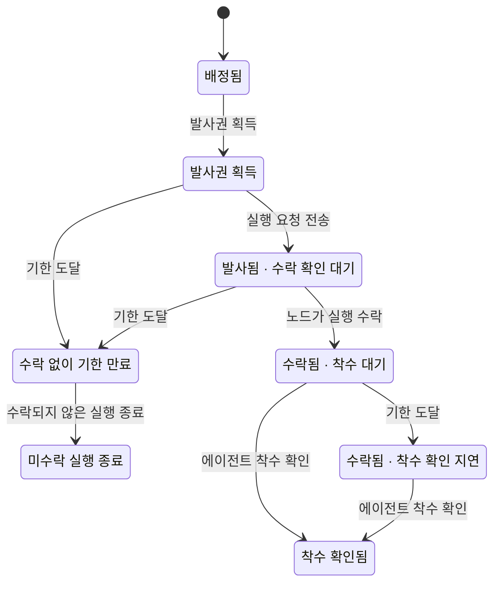
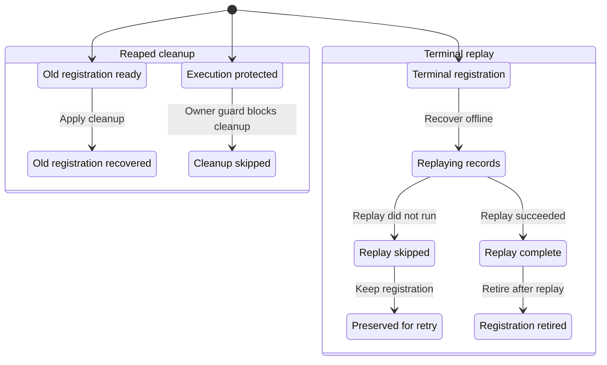
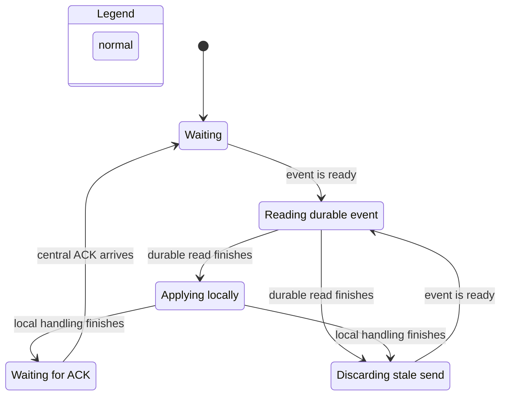

# Soulstream 상태 머신 조사와 검증

조사일: 2026-11-09 KST. 코드 기준: [`1f15e59e3747fc5de5e245babf16753cce8a7367`](https://github.com/eiaserinnys/soulstream/commit/1f15e59e3747fc5de5e245babf16753cce8a7367).

## 결과

주요 상태 경계 13개를 식별하고, 그중 네 경계의 좁은 속성을 실제 코드로 검사했다. runner 복구·카드 자동 실행·outbox 공개에는 TLA+ 모델도 만들고 TLC와 pstack `/statechart`를 실행했다. 이번 범위에서 새 제품 결함을 확정하지 않았다. 원본 검사들은 통과했고, 보호 장치를 제거한 실제 소스 변형 14개는 모두 검출했다.

소울스트림에는 이미 명시적 상태 타입과 전이 소유자가 많다. 이번 실험의 핵심은 **서로 다른 상태의 의미와 권한을 구분하고, 그 경계의 약속을 반복 실행 가능한 검사로 남기는 것**이다. 예를 들어 카드의 `running`, 세션의 `running`, 살아 있는 runner, 엔진에 전달된 입력, 소비 원장에 기록된 입력은 각각 다른 사실이다.

이 패키지는 검증 코드·모델·프로젝트용 스킬·보고서로 구성한다. 제품 코드 변경을 포함하지 않는다.

## 적용한 방법

사용자가 공유한 [poteto의 게시물](https://x.com/poteto/status/2119521036660314339)이 제안한 순서를 적용했다.

1. 실제 코드의 암묵적 상태와 상태 간 결합을 찾는다.
2. 사용자 피해가 큰 약속을 작은 불변조건으로 고정한다.
3. 서브시스템별로 실제 코드 검사 또는 TLA+ 모델을 만든다.
4. 보호 조건을 제거한 변형에서도 같은 검사를 실행해 검출력을 확인한다.
5. 핵심 흐름을 상태도로 그리고, 검증 범위와 제외한 동시성을 명시한다.

원 지침: [create-formal-verification-skill](https://github.com/cursor/plugins/blob/6b0300214a09fd6029cfb7077043125758cd1fd2/pstack/skills/create-formal-verification-skill/SKILL.md), [statechart](https://github.com/cursor/plugins/blob/6b0300214a09fd6029cfb7077043125758cd1fd2/pstack/skills/statechart/SKILL.md).

사용 도구: Node 24.22.1, Python 3, OpenJDK 17.0.20, `tla2tools` 배포본 v1.7.4(TLC 실행기 보고 버전 2.19). JAR의 SHA-256은 `936a262061c914694dfd669a543be24573c45d5aa0ff20a8b96b23d01e050e88`다. pstack 소스 기준은 `6b0300214a09fd6029cfb7077043125758cd1fd2`다.

## 검증 결과와 경계

| 서브시스템 | 실제 코드 검사 | TLA+ 정상 모델 | 실제 소스 변형 검출 | 확인한 약속 |
|---|---|---|---|---|
| runner 복구 | 192개 입력, 194개 assertion 통과 | 64개 고유 상태 통과 | 3/3 | 관측 시 이미 새 실행을 보유한 task를 과거 registration의 cleanup이 건드리지 않음. terminal replay 수행 확인 전에는 등록을 폐기하지 않음 |
| 카드 자동 실행 | 원본 class 25개 시나리오 통과 | 57개 고유 상태 통과 | 2/2 | 같은 배정의 발사권은 한 조정자만 획득. 수락된 실행은 착수 확인 지연만으로 rejected가 되지 않음 |
| 추가 입력 큐 | ID 모드당 3,529개 상태·7,236개 전이, 3개 모드 통과 | 실제 함수 BFS가 검증 본체 | 6/6 | 대기 중 동일 ID 중복 방지, 추출 시 보존, 우선순위와 lane 내 순서, runtime follow-up 단독 배치, 비어 있지 않은 큐의 진전 |
| outbox 공개·ACK | 원본 class 6개 비동기 시나리오 통과 | 18개 고유 상태 통과 | 3/3 | 공개 전 await 사이에 연결이 교체되면 이전 연결로 보내지 않음. 다른 stream/sequence/range의 ACK는 커서를 전진시키지 않음 |

별도로 모델 변형 5개(runner 2, cards 2, outbox 1)에서 예상한 불변조건 위반을 확인했다. 변형에서의 실패는 현재 제품의 버그 수가 아니다. 모델이 잘못되어 파싱 오류나 실행 오류가 난 경우도 검출 성공으로 세지 않는다. 통합 실행기는 예상한 invariant 이름과 TLC exit code 12를 함께 확인한다.

원본 코드 검사도 의존성 경계에 mock을 쓴다. 따라서 PostgreSQL·OS lock·실제 backend를 포함한 통합 검증으로 읽으면 안 된다. 다음 제한을 특히 보존해야 한다.

- **Runner:** 한 번의 recovery 관측에서 실행 identity를 고정한다. cleanup 내부 여러 `await` 사이에 새 실행이 끼어드는 전체 경쟁은 검사하지 않았다. canonical registration ACK 전 admission 금지도 이 모델의 범위 밖이다.
- **Cards:** 한 배정과 두 조정자를 모델링했다. 성공한 authorization·착수 receipt는 외부 사건으로 추상화했다. 실제 SQL claim 원자성은 mock의 가정이고, cardVersion·policyVersion·lease 전체는 검사하지 않았다.
- **Delivery:** 큐에서 꺼낸 뒤 같은 ID를 다시 접수하는 경우는 제외했다. 검사기의 `consumed`는 엔진 소비가 아니라 탐색 중 재접수를 제한하는 추출 표식이다. 같은 구조의 세 identity 모드를 각각 검사했으므로 10,587을 하나의 독립 상태공간 크기로 말하지 않는다.
- **Outbox:** TLA+는 공개 전 `readBatch`와 `beforePublish`의 await 경계를 검사한다. 이미 공개한 뒤 재연결·재송신하는 전체 프로토콜, ACK payload, disk commit은 모델 밖이다. ACK 검사는 별도의 여섯 실제 class 시나리오에 속한다.
- 모든 모델은 정해진 유한 범위의 safety 검사다. 운영 전체의 exactly-once, 완료 시간, eventual delivery 또는 liveness를 증명하지 않았다.

## 상태 축을 나눠야 하는 이유

| 사용자가 구분해야 하는 질문 | 이를 결정하는 사실 |
|---|---|
| 이 업무가 끝났는가? | 카드 상태와 검수 정책 |
| 이 세션의 기록된 진행 상태는 무엇인가? | session lifecycle과 중앙 정본 projection |
| 실제 실행 프로세스가 존재하는가? | runner 생사, registration 및 execution command identity |
| 새 실행을 시작하거나 이전 실행을 정리해도 되는가? | activation, release claim, 복구 disposition, 현재 실행 소유권 |
| 지시를 받아들였는가? | 내구 delivery 접수·claim·dispatch 기록 |
| 엔진이 지시를 처리했는가? | 엔진 입력 identity와 턴 receipt, 소비 원장 |
| 화면이 최신 상태를 받았는가? | SSE 연결 세대·snapshot·이벤트 cursor 또는 협업 문서 sync |

특히 카드의 8개 상태는 자유 전이 정책이다. `todo → queued → running → review → done`만 허용하는 모델을 만들면 현행 정책을 잘못 모델링한다. `on_hold`, `cancelled`, 보관 여부도 각각 유지한다. 세션 종료가 카드 완료를 자동으로 뜻하지 않는다. 근거: [카드 자유 상태 전이 테스트](https://github.com/eiaserinnys/soulstream/blob/1f15e59e3747fc5de5e245babf16753cce8a7367/orch-server-ts/tests/card-free-status.postgres.test.ts), [카드 작업 수명](https://github.com/eiaserinnys/soulstream/blob/1f15e59e3747fc5de5e245babf16753cce8a7367/orch-server-ts/src/cards/card_work_lifecycle.ts).

## 주요 사용자 흐름 상태도

아래 3개 도표는 pstack에서 실제 생성한 모델 상태도를 첨부한다. 내부 변수를 사용자 단계로 투영한 그림이며, 코드 전체의 모든 상태를 나타내지 않는다. 원본 Mermaid와 생성 보고서는 `charts/`에 있다. 세부 접속 변화처럼 같은 그림 상태 안에 머무는 전이는 그림에서 생략되지만 모델에서는 탐색했다.

### 카드 자동 실행

핵심 경계는 **발사권 획득 → 요청 발사 → 노드 수락 → 착수 확인**이다. 노드가 수락한 뒤 착수 확인이 늦어지는 경우는 확인 대기로 남긴다. 미수락 상태의 기한 만료와 구분한다.



### Runner 복구

상태도는 오래된 등록의 cleanup과 terminal replay 두 경우를 나눈다. 기존 실행 identity 보호와 replay 완료 확인이 각각 독립적인 약속이다.



### Outbox 공개 전 재연결

내구 이벤트를 읽는 도중 또는 로컬 처리를 기다리는 동안 연결이 바뀔 수 있다. await가 끝난 뒤 다시 세대를 검사해야 한다. 이전 연결에 매달린 전송 시도만 버리고 내구 이벤트는 유지한다.



outbox의 두 번째 연결 세대 검사를 제거한 모델에서는 4단계 반례가 나온다: 이벤트 준비 → 내구 읽기 완료 → 연결 끊김 → 로컬 처리 완료 후 오래된 연결 사용. 실제 class 변형에서도 재연결 뒤 `oldSends=1, newSends=0`이 관측되어 같은 경계를 검출했다.

## 실제 함수에서 관측한 후속 조사 1건

`CardOrchestrationWorkers.reject()`는 만료된 과거 배정을 정리하면서 현재 카드를 다시 읽고, 현재 상태가 `running/queued`이면 `blocked(no_report)`로 바꾼다. 이때 최신 version으로 CAS하므로, 과거 배정 뒤 발생한 변경 자체를 버전 충돌로 막지는 않는다. 원본 class의 mock 경계에서 이 동작은 재현했다.

후속 통합 재현은 다음 순서가 적합하다.

1. 과거 배정 A가 `launching + launch_accepted=false`로 남는다.
2. 그 뒤 사용자 변경 또는 후속 배정으로 현재 카드가 `running`이 된다.
3. A의 기한 만료를 조정자가 처리한다.
4. A가 현재 카드 상태를 `blocked`로 덮을 수 있는지, 현재 배정 identity를 확인하는 상위 보호가 있는지 확인한다.

전체 PostgreSQL·receipt·담당 교체 경로의 도달 가능성과 정책은 이번에 확정하지 않았다. 따라서 필수 수정 결함으로 분류하지 않는다. 근거: [card_orchestration_workers.ts](https://github.com/eiaserinnys/soulstream/blob/1f15e59e3747fc5de5e245babf16753cce8a7367/orch-server-ts/src/cards/card_orchestration_workers.ts).

## 다음 형식 검증에서 가장 중요한 경계

**엔진이 입력을 수락한 뒤 응답 또는 소비 receipt 저장이 실패하는 경계**다.

`엔진 수락 → 응답/receipt 유실 → caller는 미확정 → next-turn/recovery → 같은 입력의 재투입` 순서를 실제 engine·SQLite inbox·중앙 delivery ledger를 연결해 재현해야 한다. 지금의 queue 검사만으로는 이 성질을 결론 낼 수 없다.

현재 코드는 `unknown`, `deferred`, `queued`, `delivered`, `consumed`를 구분하며, runner inbox에는 `ambiguous` fence가 있다. 다만 live intervention command에서 생긴 ambiguity와 실행 command에서 생긴 ambiguity를 다르게 다룬다. 이를 하나의 상태로 합치면 모델이 실제 정책을 잃는다. 근거: [running intervention](https://github.com/eiaserinnys/soulstream/blob/1f15e59e3747fc5de5e245babf16753cce8a7367/soul-server-ts/src/task/task_running_intervention_transition.ts), [SQLite intervention inbox](https://github.com/eiaserinnys/soulstream/blob/1f15e59e3747fc5de5e245babf16753cce8a7367/soul-server-ts/src/runner/sqlite_intervention_inbox.ts).

## 재실행과 유지 관리

저장소 루트에서 Node 24.22.1 이상, Python 3, Java 11 이상을 준비하고 실행한다.

```sh
python tools/state-verification/run.py
```

첫 실행은 공식 TLC JAR을 내려받아 SHA-256을 확인한다. 이미 있는 JAR은 `--tlc-jar`로 지정한다. 모든 생성물은 `tools/state-verification/.output/`에 남는다. 한 하위계만 돌리려면 `--subsystem runner`, `cards`, `delivery`, `outbox` 중 하나를 지정한다. 다른 source checkout과 출력 위치도 인자로 지정할 수 있다.

네 프로젝트용 스킬은 `.agents/skills/verify-soulstream-{runner,cards,delivery,outbox}/SKILL.md`에 있다. 각각 적용할 파일과 함수, 검증 약속, 재실행 명령, 제외 범위, 코드와 모델을 다시 맞추는 절차를 담았다. 실행 중인 Soulstream의 Atom 카탈로그 등록과는 별도인 저장소 파일이다.

코드 변경 후에는 통과 결과보다 먼저 source-to-action mapping과 await 경계를 다시 검토한다. 검증된 기준 커밋을 앞으로 옮길 때는 baseline과 의도한 변형의 결과를 함께 확인한다. 형식 검증의 활용 가치는 이 갱신 과정까지 포함한다.

전체 inventory: [inventory.md](inventory.md). 실행 결과와 변형별 반례: [results.json](results.json). 서브시스템별 소스 대응: [coverage.md](coverage.md).
